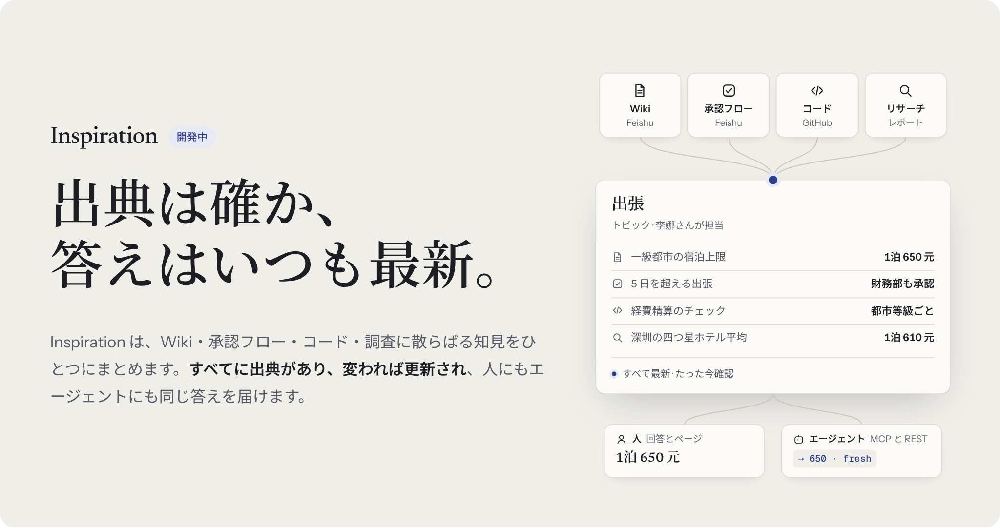
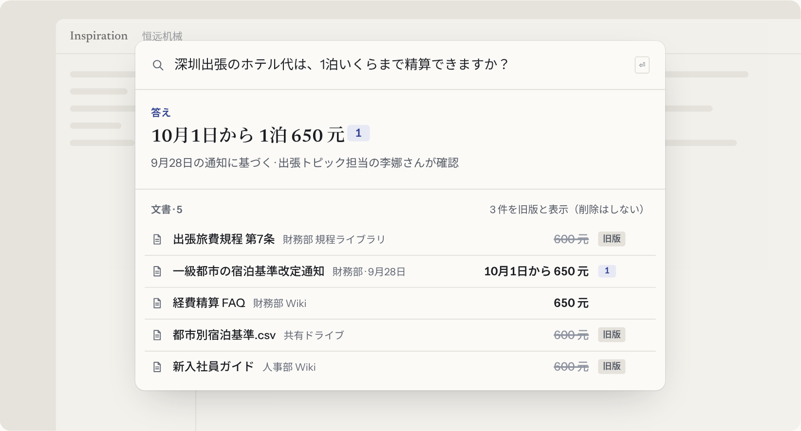
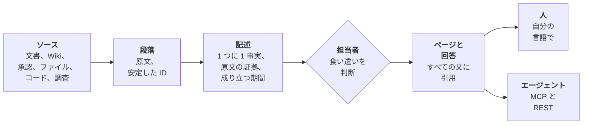
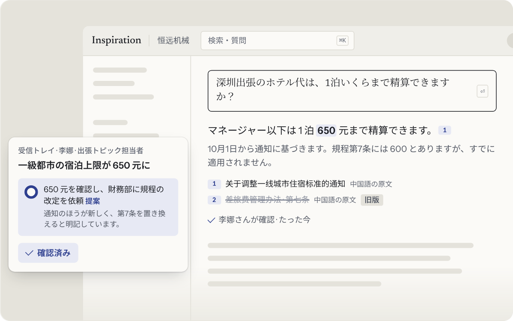
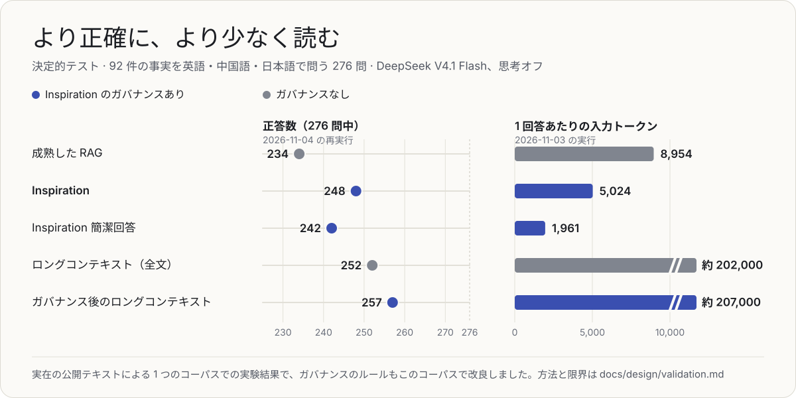
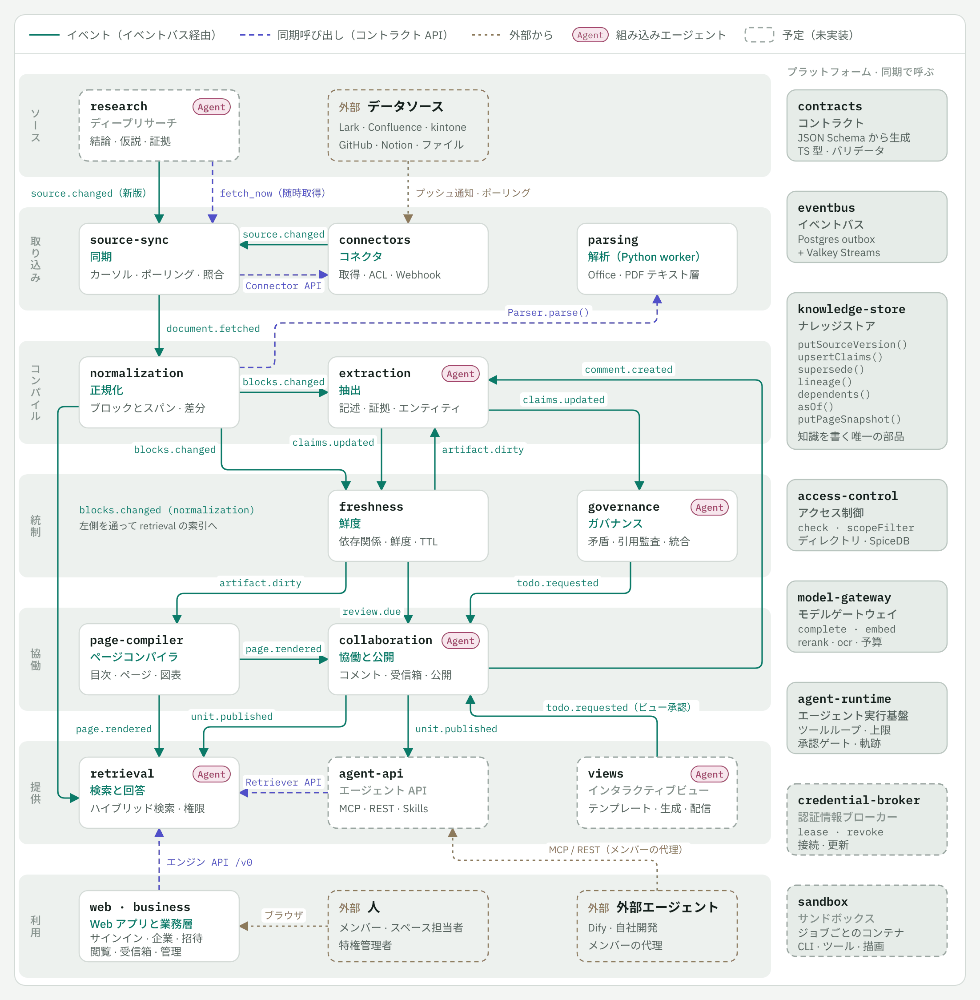
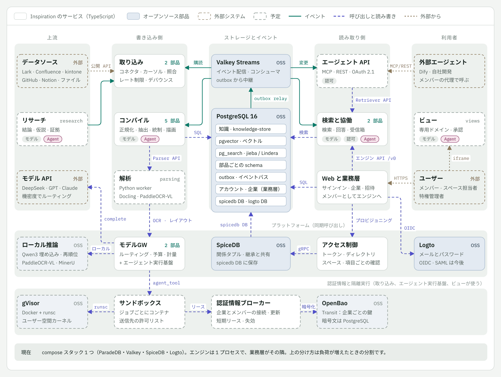

<div align="center">

<a href="https://angelmsger.github.io/Inspiration/ja/"></a>

<p>
<a href="https://angelmsger.github.io/Inspiration/ja/"></a>

<a href="https://github.com/AngelMsger/Inspiration/actions/workflows/ci.yml"></a>


</p>

<p>
<a href="#なぜ-inspiration-なのか"><b>なぜ</b></a> ·
<a href="#しくみ"><b>しくみ</b></a> ·
<a href="#これまでの結果"><b>結果</b></a> ·
<a href="#アーキテクチャ"><b>アーキテクチャ</b></a> ·
<a href="#ロードマップ"><b>ロードマップ</b></a> ·
<a href="docs/overview.md"><b>ドキュメント</b></a>
</p>

<p><a href="README.md">English</a> · <a href="README.zh.md">简体中文</a> · <b>日本語</b></p>

</div>

このページは [README.md](README.md) の日本語訳です。内容が異なる場合は英語版が優先されます。詳しいドキュメントは英語と中国語で書かれています。

**Inspiration は、社内に散らばった文書・承認フロー・コード・調査を、ガバナンスの効いたナレッジに変えます。** すべての事実が正確な出典を保ち、ソースが変われば最新に保たれ、担当者がいて、人にも AI エージェントにもそれぞれの権限の範囲で届けられます。コンパイラがコードを扱うようにナレッジベースを扱います。一度読み、検証し、差分で更新し、問う人に届けます。

> [!NOTE]
> **Inspiration は開発中で、まだ利用できる段階ではありません。** ナレッジエンジンはエンドツーエンドで動いており、実際のモデルを使って成熟した RAG と比較テストを済ませています。1 社が実際に使える製品である MVP を、いま構築しています（[ロードマップ](#ロードマップ)）。

## なぜ Inspiration なのか

**社内の知識は Wiki、承認システム、共有ドライブ、チャットに散らばり、しかも絶えず変わります。** 「深圳出張のホテル代は 1 泊いくらまで精算できるか」と尋ねると、検索は 5 つの文書を見つけます。旅費規程、料金表、新入社員ガイドは 600、より新しい通知と FAQ は 650 と書いています。RAG システムは 5 つすべてをモデルに渡し、正しいものを選ぶことに期待します。その上に作られたエージェントも、同じ推測を受け継ぎます。

<div align="center">

</div>

**Inspiration は、誰かが尋ねる前に、どの値が有効かを確定させます。** 650 と答え、通知を引用し、古い 3 つの文書を削除せずに旧版として示します。ソースが本当に食い違うときだけ、出張ルールの担当者に確認を求めます。モデルが助けを必要とするのはまさにここです。モデルを誤らせるのは、入力の長さよりも、同じ事実について競合する値が入力にあることです（[これを裏付ける研究があります](https://arxiv.org/abs/2611.04169v1)）。

| | いまの検索と RAG | Inspiration |
| --- | --- | --- |
| **何を保存するか** | 文書のチャンク | 1 つずつの記述。それぞれに原文の引用と、成り立つ期間 |
| **文書が食い違うとき** | すべてをモデルに渡し、モデルが 1 つ選ぶ | 有効な値で出典とともに答え、残りは旧版として示す |
| **ソースが変わったとき** | インデックスを作り直し、古いコピーも答え続ける | 変わった段落だけを読み直し、それを引用するものだけを再構築 |
| **誰が責任を持つか** | 誰も | トピックごとの担当者が、週ごとの少量ずつ判断 |
| **1 回答で読む量** | 私たちのテストで約 9,000 トークン | 約 5,000、簡潔回答なら約 2,000。安価なモデルで |
| **エージェント** | 同じチャンク | 人と同じ、ガバナンスの効いた答えを、メンバー自身の権限で |

## しくみ



<sub>ソースは段落に、段落は記述に読み込まれ、記述どうしの食い違いは担当者が判断し、人とエージェントが読むものはすべて記述から組み立てられます。ソースの変更は、影響する範囲にだけ伝わります。</sub>

<table>
<tr>
<td width="50%" valign="top">

**🧾 チャンクではなく記述**<br>
事実は 1 回だけ保存されます。ソースからの原文引用、成り立つ期間、システムがそれを知った時点とともに。引用がソースの原文の部分文字列でなければ保存は拒否され、記述は削除されず、有効期間が閉じられるだけです。

</td>
<td width="50%" valign="top">

**⚡ ビルドのように最新を保つ**<br>
変更があると、変わった段落だけを読み直し、それに支えられた記述だけを更新し、それを引用するページと回答だけを再構築します。ソースは一度きりの取り込みではなく、版の履歴として保たれます。

</td>
</tr>
<tr>
<td valign="top">

**🧑‍⚖️ 判断は人が、無理のない量で**<br>
エージェントは検出し、提案し、答えます。判断するのは人です。提案は記入済みで、トピックと週ごとにまとめて届きます。MVP で提供する「代わりに決める」が日常的なものを処理し、それぞれに理由を添え、取り消しもできます。

</td>
<td valign="top">

**🔐 誰が何を読めるかは会社が決める**<br>
スペースごとに担当者がいて、読める人を設定します。人であれエージェントであれ、すべての読み取りは 1 つの権限グラフで確認されます。ソースから、回答の引用 1 つひとつまで。

</td>
</tr>
<tr>
<td valign="top">

**🌏 1 つの事実を、どの言語でも**<br>
ナレッジは言語に依存しません。中国語で書かれた規程が英語や日本語の質問に答え、原文を引用します。英語・中国語・日本語に最初から対応しています。

</td>
<td valign="top">

**🤖 エージェントファースト**<br>
エージェントは MCP と REST を通じて、同じガバナンスの効いたナレッジに、代理するメンバーとしてアクセスします。MCP サーバーは MVP で提供します。すべての結果に出典、版、状態が付きます。エージェントは読むことと提案することだけを行い、変更を承認するのは人だけです。

</td>
</tr>
</table>

ルールが変われば、答えも変わります。Confluence に新しい通知が出ると、2 つの段落が読まれ、1 つの事実が変わり、それを引用するすべての回答とページが 650 になり、トピックの担当者がワンクリックで提案を確定します。

<div align="center">

</div>

## これまでの結果

**変更や食い違いのある事実を中心に作ったテストで、Inspiration は成熟した RAG より多くの質問に正答し、1 回答あたりのモデルコストは 40% 低くなりました。安価なモデルを思考オフで使っています。** 276 問中 248 問に正答し、成熟した RAG は 234 問でした。全体で 5.1 ポイント、変更や食い違いのある事実についての 204 問では 6.9 ポイント上回っています。簡潔回答は入力を 78%、コストを 86% 減らしたうえで、242 問に正答しています。

<div align="center">

</div>

| 方式 | 正答（276 問中） | 変更・食い違い（204 問中） | 1 回答の入力トークン | 1 回答のコスト（元） | 回答モデルの時間、中央値 |
| --- | ---: | ---: | ---: | ---: | ---: |
| 成熟した RAG | 234 | 164 | 8,954 | 0.0083 | 1.73 s |
| **Inspiration** | **248** | **178** | **5,024** | **0.0050** | **1.64 s** |
| **Inspiration 簡潔回答** | **242** | **173** | **1,961** | **0.0012** | **1.40 s** |
| ロングコンテキスト、トピック全体 | 252 | 180 | 202,402 | キャッシュあり 0.0048、なし約 0.20 | 3.03 s |
| **Inspiration のガバナンス後のロングコンテキスト** | **257** | **185** | 206,884 | キャッシュあり 0.0049 | 2.99 s |

- **テスト。** 実在の公開テキストから取った 92 件の事実です。GitLab ハンドブックの出張・経費のページとその編集履歴、そして英語・中国語・日本語の Kubernetes ドキュメント。それぞれを 3 つの言語で質問します。68 件は変更されたか食い違っている事実で、企業でよく起きる形をとります。遅れた転記、名前を変えたコピー、遅れた翻訳、別の場所で告知された変更、ガバナンス対象のソースどうしの食い違いです。そのうち 23 件は実際の履歴から、45 件は実テキストへの記録された編集から作りました。ほかに 24 件が対照です。検索の対象は 1,780 万トークンです。
- **比較対象。** 成熟した RAG は、ハイブリッド検索にクロスリンガルのリランカー、コーパスの言語への質問の翻訳、12〜16 段落、「ガバナンス対象のソースを優先し、次に最新のファイル」というルールを加えたものです。Inspiration も同じ検索を使うので、違いはガバナンスだけです。ロングコンテキストはトピック全体、約 20 万トークンを読みます。これはトピックが 1 つのウィンドウに収まる間だけ成り立ちます。
- **費用。** 上の回答はすべて DeepSeek V4.1 Flash を思考オフで使いました。これまでの 8 回の検証の費用は、DeepSeek で 30.46 元、GPT-6 Luna で 0.28 米ドルです。
- **ガバナンスはロングコンテキストにも効きます。** 元のトピックの代わりにガバナンス後のトピックを渡すと、正答は 252 から 257 に増え、別の文書で告知された変更についての 27 問は 16 問から全問正解になりました。

> [!IMPORTANT]
> **これらは実験室での結果として読んでください。** 1 つのコーパスでの結果であり、248 を支えるガバナンスのルールはこのコーパスでの失敗をもとに改良したため、独立したテストではありません。成熟した RAG を 10 ポイント上回るという目標は達成していません。これは長期目標として、実際の利用に近い、より大きなデータセットで測ります。まだ示せていないことが 2 つあります。ガバナンスが人の時間をほとんど使わないこと（「代わりに決める」がない状態で、文書 100 件あたり 33 件の TODO）と、回答全体が速いこと（CPU だけのマシンでは検索だけで 11.4 秒）。MVP でこの 2 つを作り、測ります。正答数は 2026-11-04 の再実行、トークン・コスト・時間は 2026-11-03 の実行によるものです。

方法、各実行とその費用は [Validating the knowledge core](docs/design/validation.md) に、ログは [`apps/bench/runs/`](apps/bench/runs/README.md) にあります。外部の研究がこれらの主張をどの程度支えるかは [Outside evidence](docs/outside-evidence.md) にまとめています。

## アーキテクチャ

**1 つのリポジトリに 2 つの層。** **エンジン**は画面を持たないナレッジの記録システムです。テナントとプリンシパルを受け取り、何がわかっているか、出典はどこか、誰が見てよいか、今も正しいかに答えます。**ビジネス層**はその周りの製品で、アカウント、会社、招待、通知、Web アプリを担います。呼び出しは下へ、イベントは上へ流れ、エンジンがビジネス層に依存することはありません。そうしようとする変更はテストで失敗します。

<div align="center">
<picture>
<source media="(prefers-color-scheme: dark)" srcset="docs/assets/components.ja.dark.png">

</picture>
</div>

<sub>段階ごとに並べたすべてのコンポーネントと、その間のイベント（実線）と呼び出し（破線）。右のプラットフォームサービスはすべてのコンポーネントが使います。破線の枠は予定です。各コンポーネントに相当する外部の製品と、私たちが再利用しているものは、[overview](docs/overview.md#9-architecture-at-a-glance) の Figure 10 にあります。</sub>

- **1 つの仕事を持つ小さなコンポーネント。** エンジンの 19 のコンポーネントのうち 14 が構築とテストを終え、ビジネス層も最初の 2 つが完成しています。[`components.yaml`](components.yaml) が各コンポーネントの持ち物、発行・購読するイベント、呼び出してよい相手を定め、テストがすべてのパッケージにそれを守らせます。
- **コントラクトが先。** [`libs/contracts/schema/`](libs/contracts/schema/) の JSON Schema が、コンポーネントをまたぐすべての型とイベントの唯一の正です。TypeScript の型とバリデーターはここから生成されます。
- **イベントはデータとともにコミット。** コンポーネントはストアのトランザクション内で outbox を通じてイベントを発行し、Valkey Streams に中継します。配信は少なくとも 1 回で、すべてのハンドラーは冪等です。
- **差し替えられるものはすべてプラグイン。** コネクター、パーサー、抽出器、モデルプロバイダー、検索インデックス、イベント転送、マイグレーションはプラグインで、レジストリから引かれるため、呼び出し側を変えずに部品を差し替えられます。
- **モデル呼び出しはすべてゲートウェイ経由。** 内容の機密ラベルでルーティングし、会社とコンポーネントごとに予算を適用し、応答をキャッシュし、コストを計測します。各モデルタスクには決定的な代役があるため、パイプライン全体をモデルなしで動かし、テストできます。
- **すべての読み取りで権限を確認。** SpiceDB による関係ベースの確認を、人にもエージェントにも検索フィルターにも同じように適用します。

| 項目 | 選択 |
| --- | --- |
| 言語 | Node 22 上の TypeScript（strict、型の除去でそのまま実行）。文書解析には Python のワーカーを 1 つ |
| 保存と検索 | PostgreSQL 16 と pgvector、pg_search（ParadeDB）。BM25 とベクトルを組み合わせ、リランク |
| イベント | トランザクショナル outbox と Valkey Streams |
| 権限 | Zanzibar をモデルにした SpiceDB |
| 認証 | Logto（ビジネス層） |
| モデル | OpenAI 互換の任意のプロバイダーと Anthropic を、モデルゲートウェイ経由で。上のテストは DeepSeek |
| Web | React と Vite |

<details>
<summary><b>デプロイの形：</b>サービス、オープンソース部品、それらのつながり</summary>
<br>
<picture>
<source media="(prefers-color-scheme: dark)" srcset="docs/assets/deployment.ja.dark.png">

</picture>
</details>

詳しくは [Architecture](docs/architecture.md)、[Contracts](docs/contracts.md)、[overview](docs/overview.md) の Part II を参照してください。

## ロードマップ

**次は、1 社の業務の流れを一巡させる MVP です。** 2026-11-05 に採択されました。サインインし、会社を作り、同僚を招待し、文書をアップロードし、3 つの言語のどれで尋ねても速く引用付きの答えが返り、担当者の受信トレイは短く保たれ、エージェントは MCP で同じナレッジを読めます。約 16 人週、6 つのスライスと 3 つのゲートで進めます（[計画](docs/design/mvp.md)）。

- [x] **代役モデルでのエンジン。** 取り込み、抽出、ガバナンス、鮮度、ガバナンスレベル、トピックと受信トレイ、続いて検索と根拠付きの回答。
- [x] **実際のモデルでの検証。** 素の RAG、成熟した RAG、ロングコンテキストとの比較で 8 回実行（[結果](#これまでの結果)）。
- [x] **インタラクティブなデモと[ウェブサイト](https://angelmsger.github.io/Inspiration/ja/)。**
- [ ] **MVP**、6 つのスライスで：

| | スライス | 作るもの | 状況 |
| :---: | --- | --- | --- |
| 1 | アイデンティティと会社 | Logto でのサインイン、会社とメンバー、招待リンク、担当者と閲覧範囲を持つスペース、ビジネス層からエンジンへの署名付きプリンシパルトークン | 🚧 進行中 |
| 2 | 文書の取り込み | ファイルとフォルダー、その新しい版のアップロード。Word・PowerPoint・Excel・PDF の解析。1 日の予算内での実モデルによる読み込み | 次 |
| 3 | 速い引用付きの回答 | 簡潔回答を標準に、より速いリランカー、安定した検索、回答内で争いのある値を明示 | 計画中 |
| 🏁 | **ゲート A：最初に使える状態** | サインインし、自分のファイルをアップロードし、英語・中国語・日本語で尋ねて、引用付きの答えを得る | |
| 4 | 人に負担をかけないガバナンス | すべての受信トレイのカードに「代わりに決める」、理由と取り消し付き。必要に応じた読み込み | 計画中 |
| 5 | エージェント | 検索・質問・閲覧を提供し、メンバーとして動く MCP サーバー。個人トークン | 計画中 |
| 🏁 | **ゲート B：流れが一巡** | 同僚は自分のスペースだけを読め、新しい版で答えが変わり、エージェントはそのメンバーが見てよいものだけを見る | |
| 6 | トライアル | 1 台のサーバーへのデプロイ、利用状況ページとフィードバック | 計画中 |
| 🏁 | **ゲート C：トライアル** | チーム外の数人が、自分の文書で 2 週間使う | |

**MVP のあと：** デザインパートナーとのパイロット、Lark（Feishu）のリアルタイム同期、メンバーごとのプライベートスペースと共有スペースへの公開、共同承認。検証は実際の利用に近い、より大きなデータセットで再開し、10 ポイントのリードを長期目標とします。その先には、Deep Research のレポートをソースにすること、承認フローを手順にすること、コードリポジトリのコードグラフ、インタラクティブなビュー、SSO とディレクトリ同期、プライベートデプロイがあります。

## はじめに

Inspiration はまだインストールして使える段階ではありません。ソースからビルドしてテストするには、Node 22.18 以上、pnpm、Python 3.10 以上、Docker を用意して（リポジトリが corepack と Volta 向けに pnpm 10.28.0 を固定しています） `make install && make up && make check` を実行します。デモ、ベンチマーク、モデルゲートウェイについては [development guide](docs/development.md) を参照してください。

## リポジトリ構成

<details>
<summary>1 つのモノレポ：エンジン、ビジネス層、共有ライブラリ、アプリ</summary>

```
libs/contracts      schema/*.yaml が唯一の正、schema/business/ はビジネス層のもの。codegen/ が TypeScript を生成
libs/kernel         設定、ログ、プラグインレジストリ、マイグレーション実行、blob ストア、データベースプール
libs/eventbus       トランザクショナル outbox、Valkey Streams への中継、コンシューマー、インメモリバス
libs/testkit        compose 環境に対するテストのフィクスチャ
engine/<component>  エンジンのコンポーネントごとに 1 パッケージ（components.yaml を参照）
business/<name>     ビジネス層のコンポーネントごとに 1 パッケージ。現在は accounts と tenancy。engine/ と libs/ はこれに依存しない
apps/engine         エンジンのプロセス。コンポーネントをストア、バス、blob ストアにつなぐ。HTTP API
apps/business       ビジネス層のバックエンド（pnpm business serve）。サインイン、会社、招待リンク。メンバーとしてエンジンを呼ぶ
apps/web            エンジンの HTTP API 上の製品 Web アプリ、代役のバックエンド（pnpm demo）、スナップショット（pnpm snapshot）
apps/bench          計測ハーネス（pnpm bench）。コーパスでエンジンを動かし、レポートを出し、答えを照合する
apps/site           製品ウェブサイト（pnpm site）。3 言語の静的ページとスクリプト化したデモを GitHub Pages に公開
examples/<corpus>   コーパスと、実行結果を照合する答え（examples/README.md を参照）
infra/              プロトタイプ環境の docker compose と、実行用のローカル embedding サーバー
config/             モデルゲートウェイの設定例
docs/               overview、エンジンのリファレンス、設計文書。索引は docs/README.md
docs/zh/            すべての文書の中国語版
docs/assets/        README の画像とアーキテクチャ図、その元ファイル（英語・中国語・日本語）
test/               リポジトリ全体のチェック：コンポーネントのマニフェスト、言語、文書、ファイルパス
README*.md          このページの英語版、中国語版（README.zh.md）、日本語版（README.ja.md）
```

</details>

## ドキュメント

| 読むもの | 内容 |
| --- | --- |
| [Overview](docs/overview.md)（[中文](docs/zh/overview.md)） | プロダクト要件と技術アーキテクチャを 1 つにまとめた文書。シナリオ、図、実現可能性、構築済みのものと計画中のもの |
| [The MVP](docs/design/mvp.md) | 範囲、スライス、ゲート、その背景にある決定 |
| [Validating the knowledge core](docs/design/validation.md) | 実際の文書で主張をどう検証するか、各実行とその費用 |
| [Architecture](docs/architecture.md) | 2 つの層、コンポーネント、その間のやりとり |
| [Development](docs/development.md) | ソースからのビルド、テスト、実行 |
| [All docs](docs/README.md) | すべてのドキュメントとそのステータス：採択、提案中、置き換え済み |

## コントリビュート

Inspiration は人とコーディングエージェントが並行して作っており、それぞれが 1 つのコンポーネントの境界の中で作業します。何かを変更する前に [AGENTS.md](AGENTS.md) を読んでください。境界、コントラクトのルール、テスト、コードをシンプルに保つ方法が書かれています。すべての変更は `make check` が通った pull request で取り込まれます。質問やアイデアは issue で歓迎します。

## ライセンス

Inspiration のライセンスはまだ決まっていません。サードパーティのスタックのライセンスと、それが提供にどう影響するかは [Licensing](docs/licensing.md) にあります。

<div align="center">
<br>
<b>出典は確か、答えはいつも最新。</b><br>
<sub>Every fact sourced. Every answer current. · 知识有源，常读常新。</sub>
<br><br>
</div>
