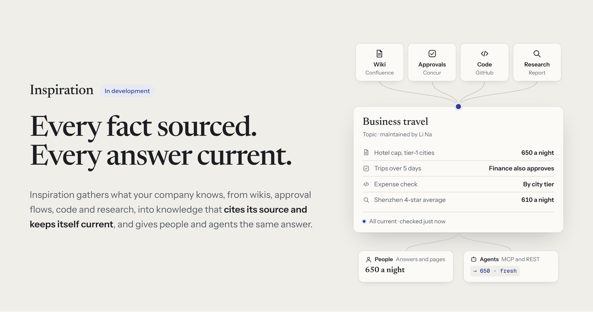
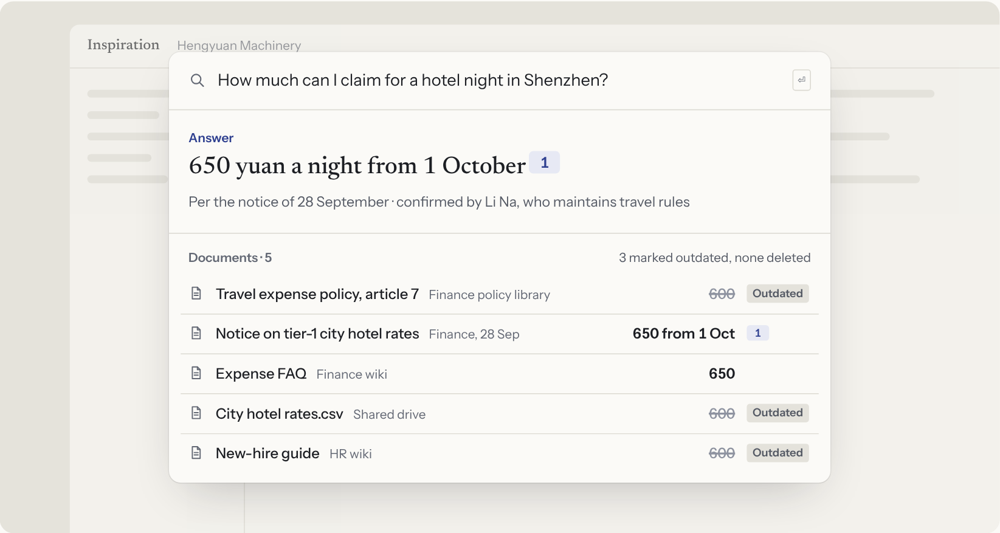
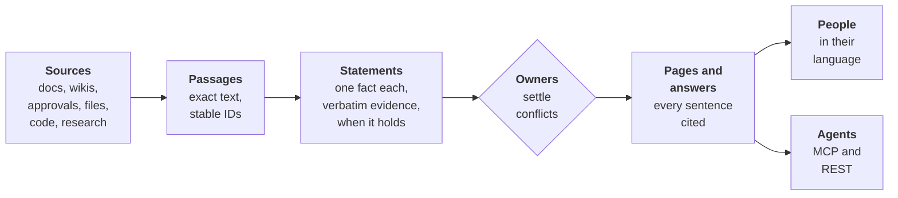
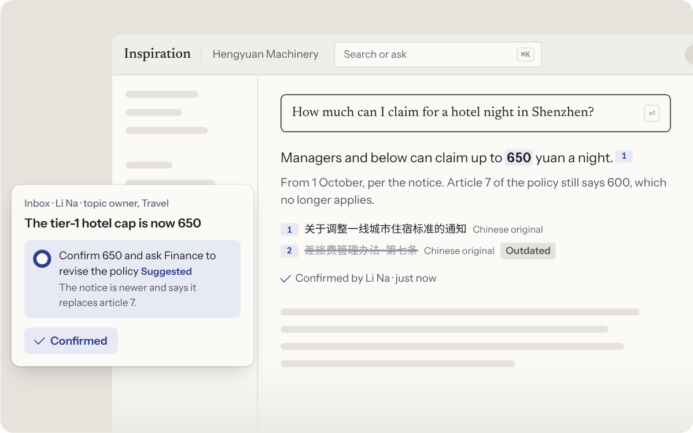
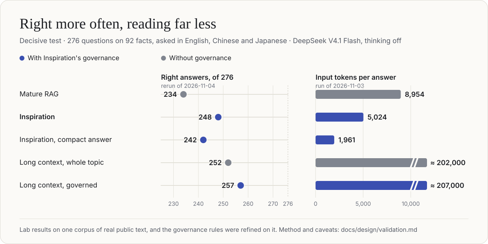

<div align="center">

<a href="https://angelmsger.github.io/Inspiration/"></a>

<p>
<a href="https://angelmsger.github.io/Inspiration/"></a>

<a href="https://github.com/AngelMsger/Inspiration/actions/workflows/ci.yml"></a>


</p>

<p>
<a href="#why-inspiration"><b>Why</b></a> ·
<a href="#how-it-works"><b>How it works</b></a> ·
<a href="#results-so-far"><b>Results</b></a> ·
<a href="#architecture"><b>Architecture</b></a> ·
<a href="#roadmap"><b>Roadmap</b></a> ·
<a href="docs/overview.md"><b>Docs</b></a>
</p>

<p><b>English</b> · <a href="README.zh.md">简体中文</a> · <a href="README.ja.md">日本語</a></p>

</div>

**Inspiration turns a company's scattered documents, approval flows, code and research into governed knowledge.** Every fact keeps its exact source, stays current as its sources change, has a person who maintains it, and reaches people and AI agents within their own permissions. It is a knowledge base built the way a compiler treats code: read once, checked, kept up to date incrementally, and served to whoever asks.

> [!NOTE]
> **Inspiration is in active development and not ready for use yet.** The knowledge engine runs end to end, and has been tested on real models against a mature RAG. The MVP, a usable product for one company, is being built now ([roadmap](#roadmap)).

## Why Inspiration

**Company knowledge is spread over wikis, approval systems, drives and chats, and it changes all the time.** Ask how much a hotel night in Shenzhen may cost, and search finds five documents: the travel policy, a rate sheet and the new-hire guide say 600; a newer notice and the FAQ say 650. A RAG system hands all five to a model and hopes it picks the right one, and every agent built on it inherits the guess.

<div align="center">

</div>

**Inspiration settles which value holds before anyone asks.** It answers 650, cites the notice, marks the three older documents outdated without deleting them, and asks the person who maintains travel rules only when the sources truly disagree. This is where models need the help: what trips them is input that holds rival values for the asked fact, more than input that is long ([research supports this](https://arxiv.org/abs/2611.04169v1)).

| | Search and RAG today | Inspiration |
| --- | --- | --- |
| **What is stored** | Chunks of documents | Single statements, each with a verbatim quote and the dates it holds |
| **When documents disagree** | All of them reach the model, which picks one | The value in force answers, with its source; the rest read as outdated |
| **When a source changes** | Re-index, while old copies keep answering | Only the changed passages are re-read, and only what cites them is rebuilt |
| **Who is accountable** | Nobody | A named owner for every topic, who decides in small weekly piles |
| **What an answer reads** | About 9,000 tokens in our test | About 5,000, or 2,000 for the compact answer, on a cheap model |
| **Agents** | The same chunks | The same governed answer people get, with the member's permissions |

## How it works



<sub>Sources are read into passages, passages into statements, owners settle what the statements disagree on, and everything people and agents read is built from statements. A change in a source flows through only as far as it matters.</sub>

<table>
<tr>
<td width="50%" valign="top">

**🧾 Statements, not chunks**<br>
Each fact is stored once, with a verbatim quote from its source, the time it holds and the time the system learned it. The store rejects a quote that is not an exact substring of its source, and never deletes a claim: it closes the claim's interval.

</td>
<td width="50%" valign="top">

**⚡ Freshness works like a build**<br>
A change re-reads only the passages that changed, updates only the statements they support, and rebuilds only the pages and answers that cite them. Every source is kept as a history of versions, not imported once.

</td>
</tr>
<tr>
<td valign="top">

**🧑‍⚖️ People decide, in amounts they can keep up with**<br>
Agents detect, propose and answer; people decide. Suggestions arrive filled in, grouped per topic and week. "Decide for me", coming in the MVP, settles the routine ones, with a reason for each and undo.

</td>
<td valign="top">

**🔐 Your company decides who reads what**<br>
Every space has an owner who sets its audience. Every read, by a person or an agent, is checked against one permission graph, from the source down to each citation in an answer.

</td>
</tr>
<tr>
<td valign="top">

**🌏 One fact, in every language**<br>
Knowledge is language-neutral. A policy written in Chinese answers questions in English or Japanese and cites the original. English, Chinese and Japanese are supported from the start.

</td>
<td valign="top">

**🤖 Agent-first**<br>
Agents reach the same governed knowledge through MCP and REST, acting as the member they work for; the MCP server comes in the MVP. Every result carries its source, version and status. Agents read and propose; only people approve changes.

</td>
</tr>
</table>

When a rule changes, the answer changes with it. A new notice is posted in Confluence: two passages are read, one fact changes, every answer and page that cites it now says 650, and the topic's owner confirms the suggested change with one press.

<div align="center">

</div>

## Results so far

**On a test built around facts that changed or conflict, Inspiration answers more questions right than a mature RAG, at 40% less model cost per answer, on a cheap model with thinking off.** Of 276 questions it answered 248 right against the mature RAG's 234: +5.1 points overall, and +6.9 on the 204 questions about changed or conflicting facts. Its compact answer reads 78% less input, costs 86% less, and still answers 242.

<div align="center">

</div>

| Arm | Right, of 276 | Changed or conflicting, of 204 | Input tokens per answer | CNY per answer | Answering model, median |
| --- | ---: | ---: | ---: | ---: | ---: |
| Mature RAG | 234 | 164 | 8,954 | 0.0083 | 1.73 s |
| **Inspiration** | **248** | **178** | **5,024** | **0.0050** | **1.64 s** |
| **Inspiration, compact answer** | **242** | **173** | **1,961** | **0.0012** | **1.40 s** |
| Long context, the whole topic | 252 | 180 | 202,402 | 0.0048 warm, about 0.20 cold | 3.03 s |
| **Long context, governed by Inspiration** | **257** | **185** | 206,884 | 0.0049 warm | 2.99 s |

- **The test.** 92 facts from real public text, the travel and expense pages of GitLab's handbook with their edit history and the Kubernetes docs in English, Chinese and Japanese, asked in all three languages. 68 facts changed or conflict, in the ways companies meet: restated copies that lag, renamed copies, lagging translations, changes announced elsewhere, governed sources that disagree. 23 of them come from real history and 45 from documented edits of the real text; 24 more facts are controls. Search runs over 17.8 million tokens.
- **The rivals.** The mature RAG is hybrid search with a cross-lingual reranker, the question translated into the corpus's languages, 12 to 16 passages and the rule "prefer the governed source, then the newest file". Inspiration gets the same search, so only governance differs. Long context reads a whole topic, about 200,000 tokens, which works only while a topic fits one window.
- **What it cost.** Every answer above ran on DeepSeek V4.1 Flash, thinking off. All eight validation runs so far cost CNY 30.46 on DeepSeek and US$0.28 on GPT-6 Luna.
- **Governance helps long context too.** Given the governed topic instead of the raw one, long context answers 257 instead of 252, and all 27 questions about changes announced in another document instead of 16.

> [!IMPORTANT]
> **Read these as lab results.** They come from one corpus, and the governance rules behind the 248 were refined on that corpus's failures, so they are not an independent test. The aim of a 10-point lead over a mature RAG is not reached; it stays a long-term goal, to be measured on a larger dataset close to real use. Two claims are not shown yet: that governance takes little of people's time (33 todos per 100 documents before "Decide for me"), and that a whole answer is fast (search alone takes 11.4 s on our CPU-only machine). The MVP builds both and measures them. Accuracy is from the rerun of 2026-11-04; tokens, cost and time from the run of 2026-11-03.

The method, every run and its cost are in [Validating the knowledge core](docs/design/validation.md), with logs in [`apps/bench/runs/`](apps/bench/runs/README.md). How outside research bears on these claims, at its true weight, is in [Outside evidence](docs/outside-evidence.md).

## Architecture

**Two layers in one repository.** The **engine** is a system of record for knowledge with no screens: given a tenant and a principal, it answers what is known, where it comes from, who may see it and whether it is still true. The **business layer** is the product around it: accounts, companies, invitations, notifications and the web app. Calls go down, events come up, and the engine never depends on the business layer; a test fails any change that tries.

<div align="center">
<picture>
<source media="(prefers-color-scheme: dark)" srcset="docs/assets/components.en.dark.png">

</picture>
</div>

<sub>Every component by stage, with the events (solid) and calls (dashed) between them; the platform services on the right serve all of them. Dashed boxes are planned. The [overview](docs/overview.md#9-architecture-at-a-glance) gives each component an outside equivalent and says what we reuse.</sub>

- **Small components with one job each.** 14 of the engine's 19 components are built and tested, and the business layer's first two. [`components.yaml`](components.yaml) gives each one's ownership, the events it publishes and consumes, and the calls it may make; a test holds every package to it.
- **Contracts first.** JSON Schema in [`libs/contracts/schema/`](libs/contracts/schema/) is the source of truth for every type and event that crosses a component; TypeScript types and validators are generated from it.
- **Events commit with the data.** Components publish inside the store transaction through an outbox relayed to Valkey Streams. Delivery is at least once and every handler is idempotent.
- **Plugins for everything replaceable.** Connectors, parsers, extractors, model providers, search indexes, event transports and migrations are plugins, looked up in a registry, so a part can be swapped without touching its callers.
- **Every model call goes through the gateway.** It routes by the content's sensitivity label, enforces budgets per company and component, caches responses and meters cost. Each model task ships a deterministic stand-in, so the whole pipeline runs and is tested without a model.
- **Permissions on every read.** Relationship-based checks on SpiceDB, the same for a person, an agent and a search filter.

| Concern | Choice |
| --- | --- |
| Language | TypeScript on Node 22, strict, run by type stripping; one Python worker for document parsing |
| Storage and search | PostgreSQL 16 with pgvector and pg_search (ParadeDB): BM25 plus vectors, reranked |
| Events | Transactional outbox, Valkey Streams |
| Permissions | SpiceDB, modelled on Zanzibar |
| Identity | Logto, in the business layer |
| Models | Any OpenAI-compatible provider and Anthropic, behind the model gateway; DeepSeek in the tests above |
| Web | React and Vite |

<details>
<summary><b>How it deploys:</b> the services, the open-source parts and how they connect</summary>
<br>
<picture>
<source media="(prefers-color-scheme: dark)" srcset="docs/assets/deployment.en.dark.png">

</picture>
</details>

Read more in [Architecture](docs/architecture.md), [Contracts](docs/contracts.md) and the [overview](docs/overview.md)'s Part II.

## Roadmap

**Next is an MVP that closes one company's whole loop**, adopted on 2026-11-05: sign in, create a company, invite colleagues, upload documents, ask in any of three languages and get a fast cited answer, keep the owners' inbox short, and let an agent read the same knowledge through MCP. About 16 person-weeks in six slices, with three gates ([the plan](docs/design/mvp.md)).

- [x] **The engine on stand-in models.** Ingest, extraction, governance, freshness, governance levels, topics and the inbox, then search and grounded answers.
- [x] **Validation on real models.** Eight runs against a plain RAG, a mature RAG and long context ([results](#results-so-far)).
- [x] **An interactive demo and the [website](https://angelmsger.github.io/Inspiration/).**
- [ ] **The MVP**, in six slices:

| | Slice | What it builds | Status |
| :---: | --- | --- | --- |
| 1 | Identity and companies | Sign-in on Logto, companies and members, invite links, spaces with owners and audiences, signed principal tokens from the business layer to the engine | 🚧 In progress |
| 2 | Documents in | Upload files and folders, with new versions; Word, PowerPoint, Excel and PDF parsing; reading on a real model within a daily budget | Next |
| 3 | Fast cited answers | The compact answer by default, a faster reranker, stable search, disputed values marked in the answer | Planned |
| 🏁 | **Gate A: first usable** | Sign in, upload your own files, ask in English, Chinese or Japanese, get a cited answer | |
| 4 | Governance that asks little | "Decide for me" on every inbox card, with reasons and undo; reading on demand | Planned |
| 5 | Agents | An MCP server with search, ask and read, acting as the member; personal tokens | Planned |
| 🏁 | **Gate B: the flow closed** | A colleague reads only their spaces, a new version changes the answer, an agent sees only what its member may | |
| 6 | Trial | One deployed server, a usage page and feedback | Planned |
| 🏁 | **Gate C: the trial** | A few people outside the team use it for two weeks with their own documents | |

**After the MVP:** a pilot with a design partner; live sync from Lark (Feishu); a private space for every member, with publishing into shared spaces; joint approval. The validation line resumes on a larger dataset close to real use, with the 10-point lead as its long-term goal. Later come Deep Research reports as sources, approval flows turned into procedures, code repositories as a code graph, interactive views, SSO and directory sync, and private deployment.

## Get started

Inspiration is not ready to install yet. To build and test it from source, you need Node 22.18 or later, pnpm, Python 3.10 or later and Docker (the repository pins pnpm 10.28.0 for corepack and Volta), then run `make install && make up && make check`; the [development guide](docs/development.md) covers the demo, the benchmarks and the model gateway.

## Repository layout

<details>
<summary>One monorepo: engine, business layer, shared libraries and apps</summary>

```
libs/contracts      schema/*.yaml is the source of truth, schema/business/ the business layer's own; codegen/ writes the TypeScript
libs/kernel         settings, logging, plugin registry, migrations runner, blob stores, database pools
libs/eventbus       transactional outbox, relay to Valkey Streams, consumers, in-memory bus
libs/testkit        fixtures for tests against the compose stack
engine/<component>  one package per engine component (see components.yaml)
business/<name>     one package per business-layer component: accounts, tenancy and access-grants so far; engine/ and libs/ never depend on them
apps/engine         the engine process: wires the components to the store, the bus and the blob store; HTTP API
apps/business       the business backend (pnpm business serve): sign-in, companies and invite links; calls the engine as the member
apps/web            the product web app over the engine's HTTP API, a stand-in backend (pnpm demo) and snapshots (pnpm snapshot)
apps/bench          the measurement harness (pnpm bench): runs the engine over a corpus, reports, checks answers
apps/site           the product website (pnpm site): static pages in three languages with a scripted demo, published to GitHub Pages
examples/<corpus>   corpora with the answers runs are checked against (see examples/README.md)
infra/              docker compose for the prototype stack, and a local embedding server for runs
config/             example configuration of the model gateway
docs/               overview, engine reference and design docs, indexed in docs/README.md
docs/zh/            Chinese copies of every doc
docs/assets/        the READMEs' images and the architecture diagrams, with their sources, in English, Chinese and Japanese
test/               repo-wide checks: the component manifest, languages, docs, file paths
README*.md          this page in English, Chinese (README.zh.md) and Japanese (README.ja.md)
```

</details>

## Documentation

| Read | For |
| --- | --- |
| [Overview](docs/overview.md) ([中文](docs/zh/overview.md)) | The product requirements and the technical architecture in one document: scenarios, diagrams, feasibility, what is built and what is planned |
| [The MVP](docs/design/mvp.md) | Scope, slices, gates and the decisions behind them |
| [Validating the knowledge core](docs/design/validation.md) | How the claims are tested on real documents, every run and its cost |
| [Architecture](docs/architecture.md) | The two layers, the components and how they talk |
| [Development](docs/development.md) | Building, testing and running everything from source |
| [All docs](docs/README.md) | Every doc with its status: adopted, proposed or superseded |

## Contributing

Inspiration is built by people and coding agents in parallel, each working inside one component's boundary. Before changing anything, read [AGENTS.md](AGENTS.md): it sets the boundaries, the contract rules, the tests and how to keep the code simple. Every change lands through a pull request with `make check` green. Questions and ideas are welcome in issues.

## License

No licence has been chosen for Inspiration yet. The licences of the third-party stack, and what they mean for delivery, are in [Licensing](docs/licensing.md).

<div align="center">
<br>
<b>Every fact sourced. Every answer current.</b><br>
<sub>知识有源，常读常新。 · 出典は確か、答えはいつも最新。</sub>
<br><br>
</div>
