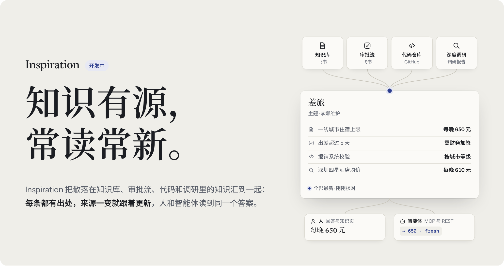
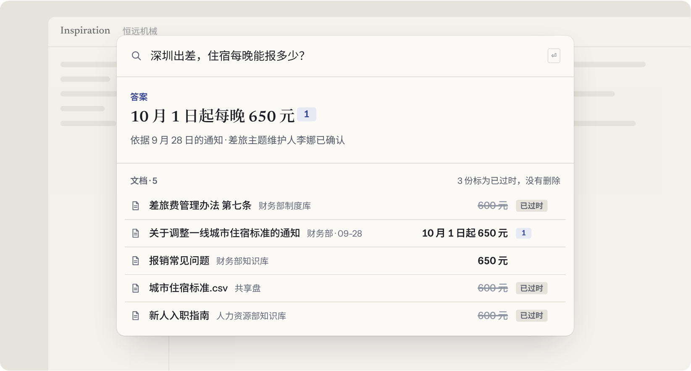
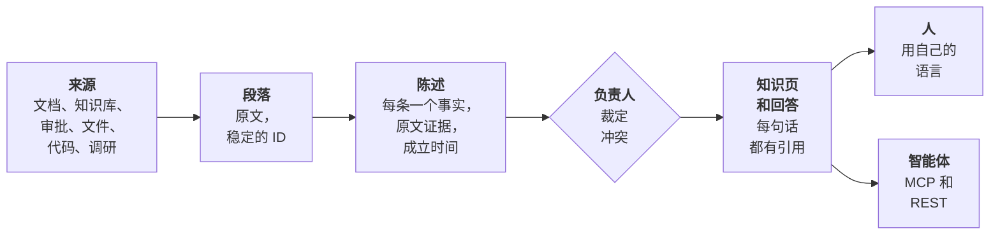
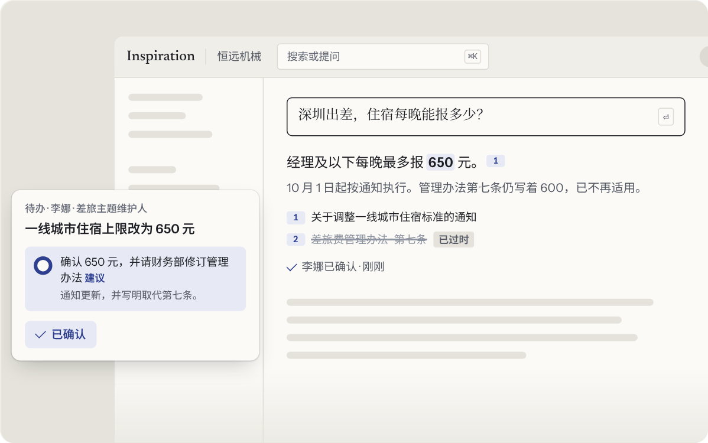
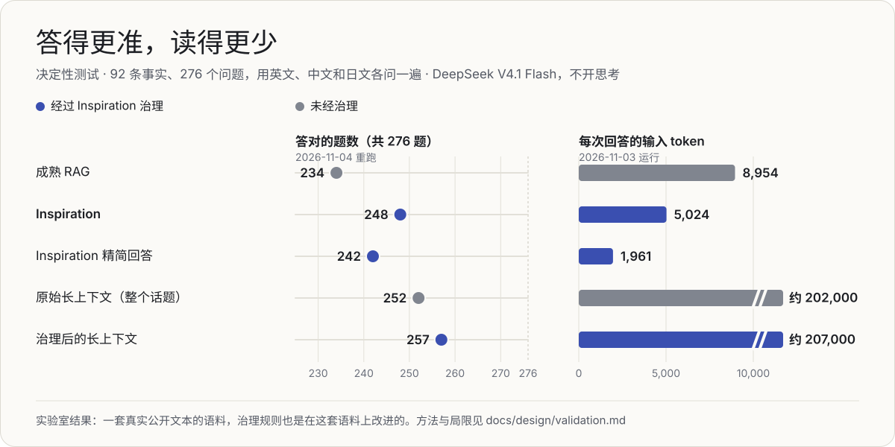
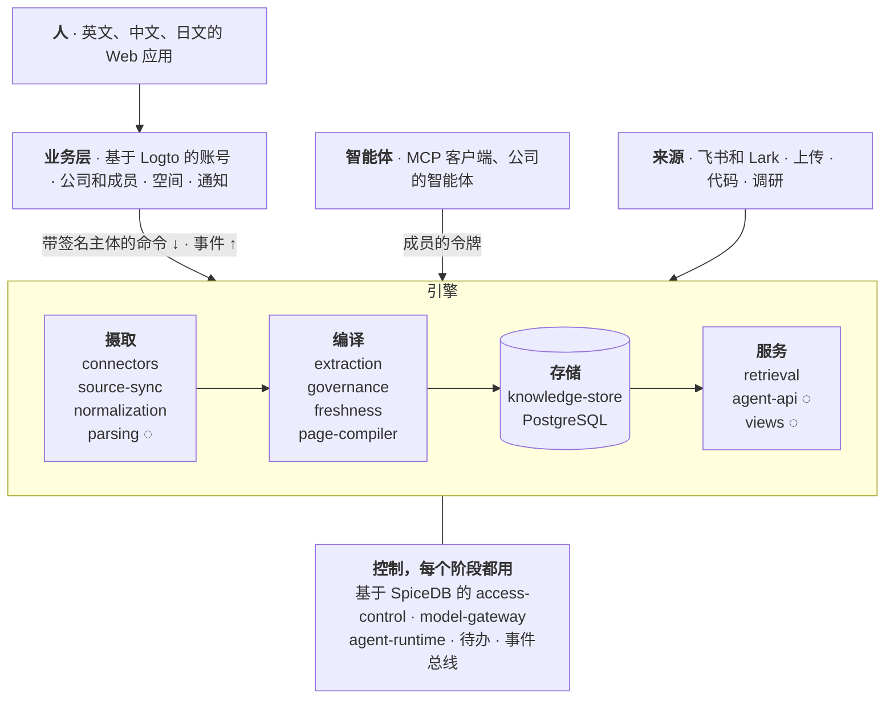

<div align="center">

<a href="https://angelmsger.github.io/Inspiration/zh/"></a>

<p>
<a href="https://angelmsger.github.io/Inspiration/zh/"></a>

<a href="https://github.com/AngelMsger/Inspiration/actions/workflows/ci.yml"></a>


</p>

<p>
<a href="#为什么需要-inspiration"><b>为什么</b></a> ·
<a href="#它怎么工作"><b>怎么工作</b></a> ·
<a href="#目前的结果"><b>结果</b></a> ·
<a href="#架构"><b>架构</b></a> ·
<a href="#路线图"><b>路线图</b></a> ·
<a href="docs/zh/overview.md"><b>文档</b></a>
</p>

<p><a href="README.md">English</a> · <b>简体中文</b> · <a href="README.ja.md">日本語</a></p>

</div>

本文是 [README.md](README.md) 的中文副本；两者不一致时以英文版为准。

**Inspiration 把企业分散在各处的文档、审批流、代码和调研变成经过治理的知识。** 每条事实都保留确切的出处，在来源变化时保持最新，有专人维护，并在各自的权限范围内提供给人和 AI 智能体。它像编译器对待代码那样对待知识库：读一次，做检查，增量更新，再交给提问的人。

> [!NOTE]
> **Inspiration 正在开发中，还不能使用。** 知识引擎已经端到端跑通，并在真实模型上与成熟 RAG 做过对比测试。MVP，也就是一家公司可以用起来的产品，正在构建中（见[路线图](#路线图)）。

## 为什么需要 Inspiration

**企业的知识分散在知识库、审批系统、共享盘和聊天里，而且一直在变。** 问一句“去深圳出差住宿每晚能报多少”，搜索会找到五份文档：差旅制度、一张价目表和新员工指南写着 600，一份更新的通知和 FAQ 写着 650。RAG 系统把五份都交给模型，指望它挑对；建在它上面的每个智能体也继承了这个猜测。

<div align="center">

</div>

**Inspiration 在有人提问之前就确定哪个值有效。** 它回答 650，引用那份通知，把三份旧文档标为已过时但不删除，只有来源真正冲突时才去问维护差旅规则的人。模型恰恰在这里需要帮助：独立研究发现，检索失败的原因是输入里同一事实有相互竞争的值，而不是输入太长（[Liu, 2026](https://arxiv.org/abs/2611.04169v1)）。

| | 今天的搜索和 RAG | Inspiration |
| --- | --- | --- |
| **存什么** | 文档切块 | 单条陈述，每条带原文引文和它成立的时间 |
| **文档互相矛盾时** | 全部交给模型，由模型挑一个 | 用现行的值回答并给出出处；其余标为已过时 |
| **来源变化时** | 重建索引，旧副本继续被引用 | 只重读变了的段落，只重建引用它们的内容 |
| **谁负责** | 没有人 | 每个主题都有负责人，每周处理一小批 |
| **一次回答读多少** | 我们的测试中约 9,000 token | 约 5,000，精简回答约 2,000，用便宜的模型 |
| **智能体** | 同样的切块 | 和人拿到同一个经过治理的答案，带着成员自己的权限 |

## 它怎么工作



<sub>来源被读成段落，段落被读成陈述，负责人裁定陈述之间的分歧，人和智能体读到的一切都由陈述构建。来源里的一处变化只会传到它影响的范围。</sub>

<table>
<tr>
<td width="50%" valign="top">

**🧾 存陈述，不存切块**<br>
每条事实只存一次，带着来源的原文引文、它成立的时间和系统得知它的时间。引文如果不是来源的原文子串，存储会拒绝；陈述永不删除，只结束它的有效区间。

</td>
<td width="50%" valign="top">

**⚡ 像构建系统一样保持新鲜**<br>
一处变化只重读变了的段落，只更新这些段落支撑的陈述，只重建引用它们的页面和回答。每个来源都保存为一串版本，而不是一次性导入。

</td>
</tr>
<tr>
<td valign="top">

**🧑‍⚖️ 人来决定，而且量在人能跟上的范围内**<br>
智能体发现、提议和回答，人来决定。建议都已填好，按主题和周分组送达。MVP 里的“替我决定”会处理日常的那些，每条都附理由，可以撤销。

</td>
<td valign="top">

**🔐 公司决定谁能读什么**<br>
每个空间都有负责人，由负责人设定谁能读。每一次读取，无论来自人还是智能体，都按同一张权限图检查，从来源一直到回答里的每条引用。

</td>
</tr>
<tr>
<td valign="top">

**🌏 一条事实，任何语言**<br>
知识与语言无关。用中文写的制度可以回答英文或日文的问题，并引用中文原文。从一开始就支持英文、中文和日文。

</td>
<td valign="top">

**🤖 为智能体而设计**<br>
智能体通过 MCP 和 REST 读到同样经过治理的知识，身份是它所代表的成员；MCP 服务在 MVP 里提供。每个结果都带出处、版本和状态。智能体只读和提议，只有人能批准修改。

</td>
</tr>
</table>

规则一变，答案跟着变。飞书里来了一份新通知：读了两个段落，一条事实改变，引用它的每个回答和页面都变成 650，主题负责人一键确认建议的修改。

<div align="center">

</div>

## 目前的结果

**在一套围绕变化和冲突事实构建的测试上，Inspiration 答对的题比成熟 RAG 多，每次回答的模型成本低 40%，用的是便宜的模型，不开思考。** 276 个问题中它答对 248 个，成熟 RAG 答对 234 个：总体高 5.1 个百分点，在 204 个关于变化或冲突事实的问题上高 6.9 个百分点。它的精简回答输入少 78%，成本低 86%，仍答对 242 个。

<div align="center">

</div>

| 方案 | 答对，共 276 | 变化或冲突，共 204 | 每次回答的输入 token | 每次回答的成本（元） | 回答模型耗时，中位数 |
| --- | ---: | ---: | ---: | ---: | ---: |
| 成熟 RAG | 234 | 164 | 8,954 | 0.0083 | 1.73 s |
| **Inspiration** | **248** | **178** | **5,024** | **0.0050** | **1.64 s** |
| **Inspiration 精简回答** | **242** | **173** | **1,961** | **0.0012** | **1.40 s** |
| 原始长上下文，整个话题 | 252 | 180 | 202,402 | 缓存命中 0.0048，未命中约 0.20 | 3.03 s |
| **经 Inspiration 治理的长上下文** | **257** | **185** | 206,884 | 缓存命中 0.0049 | 2.99 s |

- **测试。** 92 条事实，来自真实的公开文本：GitLab 手册里差旅和报销的页面及其编辑历史，以及 Kubernetes 文档的英文、中文和日文版本，每条都用三种语言提问。其中 68 条事实发生过变化或互相冲突，形式都是企业里常见的：转述的副本滞后、副本改名、翻译滞后、变化在别处宣布、受治理的来源互相矛盾。其中 23 条来自真实历史，45 条是对真实文本有记录的编辑；另有 24 条事实作为对照。搜索范围是 1,780 万 token。
- **对手。** 成熟 RAG 是混合搜索加跨语言重排序，问题翻译成语料的各种语言，读 12 到 16 个段落，并遵循“优先受治理的来源，其次最新的文件”。Inspiration 用同样的搜索，所以唯一的差别是治理。长上下文读整个话题，约 20 万 token，只在一个话题装得进一个窗口时可行。
- **花了多少钱。** 以上所有回答都在 DeepSeek V4.1 Flash 上运行，不开思考。到目前为止的八次验证运行，DeepSeek 上共花 30.46 元，GPT-6 Luna 上花 0.28 美元。
- **治理对长上下文也有帮助。** 给长上下文治理后的话题而不是原始话题，它答对 257 个而不是 252 个；对于在另一份文档里宣布的变化，27 题全对，而原始长上下文只对 16 题。

> [!IMPORTANT]
> **请把这些当作实验室结果来看。** 它们来自一套语料，而 248 背后的治理规则是根据这套语料上的失败改进的，所以不是独立的测试。领先成熟 RAG 10 个百分点的目标没有达到；它仍是长期目标，将在更大、更贴近真实使用的数据集上衡量。还有两点尚未证明：治理只占用很少的人力（在没有“替我决定”时，每 100 份文档 33 条待办），以及完整回答够快（在我们只有 CPU 的机器上，仅搜索就要 11.4 秒）。MVP 会把这两点做出来并测量。准确率来自 2026-11-04 的重跑；token、成本和耗时来自 2026-11-03 的运行。

方法、每次运行和它的花费见[验证知识核心](docs/zh/design/validation.md)，运行记录在 [`apps/bench/runs/`](apps/bench/runs/README.zh.md)。外部研究如何支撑这些结论、支撑到什么程度，见[外部证据](docs/zh/outside-evidence.md)。

## 架构

**一个仓库，两层。** **引擎**是知识的记录系统，没有界面：给定租户和主体，它回答知道什么、出处在哪、谁能看、是否仍然成立。**业务层**是围绕引擎的产品：账号、公司、邀请、通知和 Web 应用。调用向下，事件向上，引擎从不依赖业务层；任何试图这样做的改动都会让测试失败。



<sub>◌ 表示计划中。完整的全景图，包括每个组件对应的外部同类项目以及我们复用了什么，见[总览](docs/zh/overview.md)的图 10。</sub>

- **小组件，各管一件事。** 引擎的 19 个组件中有 13 个已构建并有测试，业务层的前两个也已构建。[`components.yaml`](components.yaml) 写明每个组件拥有什么、发布和消费哪些事件、可以调用谁；测试让每个包都遵守它。
- **契约优先。** [`libs/contracts/schema/`](libs/contracts/schema/) 里的 JSON Schema 是所有跨组件类型和事件的唯一来源，TypeScript 类型和校验器由它生成。
- **事件和数据一起提交。** 组件在存储事务内通过 outbox 发布事件，再转发到 Valkey Streams。投递至少一次，每个处理器都是幂等的。
- **可替换的部分都是插件。** 连接器、解析器、抽取器、模型提供方、搜索索引、事件传输和迁移都是插件，通过注册表查找，替换一个部分不用改调用方。
- **每次模型调用都经过网关。** 它按内容的敏感级别路由，按公司和组件执行预算，缓存响应并计量成本。每个模型任务都带一个确定性的替身，所以整条流水线不用模型也能运行和测试。
- **每次读取都检查权限。** 基于 SpiceDB 的关系型权限检查，对人、智能体和搜索过滤一视同仁。

| 方面 | 选择 |
| --- | --- |
| 语言 | Node 22 上的 TypeScript，严格模式，直接剥离类型运行；文档解析用一个 Python worker（计划中） |
| 存储和搜索 | PostgreSQL 16，加 pgvector 和 pg_search（ParadeDB）：BM25 加向量，再重排序 |
| 事件 | 事务性 outbox，Valkey Streams |
| 权限 | SpiceDB，参照 Zanzibar |
| 身份 | Logto，在业务层 |
| 模型 | 任何兼容 OpenAI 的提供方和 Anthropic，都经过模型网关；上面的测试用的是 DeepSeek |
| Web | React 和 Vite |

更多内容见[架构](docs/zh/architecture.md)、[契约](docs/zh/contracts.md)和[总览](docs/zh/overview.md)的第二部分。

## 路线图

**下一步是一个打通一家公司完整闭环的 MVP**，2026-11-05 已采纳：登录，创建公司，邀请同事，上传文档，用三种语言中的任何一种提问并得到快速、带引用的回答，让负责人的待办保持简短，并让智能体通过 MCP 读到同样的知识。约 16 人周，分六个切片，设三道关口（见[计划](docs/zh/design/mvp.md)）。

- [x] **引擎在替身模型上跑通。** 摄取、抽取、治理、新鲜度、治理级别、主题和待办，然后是搜索和有依据的回答。
- [x] **在真实模型上验证。** 八次运行，对比普通 RAG、成熟 RAG 和长上下文（见[结果](#目前的结果)）。
- [x] **一个交互式演示和[网站](https://angelmsger.github.io/Inspiration/zh/)。**
- [ ] **MVP**，分六个切片：

| | 切片 | 构建什么 | 状态 |
| :---: | --- | --- | --- |
| 1 | 身份和公司 | 基于 Logto 的登录，公司和成员，邀请链接，有负责人和读者范围的空间，业务层发给引擎的签名主体令牌 | 🚧 进行中 |
| 2 | 文档进来 | 上传文件和文件夹及其新版本；解析 Word、PowerPoint、Excel 和 PDF；在每日预算内用真实模型阅读 | 下一步 |
| 3 | 快速、带引用的回答 | 默认精简回答，更快的重排序，稳定的搜索，回答里标出有争议的值 | 计划中 |
| 🏁 | **关口 A：第一次能用** | 登录，上传自己的文件，用英文、中文或日文提问，得到带引用的回答 | |
| 4 | 少打扰人的治理 | 每张待办卡片上的“替我决定”，附理由，可撤销；按需阅读 | 计划中 |
| 5 | 智能体 | 一个提供搜索、提问和阅读的 MCP 服务，以成员身份行事；个人令牌 | 计划中 |
| 🏁 | **关口 B：闭环打通** | 同事只能读自己的空间，新版本会改变回答，智能体只能看到它的成员能看的内容 | |
| 6 | 试用 | 一台部署好的服务器，用量页面和反馈 | 计划中 |
| 🏁 | **关口 C：试用** | 团队以外的几个人用自己的文档试用两周 | |

**MVP 之后：** 与设计合作伙伴做试点；飞书实时同步；每个成员的私人空间，以及发布到共享空间；联合审批。验证工作在更大、更贴近真实使用的数据集上恢复，以领先 10 个百分点为长期目标。再往后是把深度调研报告作为来源、把审批流变成流程、把代码仓库做成代码图、交互式视图、SSO 和目录同步，以及私有化部署。

## 开始使用

Inspiration 还不能安装使用。要从源码构建和测试，需要 Node 22.18+、pnpm 10 和 Docker，然后运行 `make install && make up && make check`；演示、基准测试和模型网关见[开发指南](docs/zh/development.md)。

## 仓库结构

<details>
<summary>一个 monorepo：引擎、业务层、共享库和应用</summary>

```
libs/contracts      schema/*.yaml 是唯一事实来源，schema/business/ 是业务层自己的；codegen/ 生成 TypeScript
libs/kernel         设置、日志、插件注册表、迁移运行器、blob 存储、数据库连接池
libs/eventbus       事务性 outbox、转发到 Valkey Streams、消费者、内存总线
libs/testkit        针对 compose 环境的测试夹具
engine/<component>  每个引擎组件一个包（见 components.yaml）
business/<name>     每个业务层组件一个包：目前是 accounts 和 tenancy；engine/ 和 libs/ 从不依赖它们
apps/engine         引擎进程：把组件接到存储、总线和 blob 存储上；HTTP API
apps/web            基于引擎 HTTP API 的产品 Web 应用、替身后端（pnpm demo）和快照（pnpm snapshot）
apps/bench          测量工具（pnpm bench）：在语料上运行引擎、出报告、核对答案
apps/site           产品网站（pnpm site）：三种语言的静态页面和脚本化演示，发布到 GitHub Pages
examples/<corpus>   语料，以及运行结果要核对的答案（见 examples/README.md）
infra/              原型环境的 docker compose，以及运行时用的本地 embedding 服务
config/             模型网关的示例配置
docs/               总览、引擎参考和设计文档，索引在 docs/README.md
docs/zh/            每份文档的中文副本
docs/assets/        README 里展示的图片，有英文、中文和日文版
test/               仓库级检查：组件清单、语言、文档、文件路径
README*.md          本页的英文、中文（README.zh.md）和日文（README.ja.md）版本
```

</details>

## 文档

| 阅读 | 内容 |
| --- | --- |
| [总览](docs/zh/overview.md)（[English](docs/overview.md)） | 产品需求和技术架构合在一份文档里：场景、图、可行性、已构建和计划中的内容 |
| [MVP](docs/zh/design/mvp.md) | 范围、切片、关口以及背后的决定 |
| [验证知识核心](docs/zh/design/validation.md) | 如何在真实文档上检验这些结论，每次运行和它的花费 |
| [架构](docs/zh/architecture.md) | 两层、各个组件以及它们如何通信 |
| [开发](docs/zh/development.md) | 从源码构建、测试和运行 |
| [全部文档](docs/zh/README.md) | 每份文档及其状态：已采纳、提议中或已被取代 |

## 参与贡献

Inspiration 由人和编码智能体并行构建，每一方都只在一个组件的边界内工作。改动任何东西之前，请先读 [AGENTS.md](AGENTS.md)：它规定了边界、契约规则、测试以及如何让代码保持简单。每个改动都通过 pull request 合入，并且 `make check` 必须通过。欢迎在 issue 里提问和提想法。

## 许可证

Inspiration 还没有选定许可证。第三方技术栈的许可证及其对交付的影响见[许可证](docs/zh/licensing.md)。

<div align="center">
<br>
<b>知识有源，常读常新。</b><br>
<sub>Every fact sourced. Every answer current. · 出典は確か、答えはいつも最新。</sub>
<br><br>
</div>
