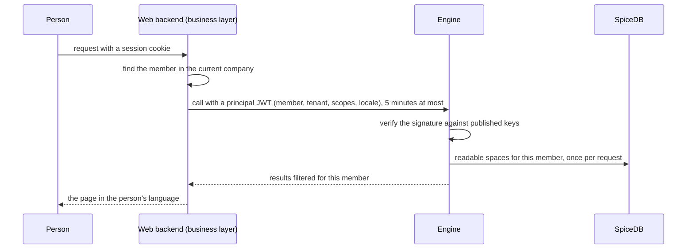
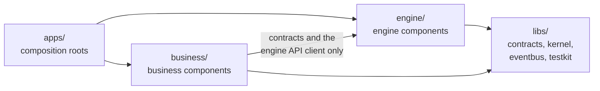
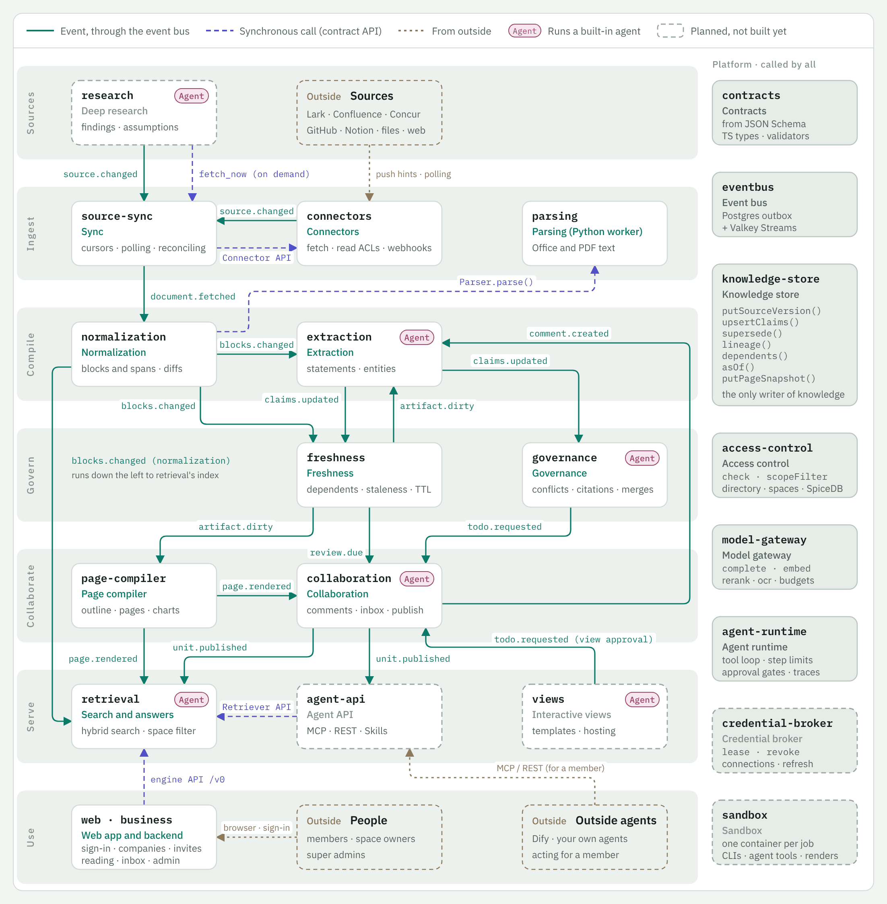
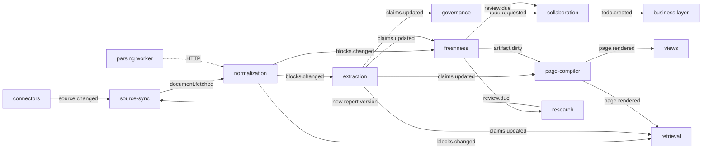
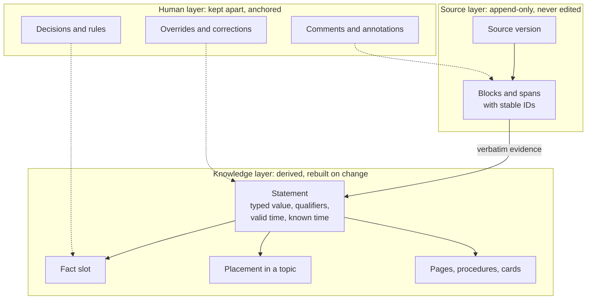
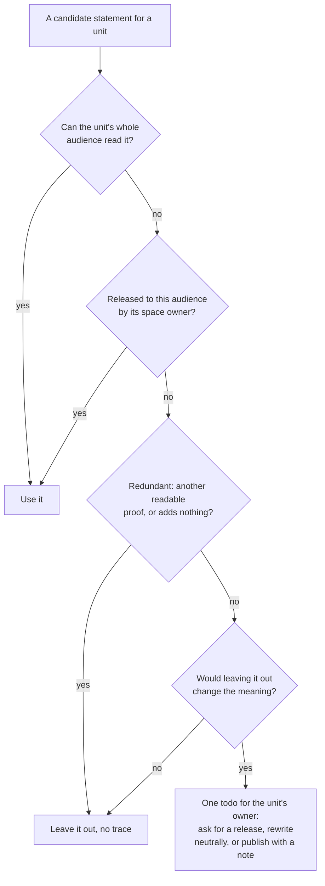
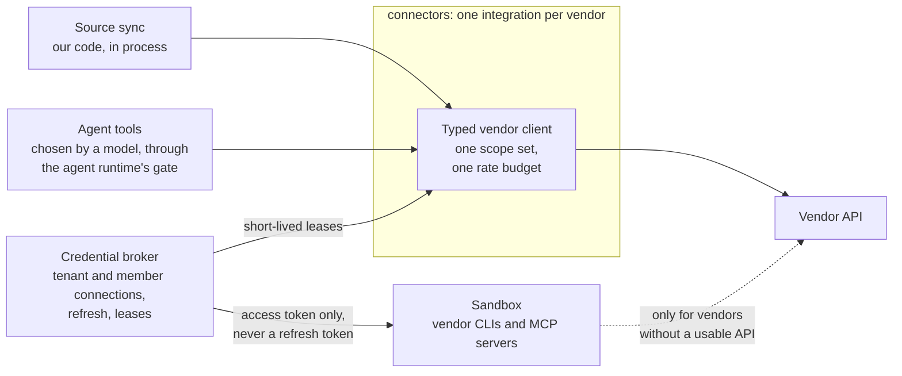
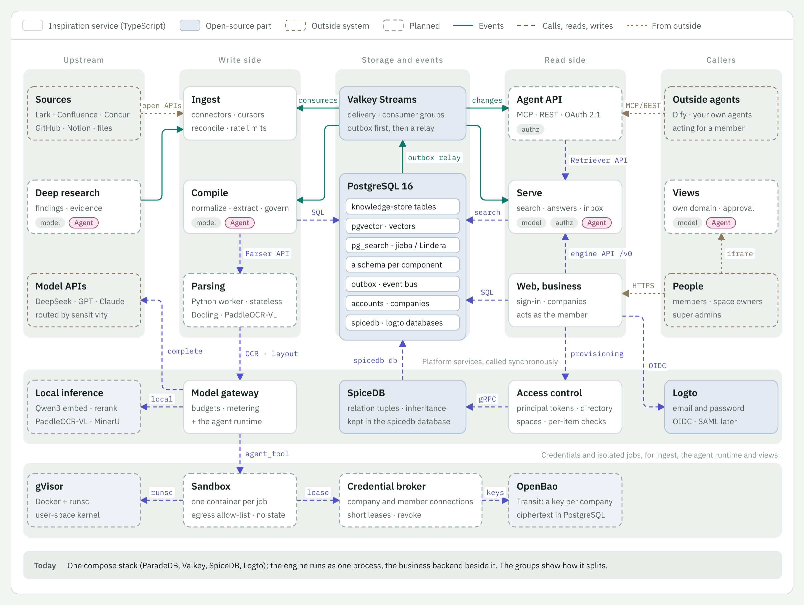

# Architecture

Inspiration is a set of components around one knowledge store. Each component owns one
job, talks to the others through a small number of well-defined paths, and can be built
and tested on its own. [`components.yaml`](../components.yaml) is the authoritative list;
this page explains how the pieces fit, from the two layers and the request path to the
knowledge model, permissions, models and agents, and how the system is built and deployed.
The [overview](overview.md)'s Part II gives the architecture at a glance and what is proven
so far. A Chinese copy is in [zh/architecture.md](zh/architecture.md); if the two differ,
this English version wins.

## Engine and business layer

The **engine** owns connectors, the knowledge pipeline, storage, permissions, model access
and the agent API. It knows tenants, spaces and principals by ID and enforces every
permission itself, but it has no accounts, sign-in, invitations or billing.

The **business layer** owns people and tenants: the external identity provider, accounts
that are members of many tenants, personal tenants, publishing policy and admin governance. It provisions the engine (members, groups, spaces, policy) through engine
commands and reacts to engine events. Calls go down, events come up: the engine never calls
the business layer. The design philosophy of the two layers, the test for where something
goes, what neither may do, and how shared concerns are split are in the overview's
[Architecture at a glance](overview.md#9-architecture-at-a-glance) section.

Engine APIs are tenant- and membership-aware and free of UI concerns, so the business layer,
its web app and agents all use the same surface.

The web app reads the engine through its HTTP API, version 0 (`apps/engine/src/http.ts`): the
spaces a member may read, a space's Documents tree, one document with the marks of its
Annotated view, search and answers, a space's knowledge outline and each topic with the values
that hold for its facts, the member's inbox with the choices each todo offers, and for a space's
owner (or a tenant admin) an overview of the space: its open work, the facts its readers see
in dispute, its documents by governance level and the latest changes. The knowledge writes
so far are resolving a todo and, for a space's owner, syncing a source now; both answer once
the engine has read everything they caused. The business layer's tenancy service provisions
tenants and members into the engine's copy of its directory (access control's `Directory`),
and spaces are administered through the same API: the super admin creates a space and names
its owners, its owners rename it and set who reads it, and the super admin may take readers
out but not add them. `GET /v0/me` tells the web app whether the member is the super admin,
and `GET /v0/spaces?manage=true` lists the spaces they administer. `GET /v0/usage` gives the
super admin a month of the company's usage: model cost against its budgets, answers and how
long they took, todos and what the assistant decided, by member, space and day, from the model
gateway's ledger, where each call is charged to the member who asked or the space it reads;
counts, times and cost only, never content. A member is let in only
while the directory has them and their tenant active. Every read is checked against the
member's permissions, and anything the member may not read answers as if it did not exist. A request carries a
principal token, a JWT the business layer signs with Ed25519 (`signJwt` in the kernel, which
both layers use) and access control verifies against the business layer's published keys
(`TokenVerifier`); its scopes bound what the request may do. For development, `--dev-identity`
also lets a request name its tenant and member in the `x-inspiration-tenant` and
`x-inspiration-member` headers, and their language in `x-inspiration-locale`, a stand-in that
listens on localhost only. The
web app's own backend is a stand-in too (`apps/web/src/backend.ts`): a person picks whom to act
as, and only the backend sets those headers. `pnpm demo` runs both over the demo tenant, and
`pnpm snapshot` records the demo script through both into a static page that answers from the
recording (`apps/web/src/replay.ts`).

The source-sync component owns full-sync execution, persisted status and restart recovery;
HTTP handlers only authorize and start or await that same job. Retrieval owns the answer
lifecycle for HTTP and MCP. Its optional reading callback invokes extraction on authorized
citations in their cited versions, then applies the original committed events through the
existing idempotent governance and freshness handlers. Other event consumers run in the
background; an answer does not drain the engine's global queue. Catalogue discovery is an
extraction option, independent of answer-time reading, owner routing and topic organization.

The business backend (`apps/business`) is the browser's real server, on the site's own origin.
It signs people in through Logto (OIDC, in `business/accounts`), keeps their companies, members
and invite links (`business/tenancy`), provisions each change in the engine as the tenancy
service, and passes the page's `/api/v0/` calls on to the engine's `/v0/` with a principal
token it signs for the member, publishing its keys at `/.well-known/jwks.json`. An MCP client
calls its `/mcp` with a member's personal access token (`business/access-grants`), and it passes
the call on to the engine as an agent acting for that member. It also serves the built web app. Its routes are listed in `apps/business/src/index.ts`.

## Identity, tenancy and the request path

There are three IDs: the tenant (`ten_`), the business layer's user, which is the account
(`usr_`), and the member (`mem_`), which is one user inside one tenant. User IDs never reach
the engine; its only person ID is the member ID. A member ID is unique only within its
tenant (the business layer may give a person the same member ID in every tenant they join),
and nothing derives one ID from another or reads meaning into an ID's body. So everything
the engine keeps outside a tenant's own rows keys principals by tenant: the permission graph
(`<ten_…>|<mem_…>`, likewise for services, groups and departments), index principal
tokens, and agent runs. One function in the tenancy component assigns member IDs.

- **One verification path.** Every call carries a JWT signed by the business layer: member, tenant, principal kind, the member an agent acts for, scopes, optional spaces and sensitivity limit, how the session signed in, and the interface `locale`. Web tokens live at most 5 minutes, OAuth access tokens 10 to 15. The engine verifies them against published keys and never sees a user ID or an identity-provider token.



*Figure 1. A request carries only a short-lived signed principal. The engine checks permissions itself.*

- **Provisioning commands are idempotent** (an idempotency key, a version on directory objects) and return SpiceDB's consistency token, so the next read sees the change. A nightly directory snapshot repairs drift, and an hourly digest check catches it in between.
- **Contracts live in one place.** JSON Schema in this repository is the source of truth for both layers; business-only types sit in their own folder that engine packages never import.

## One repository, a folder per layer

Both layers are built in this repository, as one pnpm workspace, and each has its own folder:

```
libs/<name>       shared libraries both layers use: contracts, kernel, eventbus, testkit
engine/<name>     engine components, one package each
business/<name>   business-layer components, one package each
apps/<name>       composition roots: the engine process, its measurement harness, the
                  business backend and the web app
```



*Figure 2. Dependencies point one way. Nothing in `engine/` or `libs/` depends on `business/`, and the manifest test fails any change that tries.*

Package names stay `@inspiration/<name>`.

One repository makes boundaries a matter of checks rather than of repository walls:

- **Dependencies point one way.** Nothing in `engine/` or `libs/` depends on `business/`.
  A business component reaches the engine only through the contracts (types, interfaces and
  the engine's API client), never by importing an engine component, so the engine still runs
  on its own and either side can be tested against a fake of the other.
- **Within a layer, only what is declared.** A package depends on the libraries and on the
  components in its `calls`, as today. The business layer has its own levels: business
  components, the backend that wires them and serves the web app, and the web app, which talks
  only to that backend.
- **Apps wire, packages don't.** An app may wire components of both layers, for example a
  single-process development server, and no package depends on an app. The one exception is
  the measurement harness (`apps/bench`), which runs the engine process it measures.
- **One manifest and one check.** Each section of [`components.yaml`](../components.yaml)
  maps to one folder: `components` to `engine/`, `libraries` to `libs/`, `business` to
  `business/` and `apps` to `apps/`. An
  engine component's `layer` field keeps naming its stage (ingest, compile, store, serve,
  control). `test/manifest.test.ts` fails a package that sits outside its section's folder,
  and anything in `engine/` or `libs/` that depends on `business/`.
- **One schema tree.** Business-only types live in their own folder of the contracts
  (`libs/contracts/schema/business/`), generated into an entry of their own
  (`@inspiration/contracts/business`) that nothing in `engine/` or `libs/` imports.
- **One toolchain, separate deployments.** One lockfile, one Biome, `tsc` and Vitest setup,
  and one `make check`, so a contract change lands with both sides in one pull request. The
  engine's APIs stay versioned all the same, because outside agents use them too. The engine and
  the business backend still deploy as separate processes: the monorepo is about source, not
  runtime. When separate teams own the layers, `CODEOWNERS` follows the folders and CI can run
  only the packages a change affects.

## Layers and components

<picture>
<source media="(prefers-color-scheme: dark)" srcset="assets/components.en.dark.png">

</picture>

*Figure 3. Every component in its stage: the events between components as solid lines and the synchronous calls as dashed ones; the platform services on the right serve every component. Dashed boxes are planned.*

**Engine components.** Each has one job. Its name is also its event producer name, its consumer group and the prefix of its model task names.

| Stage | Component | Job | State |
| --- | --- | --- | --- |
| Ingest | connectors | One integration per vendor: list, fetch, read ACLs, webhooks, agent tools. Built: local folders, live Confluence space pages and Feishu docx/wiki page links, recorded Feishu approvals | Built |
| Ingest | source-sync | Versions, tombstones, ACL snapshots, polls and reconcile; later `fetch_now` and the Documents tree | Built; poll and reconcile schedules planned (a sync runs when called) |
| Ingest | parsing | Python worker for Word, PowerPoint, Excel and PDF behind an HTTP contract; later scans through OCR and layout models | Built for the text layer |
| Ingest | normalization | Canonical blocks and spans with stable IDs, block diff, duplicate documents; later mirror pages | Built |
| Ingest | research | Research agent over the agent API and approved web search; reports become sources | Planned |
| Ingest | code-graph | A git mirror per repository and a code graph per commit, built in the sandbox; `code.changed` at every merge ([code repositories](design/code-repositories.md)) | Proposed |
| Compile | extraction | Statements with verbatim evidence, fact-slot keys, governance levels, extract on use; later entities and procedures | Built |
| Compile | freshness | Review clocks, plan dates, copies, staleness, `review.due`; later the dependency graph and `artifact.dirty` | Built |
| Compile | governance | Slot values, conflict cases with a proposed value, todo requests, notes; later model-judge tiers and rules | Built |
| Compile | page-compiler | Topics and placements; later cited pages, the omission check, diagrams, snapshots | Topics built |
| Store | knowledge-store | The only owner of knowledge tables: lineage, bitemporal reads, slots, topics, page snapshots | Built |
| Serve | retrieval | Every search index; hybrid search, rerank, permission filters, grounded answers | Built for passages, with the statements they quote joined at query time; also two baselines to measure answers against (a mature RAG and long context), a governed long context and compact answers; its own chunk tables, now in `kb`, and page, procedure and entity indexes planned |
| Serve | agent-api | MCP server, REST and OpenAPI, Skills export, per-call audit | MCP server built with search, ask and read, acting as the member; the rest planned |
| Serve | views | Interactive view templates, generation, render check, sandbox hosting | Planned |
| Control | collaboration | The inbox; later comments, overrides, publishing, decisions, releases | Inbox built |
| Control | access-control | Permissions on SpiceDB, search pre-filters, audit | Built; space and proof rules designed |
| Control | model-gateway | Every model call: routing by sensitivity, budgets, prompts, cache, metering | Built |
| Control | agent-runtime | The loop built-in agents run on: tools, limits, approval gates, traces | Built; no built-in agent runs on it yet |
| Control | credential-broker | Tenant and member connections, encrypted secrets, refresh, short-lived leases | Designed |
| Control | sandbox | One isolated container per job for code we did not write | Designed |

**Business components.** One TypeScript service with its own database schema, plus the web app.

| Component | Owns | Phase |
| --- | --- | --- |
| accounts | Users, login identities, sessions, the identity-provider adapter (Logto; Keycloak as fallback) | 1; built for the MVP |
| tenancy | Tenants, members and member IDs, invitations, verified domains, company roles, sign-in policy, personal to company, transfers | 1; built for the MVP |
| directory | SSO connections, Feishu contacts (SCIM in phase 2), groups, departments, external identity links | 1 and 2 |
| access-grants | OAuth authorization server, client registry, device flow, personal tokens, company agents, revocation | 1 |
| connections | Connect flows for company and personal connections, consents | 1 |
| publishing | The publish wizard: target space, freshness choice, coverage, audience gap, approval routing | 1 |
| approvals | Single and joint approvals, deadlines, fallback deciders, decision records | 1 (joint in 2) |
| notifications | Inbox, email, Feishu, Lark and DingTalk cards, digests, preferences, message catalogs | 1 |
| admin | Space ownership, company settings, roles, audit and usage views | 1 |
| billing | Plans, seats, quotas, per-member limits, model budgets | 3 |
| web | The product web app and its backend for the frontend | 1; being built |

Shared libraries sit under all of them: **contracts** (types, validators, the event
catalogue, component interfaces), **kernel** (settings, logging, plugins, migrations, blob
store, database pools, language packs), **eventbus** (outbox, relay, consumers) and
**testkit** (fixtures for the compose stack, test data).

Everything is TypeScript on Node 22 except **parsing**, a Python worker for the heavy
document parsers (Office, PDF, scans), which normalization calls over an HTTP contract.

## How components talk

There are exactly three paths.

1. **Events.** A component writes data and its events in one Postgres transaction
   (`tx.publish` writes `bus.outbox`). The relay moves outbox rows to Valkey Streams, one
   stream per event type. Each consuming component reads with its own consumer group,
   named after the component, so every component sees every event once (at least once on
   failure). Unparseable events, events of a newer version than the consumer knows, and
   events that keep failing go to a dead-letter stream per group. Payloads carry IDs and codes, never sentences.
2. **The knowledge store's repository API.** Reads and writes of knowledge go through
   `KnowledgeStore`. No component reads another component's tables.
3. **Synchronous calls** to the interfaces in `libs/contracts/src/interfaces.ts`:
   `AuthZ` (access-control), `ModelGateway` (model-gateway), `Retriever` (retrieval),
   `AgentRuntime` (agent-runtime), the blob store, and `SlotVerdicts` (governance) and
   `StalenessReader` (freshness), which retrieval reads while it answers: the value that
   holds in a slot, and how stale a unit is. Later come `SourceSync.fetch_now`,
   `CredentialBroker` and `Sandbox`. Each has an in-process implementation and,
   where useful, an HTTP one with the same interface (the model gateway has both today). `components.yaml` lists which calls each component may make,
   and the manifest test checks that a package depends on nothing else.



*Figure 4. The engine pipeline as events. Each component reacts only to the events it subscribes to.*

The engine's daily tick also runs two jobs: freshness publishes the reviews that fall due, and governance rechecks the changes whose dates have come.

| Event | Published by | Consumed by | State |
| --- | --- | --- | --- |
| `source.changed` | connectors, source-sync, research | source-sync | Consumer built; publishers planned (webhooks, polls, research), so a sync runs when called |
| `document.fetched` | source-sync | normalization | Built |
| `acl.changed` | source-sync | collaboration for the source-restricted todo (planned); nothing else, since ACL snapshots are advisory | Built |
| `blocks.changed` | normalization | extraction, freshness, retrieval | Built |
| `claims.updated` | extraction; governance and collaboration (planned) | freshness, governance, page-compiler; retrieval (planned) | Built |
| `artifact.dirty` | freshness | extraction, page-compiler, retrieval | Planned |
| `review.due` | freshness | collaboration, research | Built |
| `todo.requested` | extraction, governance; views and page-compiler (designed) | collaboration | Built |
| `todo.created` | collaboration | business layer | Built |
| `page.rendered` | page-compiler | collaboration, retrieval, views | Planned |
| `comment.created` | collaboration | extraction, collaboration | Planned |
| `unit.published` | collaboration | retrieval, agent-api, business layer | Planned |
| `connection.changed` | credential-broker | source-sync, collaboration, business layer | Designed |
| `source.tree_changed`, `source.moved` | source-sync, the publish step | access-control, retrieval, normalization, business layer | Designed |
| `todo.updated`, `publish_request.updated`, `decision.applied`, `member.offboarded`, `usage.recorded` | engine | business layer | Designed |

Only the engine publishes events. Business components read them as consumer groups; a product deployment adds a feed endpoint so the business layer is not tied to the transport.

## Knowledge model

Knowledge lives in three layers that never write into each other.



*Figure 5. Three layers. The source layer always matches the source; everything people add lives in its own layer, anchored to stable IDs.*

- **The source layer matches the source, always.** Each sync stores an immutable source version; a change adds a version and a deletion adds a "deleted" version. Nothing inside Inspiration edits it.
- **The knowledge layer is derived.** Statements, slots, topics and pages are computed from source versions and rebuilt when they change.
- **The human layer is kept apart.** Annotations, corrections, decisions, rules and statements a person added are stored separately, with author and time, anchored to stable IDs (Feishu block IDs, statement IDs). When a new version arrives, an annotation whose anchor is unchanged moves with it; a correction the source now agrees with retires itself; a correction the source contradicts gives its author a todo; an annotation whose anchor is gone is kept in the margin as orphaned. So the system can never drift away from the source in a way nobody can explain.

**Anatomy of a statement.** The Shenzhen hotel cap from the price list:

| Field | Value |
| --- | --- |
| Subject, predicate | Business travel, hotel cap per night |
| Value | 650 CNY per night (typed money) |
| Qualifiers | City tier: tier 1; grade: managers and below |
| Valid time | From 2026-10-18 |
| Known time | From the sync that read the price list |
| Class | Policy |
| Evidence | Verbatim quote from the price list, with its version and span |
| Slot key | Predicate + qualifiers, language-neutral |

**Statements carry knowledge; queries carry data at scale.** A statement is more than subject, predicate and object: its typed value, qualifiers that work as dimensions (city, grade, period) and valid time mean the statements of one predicate form a small fact table, such as hotel caps by city and grade, that stays cited and governed. That suits rules and facts, from hundreds to a few thousand per subject, because each can be reviewed. Business data at scale (daily sales, stock, transactions) is never turned into statements: it stays in its system of record and reaches a chart through a registered, parameterized query that a `data_providers` plugin runs with that system's permissions and caches as a snapshot the chart cites. A large table inside a document, such as a price list of thousands of items, stays a source whose rows can be cited; a row becomes a statement only when a page or an answer uses it.

| Layer | Holds | State |
| --- | --- | --- |
| Source version | One fetched revision, its hashes, sensitivity and governance level | Built |
| Block, span | Stable IDs, heading path, parent; spans content-addressed by block and text | Built |
| Statement and evidence | Subject, predicate, value, qualifiers, class, slot key, two time intervals, verbatim quotes | Built |
| Fact slot | Current variants with counts and representatives, and every value held over time | Built |
| Topic and placement | Taxonomy nodes with stable keys, status, owner and counts; one placement per statement | Built |
| Entity, relation | People, departments, products, suppliers; every edge backed by a statement | Planned |
| Procedure, model | Steps, roles, conditions; formulas and decision tables whose assumptions are statements | Planned |
| Page | `PageSpec` versions with sentences bound to statements; mirror pages for the Original view | Contract only |
| Source node | The Documents tree: each document's position in its source's hierarchy | Designed |

The knowledge store enforces four rules: a statement without evidence or a derivation is rejected; an evidence quote must be a verbatim substring of its span; statements are never deleted; page versions are immutable and increase by one. Reads are bitemporal: what was true at a time, as the system knew it at a time.

## Governance levels and fact slots

Not every document deserves an owner's attention. A source, or a folder or item within it,
has a governance level that source sync resolves onto every version (`SourceVersion
.governance_level`; uploads and web pages start as `reference`):

| Level | Extraction | Governance | Freshness |
| --- | --- | --- | --- |
| `governed` | in full | its values decide a slot; owners get todos | review clocks and copy reviews |
| `reference` | where a block names a catalogue fact, slot claims only; a passage in full once a page or an answer uses it | its values never outvote or hold up a governed one, except a change it dates that is in effect and later than the governed value (an announcement the page has not caught up with), which holds and asks the page's owner; a value only it states is a note | none |
| `search_only` | never | none | none |

Claims about one single-valued fact share a slot key (`Claim.slot_key`: subject entity when
resolved, predicate and sorted qualifiers). `KnowledgeStore.slot()` reads a slot as a
handful of rows however many statements it holds: the current values with their counts and
representatives, and the values it held over time.

## The knowledge outline

Every statement has two outlines. The source outline (document, heading path, passage) comes
from its evidence spans. The knowledge outline (space, area, topic, subtopic) comes from a
placement (`Placement`: claim, topic key, page block, placed_by, confirmed).

- Page-compiler clusters the sections of current governed documents into topics, per space.
  Topics are `TaxonomyNode`s, at most three levels deep, with keys that stay the same from
  one re-clustering to the next.
- A statement with a fact slot sits where most of its slot's statements are. That is also
  the only way a reference document's statements are placed.
- A governed statement without a topic is unfiled and shows under its source section.
- Clustering proposes topics, and an owner confirms them. Confirmed topics, and placements
  made or confirmed by a person or a page, never move. At most `budget` (5%) of the placed
  statements change topic in one re-clustering.
- `KnowledgeStore.topics()`, `placementsOf()` and `placementsIn()` read the outline.

## The pipeline and incremental freshness

1. **Sync.** Source-sync lists a source, compares each item's content, metadata and ACL hashes with the last ones, fetches what changed, and writes the source version and ACL snapshot in one transaction. A permission change alone writes no new version, so nothing is re-parsed.
2. **Normalize.** Normalization parses the version (built-in parsers for text formats, the parsing worker for Office, PDF and scans), builds blocks and spans with stable IDs, diffs them against the previous version and detects duplicate documents. Every later stage works from this diff.
3. **Extract.** Extraction reads only added and changed blocks of governed documents, and of reference documents only those that name a known fact. Each window is one model call. A statement is kept only if its quote is verbatim; statements whose evidence disappeared are superseded, or held for their owner when the document was deleted.
4. **Govern.** Governance keeps each slot's values counted incrementally, proposes the value that holds, opens conflict cases for the others, and sends one todo request per slot. It is deterministic today; semantic and model-judge tiers come later for statements without a slot.
5. **Keep fresh.** Freshness keeps review clocks and publishes `review.due` once a day for what has fallen due. It asks no model and changes no knowledge, so a model outage or an exhausted budget never stops it.
6. **Organize and compile.** Page-compiler embeds the sections of governed documents, places statements in topics and re-clusters within the change budget. Next it writes cited pages and diagrams for their audience and snapshots every version.
7. **Ask people.** Collaboration is the only component that creates todos: it merges requests, routes them to owners and groups them on weekly cards.
8. **Serve.** Retrieval indexes blocks, statements and pages, and serves search and answers to the web app and the agent API.

**Why incremental works.** Blocks have stable IDs and every stage consumes the block diff, so a typical edit touches a handful of blocks. Re-extraction that yields the same statements changes nothing further. Engine-caused changes, such as a new prompt or model, stay silent while values stay the same and go to evaluation, not to inboxes, when they do not.

## The governance engine

| Kind | Example | Decided by |
| --- | --- | --- |
| Edit collision | Two people edit the same paragraph | Merged live in drafts |
| Override conflict | A person's edit says 500, the source now says 600 | The override's author |
| Knowledge conflict in one scope | Two sources disagree on a price | That scope's owner (single by default) |
| Knowledge conflict across scopes | Finance says X, the Sales procedure says Y | Every affected owner (all by default); after the deadline the space owner, or across spaces an owner the super admin names |
| Assertion conflict | A comment states a fact that contradicts a verified statement | The scope's owner |

- **The engine proposes a value and says why.** For each slot, governance proposes the most authoritative value in force, unless a later dated statement changed it ("from 2026-10-01 the cap is 650"). Clear supersessions by archived documents settle without a person.
- **One trigger, one todo; one cause, one review.** Requests for the same slot or document merge into one todo, routed to the owner of its topic, else the nearest owner above, else the space owner. A cause that would produce more than 20 todos or touch more than 3 topics becomes one change review for the owner of the smallest scope that covers it, decided in bulk with a record per item. Connection problems go to the super admin, because they are not knowledge changes.
- **Joint approval always finishes** ([scenario 5.3](overview.md#53-two-departments-disagree)). Each policy has a mode, a deadline (5 working days across scopes by default) and a fallback decider. While people decide, readers and agents get the last verified value marked Disputed (the default), both values, or nothing, as the company chooses.
- **Every decision is a record.** "Why this value?" shows who decided, when and on what. A decision can become a precedence rule, which governance applies to new conflicts of the same kind and reports weekly.
- **Owners must be able to read their whole scope,** or they would judge half a conflict. The console warns when they cannot, and such a conflict goes to the backup owner or the fallback decider.

## The inbox

Collaboration turns `todo.requested` and `review.due` into todos and puts them in front of
the people who own the topics, in amounts a person can keep up with.

- There is one open todo per dedupe key. A later request updates it, and a request marked
  withdrawn (its reason went away) dismisses it.
- A todo's topic comes from its claims' placements. Its assignee is the topic's owner, or
  the nearest owner above it. The business layer names owners, and the topic keeps them
  (`TaxonomyNode.owner_id`).
- An owner's todos about one topic in one ISO week share a card (`Todo.batch_key`) of at
  most 20. An owner gets at most 10 cards a week; the rest wait for the first later week
  with room, except high and urgent todos. The budget is a soft limit: a conflict and its
  copy reviews also stay together in their week, over the budget when they must.
- Notes, where reference documents state another value than the governed one, go on a
  weekly notes card outside the budget, and one action acknowledges them.
- A copy review rides on the card of the conflict its source update opened (on its next
  part when the card is full), in whichever order the two arrive, until that conflict
  closes. Reviews already due when a document is first seen go to a first-review campaign
  per topic. The todos of topics nobody owns go to the space's steward.
- A todo may offer resolutions, each with an effect its requester applies: a conflict offers
  one per value. Resolving a todo publishes `todo.resolved` with the choice, in the same
  transaction. Governance then holds the chosen value (`SlotVerdict.chosen_by`), marks every
  other value outdated, and keeps the choice until a new value comes in. A choice made on a
  conflict that has changed since it was asked is asked again.

## Storage

One Postgres instance (ParadeDB image: Postgres 16 with pgvector and pg_search) holds:

| Schema | Owner | Contents |
| --- | --- | --- |
| `kb` | knowledge-store | source versions, source blocks, spans, chunks (BM25 index), embeddings (HNSW), claims, evidence, derivations, dependencies, page snapshots, ACL snapshots |
| `bus` | eventbus | outbox and inbox |
| `gateway` | model-gateway | usage records (budgets are sums over them) |
| `agents` | agent-runtime | agent run traces |
| `authz` | access-control | the copy of the business layer's directory (tenants, members, with their versions); spaces with their owners and audiences; idempotency keys of space creation. SpiceDB holds the graph these grant |
| `sync` | source-sync | registered sources; per item, the connector's version hashes and the source version they became |
| `normalization` | normalization | per document, the version last stored as blocks (the diff base), its parser and fingerprint; the SimHash band index for duplicates |
| `extraction` | extraction | per document, the latest version extracted |
| `freshness` | freshness | per document, its review clock, claim classes and plan days; copies; reviews due by day; deleted documents |
| `governance` | governance | slot members and value groups, conflict cases, what each slot last asked and the notes it left, recheck days |
| `page_compiler` | page-compiler | sections with their embeddings and topics, the last clustering's topics and centroids, the topic of each fact slot, store writes an update has yet to finish |
| `collaboration` | collaboration | the inbox: every todo with its dedupe key, card, week and the week it fell due |
| `retrieval` | retrieval | per document, the version its chunks are of; documents that are editions of one text, as normalization reported them |
| `public.inspiration_migrations` | kernel | migration ledger with checksums |

SpiceDB keeps its own datastore in a separate `spicedb` database on the same instance.
Valkey carries the event streams and the model response cache. Binary files go to the
blob store (a local directory in the prototype, object storage later).

Every `kb` table keeps the full contract object in a `doc` column and copies only the
fields queries filter on into typed columns, so a contract change rarely needs a
migration.

Search runs inside Postgres in the prototype: BM25 through pg_search with the jieba
tokenizer (search mode, whitespace trimmed, traditional folded to simplified), vectors
through pgvector. Both sit behind the `VectorIndex` and `KeywordIndex` interfaces, so a
deployment can move to Milvus or OpenSearch without touching retrieval.

## Permissions

The engine makes every permission decision itself, from a copy of what the business layer provisions. Visibility comes from the space a unit is in, never from source permissions (the adopted permission model; see the [business and engine contract](design/business-engine-contract.md)).

**Built.**

- **Spaces decide who reads.** A source belongs to one space, and its documents are readable
  by whoever may read the space: its audience (members, groups, departments or the whole
  tenant) with a role from viewer to owner, each holding in every space below. The super
  admin manages every space (its name, owners and audience) but reads only the spaces whose
  audience includes them. Source ACLs decide nothing: source-sync keeps them as advisory
  snapshots, for the audience-gap warning when something is published.
- **SpiceDB holds tenants, members, groups, departments and spaces,** keyed by tenant. Statements, pages and procedures are not written to it. A shared space's roles (`viewer`, `commenter`, `editor`, `steward`, `owner`) are granted top down and inherited down the space tree.
- **A unit is readable if its space is readable and its sensitivity label is at or below the reader's clearance.** Labels are `public`, `internal`, `confidential` and `secret`.
- **Derived knowledge follows its sources.** A claim, page or SOP is readable only through
  source documents the viewer can read now. Access control decides this at read time by
  walking lineage along support paths (supporting evidence, derivations, dependencies), so it
  follows the spaces the viewer can read now; evidence that contradicts or qualifies a claim
  never makes it readable. Hidden support is never counted or named. Source checks for one
  request go to SpiceDB in bulk and are memoised.
- **Search pre-filters.** `scopeFilter` gives each index the viewer's readable spaces, their
  tenant's token and their clearance, so top-k is taken only over rows the viewer may see.
  Results are re-checked before they leave the server.
- **Fresh reads after writes.** Every permission write returns SpiceDB's consistency token
  (a ZedToken). Decisions carry it as `consistency_token`, so a caller can ask a later
  read to be at least that fresh.
- **Sensitivity routing.** Every model call carries the highest sensitivity label of its
  content. Each model provider has a maximum label; confidential and secret content only
  ever reaches models inside the customer network.
- **Agents act for a member.** An agent principal must carry `on_behalf_of`, a member of
  its tenant. Its rights are the member's rights cut down to its scopes (read-only by
  default) and spaces. Built-in agent tools only read or propose; nothing an agent does
  changes knowledge without a person approving it. An outside agent reaches the engine only
  through the MCP endpoint (`POST /v0/mcp`, the agent API), with a token the business layer
  signs for it from the personal token it holds, and only while its member is active.

**Designed, not built yet.**

- **Two domains.** The member domain is each member's My space: only that member reads it, the super admin included, and no tenant or admin relation reaches into it. The tenant domain is every shared space. Knowledge enters the tenant domain only by publishing, and nothing is merged or compared across the boundary.
- **A statement also needs a proof the reader can read.** A proof shows why a statement is true. It is either an evidence quote from a document in a space the reader can read, or a derivation (a statement computed from other statements) whose every input the reader can read. Two documents that both state the Shenzhen cap are alternative proofs: either one is enough. A margin computed from a Sales price and a Finance cost needs both: someone who saw the margin and the price could work out the cost. Today's lineage walk accepts any one readable source: right for alternative evidence, too loose for jointly required inputs; nothing built writes such derivations yet.

**Compiled knowledge is written for its audience** (proposed). Pages, procedures, topic summaries and answers combine statements from several spaces. Cutting them per reader distorts meaning, and blocking them because one input is restricted is unusable and abusable. The design keeps both promises with six principles: people set audiences and inputs never do; write for the audience, never cut per reader; an omission that changes the meaning needs a person; readers are told, never misled; `secret` material stays in its own space; alternative proofs only add visibility.



*Figure 6. How the compiler treats each input. A `secret` input never enters this flow outside its own space; if it contradicts a unit, the todo goes to the secret space's owner.*

- **The omission check.** Leaving an input out changes the meaning when it states a different value for a slot the unit uses, supersedes what the unit says, adds a condition or exception, or argues the other side of a point. The first three come from the knowledge model without a model call; the last needs the model task `page_compiler.check_omission`, with a deterministic mock in the prototype.
- **Releases are per statement.** A release opens one statement to one audience, records who approved it and when, and becomes a proof that audience can read. The evidence quote stays behind unless the release includes it. A later change gives the approver a todo to keep or withdraw it.
- **Answers** are written for one asker from what the asker can read. If material outside the asker's reach would change the answer, it says it may be incomplete and whom to ask, at `internal` and `confidential`; for `secret` material it says nothing.
- **The per-reader safety net** acts only on whole items (a document, a block, a row, a search result), never on words inside prose. When it would cut a paragraph, the unit is compiled again for that reader's set of readable spaces and cached for everyone who shares the set. Procedures are all or nothing.
- **Existence is hidden where it matters.** Unreadable spaces never appear in trees, search, counts or graphs, and a citation into a space the reader cannot read is left out with no marker when the statement stands on another proof.
- **Shared answer caches** are keyed by readable spaces and clearance; an entry is dropped when a unit it used changes label, proof or grant; an answer that used a unit readable only through the reader's own grant is never shared.

The design, its abuse cases and eight acceptance tests are in [Permissions in compiled knowledge](design/compiled-knowledge-permissions.md).

## Connectors, credentials and the sandbox



*Figure 7. Sync and agent tools share one vendor integration and one credential broker; only code we did not write runs in the sandbox.*

- **One integration per vendor serves both sync and agent tools.** Both face the same problems: whose identity a call uses, keeping tenants and members apart, token refresh, rate limits, consent, revocation and audit. So each vendor (Feishu first) has one typed client, with one scope set and one rate budget per connection. Sync uses it to follow changes; agent tools, registered as `agent_tools` plugins, use it to search, read and propose. Revoking a connection stops both. Interactive tool calls keep a reserved share of the rate budget, so a large sync never starves them.
- **The same identity rules for both.** Sync acts with the connection its publish chose. An agent tool always acts as the member it works for, with that member's own connection; a company connection is never leased to an agent run.
- **Different trust, different execution.** Sync is our own deterministic code and runs in process. A tool call is chosen by a model from content that may be hostile, so it passes the agent runtime's gate: allowed operations, validated arguments, read or propose only unless a member asked for an edit, and an audit record per call. Code we did not write (a vendor CLI such as lark-cli, or a vendor MCP server) runs only in the sandbox, gets a short-lived access token and never refreshes tokens itself, because Feishu refresh tokens are single-use and a second refresher would break the connection.
- **Anyone who holds a credential may import** (decided 2026-10-26). If a person can sign in to Feishu, DingTalk, WeCom or an OA system, that system's administrator has already let them read the content. Blocking the connection here would not be a security boundary: the same content can be exported through any third party and imported, and its origin can no longer be recognized. Members are governed upstream, through the source system's permissions and credentials. Verified email domains remain, only for joining a company automatically.
- **The credential broker owns every connection and its secrets.** A connection belongs to the tenant (the company's app, for shared spaces) or to a member (their own sign-in). Secrets are envelope-encrypted with a per-tenant data key; the key-encryption key is a deployment key in the prototype and OpenBao Transit or the customer's KMS in the product (SM4 where required). Refresh is proactive, single-flight per connection, with a daily keep-alive. A failed refresh marks the connection for re-authorization, pauses its sources and gives the owner a todo.
- **The sandbox runs one container per job:** read-only root, no volumes, egress through an allow-list proxy, never shared across tenants, nothing kept between jobs. Docker with gVisor in the prototype, Kata Containers or Firecracker in the product. Its profiles are vendor CLIs and MCP servers, and the view render check.

## Models and agents

- **Every model call goes through the model gateway,** for completion, embedding, rerank and OCR, with `web_search` planned for research. A call names its task (`<component>.<verb_object>`, such as `extraction.extract_claims`), its budget key (`tenant:<id>/<component>`) and the highest sensitivity label of its content. The gateway refuses to send content to a provider that is not cleared for that label.
- **Prompts are versioned files.** The version is part of every artifact's inputs hash, so a prompt or model change shows exactly what to rebuild and what it would cost.
- **Until real models are configured, each model task ships a deterministic stand-in** (a `model_mocks` plugin), and the fake providers answer with it. Numbers measured on mocks describe the pipeline, not model quality.
- **The agent runtime** runs every built-in agent: an `AgentSpec` named `<component>.<agent>`, tools whose effect is read, propose or (on a member's request) edit, step and token limits, approval gates and run traces. Tool selection uses schema-constrained output over an OpenAI-compatible API, so swapping models does not change the agents.
- **Built-in agents:** the comment assistant, the Q&A assistant, the governance agents, the procedure writer, the publish check, the view generator and the research agent.
- **When an agent may change knowledge** (decided 2026-10-26). Running on its own (in the background, on a schedule or on an event), an agent only reads or proposes. When a member explicitly asks for a change in a conversation or a comment, that request is the approval: the agent edits where the member may edit, the change is recorded under the member's name, marked as made by the agent, and can be undone. Where the member may only propose, the agent proposes.

**The agent API.** A stateless MCP server on the current specification behind a plain load balancer, with REST and OpenAPI generated from the same operation schema. The business layer is the OAuth authorization server; the engine is the resource server, checks the token audience and never passes a client's token on. MCP clients sign in with OAuth and PKCE, the CLI with the device flow, and the super admin registers company agents.

**Built so far** (the MVP's agents slice): the MCP server at `POST /v0/mcp` with `search`, `ask` and `read`, which an MCP client reaches through the business backend's `/mcp` with a member's personal access token. Their inputs follow the contracts (`text`, `space_ids`, `top_k`, `question`, `version_id`) rather than the table below. OAuth, REST, `get_changes` and `report_feedback` come later.

**Scopes follow what a call does to knowledge,** in the usual `resource.action` form: `knowledge.read` has no side effects; `knowledge.propose` creates a proposal that goes through approval; `knowledge.write` edits directly with the member's own rights, as above; `comments.write` writes to the discussion, which is not knowledge itself. An agent's rights are always the member's rights cut down to its scopes and spaces.

**The tools** (proposed on 2026-10-27, replacing a first draft of ten). An agent chooses a tool by its name and description, so the tools follow what an agent is trying to do, not the shape of our knowledge model. Inside a call, the engine decides whether statements, procedures, entities or passages answer it.

| Tool | Use it when | Main inputs | Main outputs | Scope |
| --- | --- | --- | --- | --- |
| `ask` | You have a question, or a sentence to check | `question` or `claim`, `spaces`, `max_tokens` | An answer with a citation per sentence, and a note on conflicts, thin evidence or possible incompleteness; for a sentence, supported, contradicted or unsupported, with evidence; handles to read further | `knowledge.read` |
| `search` | You need to find or list material | `query`, `types`, `spaces`, `exclude_states` (such as stale, superseded), `limit` (10 by default, at most 50), `cursor` | Hits: handle, type, contextual heading, snippet of about 80 tokens, reader status, space, token estimate of the whole item; never full text | `knowledge.read` |
| `read` | You have a handle and need what is behind it | `id` (a page, section, procedure, card or passage), `outline` with `depth`, `max_tokens`, `cursor` | The content with a citation per sentence, or its heading tree with a token estimate per section; related cards and pages as handles; cut at the budget with a `cursor` to continue | `knowledge.read` |
| `get_changes` | You keep a copy, a cache or an index in step | `since` (the last `cursor`), `spaces`, `types` | Items added, changed and superseded, and a new `cursor` | `knowledge.read` |
| `report_feedback` | A result is wrong, outdated or missing | `target`, `kind` (wrong, outdated, missing), `note` | A todo for the owner of the scope | `comments.write` |

- **Where the first draft's tools went.** `get_outline` and `get_sop` are `read` on a page or a procedure; a procedure comes back as preconditions, steps, owners and exceptions in about 2,500 tokens or fewer. `get_entity` and `graph_neighbors` are the cards and links that `read` returns. `verify_claim` is `ask` with a sentence, and `answer` is `ask`.
- **The same permission rules as the screens.** What an agent can read is the member's readable spaces and clearance, cut to the agent's scopes and registered spaces. "No permission" and "does not exist" return the same `not_found`.
- **One response envelope.** Every result carries source, version, reader status, confidence, review status and a token estimate; each response carries a consistency token the agent passes back to read the same version.
- **Built for agents.** Ask or search first, then read: answers and hits return handles and token estimates, and the agent decides what to read within its budget. Handles are stable and work in every tool. Every result says what to do next ("read this handle for the full procedure"), and a refusal or a cut says which `cursor` or parameter to use. Every tool is stateless and the read tools are idempotent.
- **Measured, not assumed.** Before the API is fixed, the same task set runs with several models against these tools and against the first draft's ten, comparing tasks completed, calls and tokens.
- **Still open:** whether `search` ranks blocks and statements together by default, and whose budget pays for the model call inside `ask`.

## Pages, views and search

The contracts for pages and views are in place; the compilers and the view host are planned. Retrieval is built for passages and statements.

**From documents to knowledge** (decided 2026-10-27). People meet their own material first. After an import, a source opens as a mirror page: the document in its own shape, with its headings, paragraphs, lists and tables, close to the original even where it is not identical, much as a Claude Artifact renders a page. Knowledge is revealed from there one step at a time, from concrete to abstract: first the marks in the Annotated view, then, when someone selects a passage, the What this says panel (what the passage states, which other documents agree with it, differ from it or add to it, and the pages that use it), then the knowledge pages built from it. Someone new starts in their own documents, not in knowledge cards, and the Documents tree sits above the Knowledge tree. The UI principles call this "Concrete before abstract", and the design canvas draws it. Readers of a shared space stop at the marks and the pages, because statements and lineage belong to the Trace view; a member owns their own My space, so the Trace view is open to them there.

- **A page is a `PageSpec`:** an ordered list of 14 typed blocks (heading, paragraph, list, callout, quote, table, code, math, image, divider, diagram, chart, view, embed) whose sentences carry statement IDs. Every version is an immutable snapshot with its cause, and block keys stay stable so comments survive rebuilds and diffs can say what moved.
- **A page is written for its audience,** from statements its whole audience can read or that were released to it (see [Permissions](#permissions)). Procedures are published only when their audience can read every step. When a space narrows later, the page is compiled again as a new version.
- **Diagrams are compiled from structure:** the model chooses what to show but never draws edges.
- **Charts** take their data from a `DataRef`: inline rows, statements (fixed or by query) or a registered query of a connected system, never free SQL. Rows built from statements keep their statement IDs.
- **Interactive views** separate code from data. A view version is a template or generated code that passes a headless render check (console errors, overflow at phone and desktop widths, both themes, empty and large data) and a person's approval. It runs in an iframe on a separate origin with a Content Security Policy that blocks all network access, and talks to the host only through a typed message protocol.
- **Mirror pages** render the Original view from blocks without a model, with per-block fidelity (exact, approximate, or a placeholder that says "open in source").
- **Retrieval owns every search index:** structure-aware chunks with contextual headers, embeddings, BM25 and vector indexes for blocks, statements, procedures and pages. Search is hybrid with reciprocal rank fusion and a reranker, pre-filtered by readable spaces and sensitivity. Each citation carries one reader status (fresh, aging, stale, at risk, superseded, disputed), which the UI maps to the four words readers see.
- **Citations never wait for extraction.** A citation is span-based. When a reference passage is cited for the first time, retrieval asks extraction to read it in full in the background (13 ms median on mocks).

## Internationalization

The engine reads and writes English, Chinese and Japanese. What a component knows about a
language (cue words, punctuation, how dates and numbering are written, the words its model
stand-ins write) is data: a language pack per tag in its `languages/` directory, so a new
language takes new packs, not new code. Until documents carry a language tag, a component
reads every text with all its packs and writes in the language the text looks to be in.

| Where | Design | State |
| --- | --- | --- |
| Contracts | `Locale` (BCP 47) on documents, parse hints, statements, pages and view messages; events and todos carry codes and parameters, never sentences; the principal token carries the interface `locale` | Locale built; the rest designed |
| Language packs | Sentence and clause rules, full-width forms, number formats and heading patterns in per-language resource files (en, zh, ja), checked by a repo test | Built |
| Normalization | Language detected per document and per block | Designed |
| Extraction | Prompts state the source language; quotes stay verbatim; dates, eras, large-number units and currencies become typed values | Designed |
| Fact slots | Language-neutral predicate and qualifier keys with labels and aliases per language; entity names resolved across scripts | Keys and typed values built; the rest designed |
| Statements | A translation is linked to its original and counts with it; statements merge across languages after a model check | Designed |
| Retrieval | Multilingual embeddings (Qwen3-Embedding); BM25 with a tokenizer per language (jieba, a Japanese morphological tokenizer, English stemming) | Hybrid search, rerank and answers built on stand-ins; a jieba index exists in the knowledge store; the tokenizers per language are designed |
| Page-compiler | A page's structure is built once; its canonical rendering is in the space's content language, and other languages are compiled from the same statements on request | Designed |
| Business layer | Account language, a company default for broadcasts, ICU MessageFormat catalogs (a missing string fails the build), localized sign-in, region per tenant | Designed |
| UI | Catalogs for en, zh-Hans and ja; a language tag on every block; fonts per script; locale formats and collation; input-method rules; pseudo-locale tests | Designed |
| Repository | No Chinese or Japanese in code or comments; docs in English with a Chinese copy under `docs/zh/` | Built (repo test) |

## How we build

- **Contracts first.** `libs/contracts/schema/*.yaml` is the source of truth; types and validators are generated. Additive changes are fine in a branch; anything that removes, renames or tightens a field needs agreement first. See [contracts.md](contracts.md).
- **Boundaries are checked, not trusted.** A package sits in its layer's folder and depends only on the libraries and the components in its `calls`; dependencies between the layers point one way.
- **Plugins by registry.** Connectors, agent tools, parsers, diagram compilers, index backends, data providers, model providers, model mocks, view templates and migrations register by name in fixed plugin groups. A new source or model is a new plugin, not a core change.
- **Tests on both backends.** Unit tests use in-memory doubles; code with a Postgres, Valkey or SpiceDB implementation runs the same tests against the real stack. `make check` runs Biome, strict `tsc`, contract freshness and the tests with the stack up, leaving out the corpus runs that take minutes; `make check-full` and CI run those too.
- **A demo tenant and a scale generator.** `examples/corpus` is Hengyuan Machinery, with planted duplicates and conflicts; `pnpm bench synthesize` writes synthetic tenants of any size, and `pnpm bench ingest` prints a volume report.
- **Every change lands through a pull request, merged once CI passes.** Correctness comes first, then layering, clear component boundaries and explicit contracts.
- **Complexity is kept down on purpose.** Build only what a requirement in force needs; an abstraction needs two users; reuse before adding a helper or a package; files at most 800 lines and functions at most a cognitive complexity of 40, both checked; at most one folder level under a package's `src/` and no grab-bag files; a new folder, library, app, component or plugin group needs the product owner's agreement first. [AGENTS.md](../AGENTS.md), "Keeping the code simple", has the rules.
- **Names describe what things do.** No plan numbers in code, docs or events. [AGENTS.md](../AGENTS.md) has the full rules for anyone, human or agent, building a component.

**Technology stack.**

| Concern | Prototype | Product |
| --- | --- | --- |
| Language | TypeScript on Node 22 everywhere; a Python worker only for document parsing | Same; Go only for single-binary pieces |
| Database | PostgreSQL 16 | PostgreSQL, or KingbaseES and openGauss through a narrow SQL subset |
| Search | pgvector and ParadeDB pg_search | Milvus, or Elasticsearch or OpenSearch where the customer runs it |
| Permissions | SpiceDB | SpiceDB, plus a policy engine for labels |
| Queue | Postgres outbox and Valkey Streams | NATS JetStream or Kafka |
| Models | Fake providers with mocks now; next one flash-class model (domestic in China), Qwen3-Embedding and Qwen3-Reranker | Routing across vLLM, SGLang and MindIE, per region and sensitivity |
| Parsing | A Python worker for the text layer of Office files and PDFs; Docling and PaddleOCR-VL on one GPU for scans later | A router with confidence escalation |
| Identity | Logto behind an OIDC adapter | Logto, Keycloak, or the customer's own identity provider |
| Secrets | Envelope encryption under a deployment key | OpenBao Transit or the customer's KMS or HSM |
| Sandbox | Docker with gVisor | Kata Containers or Firecracker with warm pools |
| Deployment | Docker Compose on one node | Helm, air-gapped bundle, amd64 and arm64 |

## Deployment shapes

The prototype runs every component in one process or a few, against the compose stack. The
interfaces are the seams for splitting later: the model gateway already runs as its own
HTTP service (`inspiration-gateway`) with a client that raises the same errors, and the
event bus lets consumers run anywhere that reaches Valkey.

<picture>
<source media="(prefers-color-scheme: dark)" srcset="assets/deployment.en.dark.png">

</picture>

*Figure 8. The components grouped into the services they split into as load grows, beside the open-source parts they run on; dashed boxes are planned. Today the groups all run in the engine's one process, and the business backend and the compose stack (ParadeDB, Valkey, SpiceDB and Logto) run beside it. In SaaS each region runs one such set, and a company's data stays in the region chosen when the company was created.*

Figures 3 and 8 are drawn from a source file each in [`assets/`](assets/components.html); the
[development guide](development.md#redraw-the-diagrams) says how to redraw them.

- **Two deployment profiles from one codebase.** SaaS comes first: a company's region is fixed at creation, starting with mainland China and one global region. Public SaaS in mainland China needs a generative AI filing, an ICP licence and classified protection. Private deployment is the second profile, with domestic infrastructure (Kylin, Kunpeng or Hygon, KingbaseES, Ascend) as the target for certification.
- **Licences.** pg_search is AGPL-3.0; BM25 sits behind a plugin interface so an OpenSearch index can replace it where a customer needs that. Valkey (BSD) is used instead of Redis. See [licensing.md](licensing.md).
