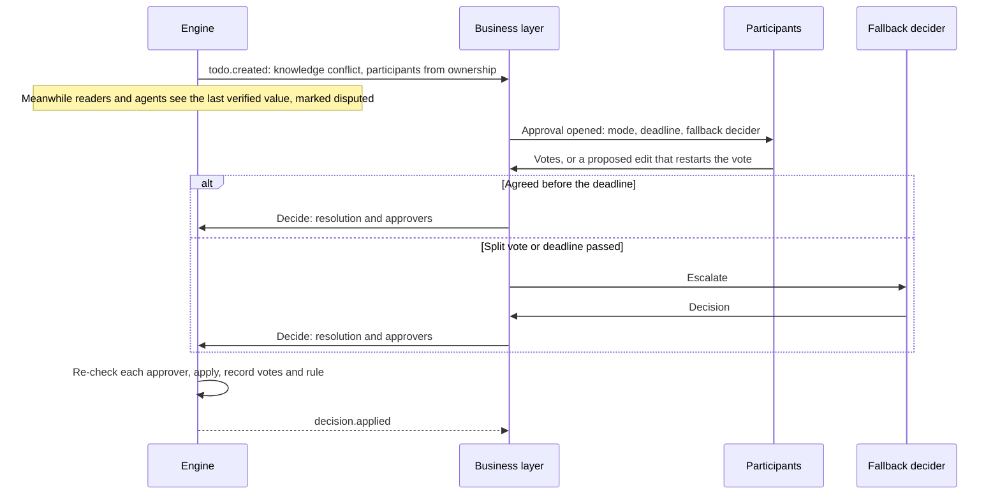
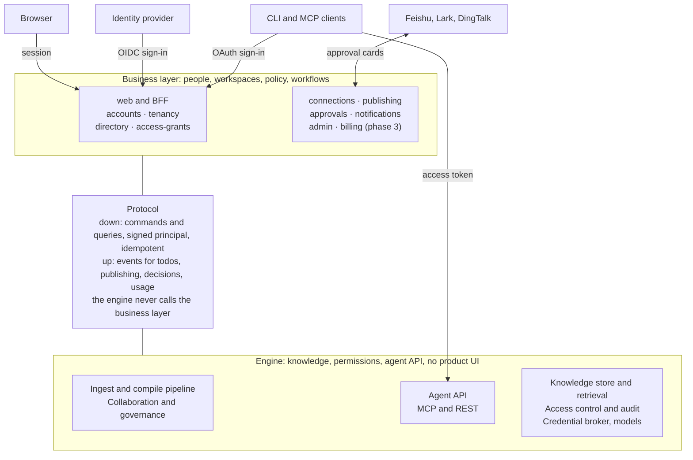

# Business layer: functional design

Status: adopted design, 2026-10-24. The engine contract changes it needs are listed in [Business layer and engine contract](business-engine-contract.md). Chinese copy: [docs/zh/design/business-layer.md](../zh/design/business-layer.md).

## Summary

Inspiration has two layers. The **engine** is headless: knowledge, permission mechanics, and agent-facing APIs (MCP, REST and the CLI). The **business layer** sits above it and owns people, workspaces, policy, approvals, notifications and the web app. The business layer calls engine commands with a signed principal, the engine sends events back, and a nightly reconcile repairs drift. The engine never calls the business layer.

One person has one **user** (the account) and a **member** in each **tenant** they belong to, and all work is tied to the member. This is the usual B2B shape (Notion, Figma and Linear work this way). In the product a tenant is called a **workspace**.

Five points shape the design:

1. **Publishing never crosses a tenant.** Solo use runs in a personal tenant that the product never shows as one. Every member also has a private My space in each tenant they join. Publishing moves work from My space into the tenant's shared spaces. Bringing work from a personal tenant into a company is a separate, explicit transfer.
2. **Two domains, and published knowledge follows the tenant, not the source.** My space belongs to its member alone: nobody else can see into it, the super admin included. Publishing moves knowledge into the tenant domain, where the super admin and space owners decide top down who reads it, and the publisher keeps access. Source permissions are not inherited; they only raise warnings. The price is a risk of oversharing at publish time, so every publish gets checks and an approval.
3. **Companies can keep their data in company control.** An employee could connect company Feishu to a personal tenant. A company claims its Feishu tenant and email domain, then blocks or redirects such connections.
4. **Joint approval always finishes.** Edit conflicts are kept apart from knowledge conflicts, and consensus applies only to knowledge conflicts on governed knowledge. Every approval has a deadline and a fallback decider, and a workspace setting decides what agents see during a dispute. Decisions can become reusable precedence rules, so the same conflict does not come back.
5. **Agent access is managed in the business layer.** It issues OAuth tokens to MCP clients, device-flow tokens to the CLI, and identities to workspace agents. The engine only verifies them.

**Cost.** The business layer prototype is about 16 person-weeks, plus about 4.5 net on the engine side. That takes the plan from about 70 to about 90 person-weeks, with two builders on a parallel business track for 8 to 9 weeks.

## Risks the design addresses

The structure is simple: tenant as the unit of isolation and billing, user above members, member as the actor, bottom-up publishing followed by top-down administration. The risks are almost all at the transitions: personal to team, a member leaving, a credential owner leaving, and a decision that nobody makes.

| # | Risk | Why it matters | How the design handles it |
| --- | --- | --- | --- |
| 1 | "Publish to the tenant" is ambiguous when the work sits in a personal tenant | A tenant is the isolation boundary. Live links across it break permission checks, deletion and billing | Publishing is always inside one tenant. Every member gets a personal space in each tenant. Cross-tenant moves are an explicit transfer that re-creates sources |
| 2 | Published knowledge can reach people the source would not let in | Under the two-domain model, a page built from A's connection is readable by the whole space audience, including people who cannot open the document in Feishu. That is intended, but it makes oversharing easy | Every publish is checked: an audience-gap warning from the source permissions, a sensitivity and personal-data scan, approval by the topic owner or space owner, and an audit record. Documents whose source permissions tighten later are flagged |
| 3 | Personal tenants can pull company data out of company control | An employee connects company Feishu to a personal tenant, outside the company's audit and offboarding | Companies verify their email domain and claim their Feishu tenant. Policy can block such connections, or redirect them into the company tenant |
| 4 | Each company has its own sign-in rules | A company needs its own SSO, MFA and session rules when someone enters its tenant, and must cut access when HR offboards a person | Sign-in policy is per tenant. Entering a tenant may require a fresh sign-in through its SSO. Deprovisioning through SCIM or directory sync suspends the member, not the user |
| 5 | Conflict types are easily mixed together | Two people editing the same block is not the same as two sources disagreeing. Consensus on every edit would stall work | Edits merge live or become override todos. Consensus applies only to knowledge conflicts on published or verified knowledge |
| 6 | A joint approval could stall forever | One absent approver would block the knowledge, while agents keep reading it | Each policy has a mode (single, any, all, quorum), a deadline and a fallback decider: the space owner, or the super admin across spaces. A tenant setting decides what agents see during a dispute |
| 7 | Open access for agents needs an owner | MCP clients, the CLI and workspace agents need tokens, scopes and revocation | The business layer runs the OAuth server and the agent registry. The engine verifies tokens as a resource server |
| 8 | Ownership per statement is too fine to manage | Statements number in the thousands. Nobody will assign them one by one | Owners are named for a space, topic, page or SOP. Statements inherit from the nearest scope, ending at the space owner and then the super admin, so nothing is ever unowned |
| 9 | Owners may not be able to read the evidence | A conflict across spaces can involve a space the owner cannot read, so they would judge half of it | The console warns when an owner cannot read every space in their scope, and such a conflict goes to someone who can, or to the fallback decider |
| 10 | Too many roles, or admin rights that include reading content | A long role list confuses a small team, while some enterprise and government buyers expect separate system, security and audit admins | Three product roles: super admin, owner and member. The super admin sees usage, never content: shared content only through an audited break-glass step, and never a My space. Permissions are finer inside, so a three-admin split can come later as a new bundle of them |
| 11 | Data ownership when someone leaves | Who keeps a departed member's personal-space work, connections and published pages | Published knowledge belongs to the tenant and passes to the space owner. My space stays private: it is locked when the member leaves and erased after the retention period. Their connections are revoked |
| 12 | Model spend needs limits, and one heavy user can use up a team's share | Model calls are the largest variable cost | The tenant is the billing unit. As in mainstream AI products, seats fill one usage pool, and each member has a default cap the super admin can raise. The engine meters usage per tenant, member and space; the super admin sees usage per member, never content. Besides connection policy, limits are the tenant's only say over a member's My space |
| 13 | SaaS and private deployment pull in different directions | Self-serve sign-up and personal tenants are SaaS features, while many enterprise buyers require private deployment | One codebase, two deployment profiles, SaaS first. Public SaaS in mainland China also needs a generative AI filing, an ICP licence and classified protection |
| 14 | Guests from other companies | Suppliers and partners often need one space only | A guest member limited to named spaces, with an expiry. Later phase |

## Core model

A user is the person (the account), a member is that user inside one tenant, and only the member ever reaches the engine. There are three IDs, and they never stand in for each other:

| ID | Prefix | Unique within | Seen by |
| --- | --- | --- | --- |
| Tenant ID | `ten_` | The whole system | Both layers |
| User ID (account ID) | `usr_` | The whole system | Business layer only: never sent to the engine, never in a token |
| Member ID | `mem_` | One tenant. The full key is tenant ID plus member ID | Both layers. The engine's only ID for a person |

**One rule assigns the member ID, in one place.** The tenancy component assigns it when a user joins a tenant. In phase 1 the rule reuses the user ID's body under the member prefix (`usr_01H…` becomes `mem_01H…`). Later the rule can mint a fresh ID per tenant. Only new members get the new form; an existing member ID never changes.

**Nothing may depend on that rule.** Code never derives a member ID from a user ID or the reverse, never parses an ID's body, and finds the user only through the member record. Every key that holds a member ID also holds the tenant ID: database keys, permission objects (the SpiceDB object is `ten_…|mem_…`), caches, audit records and exports. The separate prefixes let the schema and the type checker reject a user ID where a member ID belongs.

While phase 1 reuses the body, anyone holding member IDs can link one person across tenants, including the engine and exported audit logs. That is acceptable at the start. Changing the rule stops it for new members only; unlinking existing members would need a re-keying migration.

| Object | System of record | Key fields | Notes |
| --- | --- | --- | --- |
| User (the account) | Business | `usr_` ID, name, verified email or phone, UI language, time zone, status | One per person. Never sent to the engine |
| Login identity | Business | Provider, subject, verified email | Many per user: email or SMS code, WeChat, Feishu, company SSO |
| Tenant (shown as "workspace") | Business, copied to the engine | `ten_` ID, kind (personal, team, enterprise), plan, region, default language, sign-in policy | The unit of isolation, policy and billing |
| Member | Business; the engine knows only its ID | `mem_` ID, tenant, user, role, status, name and work email in this tenant | Status: invited, active, suspended, left. Every action in a tenant is done by a member |
| Group, department | Business, from the directory, pushed to the engine | `grp_`, `dep_` IDs, members, parent | Used in space audiences and roles |
| External identity link | Business, pushed to the engine | Provider, external ID (for example a Feishu union\_id), member | Maps a source's permission entries to members. Used only for warnings at publish time, never to decide who reads |
| Space | Engine | `spc_` ID, kind (personal, team, org), parent, audience (roles) | A personal space is the member's My space, readable by that member only. The super admin or the space owner sets the audience of every other space |
| Agent identity | Business, pushed to the engine | `agt_` ID, owner member, scopes, spaces, sensitivity limit | See Agent access |

**Two domains in every tenant.** The member domain is each member's My space: only that member can read it, and nobody else, the super admin included, can see into it. The tenant domain is every shared space: the super admin and space owners decide who reads what, top down, by space roles and sensitivity labels. Knowledge enters the tenant domain only by publishing. The engine never merges entities, deduplicates statements or detects conflicts across the boundary, so two members' private knowledge never mixes and nothing private leaks into shared knowledge. A member's own pages may still link to shared knowledge they can read.

**A tenant's say over a member is commercial.** In the tenant domain the tenant gives the member roles. In the member domain it only sets limits: plan, seats, storage and model usage per member, and which connections company policy allows. It never decides what a member's My space contains or who sees it.

**Solo use never shows the tenant.** Sign-up creates a personal tenant with one member, and the product shows no workspace, space or publishing: the person sees their own library, and all of it is their member domain. Collaboration has two ways in. Inviting someone, or turning on collaboration, turns the personal tenant into a team workspace: the workspace layer appears, and existing content stays private in the creator's My space. Creating a team workspace starts a new tenant and leaves the personal one as it was. Either way nothing is shared until it is published. Every member of a team or enterprise workspace has a My space there for drafts, personal connections and experiments.

**Sign-in policy is per tenant.** The user's session is global, but entering a tenant checks that tenant's rules: required SSO connection, MFA, session length, and later an IP allow-list. If the session does not meet them, the person signs in again through the tenant's SSO. Each tenant context then gets its own short-lived engine token.

**Linking identities safely.** Two login identities join one user only when the person completes sign-in with both in one session. An unverified email never links users automatically. A tenant with a verified email domain may allow its SSO to link to an existing user with the same verified address.

**Identity provider.** The business layer keeps its own user, member and tenant records and uses the identity provider only to authenticate, behind an OIDC adapter. It does not use the provider's own organization feature as the tenant record, because tenants also carry policy, plan and engine state. The prototype uses **Logto** (MPL-2.0, OIDC and SAML enterprise SSO, written in TypeScript like the rest of the stack), with **Keycloak** (Apache-2.0, the most mature for SAML and LDAP) as the fallback for LDAP-heavy customers. Both can be self-hosted. For a private deployment, the adapter can point straight at the customer's own identity provider, with no broker in between.

## Lifecycle flows

Every flow ends in an engine command, and none of them widens who can read anything without an explicit publish. Turning a personal library into a team workspace, for example, shares nothing until someone publishes.

| Flow | Trigger | What the person sees | What the engine does |
| --- | --- | --- | --- |
| Sign-up | Sign-in through the identity provider with no user yet | Lands in their own library with "connect a source" and "upload" as first steps. No workspace is shown | Provisions the tenant (kind personal), the person's member, which holds every role, their personal space and default policies |
| Invite | The super admin invites by email, phone or link (link expires after 7 days) | The invitee signs in or signs up, then the workspace appears in the switcher | Adds the member, creates their personal space |
| Join by domain | The tenant has verified its email domain by DNS | People with a verified address in that domain see "Join". Policy picks: join at once, or ask the super admin | Same as invite, after approval if required |
| SSO and directory | First SSO sign-in (just in time), or a SCIM or Feishu contacts push | Nothing to do: the member exists before first sign-in | Adds members, groups, departments and external identity links |
| Personal to team | The person invites someone or turns on collaboration | The workspace layer appears: a name, an admin area, shared spaces. Existing content stays private in their My space | Tenant kind becomes team. Nothing becomes readable by anyone else |
| Create a team workspace | The person creates one from the account menu | A new workspace with them as super admin. Their personal library stays as it was | Provisions a new tenant (kind team), their member and their My space |
| Personal to company | A member chooses "Transfer to workspace" on items in their personal library | Picks items and copy or move. Sources ask for a connection in the target workspace | Exports human-made content (uploads, comments, overrides), re-creates sources in their My space there, recompiles knowledge there. Derived knowledge is rebuilt, never copied |
| Member leaves | Removed by the super admin, deprovisioned by SCIM or directory, or leaves | The scopes they own and their published pages appear as handover todos for the space owner. Their My space is never handed over | Removes their permission tuples, revokes their member connections and agent tokens, pauses team sources kept fresh by those connections, locks their My space so nobody can read it, and erases it after the retention period |
| User deleted | The person deletes their account (a right under China's personal information law, PIPL) | Blocked until they hand over any team workspace where they are the only super admin | Personal tenant is erased (its key destroyed). Their members in other tenants become "left"; contributions stay under a pseudonym if the tenant's policy says so |
| Tenant deleted | The super admin deletes the workspace | 30 days of grace with export, then deletion | Destroys the tenant's data key, drops its data, revokes all its connections. The audit record is kept as the law requires |

Transfer between workspaces is the only flow that moves data across a tenant boundary. In the prototype it covers uploads and pages, and the person reconnects sources by hand.

## Permissions and publishing

The rule: knowledge does not inherit source permissions. A member controls their own knowledge, and published knowledge is governed top down by the tenant. Inheriting would not be reliable anyway: a connection often cannot see who else may open a Feishu document, so B would be blocked from knowledge B is entitled to.

| Domain | Where it lives | Who can read | Who decides |
| --- | --- | --- | --- |
| Member domain | My space, and all of a personal tenant | The member only | The member |
| Tenant domain | Team and org spaces | The space's audience, within each reader's sensitivity clearance. The publisher keeps read and edit access to what they published | The super admin and space owners, top down |

Source permissions still count at two moments, as warnings only. When publishing, the engine compares a source's permissions, where it can read them, with the target space's audience: "9 of 40 Sales members cannot open 3 of these documents in Feishu." After publishing, if a document's permissions tighten in the source, the space owner gets a todo, and a workspace policy chooses between notify (the default) and quarantine, which hides the affected knowledge until the space owner decides.

### How published sources stay fresh

The person always keeps their own credential, and no secret ever changes hands. Since a credential does not decide who reads, the only question at publishing is how each source stays fresh:

| Choice | How it works | When it stops | Use it for |
| --- | --- | --- | --- |
| Keep fresh with the workspace connection (default when one exists) | The source switches to the workspace's app connection. A coverage check first lists what the app can reach, what it cannot and why (for example the app was not added to that wiki space), and what it would add | When the super admin removes the connection | Anything the team relies on |
| Keep fresh with my connection | The publisher's personal connection keeps fetching. The publisher consents on a screen that says the documents it reaches will be shared with the space | When the publisher leaves or the connection breaks. The owner gets a todo to switch to the workspace connection or freeze it | Small teams, and tools that only have personal tokens. Policy can turn it off; it is off by default in an enterprise workspace |
| Publish a snapshot | A frozen copy with no live source. A review date is required | Never refreshes; the owner can upload a new version | Uploads, finished documents, sources nobody can connect |

The source always travels with its knowledge, so readers can trace every statement to its evidence. A source that only the publisher can reach stays fresh through "my connection", and nobody else ever holds that credential.

### The publish flow

1. A selects pages, SOPs, sources or folders in My space and proposes a target space.
2. A chooses how each source stays fresh.
3. The engine checks the request: a sensitivity and personal-data scan that suggests a label, a preview of conflicts with knowledge already published, the coverage difference, and the audience-gap warning.
4. The owner of the target topic approves, or the space owner when no topic is owned. They can change the target space or the label. Submitting the request is the one way into My space: it lets the approvers read the items in the request, and nothing else, until it is decided. The super admin sees the request and its checks in the publish queue but cannot open the items. The super admin can reassign the approver, and on taking over as approver gets the same item-only access, logged.
5. The engine moves the items into the tenant domain. Human work comes along (uploads, edits, overrides, comments). Derived knowledge is rebuilt there and merged with what is already published, and new conflicts become todos. A keeps access to what they published, so nothing disappears for them.
6. From then on the space's audience can read it. The super admin and the space owner change that audience top down, and the source's own permissions play no part.

A source published with a live connection keeps bringing in new documents from the same folder. Each one passes the same sensitivity scan: flagged documents wait for the space owner, and the rest arrive with a weekly digest to the space owner. A workspace policy can require approval for every new document.

### Why merging stays simple

All published knowledge sits under one permission model, so the tenant domain can merge entities, deduplicate statements and find conflicts across every space without splitting a merged page by who can read which source. A reader sees a statement and its citations only from spaces they can read, which is a set lookup over its evidence and derivation inputs, not a walk through source permissions. A's and B's private knowledge is never merged at all until each of them publishes.

### Guard against shadow IT

A personal library lets an employee move company documents outside company control, into a My space that the company's super admin cannot see. Three controls close this:

- **Claims.** When a company installs its Feishu app, the business layer records that this Feishu tenant belongs to that workspace. Verified email domains work the same way.
- **Policy per claim.** Allow connections from anywhere, allow them only inside the company workspace (the default), or require the super admin's approval.
- **Check at connect time.** The business layer runs the OAuth flow. The credential broker exchanges the code and reports the provider's tenant or site ID before the connection becomes active. The business layer checks the claim, then activates or discards it. The engine never needs to know about other tenants.

When a claim is added, existing personal connections to that Feishu tenant are reported to the company's super admin as a count per member, never their content. The members get 30 days to move them.

## Governance

Governance moves from bottom-up to top-down at the moment of publishing: before it, the author decides everything; after it, the super admin and space owners decide who reads it, and owners decide what it says. Machines detect and propose in the engine; people decide in the business layer; the engine applies the decision and keeps its trace.

### Roles

The product has three roles, kept few on purpose while the product is young. Permissions are finer inside, so a role can be split later without new code.

| Role | Scope | Can do | In solo use | In a team or company |
| --- | --- | --- | --- | --- |
| Super admin | Workspace | Members, spaces and their audiences, connections, policies, sensitivity labels and model routing limits, claims on external tenants, audit, agents, plan, billing and usage, deleting the workspace. The last fallback owner, and the fallback decider for conflicts across spaces. Sees usage per member, never content: shared content only through an audited break-glass step, and never a My space | The person | The creator, and anyone they add |
| Owner | A space, topic, page, SOP or model | Approves publishing into the scope, verifies, keeps it current (stale, review-due and conflict todos) and decides its conflicts. A space owner takes anything in the space that has no nearer owner, and decides joint approvals in the space that stall | The person | Named by the super admin, or by the owner of the scope above |
| Member | Workspace | Reads, asks, comments and edits within each space's audience; owns their My space and publishes from it. Guests (later) are members limited to named spaces, with an expiry | The person | Everyone else |

Inside, the engine keeps finer roles: a space grants `viewer`, `commenter`, `editor`, `steward` and `owner`, and topics, pages and SOPs carry an owner. A product role is a bundle of them: a space owner holds the space's `owner` and `steward` roles, and a member gets `viewer`, `commenter` or `editor` from the space's audience. A later preset, such as the separate system, security and audit admins that government and state-owned buyers in China expect, is a new bundle of the same permissions rather than new code.

### Usage

Usage follows mainstream AI products and stays simple until billing is designed. Seats fill one usage pool for the workspace. Each member has a default cap that the super admin can raise for a heavy user, so one person cannot use up the team's share by accident. Work is charged to whoever started it: questions, research, agents and My space upkeep to the member, and upkeep of a shared space to that space. The engine meters model use per workspace, member and space, and checks both the member's cap and the pool before a call; the lower limit wins. The super admin sees usage per member and per kind of work, never what anyone asked, read or researched. Credits per seat, and what happens when the pool runs out, are decided with billing.

### Ownership

Owners are named for scopes, not for single statements: a space, a topic in the taxonomy, a page, an SOP or a model. A statement belongs to the scopes of the pages and SOPs that cite it and of its topic. The owner of anything is the nearest owned scope above it, then the space owner, then the super admin, so nothing is ever unowned. An assignment names one or more owners, a backup, and the approval policy for conflicts in that scope.

An owner must be able to read every space in their scope, or they would judge half a conflict. The console warns when that is not true, and such a conflict goes to the backup or the fallback decider.

### Kinds of conflict

Only knowledge conflicts on published knowledge need more than one person. Everything else stays with one person, so collaboration does not stall. Conflicts among a member's own sources stay in their My space and are theirs alone to settle.

| Kind | Example | Detected by | Decided by | Joint approval |
| --- | --- | --- | --- | --- |
| Edit collision | A and D edit the same paragraph at once | Live co-editing | Merged live in drafts | No |
| Override conflict | A's edit says 500 yuan, the source now says 600 | Freshness engine | The override's author | No |
| Knowledge conflict in one scope | Two sources disagree on a price | Governance agents | That scope's owners | Per policy, default single owner |
| Knowledge conflict across scopes | Finance says X, the Sales SOP says Y | Governance agents | Owners of every affected scope | Yes, default all; after the deadline the space owner decides, or the super admin across spaces |
| Assertion conflict | A comment states a fact that contradicts a verified statement | Comment agent | The scope's owner | Per policy |

### Joint approval

Each approval runs on a policy: a mode (single owner, any one participant, all, or a quorum of n), a deadline, and a fallback decider: the space owner, or the super admin when the conflict crosses spaces. The defaults are single owner within a scope, and all owners across scopes with a 5 working day deadline. Participants vote for one of the resolutions the engine offers (keep A, keep B, both with their scopes made explicit, newest wins) or propose an edit, which becomes a new option and restarts the vote. Agreement sends the decision to the engine. A split vote or a missed deadline goes to the fallback decider. When a participant leaves, their vote is withdrawn and the policy is re-checked.

The engine re-checks that every approver may verify in the scope before it applies the decision. It never trusts the vote count alone.

The engine detects and applies; people decide in the business layer; the fallback decider keeps a disputed fact from staying open forever.

### What readers and agents see during a dispute

A workspace setting decides, because agents keep calling while people vote:

- **Last verified** (default): the last verified value, marked "disputed", with both sides available on request.
- **Both**: both statements, with the conflict marked, so the agent can ask its user.
- **Withhold**: "disputed" with no value, for regulated content.

### Trace and reusable rules

Every decision is stored with the conflict, the options, each vote (who, which option, when, why), and the outcome. Readers see it from the value itself: "Why this value?" shows who agreed and on what. A decision can also produce a **precedence rule**, for example "for prices in Finance, the 2026 price list outranks wiki pages". A rule needs the same approval as the decision that created it. Governance then applies it to new conflicts of the same kind, logs each use, and lists them in a weekly digest to the owners, who can retire it.

## Agent access

The business layer is the OAuth authorization server, and the engine's MCP and REST endpoints are resource servers that only verify tokens. This is the split the [MCP authorization specification (2025-11-25)](https://modelcontextprotocol.io/specification/2025-11-25/basic/authorization) expects: the MCP server publishes protected resource metadata (RFC 9728) naming its authorization server, clients send a resource indicator (RFC 8707), the server rejects tokens issued for any other audience, and it never passes a client's token on.

| Client | How it gets access | What the token carries |
| --- | --- | --- |
| MCP client (Claude, Cursor, an in-house agent) | OAuth with PKCE. Client ID metadata documents first, dynamic registration as a fallback. The consent screen asks which workspace | Member ID, tenant ID, agent identity for that client, scopes, optional space list and sensitivity limit, locale |
| Inspiration CLI | Device authorization flow. A personal access token (expires within 90 days) only for scripts | Same, with the CLI as the client |
| Workspace agent (for example a procurement bot) | The super admin registers it with a space list and scopes | Acts for the calling member where possible. Acting as itself needs explicit grants and is audited as a service |
| Web app | The business layer's own backend, from the session | A short-lived signed principal (see the protocol section) |

Scopes follow the engine's tool effects: `knowledge.read`, `knowledge.propose`, `comments.write`. Effective rights are always the member's rights intersected with the agent's scopes, never the rights of whoever registered the agent. Access tokens live 10 to 15 minutes, and refresh tokens rotate, as the specification requires for public clients. When a member leaves or the super admin revokes a grant, the business layer sends a revocation and the engine refuses that grant for the rest of its token lifetime. The super admin sees every grant per member and can revoke any of them.

## Languages and regions

Inspiration serves English, Chinese and Japanese users from its first release. Most of that work sits in the business layer, because it owns everything people read apart from the knowledge itself.

- **Language per account.** Each account picks a UI language: English, Simplified Chinese or Japanese, with Traditional Chinese to follow. Sign-up takes the default from the browser. The language belongs to the account, not the member, because a person's language does not change from one workspace to the next. A workspace also has a default language for messages sent to many people, such as digests. Dates, times, numbers and name sorting follow the account's locale and time zone.
- **The engine never writes sentences for people.** The principal token carries a `locale` claim, so the engine can choose the language of anything it generates without seeing the account. Events and todos carry a message key and parameters, never display text, and the business layer renders them.
- **No product text in code.** UI strings, emails, notifications and chat cards come from message catalogs in all three languages, with ICU MessageFormat for plurals and variables. A string missing in any language fails the build. Each language takes its words from one glossary, the terms table below.
- **Sign-in pages.** The identity provider's pages follow the account language. Logto ships English, Chinese and Japanese.
- **What people type stays as typed.** Space names, policy text, comments and approval reasons are shown as written, never machine-translated.
- **Chat apps by market.** Feishu and DingTalk serve teams in China. Lark, the international edition of Feishu, has almost the same API on a different host, so the same integration serves Lark teams in Japan and elsewhere. Email and the in-app inbox work everywhere.
- **Region per tenant.** A tenant gets its region when it is created (the provision command carries it), and its data stays in that region. Public SaaS in mainland China needs the filings named in decision 5; a global region serves everyone else.

Knowledge in three languages (parsing, search, extraction, and matching the same fact across languages) belongs to the engine and is out of scope here. On the business track this adds about 0.5 person-weeks to accounts and notifications in phase 1; the web app's string catalogs are part of its 8 person-weeks.

Still open: which regions open first, and whether Slack and Microsoft Teams cards join Feishu and DingTalk in phase 2 (about 0.5 person-weeks each).

## Functional architecture

The business layer is ten components in one TypeScript service plus the web app, with its own database schema. Users are global and cannot live in the tenant-scoped engine store. It shares the contracts package, the event bus library and the test kit with the engine, and talks to the engine only through the protocol in the next section. The web app belongs to the business layer, so the engine has no product UI.

The browser reaches the engine only through the business layer, while the CLI and MCP clients sign in with the business layer and then call the engine's agent API directly with that token.

| Component | Owns | Calls in the engine | Phase |
| --- | --- | --- | --- |
| accounts | Users, login identities, sessions, language and time zone, identity provider adapter, identity linking | None | 1 |
| tenancy | Tenants, members and member ID assignment, invitations, join requests, verified domains, workspace roles, sign-in policy, personal-to-team change, transfers | Tenant and member provisioning | 1 |
| directory | SSO connections, SCIM endpoint, Feishu and Lark contacts sync (DingTalk and WeCom later), groups, departments, external identity links | Directory provisioning. A lease from the credential broker for the Feishu tenant connection | 1 (Feishu), 2 (SCIM) |
| access-grants | OAuth authorization server, client registry, device flow, personal tokens, workspace agents, revocation, signing keys | Agent provisioning, revocations | 1 |
| connections | Connect flows for tenant and member connections, consent to keep published sources fresh with a member connection, claims on external tenants | Credential broker: begin, complete, activate, discard, revoke | 1 (claims in 2) |
| publishing | The publish wizard: target space, how each source stays fresh, coverage check, audience-gap warning, approval routing | Publish requests and their checks (coverage, audience gap, sensitivity, conflicts) | 1 |
| approvals | Multi-party approvals for publishing, conflicts, snapshots and join requests: policy, votes, deadlines, escalation, decision record | Decision commands on todos and publish requests | 1 (single), 2 (joint) |
| notifications | Inbox, email, Feishu, Lark and DingTalk bot cards with approve buttons, digests, preferences, message catalogs | None. Consumes engine events | 1 |
| admin | Space audiences, workspace policies, roles, ownership assignments, audit viewer, usage per member | Policy, ownership, audit and usage APIs | 1 |
| billing | Plans, seats, the workspace usage pool and per-member caps | Budget limits, usage records | 3 |
| web | Product web app and its backend-for-frontend (UI design: [UI principles](ui-principles.md)) | All of the above, as the signed-in member | 1 |

What stays in the engine: everything about knowledge (connectors, sync, parsing, normalization, extraction, freshness, governance agents, page compiler, views, collaboration mechanics such as comments, overrides, todos and the publish state machine), the knowledge store, retrieval, the agent API, access control (SpiceDB, space audiences, the two domains, audit), the model gateway and agent runtime, research, the credential broker and the sandbox. Access control does not do SSO or directory sync, which belong to the business layer; it keeps identity mapping, and only for publish warnings.

## Engine and business protocol

Calls go down, events come up: the business layer sends commands and queries to the engine, and the engine answers and publishes events, but never calls the business layer. That one rule keeps the engine usable on its own through MCP, REST and the CLI, and lets either side be tested against a fake of the other.

### Principles

1. **Authority is split by subject.** The business layer is the authority on people, tenants and policy values. The engine is the authority on knowledge and on every permission check. The engine keeps a copy of whatever it must enforce (members, groups, roles, policies) and never takes the business layer's word on content access.
2. **Every call carries a principal.** User actions carry the member. Provisioning carries a service principal (for example `svc_tenancy`) with a narrow scope such as `provision.directory`.
3. **Commands are idempotent.** Each carries an idempotency key and, for directory objects, a version. Each returns a consistency token (the SpiceDB ZedToken), which the web backend passes on the next read so a newly granted space shows at once.
4. **Contracts live in one place.** JSON Schema in `packages/contracts/schema` stays the source of truth. Business-only types (users, invitations, approvals) go in their own folder that engine packages never import. REST shapes are generated from the schema.

### Identity on each request

The web backend keeps the browser session and, per tenant context, mints a principal token: a JWT signed by the business layer, audience = engine, lifetime at most 5 minutes. It carries the member ID, tenant ID, principal kind, `on_behalf_of` for agents, scopes, space list, sensitivity limit, `locale` (the account's language, for anything the engine generates), and how the session signed in (method, MFA, time). Agent access tokens from the OAuth server use the same claims, so the engine has one verification path, against the business layer's published signing keys. The engine never sees a user ID, a session or an identity provider token. A token's sensitivity limit can only narrow the clearance that access control already holds: the engine uses the lower of the two, never the higher. The sign-in context feeds policy only, for example requiring MFA for super admin commands, and is never treated as identity.

### Commands and queries (business to engine)

| Group | Operations | Called as |
| --- | --- | --- |
| Tenants | Provision (kind, name, region, default language, default policy), suspend, resume, export, delete with grace | Service |
| Directory | Upsert member (status, roles, clearance), group, department; batch identity links; full snapshot reconcile; offboard member (handover target) | Service |
| Agents | Register or update an agent identity (owner, scopes, spaces); revoke a grant | Service |
| Policy | Put the workspace policy document (publish rules, dispute serving, model limits, retention) | Super admin |
| Ownership | Put an ownership assignment for a scope (owners, backup, approval policy) | Super admin, or the owner of the scope above |
| Spaces | Create, move, set the audience (grant and revoke roles) | Super admin or space owner |
| Publishing | Publish checks (coverage, audience gap, sensitivity, conflicts); create a publish request (target space, how each source stays fresh, consent) | The member |
| Decisions | Decide a todo or publish request (resolution, approvers, approval ID, optional precedence rule) | Service, with the approvers listed; the engine re-checks each |
| Connections | Credential broker: begin, complete, activate, discard, revoke | The member or the super admin |
| Usage | Set the tenant pool and per-member caps; read usage per tenant, member, space and period | Service |

Each directory command can be repeated safely. Once a night, and on demand, the business layer sends a full directory snapshot with a version. The engine applies the difference and reports how much drift it fixed, and any drift raises an alert. An hourly digest check (a hash per section) catches drift cheaply in between.

### Events (engine to business)

| Event | Used by | On main today |
| --- | --- | --- |
| `todo.created` | Notifications, approvals (opens joint approvals for conflicts) | Yes |
| `todo.updated` | Inbox state, approvals (withdraws stale approvals) | No |
| `publish_request.updated` | Publishing, notifications | No |
| `unit.published` | Notifications, admin activity | Yes |
| `decision.applied` | Approvals (closes the record with the resolution ID) | No |
| `connection.changed` | Connections, notifications (re-authorize) | No (from the connectors design) |
| `member.offboarded` | Tenancy (marks offboarding complete, lists handovers) | No |
| `usage.recorded` | Admin usage view, billing (hourly per tenant, member, space and budget key) | No |

Only the engine publishes events, so business components appear as consumer groups, listed under external consumers in the engine's component manifest (`components.yaml`). In the prototype they read the engine's Valkey streams with their own groups. A product deployment gets a feed endpoint, so the business layer is not tied to the transport.

The full list of schema changes is in [Business layer and engine contract](business-engine-contract.md).

## Parallel development

The two layers are built in parallel, after about one week of contract work. The dependency runs one way: the engine needs nothing from the business layer at run time except tokens and directory data, and a development token issuer plus a seed command supply both.

### How the two tracks stay apart

1. **Contract v0 (week 1).** Token claims and signing keys, the provisioning commands, the policy and ownership shapes, the decision and publish request shapes, and the new events. The engine track owns the schema changes; the business track reviews them.
2. **Fakes on both sides.** The engine's test kit gains a development token issuer and a seed command (a tenant with members, groups and spaces). The business layer gets an engine fake generated from the REST schema, plus the test kit's in-memory event feed.
3. **Contract tests in CI.** Both sides record request, response and event fixtures and validate them against the JSON Schema on every change, so drift fails a build instead of an integration day.
4. **Integration gates.** Each gate is a script that runs end to end against the real engine:
   - **Week 3:** sign up, land in the personal library, upload a file, read the compiled page; an MCP client signs in with OAuth and searches.
   - **Week 6:** team workspace, invite, member connection, publish kept fresh by the workspace connection and by my connection, the super admin sets the audience, a single-owner conflict decision.
   - **Week 9:** Feishu SSO and contacts sync, a claim on a Feishu tenant, joint approval with a deadline and a fallback decider, a member offboarded with handovers.

### Effort (person-weeks)

| Work | Phase 1 (personal and small team) | Phase 2 (enterprise) |
| --- | --- | --- |
| accounts | 1.5 | 0.5 (sign-in policy per tenant) |
| tenancy | 1.5 | 0.5 (domain join, transfer) |
| directory | 1 (Feishu contacts) | 1 (SCIM) |
| access-grants | 1.5 | 0 |
| connections | 1 | 0.5 (claims) |
| publishing | 1.5 | 0 |
| approvals | 1 (single decider) | 1 (joint, deadlines, fallback deciders) |
| notifications | 1 | 0.5 (chat app cards) |
| admin | 1.5 (space audiences, publish queue) | 0.5 |
| **Business layer** | **11.5** | **4.5** |
| Engine: token verification, service principals | 0.5 | 0 |
| Engine: provisioning, reconcile, offboarding | 1 | 0.5 |
| Engine: policy and ownership | 1 | 0 |
| Engine: publishing into the tenant domain, freshness choice, coverage, audience gap | 1.5 | 0 |
| Engine: two knowledge domains, visibility by space and proof instead of source ACLs | 0.5 | 0 |
| Engine: multi-approver decisions, rules, dispute marker | 0.5 | 0.5 |
| Engine: SSO and directory sync moved out of access control | −1.5 | 0 |
| **Engine, net** | **3.5** | **1** |

The web app is already in the plan (8 person-weeks). Billing is phase 3, about 3 more. Languages add about 0.5 in phase 1 (see Languages and regions). With two builders on the business track, one on identity (accounts, tenancy, access-grants, directory) and one on workflow (connections, publishing, approvals, notifications, admin), phase 1 takes about 6 weeks and phase 2 about 3.

## Terms and screens

The UI says "workspace" for a tenant, "member" for a member and "account" for a user, and never shows "tenant" or IDs. A solo user sees no workspace at all. A single extracted fact is a "statement" in the UI; "claim" stays an engine word. Chinese terms follow what Feishu and DingTalk users already know, including "会签" (all must agree) and "或签" (any one agrees) for approval modes. Japanese terms follow common Japanese business software; the Japanese column is a first draft for a native speaker to review.

| Concept | UI term | 中文 | 日本語 (draft) | Note |
| --- | --- | --- | --- | --- |
| Tenant | Workspace | 企业 | ワークスペース | Never shown for a personal tenant: a solo user sees only their library until they invite someone or create a team workspace |
| Personal tenant | Personal library | 我的知识库 (in the switcher: 个人知识库) | マイライブラリ (in the switcher: 個人ライブラリ) | A solo user sees no workspace words at all |
| Member | Member | 成员 | メンバー |  |
| Personal space in a workspace | My space | 我的空间 | マイスペース | Private to the member. The super admin cannot see into it |
| Team or org space | Space | 空间 | スペース |  |
| Claim | Statement | 陈述 | 記述 | "Claim" stays an engine word |
| Tenant connection | Workspace connection | 企业连接 | ワークスペースの接続 |  |
| Member connection | Personal connection | 个人连接 | 個人の接続 |  |
| Freshness by tenant connection | Keep fresh with the workspace connection | 通过企业连接保持更新 | ワークスペースの接続で最新に保つ | Default when one exists |
| Freshness by member connection | Keep fresh with my connection | 通过我的连接保持更新 | 自分の接続で最新に保つ | Needs the publisher's consent |
| Snapshot | Publish a snapshot | 发布快照 | スナップショットを公開 | Needs a review date |
| Space audience | Who can read this | 可见范围 | 公開範囲 | Set by the super admin or the space owner |
| Audience gap | Some readers can't open the original | 部分读者无法打开原文 | 一部の閲覧者は原文を開けません | A warning, never a block |
| Source permissions tightened; quarantine | Source permissions tightened; Hide the affected knowledge first | 来源权限收紧；先隐藏受影响的知识 | ソースの権限が縮小されました；影響するナレッジを先に非表示にする | Quarantine is a policy option; notify is the default |
| Owner | Owner, shown by scope: Space owner, Topic owner, Page owner, Procedure owner | 负责人：空间负责人、主题负责人、页面负责人、流程负责人 | 担当者：スペース担当者、トピック担当者、ページ担当者、手順担当者 | Replaces steward, freshness owner and arbiter |
| Super admin | Super admin | 超级管理员 | 特権管理者 | Also covers security and audit for now |
| Fallback decider | Decides after the deadline | 截止后决定 | 期限後に決定 | The space owner, or the super admin across spaces |
| Approval modes | Single, Any one, Everyone, At least n | 单人、或签、会签、至少 n 人 | 単独承認、いずれか承認、全員承認、n名以上 |  |
| Disputed value | Disputed | 有争议 | 異論あり |  |
| Precedence rule | Rule | 裁决规则 | 裁定ルール |  |
| Claim on an external tenant | Verified Feishu organization | 已认证飞书企业 | 認証済みの Lark 組織 | Avoid "claim". Shows Lark instead of Feishu for Lark tenants |
| Agent grant | Connected apps | 已授权应用 | 連携済みアプリ |  |

| Screen | Main objects | States and actions |
| --- | --- | --- |
| Sign in, sign up | Login methods allowed by the deployment | Workspace chooser after sign-in, only for people in a team or company workspace; "sign in with company SSO" when a workspace requires it |
| Workspace switcher | Personal library, team and company workspaces | Hidden until the person joins or creates a team workspace. A badge when entering needs a fresh sign-in |
| First run | Empty personal library, no workspace shown | Connect a source, upload, ask a question; later, invite someone or create a team workspace |
| Account settings | Profile, login identities, language, time zone | Choose English, 中文 or 日本語; link or unlink a login identity; sign out everywhere |
| Invite and join | Invitations, join requests, verified domains | Pending, accepted, expired; approve or decline a request |
| Connections | Workspace and personal connections | Pending consent, active, needs re-authorization, suspended, revoked, blocked by company policy |
| Publish wizard | Units, target space, sources | Pick the target space, choose how each source stays fresh (with the coverage difference), see the space's audience and any audience-gap warning, consent when using my connection, submit. Request states: draft, in review, published, retired |
| Inbox | Todos by kind | Open, in progress, done, dismissed; group by batch; approve from the card |
| Conflict resolution | Both statements with evidence, affected pages, options | Participants and their votes, mode, deadline, who decides after it; what readers see meanwhile; "make this a rule". Approval states: open, agreed, split, escalated, decided, withdrawn, expired |
| Why this value? | Resolution record, rule | Who agreed, when, and which rule applied |
| Admin console (super admin) | Members, spaces tree with audiences and owners, publish queue, ownership by topic, policies, workspace default language, verified domains and Feishu or Lark organizations, connected apps, audit log, usage per member and per kind of work | Never shows a My space, or what anyone asked, read or researched |
| Handover | A leaving member's scopes, published pages and connections. Never their My space | Reassign each item, or accept the space owner default |
| Connected apps | A member's agent grants and tokens | Revoke, see last use |

## Decisions

Decisions 1 to 10 were made on 2026-10-24, and 11 and 12 on 2026-10-26.

| # | Question | Decision |
| --- | --- | --- |
| 1 | The split and protocol | Adopted. The web app belongs to the business layer; access control drops SSO and directory sync; the engine makes the contract changes |
| 2 | How personal work reaches a company | A personal library, plus a private My space in every workspace. Publishing stays inside one workspace; moving between workspaces is an explicit transfer |
| 3 | How published sources stay fresh | The workspace connection by default. "My connection" is allowed by default in a team workspace and off by default in an enterprise workspace |
| 4 | When a source's permissions tighten after publishing | Notify the space owner. Quarantine is a workspace policy option |
| 5 | Go-to-market | SaaS first, with private deployment as a second profile of the same code. Public SaaS in mainland China needs a generative AI filing, an ICP licence and classified protection |
| 6 | Default policy for a verified Feishu organization | Personal connections allowed only inside the company workspace |
| 7 | What agents see during a dispute | The last verified value, marked disputed |
| 8 | Identity provider for the prototype | Logto, with Keycloak as the fallback |
| 9 | Budget | About 20 more person-weeks (the plan goes from about 70 to about 90), with two builders on a parallel business track |
| 10 | A member's My space when they leave | Locked so nobody can read it, then erased after the retention period (default 30 days). The member can publish before leaving |
| 11 | Product roles | Three: super admin (who also covers security and audit for now), owner of a space, topic, page or procedure, and member. Finer roles stay inside, and product roles are bundles of them |
| 12 | How usage reaches members | As in mainstream AI products: seats fill a workspace pool, members have a default cap the super admin can raise, and the super admin sees usage but never content. Credits per seat and what happens when the pool runs out come with billing |

The product supports English, Chinese and Japanese; Languages and regions lists what that adds and the two questions still open there.

## Sources

- [MCP authorization specification, 2025-11-25](https://modelcontextprotocol.io/specification/2025-11-25/basic/authorization)
- [Logto repository mirror](https://gitee.com/mirrors/logto)
- [Keycloak 26 organizations (CNCF blog)](https://www.cncf.io/blog/2024/11/13/scalable-authentication-across-organizations-with-keycloak-26/)
- [Business layer and engine contract](business-engine-contract.md)
