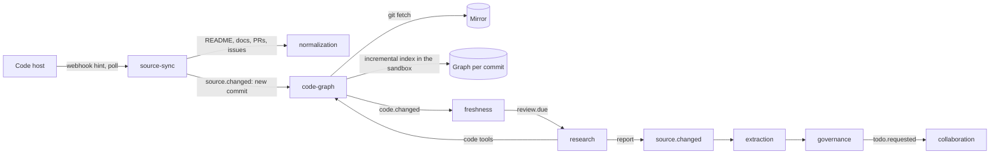

# Code repositories as a knowledge source

Status: proposed, 2026-10-27, for the product owner's decision. This is the third version. It follows the product owner's direction of 2026-10-27: connect the repository, keep a local clone, build a code graph for it with open-source tools, and make it an input of Deep Research, so that code joins the existing knowledge upkeep. Nothing here is built. A Chinese copy is in [docs/zh/design/code-repositories.md](../zh/design/code-repositories.md); if the two differ, this English version wins.

## Summary

**A connected repository is kept as a local mirror with a code graph, and Deep Research reads it the way it reads documents and the web.** The research component runs topic by topic, with read-only code tools over the mirror and the graph. Its reports become sources, and their conclusions become statements under the topic, so code knowledge sits on the same topic pages as Feishu documents and goes through the same governance.

**Knowledge is organized by topic and by code area, not by question.** This answers the product owner's two objections to the second version:

- **Nobody had to ask.** Graph communities and folders are mapped to topics, and each mapped area is researched once when the repository connects. Areas without a topic are listed for the space owner.
- **The links are structural, not fragments.** Evidence is anchored to graph symbols at a commit, and each conclusion that rests on code carries a code assumption naming its symbols.

**Every merge is compared on the graph, without a model.** The mirror fetches the merge and the graph is re-indexed incrementally. The diff of the two graphs gives the changed symbols and their nearest callers. Freshness turns the hits on cited symbols into one `review.due` per affected report a day. Research then re-checks only the conclusions that rest on those symbols. A changed conclusion becomes a new report version, and a disagreement with a document becomes a todo for that document's owner.

**The graph is an open-source tool behind our own interface.** [codebase-memory-mcp](https://github.com/DeusData/codebase-memory-mcp) is recommended first:

- It is MIT-licensed and ships as one C binary with no network access.
- It stores the graph in SQLite and has tree-sitter grammars for 162 languages.
- It resolves types for the main languages, including TypeScript, Python, Go and Java.
- It updates by file hash and diffs graphs between commits.

It runs in the sandbox, behind a `code_indexers` plugin, so it can be replaced.

**The work is about 8.5 person-weeks,** on top of the research component itself. It is feasible at hundreds of merges a day, because per-merge work is a fetch, an incremental index and a diff, and model work is capped per topic and per day.

## The direction, and what it fixes

The second version kept code answers that a coding agent produced on demand. The product owner rejected it on 2026-10-27, for three reasons:

1. **Answers are fragmentary.** Knowledge kept as questions and answers is scattered.
2. **Knowledge nobody asks about does not exist.**
3. **The links are fragmentary too.** The links between upstream changes and individual answers are scattered.

The direction instead: connect the repository; keep a cloned copy locally; build a code graph for it with open-source tools; use it as an input of Deep Research, which then searches the local copy; and make the associations in the research agent, so that code fits into the existing knowledge upkeep.

| Objection | How this version answers it |
| --- | --- |
| Answers are fragments | Research runs per topic under a standing brief, and its conclusions become statements of that topic, next to the statements from documents |
| What nobody asks about does not exist | An initial sweep covers every mapped area; a coverage list shows code areas without a topic and topics without research |
| Updates and answers are linked in fragments | Evidence is anchored to graph symbols; a merge is diffed on the graph, and the affected conclusions are found by their symbols and re-checked together, one run per report a day |

## How it works

### Connection and mirror

- **One integration per code host,** as for every vendor. A typed client serves sync and agent tools, with one scope set and one rate budget per connection. GitHub comes first; GitLab, Gitee or Alibaba Cloud Codeup follow, chosen with the first design partner. A company connection is a GitHub App installation.
- **The mirror is a git clone owned by code-graph.** It sits on an encrypted per-company volume, because git needs a file system rather than the blob store. When source-sync records a new commit on the followed ref, code-graph fetches it with a short lease from the credential broker. That is sync, not an agent run, so the company connection may be used.
  - A very large monorepo is cloned without blobs and fetches the blobs of the followed commit.
  - Hooks never run and submodules are not fetched.
- **The followed ref** is what the company says is live: a release branch or tag, else the default branch. Each fetched commit on it is a version of the repository source.
- **Repository text is an ordinary source.** README files, `docs/`, decision records, and pull requests and issues with their discussions become Reference documents, read on use like uploads. A pull request's links to the issues it closes and to documents Inspiration already holds become links between sources.
- **Disconnecting** erases the mirror and the graphs. Registered evidence quotes stay under the [source changes](source-changes.md) rules.

### The code graph

- **What it holds:** files, modules, classes, functions, routes, configuration keys and environment variables. Edges cover calls, imports, inheritance, HTTP routes to handlers, configuration keys to the code that reads them, and documentation to the code it mentions, plus communities of call edges.
- **Indexing runs in the sandbox** under a new profile, `code_index`. The mirror's worktree is mounted read only, a graph directory is writable, there is no network, and CPU and memory are limited. The binary is pinned by version and checksum. Tree-sitter parses code without running it; indexers that would need a build (SCIP for Java, for example) are not used by default.
- **One graph per indexed commit.** The first index is full. After that, only files whose hash changed are parsed again; the paper behind codebase-memory-mcp reports about 1.2 seconds for an incremental update. Snapshots are compressed into the blob store (zstd, typically 8 to 13 times smaller). The latest snapshot is kept, together with those still named by an open review.
- **Symbol IDs** are the graph's qualified names (`engine/collaboration/src/inbox.ts::INBOX_DEFAULTS`). They do not change when code moves within a file. A rename is matched on the graph and on git's rename detection, and is carried over silently, like a document move.
- **code-graph owns the mirror and the graph,** not retrieval. The graph is to code what normalized blocks are to documents: the structure with stable IDs that evidence is anchored to and that changes are computed on. Its keyword and structure search serves research's tools only. Knowledge derived from code is indexed by retrieval like any other.

### Deep Research over the code

- **Tools.** code-graph provides read-only `agent_tools` plugins. Each call goes through the agent-runtime gate.

  | Tool | What it does |
  | --- | --- |
  | `code_overview` | Areas, packages, routes and hot spots of a repository at a commit |
  | `code_search` | Names, text and structure |
  | `code_read` | A file or a symbol at a commit, with lines |
  | `code_trace` | Callers, callees and paths between symbols |
  | `code_impact` | What a symbol's change reaches |
  | `code_history` | Commits and pull requests that touched a symbol, from the mirror's history and the code host's discussions |

  The head-to-head showed that an agent over plain files answers well. The paper behind codebase-memory-mcp reports that graph queries use about a tenth of the tokens of file-by-file exploration, at about 90% of its answer quality. So research gets both kinds of tool.
- **A standing brief per topic.** "How does the product behave in this topic's areas, with which rules, limits, states and exceptions, since when and why." A run reads the mapped areas, the topic's existing statements and its documents. It writes a report of conclusions, code assumptions and evidence.
- **Code evidence** is a quote from a file at a commit, with path, lines and symbol. It is checked as a verbatim substring of that file before it is stored, and it passes the secret scanner. Discussion evidence is a quote from a pull request or issue.
- **Code assumptions.** Each conclusion that rests on code names the symbols it depends on, as an assumption with the re-check method `code`. This is what ties later merges to conclusions.
- **Disagreements with documents.** A run compares its conclusions with the documents of the same topic. Where they differ, it proposes a drift todo: "The product does X (code at a commit, pull request); the onboarding guide says Y". The todo goes to the document's owner, who can update the document, ask the assistant to open an issue against the code as themselves, or record that both hold in different cases. Separately, governance also finds conflicts between the new statements and document statements in the same fact slot, as usual.
- **A report is a source.** It is stored as an `inspiration.research` source of the topic's space, and extraction turns its conclusions into statements, as for every research report. The topic page shows them in its "How it works today" and "History" sections.

### Associations

| From | To | Made by | Used for |
| --- | --- | --- | --- |
| Code area (community or path pattern) | Topic | Research proposes them from the graph and the knowledge tree; the space owner confirms them, with bulk confirmation | Coverage, the sweep, routing changes to topics |
| Conclusion | Symbols at a commit | The research run, as a code assumption | Finding the conclusions a merge affects |
| Evidence | File, lines, symbol, commit | The research run | Citations; "code changed since" on a citation |
| Merged pull request | Issues it closes; documents it links | The connector | History, and links between sources |
| Repository document | Symbols it mentions | The graph's documentation-to-code edges | Showing which repository documents a change makes stale |

### Keeping knowledge current at every merge

1. **A push to the followed ref** arrives as a webhook hint, or a poll finds it. source-sync records the new commit as a version of the repository source, and code-graph fetches it into the mirror.
2. **code-graph indexes the new commit incrementally** and compares the graph with the last indexed one. It publishes `code.changed`, which lists the changed, added, removed and renamed symbols, and the impacted symbols: direct callers and readers of a changed symbol, up to a depth the company can set (1 by default).
3. **Freshness looks up the code assumptions** that name those symbols. It collects them per report over a day, and emits one `review.due` of kind `evidence_changed` per affected report, with the symbols as causes. Freshness decides when; research decides how, as already settled for research.
4. **Research re-checks only the affected conclusions.** It gets the old conclusions, the diff of the named symbols and the code tools. If nothing changed, it records the re-check on the new commit. If a conclusion changed, it writes a new report version, and the usual pipeline supersedes the old statements.
5. **People see a todo only when something changed.** A changed conclusion that a page or governed topic relies on goes to the topic's owner. A new disagreement with a document goes to the document's owner. A release that changes many conclusions becomes one change review, under the existing rule.
6. **A daily budget per repository** caps re-check runs. Beyond it, reports wait for the next day, oldest change first, and their citations show "code changed since".

Changes in unmapped areas trigger nothing. They are counted on the coverage list, so the space owner sees code that no topic covers.

### Knowledge nobody asked for

- **The initial sweep.** After the area mapping is confirmed, research runs the brief once for each mapped topic. A space owner can start it area by area to spread the cost.
- **Coverage list,** on the space owner's notes card:
  - code areas with no topic;
  - topics with mapped areas but no research;
  - areas whose research is older than a set age.
- **Questions in the assistant.** A question about how the product behaves is first answered from the topic's statements. When they do not cover it, the assistant offers to research it. The run attaches to the topic as part of its research, never as a loose answer.

### Permissions and secrets

- **The rules do not change.** The repository is published to a space, usually Engineering, whose audience reads what research derived from it. The code host's readers only feed the audience-gap warning ("12 people can read this repository; this space has 400 readers").
- **Agents never hold a token.** Research reads the mirror only through code-graph's tools, within the permissions of the member or space it runs for. A company connection is never leased to an agent run.
- **Wider audiences** read released statements. The space owner releases statements under the per-statement release of [Permissions in compiled knowledge](compiled-knowledge-permissions.md), without code quotes where code is restricted. Readers then see "Source: code in repository X (engineering only)".
- **Secrets.** Code evidence passes a secret scanner before it is stored, and the graph stores the names of environment variables but never their values. Code evidence carries the `confidential` label by default, so the model gateway sends it only to providers cleared for it.
- **Isolation.** Mirrors, graphs and sandboxes are per company and never shared.

### What people see

| Where | What appears |
| --- | --- |
| Documents tree | The repository with its documents, Pull requests and Issues, and its code areas with their topics |
| Knowledge view | Topic pages whose "How it works today" and "History" sections cite code at a commit and the discussion behind it |
| Citation popover | File, lines, commit, "Open in GitHub", and "code changed since" when it did; or "code in repository X" without a quote |
| Inbox | Drift todos, changed conclusions, change reviews for large releases, and the coverage list on the notes card |
| Agent API | The same tools as for all knowledge ([architecture](../architecture.md#models-and-agents)); code knowledge is found like any other knowledge |

## Choosing the code graph

| Tool | Licence | What it is | Fit |
| --- | --- | --- | --- |
| [codebase-memory-mcp](https://github.com/DeusData/codebase-memory-mcp) | MIT; vendored parts MIT, BSD, public domain; bundled code embedding model Apache-2.0 | One C binary, SQLite, 162 grammars, type resolution for the main languages, routes, configuration keys, documentation-to-code edges, communities, graph diff between commits, CLI and MCP, no network access | **Recommended first.** Runs in the sandbox as is; fits private deployment and arm64 |
| [CodeGraphContext](https://github.com/CodeGraphContext/CodeGraphContext) | MIT | Python, with an embedded or server graph database | Second choice; more to operate |
| CodeGraph | MIT | Rust engine, SQLite | Telemetry is on by default; younger |
| SCIP indexers (Sourcegraph) | Apache-2.0 | Precise per-language indexes | Precise, but needs a build per language, so code runs; later, per language, if precision demands it |
| GitNexus | PolyForm Noncommercial 1.0.0 | Graph with impact queries | Ruled out: no commercial use |
| Code Wiki, DeepWiki | Hosted services | Generated wikis | Not a source: generated prose, not evidence |

The backend sits behind a `code_indexers` plugin with a `CodeGraph` interface in the contracts, so a second backend can replace it per language or per customer. Licences and the first two tools' details were read on 2026-10-27 from their repositories and package registries. A review of 17 tools ([rywalker.com](https://rywalker.com/research/code-intelligence-tools)) and one of five ([ai.dosa.dev](https://ai.dosa.dev/blog/code-knowledge-graph-tools-ai-coding-agents)) agree on these licences. codebase-memory-mcp is a young project from one company that changes quickly; version 0.11 changed its index format. So the version is pinned, and an upgrade is a full re-index checked by the validation set.

## Cost at many merges a day

### Per merge, no model

| Work | Cost |
| --- | --- |
| Fetch the merge into the mirror | One incremental `git fetch` |
| Index the changed files | Seconds of CPU in the sandbox |
| Diff the graphs and look up code assumptions | Database lookups |
| Store the merged pull request's text | Embedding a few thousand tokens |

### With a model

| Work | When | Cost |
| --- | --- | --- |
| Area-to-topic proposals | Once, then for new areas | One run per repository, in the hundreds of thousands of tokens on a large one |
| Initial sweep | Once per mapped topic | One research run per topic; estimated at about twice a single question, about 150,000 tokens |
| Re-check | At most once a day per affected report | One run given the old conclusions and the diff, estimated at 30,000 to 60,000 tokens |
| A new question not covered by a topic | When asked | One research run; in the head-to-head a question took a median of about 76,000 tokens and 76 seconds without graph tools |

### A large repository, worked through

These are assumptions, not measurements:

- 300 merges a day, about 30 changed symbols per merge, in a repository of 200,000 symbols;
- 100 topics whose research cites 40 symbols each, so 4,000 cited symbols in all.

- **Per merge:** 300 fetches, incremental indexes and diffs a day, plus about a million tokens of embeddings for the pull requests' text.
- **Hits:** with depth-1 callers counted at about three times the direct changes, a merge touches 90 × 4,000 / 200,000 ≈ 1.8 cited symbols. That is about 540 hits a day, falling on a few dozen reports, because changes cluster in hot areas. At an assumed 40 reports a day and 50,000 tokens a run, re-checks come to about 2 million tokens a day, under the daily budget.
- **The sweep:** about 100 × 150,000 = 15 million tokens once, spread over days if wanted.
- **For comparison:** compiling the changed files into knowledge on every merge would re-read 2 to 21 million tokens a day before writing anything (measured on this repository's commits, scaled to 300 merges). Here, the per-merge work uses no model at all.
- **People:** todos arise only when a conclusion changes or a document disagrees, within the weekly budget of 10 cards per owner.

So the model cost follows the number of topics and how often their code really changes, not the merge rate, and a company caps it with the daily budget.

## Evidence so far

- **The head-to-head of 2026-10-26** ([examples/code-questions](../../examples/code-questions/answers.md)):
  - Setup: a fresh coding agent over a clean clone of this repository at 4d5ea00, with read access to pull request discussions.
  - It answered all eight designer-style questions correctly and completely, at a median of 76,391 tokens and 76 seconds. Answers whose reasons lived only in a pull request comment needed the code host's discussions.
  - It found eight disagreements between documents and code, or rules that no document states. Three are worth fixing now:
    - The overview marks the 15-minute poll "Built", but no timer exists.
    - The overview names only "urgent" todos as the exception to the inbox budget.
    - Done todos still take room on cards.

  This is the quality bar for research over the mirror. The same eight questions are the first validation set.
- **Published numbers for codebase-memory-mcp,** from its paper and README, measured on an Apple M3 Pro, not by us:
  - Django: indexed in about 6 seconds, 49,000 nodes.
  - The Linux kernel: indexed in about 3 minutes, 4.8 million nodes.
  - About 10 times fewer tokens than file-by-file exploration, at 0.83 against 0.92 answer quality.
  - Named limits: static structure only, no reflection or dynamic dispatch, and macros are missing from the parse.
- **Not yet measured:** the graph on this repository. This environment does not allow building or running downloaded code, so the first step of stage 2 indexes this repository in the sandbox. It measures index time, graph size, the incremental update per commit, and whether the diff of each later commit flags exactly the conclusions it should.

## How this design got here

| Version | Idea | Why it changed |
| --- | --- | --- |
| 1 (PR #21) | Read behavior statements from code literals into fact slots; compile feature pages | The head-to-head: literal mapping caught at most 2 of 7 real code findings, and the per-merge cost follows the merge rate |
| 2 (PR #22) | Answers produced on demand by a coding agent, kept, watched and shared | The product owner: answers are fragments, what nobody asks about does not exist, and links from changes to answers are fragmented |
| 3 (this) | A mirror and code graph as an input of Deep Research, organized by topic and area | — |

What carried over: repository text as Reference sources, commits as versions, the code tools, code evidence, drift todos to document owners, the secret scanner, the permission rules, and the daily budget.

## What we do not build

- **A graph or wiki for people to browse.** The graph is research's instrument. People read topic pages; engineers keep their own code tools.
- **Our own parser or graph engine.** We wrap an open-source one.
- **Precompiled pages from code without research.** Every sentence about code comes from a research report with evidence.
- **Machine-written wikis as sources** (Code Wiki, DeepWiki). They would count as support for themselves.
- **A proxy that serves raw code to external coding agents.** They use their code host; the verified rules of a topic can be exported to them as an Agent Skill.
- **Writing to repositories on our own.** An issue is opened only when a person deciding a drift todo asks for it, as themselves.

## Validation

1. **This repository first, mocked end to end:**
   - Index the repository in the sandbox, and map areas to topics.
   - Run the brief for the inbox and source-sync topics, with model calls mocked, so the pipeline is measured, not model quality.
   - Replay the commits after 4d5ea00. Measure whether each commit flags exactly the conclusions it should, the index time per commit, and the graph size.
2. **The eight questions with real models,** answered from the topic pages after the sweep, against the head-to-head's answers, tokens and time.
3. **A larger repository,** chosen with the product owner, with long pull request history, thin documents and more than one language. It measures the sweep's cost, re-checks a day, and the precision of drift todos against the bar of at least half that applies to conflicts.
4. **A design partner's repository in the pilot,** read only.

## Stages and effort

| Stage | Delivers | Main work | Person-weeks |
| --- | --- | --- | --- |
| 1. Connection, mirror and repository text | The repository as a source; README, `docs/`, pull requests and issues as Reference documents | GitHub connector (App and OAuth through the credential broker, webhooks, followed ref, compares, renames), the mirror and its fetches, pull request and issue items, links between sources | 2.5 |
| 2. Code graph | A graph per commit and its diff | The code-graph component, the `code_index` sandbox profile, the codebase-memory-mcp backend behind `code_indexers`, the `CodeGraph` read API, snapshots, `code.changed` | 2 |
| 3. Deep Research over code | Topic research from code, with code evidence and assumptions | The code tools, verbatim checks of code evidence, symbol anchors, area-to-topic proposals and confirmation, the brief and the sweep, mocks for the research tasks | 2.5 |
| 4. Keeping it current | Re-checks per merge, drift todos, the coverage list | The freshness rule from `code.changed` to `review.due` with the daily batch and budget, re-checking affected conclusions only, carrying renames over, drift todos, the coverage list | 1.5 |
| **Total** | | | **about 8.5** |

Stages 3 and 4 build on the research component (planned, about 2.5 person-weeks in the overall plan). GitLab self-managed adds about 1.5 person-weeks. Stages 1 and 2 can run on this repository before the credential broker, with a deployment token, as the probe on real content.

## Contract changes

All additive; see [contracts.md](../contracts.md).

- `SourceItemKind` gains `change_request` (a pull or merge request) and `issue`.
- `SourceVersion` gains optional `commit { sha, ref, committed_at, reached_ref_at }`.
- `ResearchEvidence` gains optional `code { repository, commit, path, start_line, end_line, symbol }`.
- `RecheckMethod` gains `code`: the target is a list of symbol IDs, re-checked when a merge changes them.
- A new event `code.changed { source_id, from_commit, to_commit, changed, added, removed, renamed, impacted }`, published by code-graph and consumed by freshness.
- A new `CodeArea { source_id, id, paths, community, topic_id, confirmed_by }` for the area-to-topic mapping.
- `TodoKind` gains `drift`: a document and the code disagree.
- A new `SourceLink { from, to, kind: closes | references }` between source items.
- A new `CodeGraph` interface in `interfaces.ts`, and a new plugin group `code_indexers` in the kernel.

## Risks and open points

| Risk | Mitigation |
| --- | --- |
| A static graph misses runtime behavior (reflection, dependency injection, feature flags, configuration read at run time) | Research reads code as well as the graph; impact depth is configurable; a conclusion records which symbols it rests on, so a miss shows as a missing assumption in the validation |
| Graph accuracy differs by language | Type resolution covers the main languages; the validation set runs per language; SCIP per language where precision demands it |
| The backend is young and changes fast | Pinned version, an interface of our own, a second backend ready (CodeGraphContext), and a full re-index on upgrade |
| Communities are not product features | Area-to-topic mappings are proposals that the space owner confirms; path patterns override communities |
| The sweep costs a lot on large repositories | Only confirmed areas; started area by area; budgeted |
| Customers will not send code to a SaaS | Stage 1 reads only text; code stays in the company's mirror and only cited spans are stored; the `confidential` label routes model calls; private deployment, where the single binary helps |
| Mirrors take disk space | One mirror per repository and company; blobless clones for monorepos; old graph snapshots dropped once no review names them |
| Self-hosted GitLab cannot be reached from SaaS | GitHub, Gitee and Codeup first; private deployment or an outbound-only relay (not designed) |

## Decisions for the product owner

1. **The design:** a mirror and code graph as an input of Deep Research, organized by topic and code area, with code knowledge maintained through the existing upkeep.
2. **The graph backend:** codebase-memory-mcp first behind our own interface (recommended), CodeGraphContext, or SCIP per language.
3. **Order:** stages 1 and 2 now on this repository as a probe, then research when its component is built (recommended); or everything after the credential broker and the research component.
4. **Two defaults:** re-check affected reports at most once a day (recommended) rather than on every merge; the sweep runs only for areas the space owner confirms (recommended) rather than for the whole repository.

## Terms

| Concept | UI term | 中文 | 日本語 (draft) |
| --- | --- | --- | --- |
| Code repository | Repository | 代码仓库 | リポジトリ |
| Followed ref | Followed branch | 跟踪分支 | 追跡ブランチ |
| Pull request | Pull request | 合并请求 | プルリクエスト |
| Code graph | Code map | 代码图谱 | コードマップ |
| Code area | Code area | 代码区域 | コード領域 |
| Code changed since | Code changed since | 代码已更新 | コードが更新されました |
| Drift | Documents and product disagree | 文档与产品不一致 | 文書と製品の不一致 |
| Coverage list | Not covered yet | 尚未覆盖 | 未カバー |
