# Inspiration: product requirements and technical architecture

Version 2, as of 2026-10-27. This document replaces the first product and technical overview and folds in every discussion on it. Part I is the product requirements: who Inspiration is for, the scenarios it must handle and what it must do. Part II is the technical architecture: how it is built, and how we know the hard parts can work. Part III is the plan: where we are, what comes next, the risks and the decisions. Every requirement and component says whether it is built, designed, proposed or still open. The design documents listed at the end hold the details. A Chinese copy is in [zh/overview.md](zh/overview.md); if the two differ, this English version wins.

| If you want to know | Read |
| --- | --- |
| What the product is and why it should exist | 1 Summary, 2 The problem |
| Who uses it and what they do with it | 3 Key concepts, 4 Users and roles, 5 Scenarios |
| What exactly must be built | 6 Functional requirements, 7 Quality requirements, 8 Releases |
| How it works | 9 to 20 |
| Whether the hard parts can work | 21 Feasibility |
| What happens next, and what needs a decision | 23 to 27 |

## 1. Summary

**Inspiration turns a company's scattered documents, approval flows and research into governed knowledge.** Every statement keeps its exact evidence, stays current as its sources change, has a person who maintains it, and reaches people as readable pages and agents through MCP, each within their own permissions.

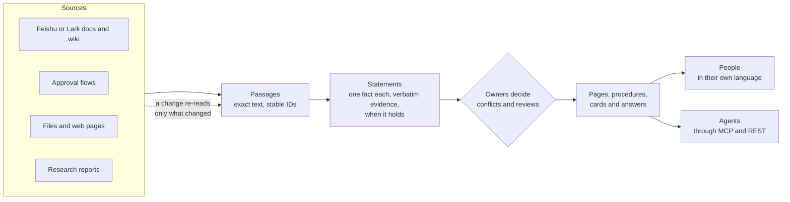

*Figure 1. The knowledge lifecycle. Sources are read into passages, passages into statements, people settle what the statements disagree on, and everything people and agents read is built from statements. A change in a source flows through only as far as it matters.*

Four bets set Inspiration apart, each answering a failure of today's tools:

1. **Knowledge is stored as single statements, not as documents or chunks.** Each fact is stored once, with a verbatim quote from its source, the time it holds and the time the system learned it. Pages, procedures and answers are built from statements, so every sentence can be traced. A question such as "may I book a 650-yuan hotel in Shenzhen?" needs the one value in force and its source, not five passages from five versions.
2. **Freshness works like a build system.** A change re-reads only the passages that changed, updates only the statements they support, and rebuilds only what cites them. Policies change all the time; reading everything again is too slow and too costly, and asking a person about every change floods them.
3. **People decide, in amounts they can keep up with.** Agents detect, propose and answer; people decide. Most sources are never governed statement by statement, and reviews arrive grouped per topic and week, within a weekly budget. A governance product that floods its owners is abandoned within weeks.
4. **Knowledge moves from personal to shared under one rule.** Each member's My space is private. Publishing moves knowledge into a shared space, whose owner decides who reads it. Source permissions only warn. Permission arithmetic across merged sources cannot be done reliably, and the company, not each source app, should decide who reads company knowledge.

**Who it is for.** Teams and companies whose knowledge lives across several tools (Feishu or Lark, Confluence, approval systems, file shares, PDFs). It starts with one person's library and grows into teams and companies. The strongest early uses are governing procedures and policies across tools, and a governed knowledge endpoint for a company's own agents. It is sold as SaaS first, with private deployment as a second profile of the same code. English, Chinese and Japanese are supported from the first release, as one knowledge base: knowledge is language-neutral, and language is only how it is expressed.

**Where it stands.** The engine runs end to end on a mocked model through seven stages: ingest, extraction, governance, freshness, governance levels, topics and the inbox, all merged on `main`, and its language rules live in resource files. Pages, search, the agent API, the business layer and the UI are designed but not built. Real models are switched on once the mocked pipeline covers every stage.

**What is new in this version.** It is written as a PRD plus an architecture, with scenarios that say why each design exists and a feasibility section that says what is proven and what is not. It also takes in the decisions and proposals from the discussions since the first version:

- The super admin runs the company and owners run knowledge, with a sharper line between them; the Chinese name for owners becomes 维护人 (proposed, section 4).
- Compiled knowledge is written for its audience and never cut per reader; an omission that changes the meaning goes to a person (proposed, section 15).
- Anyone who holds a credential to a source may import from it; personal connections are no longer blocked by email domain or Feishu organization (decided, section 17).
- Agents running on their own only read or propose; a member's explicit request is the approval for an edit under that member's own rights (decided, section 18).
- The agent tools: four shaped by what an agent is doing and one for feedback, with inputs, outputs and permissions (proposed, section 18).

## Part I. Product requirements

## 2. The problem

Take Qinghe Technology (青禾科技), the fictional company in our demo corpus. Its rules for business travel live in six places:

| Where | What it says about a hotel in a tier-1 city such as Shenzhen |
| --- | --- |
| Travel expense policy, Finance policy library | 600 yuan a night |
| Forwarded copy of the policy, HR folder | 600 yuan a night |
| Onboarding guide, team wiki | 600 yuan a night |
| Minutes of the September business meeting | 650 yuan a night from 2026-10-01, and Finance is to revise the policy |
| Notice on tier-1 hotel rates | 650 yuan a night from 2026-10-01 |
| Archived 2023 edition of the policy | 500 yuan a night |

The same company has three more planted disagreements: the meal allowance, the first-year leave (the onboarding guide says 7 days, the HR policy 5) and a budget deadline that only the meeting minutes moved. This is ordinary. What goes wrong today:

1. **Nobody can tell which value holds.** Search returns all six documents. The reader has to work out that the notice changed the policy on 2026-10-01.
2. **Assistants answer with confidence from whatever ranks first.** A chat assistant over chunks may quote the 2023 edition, or the copy in HR's folder.
3. **Nobody maintains a fact.** Documents have authors, but a fact restated in six documents has no one responsible for it.
4. **Changes do not propagate.** When Finance revises the policy, nobody updates the HR copy, the onboarding guide or the FAQ.
5. **Agents need the same answers, within the same permissions, in a token budget.** A procurement bot in Feishu or a coding agent needs the current procedure, with its sources, for the person it acts for.

How existing approaches handle this:

| Approach | Good at | Falls short when |
| --- | --- | --- |
| Knowledge bases inside one suite (Feishu wiki, Confluence) and their assistants | Writing and organizing pages inside that suite | Knowledge spans several tools; answers come from pages, not from facts that someone maintains |
| Enterprise search and retrieval over chunks (RAG) | Finding passages across tools quickly | Passages disagree: nothing decides which value holds or notices a stale copy |
| Verified knowledge cards | An owner vouches for a card on a schedule | Cards are written by hand, apart from their sources, and age silently between reviews |
| Inspiration | Statements tied to their sources across tools, a maintainer per scope, change propagation, one governed endpoint for people and agents | Extraction quality is still to be proven with real models (section 21) |

## 3. Key concepts

These words are used throughout. The engine uses a few more precise ones, which section 12 lists.

| Concept | What it is |
| --- | --- |
| Company | One business or team using Inspiration. It is the unit of isolation and billing. Someone working alone has a personal library instead and never sees a company |
| Space, My space | A space is an area of a company with an audience, such as Finance or Procurement. Each member also has a private My space in every company |
| Source | A connected app or folder, such as one Feishu wiki space, an upload folder or a research report |
| Passage | An exact piece of a source: a sentence, a table cell, a form field. Every citation points at one |
| Statement | One fact with its verbatim evidence, the time it holds, a status and a knowledge class (policy, pricing, process and so on) |
| Fact slot | All statements about one single-valued fact ("hotel cap, tier-1 city, managers and below"). Conflicts live inside one slot |
| Governance level | Per source or folder: Governed (fully read and maintained), Reference (read only where it touches a known fact or is cited) or Search only |
| Topic | A place in the knowledge outline (area, topic, subtopic). Every governed statement is filed under one |
| Page, procedure, card | What readers read, built only from statements: knowledge pages, procedures (SOPs) and cards about one thing, such as a city or a supplier |
| Todo, inbox | A todo asks a person to decide or review something. Todos arrive in one inbox, grouped into weekly cards |
| Owner | The person who maintains a scope: a space, topic, page or procedure. Always named with the scope, such as topic owner |
| Super admin | The person who runs the company: people, connections, settings, usage and audit |

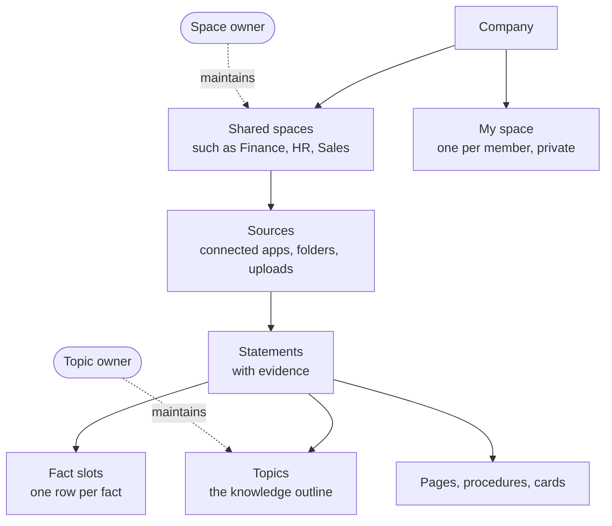

*Figure 2. How the concepts fit. Sources belong to spaces; statements come from sources; slots, topics and pages organize statements; owners maintain spaces and topics.*

## 4. Users and roles

Most people only read. The product is built so that readers see a normal document and never the knowledge machinery behind it.

| Who | Main jobs | What they see |
| --- | --- | --- |
| Member | Read, ask, comment, keep material in My space, publish from it | Pages with small citation numbers. Only two marks appear in the text: Outdated and Disputed |
| Owner of a space, topic, page or procedure | Approve what is published into the scope, keep it current, decide its conflicts, release statements to wider audiences. A space owner also sets who reads the space and its governance levels | Their inbox, and the Trace view of statements, sources and lineage. A space owner also sees the space's backlog and first-review campaigns |
| Super admin | Members and seats, connections, company settings, sensitivity labels and clearances, audit, agents, plan and usage. Creates spaces and names their owners | The admin console, with usage per member. Never anyone's My space, and never what anyone asked, read or researched |
| Agent developer (a member) | Connect agents through MCP or REST | Connected apps, scopes and audit |
| Someone working alone | Everything above for their own library | No company, spaces, members or publishing |
| An agent | Acts for one member, with that member's rights cut down to its scopes | The same knowledge the member could read, through tools |

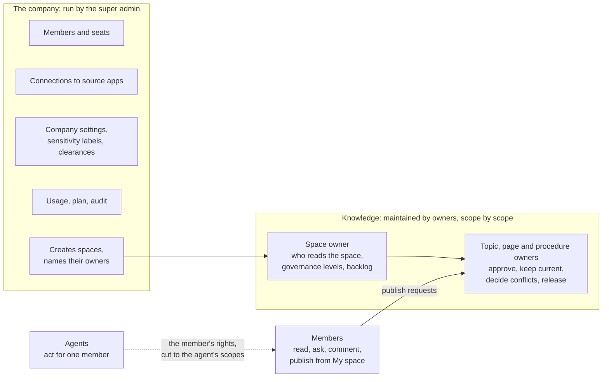

*Figure 3. The super admin runs the company; owners maintain knowledge. The only link between the two sides is that the super admin names each space's owner.*

**The boundary between the super admin and owners** (proposed 2026-10-26, waiting for the product owner's confirmation):

- **The super admin decides who and how, never what.** Who is in the company, which apps are connected, what the company settings and sensitivity labels are, what it uses and pays. The super admin never decides what a statement says or which value holds.
- **Owners decide what knowledge says and who reads it.** They approve publishing, keep their scope current, decide conflicts and release statements to wider audiences. A space owner sets the space's audience and governance levels.
- **Every shared space always has an owner.** The super admin names one when creating the space, and names a new one before the last one leaves. Topics, pages and procedures without an owner fall to the nearest owner above, ending at the space owner, so nothing is ever unowned.
- **Where nobody would decide, the super admin names someone; they do not decide themselves.** A conflict across spaces that passes its deadline goes to an owner the super admin names for cross-space decisions. Until one is named, the value stays marked Disputed.
- **One safety lever stays with the super admin.** In a security incident the super admin can narrow any space's audience at once, which is audited. Widening an audience is always the space owner's call.
- **One person can hold both roles.** In a small team the super admin is often also a space owner; the two roles still act separately and are audited separately. Someone working alone holds all three.

**Names.** In English the role is Owner, always with its scope: Space owner, Topic owner, Page owner, Procedure owner. In Chinese it becomes 维护人 (空间维护人, 主题维护人, 页面维护人, 流程维护人) instead of 负责人, because 负责人 reads as "the person in charge" and blurs into 管理员; 维护 belongs to knowledge as 管理 belongs to the company, and 文档维护人 is a familiar phrase. The Japanese drafts are スペース担当者 and so on.

**Product roles are bundles of internal roles.** Inside, permissions are finer: a space has the internal roles `viewer`, `commenter`, `editor`, `steward` and `owner`, and topics and pages have owners. The super admin holds the company-level internal roles `owner`, `admin`, `security_admin` and `auditor` together. A later preset, such as the separate system, security and audit admins some Chinese buyers require, is a new bundle, not new code.

## 5. Scenarios

Each scenario says what happens, why the product works that way, and how far it is built. Together they cover every major feature.

### 5.1 A member asks a question

A sales manager asks: "May I book a 700-yuan hotel in Shenzhen next week?" The answer comes in the asker's language: "No. The cap for tier-1 cities is 650 yuan a night from 2026-10-01 [1], raised from 600 [2]." Citation 1 opens the notice beside the answer at the exact passage; citation 2 opens the policy. The HR copy, the onboarding guide and the 2023 edition are not cited, because their statements are superseded or are copies.

- **Why.** The hotel cap is one fact slot holding every value over time, so the answer takes the value in force on the travel date, with its evidence. Retrieval over chunks would return all six documents and leave the reader to sort them out.
- **What the reader sees.** A plain answer and a page with small citation numbers. Only Outdated and Disputed appear in the text; Review due appears in the citation popover. If relevant material sits in a space the asker cannot read, the answer says it may be incomplete and whom to ask (section 15).
- **State.** Statements, slots and the proposal of 650 are built and run on the demo corpus. Retrieval, answers and the reading UI are designed.

### 5.2 A policy changes

Finance publishes the revised travel policy (version 4) with the new cap and 40 other changes.

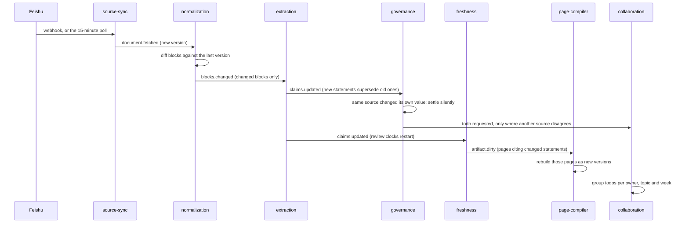

*Figure 4. A change flows through only as far as it matters. Each arrow is an event; nothing re-reads an unchanged block.*

- **What happens.** Only the changed blocks are read again. A value the policy changed itself is a correction, so it syncs silently and the Trace view keeps the history. Copies that now disagree (the HR copy, the onboarding guide) produce reviews that ride on one card. Because 41 changes from one cause would flood the topic owner, they become one change review: what happened, grouped by topic, with bulk actions such as "follow the source everywhere".
- **Why.** A source correcting itself is not a conflict; only sources that disagree need a person. A cause that would produce more than 20 todos or touch more than 3 topics is reviewed once, as a whole, with a record per item.
- **State.** Block diff, incremental extraction, silent self-correction and review clocks are built. In the measured edit round, 1 of 175 source updates asked a person anything. Change reviews and page rebuilds are designed.

### 5.3 Two departments disagree

Finance's policy says the tier-1 cap is 650. The Sales travel procedure still says 700 for client visits.

- **What happens.** Governance finds two values in one slot, proposes the more authoritative one in force and opens one conflict case. The card shows both sides with their evidence and how many distinct documents support each, with their authority ("4 documents say 650, 1 says 700"). The topic owners of both scopes decide together under a joint approval policy, by default everyone within 5 working days. Meanwhile readers and agents see the last verified value marked Disputed.
- **Why.** A conflict between scopes needs both owners, but a vote must never stall forever. One resolution is often "both, with their scopes made explicit": 650 in general, 700 for client visits approved by Sales. A decision can become a rule ("for prices in Finance, the price list outranks wiki pages") that settles later conflicts of the same kind.

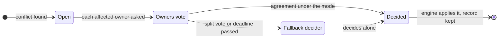

*Figure 5. A joint approval always finishes. Modes are Single, Any one, Everyone and At least n. The fallback decider is the space owner, or across spaces an owner the super admin names.*

- **State.** Conflict cases, proposals and owner routing are built. Joint approval, votes and rules are designed.

### 5.4 A source is deleted upstream

Someone deletes the onboarding guide in Feishu.

- **What happens.** Nothing disappears. Statements stay, their citations say "Source deleted in Feishu on Oct 20", and the evidence still opens the last version. Statements that other sources also support are recalculated quietly. For the rest, the topic owner gets one todo per deleted document or folder with three choices: keep it as a snapshot, point it to a replacement, or retire it. Without a decision it is kept after 30 days, with a review date. If more than 10% of a source's documents, or more than 50, vanish in one sync, the cause is almost always lost access, so the source is paused and the super admin gets a connection todo instead.
- **Why.** Knowledge that silently vanishes breaks trust, and a governed fact may matter more than the document it was found in. Keeping is the safe default because it never changes who can see anything.
- **State.** Designed ([Source changes](design/source-changes.md)); about 3 person-weeks.

### 5.5 From one person to a team

A procurement specialist signs up alone, connects their own Feishu account and builds a library of supplier notes and research. Later the team adopts Inspiration.

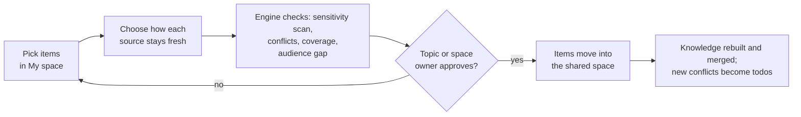

*Figure 6. Publishing moves knowledge from My space into a shared space. Approvers read only the items in the request.*

- **What happens.** Inviting a colleague turns the library into a company; the specialist's material becomes their My space, private to them. To share the supplier onboarding notes, they publish them to the Procurement space. For each source they choose how it stays fresh: with the company's connection (the default), with their own (with consent), or as a snapshot with a review date. The engine checks the request, the topic owner approves, and the items move. From then on the Procurement space's audience reads them, and the source's own permissions only produce a warning if they tighten.
- **Why.** Personal knowledge should stay fully personal, and shared knowledge should be governable and mergeable. Merging inside one domain only means two members' drafts never collide, and they meet only after both publish.
- **State.** Designed in the [business layer](design/business-layer.md); the engine side of the two domains is the next engine change.

### 5.6 Knowledge that crosses departments

The all-staff travel guide uses HR's grades and Finance's hotel caps. Finance also holds a memo, readable only by Finance, that argues for cutting the cap, while a public document argues against.

- **What happens.** The guide is written for its whole audience from what that audience can read. HR and Finance make their grades and caps readable to all staff, so the guide uses them. The memo is not readable by all staff, and leaving it out would leave only one side of an argument, so the omission check fires. The guide's owner gets one todo: ask Finance to release the relevant statement, rewrite the section without taking a position, or publish with a note. A reader who cannot open the memo sees "Some material on this point is in a space you cannot open. Ask the Finance space owner." A Finance reader sees the full section.
- **Why.** Cutting text per reader distorts meaning, and hiding a whole page because one input is restricted is unusable and invites abuse: anyone could hide a page by linking a trivial restricted note to it. So people set audiences, inputs never do; units are written for their audience; and an omission that changes the meaning goes to a person (section 15).
- **When it applies.** A company with a single shared space never meets this. It starts to matter when a department such as Finance or HR narrows who can read its space.
- **State.** Proposed ([Permissions in compiled knowledge](design/compiled-knowledge-permissions.md)), waiting for the product owner to confirm the trade-off in section 27; about 3 person-weeks.

### 5.7 A company agent uses the knowledge

A member asks the company's procurement bot in Feishu how to onboard a new supplier.

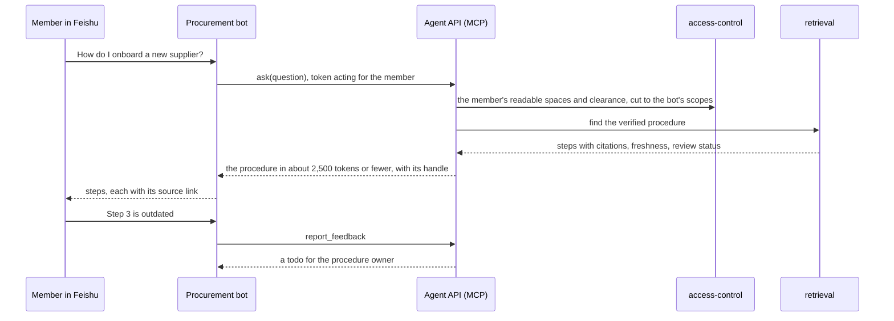

*Figure 7. An agent reads with the rights of the member it acts for, and its feedback reaches the owner as a todo.*

- **Why.** Agents fail on stale or conflicting context, and they pay for every token. A governed endpoint gives them the current procedure with sources, freshness and a token estimate, and never more than the member may read. A coding agent uses the same tools through MCP.
- **State.** The agent API and its tools are proposed (section 18); the agent runtime for built-in agents is built.

### 5.8 A member corrects knowledge with the assistant

A member comments on a page: "This is outdated; the cap has been 650 since October."

- **What happens.** The assistant checks the claim against the sources, finds the notice, and proposes an edit. If the member asked it to make the change and may edit the page, the assistant makes it at once, recorded under the member's name, marked as done by the assistant, and undoable. Where the member may only propose, it files a proposal for the owner. A person's edit is a pinned override that a rebuild never overwrites; if the sources later disagree with it, its author gets a todo.
- **Why.** Making people retype what they just asked an assistant to change is painful, and the request itself is the approval. Agents running on their own (in the background, on a schedule or on an event) still only read or propose, because nobody asked them.
- **State.** Decided; comments, overrides and the edit path are designed.

### 5.9 The same policy in Chinese and Japanese

Qinghe's Japanese subsidiary keeps a Japanese travel regulation that repeats the hotel caps.

- **What happens.** The Japanese and Chinese statements of the same cap land in one fact slot, because slots key on language-neutral predicates, qualifiers and typed values, not on words. If the Japanese text is a translation, it counts with its original rather than as a second source. When the original changes and the translation does not, the translation gets a "translation out of date" review instead of a conflict. A Japanese reader reads pages in Japanese, compiled from the same statements, with quotes in their original language.
- **Why.** Knowledge is language-neutral; language is only how it is expressed. The same knowledge in two languages must never become a duplicate or a false conflict.
- **State.** Designed ([Knowledge and language](design/knowledge-and-language.md)); language packs for en, zh and ja are built.

### 5.10 An approval flow becomes a procedure

Qinghe's travel request approval runs in Feishu.

- **What happens.** A procedure is built from the flow definition, from process mining over 90 to 180 days of approval logs, and from a model's write-up. Each step is tagged "from the definition", "mined" or "inferred", and the procedure owner approves it before anyone reads it. Agents get it with `ask`, or by reading its handle, and it can be exported as an Agent Skill.
- **Why.** The formal definition says who approves; the logs say what really happens (for example that amounts over 5,000 yuan always go to Finance). Tagging keeps inferred steps from passing as facts.
- **State.** The Feishu approval connector is built with recorded fixtures; procedure building is designed.

### 5.11 Research becomes a source

A buyer asks the research agent which suppliers in East China hold a given certification.

- **What happens.** The research agent works through the agent API and approved web search, and writes a report of conclusions, assumptions and evidence. The report is stored as a source like any other. Each assumption gets a re-check query and a date. When cited material changes or a date comes, only the affected conclusions are checked again, and a new version is written only if a conclusion changes.
- **State.** Designed.

## 6. Functional requirements

States: **Built** (on `main`, with tests), **Designed** (decided, not built), **Proposed** (waiting for a decision), **Planned** (agreed to build, not yet designed in detail), **Open** (not decided).

### 6.1 Bringing knowledge in

| ID | Requirement | State |
| --- | --- | --- |
| IN-1 | Connect Feishu documents, wiki and approvals and file uploads; serve Lark, Feishu's international edition, with the same connectors | Built (recorded fixtures) |
| IN-2 | Watch sources continuously: push events as hints, a 15-minute poll and a nightly full listing that also finds deletions | Built |
| IN-3 | Parse Office files, PDFs and scans into blocks with stable IDs | Planned (parsing worker) |
| IN-4 | Give every source or folder a governance level, inherited down the Documents tree; uploads and web pages start as Reference | Built |
| IN-5 | Build procedures from approval flows: definition, mined logs and a write-up, each step tagged by origin and approved by its owner | Designed |
| IN-6 | Store research reports as sources, with a re-check query and date per assumption | Designed |
| IN-7 | Add Confluence and DingTalk in the pilot; Notion and Jiandaoyun later; connectors outside China to be chosen | Planned / Open |

### 6.2 Statements and structure

| ID | Requirement | State |
| --- | --- | --- |
| ST-1 | Keep a statement only if its evidence quote is a verbatim substring of the cited passage | Built |
| ST-2 | Never delete statements: a newer one supersedes an older one and closes the interval in which it was known | Built |
| ST-3 | Key single-valued facts into fact slots with typed values (number with unit, range, date, money) | Built |
| ST-4 | Read reference documents only where they touch a known fact, and in full the first time a page or answer cites them | Built |
| ST-5 | File statements into topics at most three levels deep, with stable keys; at most 5% move in one re-clustering, and nothing a person placed ever moves | Built |
| ST-6 | Resolve entities (people, departments, products, suppliers) and relations, each backed by a statement | Planned |
| ST-7 | Treat translations as copies of their originals, and merge the same statement across languages after a model check | Designed |
| ST-8 | Never merge or compare knowledge across domains: a member's My space and the company's shared spaces | Designed |

### 6.3 Reading and asking

| ID | Requirement | State |
| --- | --- | --- |
| RD-1 | Three views with shared IDs: Original (as written), Annotated (with marks) and Knowledge (topic pages). A newly imported source opens in the Original view, and knowledge is revealed from there, concrete to abstract (section 19) | Designed |
| RD-2 | Two trees: the Documents tree and the Knowledge tree; a folder or space the reader cannot open is never shown, not even as a count | Designed |
| RD-3 | Pages as `PageSpec` with 14 block types, every sentence citing statements, every rebuild a version with a diff | Contract built, compiler planned |
| RD-4 | A citation opens the source beside the page at the exact passage and version, and says so when the passage changed since | Designed |
| RD-5 | Four statuses in words, never colour alone: Fresh, Review due, Outdated, Disputed; only Outdated and Disputed in the text | Designed |
| RD-6 | Answers grounded in statements, citing passages, in the asker's language; an answer that may be incomplete says so | Designed |
| RD-7 | Comments go to the assistant, which answers with citations or proposes an edit; a person's edit is a pinned override | Designed |
| RD-8 | Charts from statements or registered queries, never free SQL; interactive views from templates, run in a sandbox | Designed |

### 6.4 Freshness and source changes

| ID | Requirement | State |
| --- | --- | --- |
| FR-1 | Re-read only changed blocks, supersede only statements whose evidence changed, rebuild only what cites them | Built to extraction; rebuilds planned |
| FR-2 | A source that changes its own value syncs silently, with history kept | Built |
| FR-3 | Review clocks from knowledge classes (for example yearly for policy, 180 days for process), plan dates and copies left behind | Built |
| FR-4 | A deleted source keeps its knowledge, marked; one todo per document or folder: keep as snapshot, point to a replacement, or retire; kept by default after 30 days | Designed |
| FR-5 | When more than 10% of a source's documents, or more than 50, vanish in one sync, pause the source and ask the super admin about the connection | Designed |
| FR-6 | Re-check research when cited material changes or an assumption's date comes; write a new version only if a conclusion changes | Designed |
| FR-7 | Start a new company with first-review campaigns per topic for the space owner, not a flood of overdue reviews | Built |

### 6.5 Governance and the inbox

| ID | Requirement | State |
| --- | --- | --- |
| GV-1 | For each fact slot, propose the most authoritative value in force and say why | Built |
| GV-2 | One trigger, one todo, routed to the nearest owner; nothing is ever unowned | Built |
| GV-3 | One cause, one review: a cause that would give more than 20 todos or touch more than 3 topics becomes one change review | Designed |
| GV-4 | Weekly cards: at most 20 todos per card and 10 cards per owner per week; notes on their own card outside the budget | Built |
| GV-5 | Conflict cards show how many distinct documents support each value, and their authority | Designed |
| GV-6 | Joint approval with a mode, a deadline and a fallback decider; the company chooses what readers see meanwhile | Designed |
| GV-7 | Every decision is a record, and can become a precedence rule that governance applies to later conflicts | Designed |

### 6.6 Domains, publishing and permissions

| ID | Requirement | State |
| --- | --- | --- |
| PB-1 | Someone working alone sees no company; inviting someone or turning on collaboration creates one | Designed |
| PB-2 | My space is private to its member, the super admin included | Designed |
| PB-3 | Publishing moves items from My space into a shared space after checks and an owner's approval; approvers read only the request's items | Designed |
| PB-4 | Each published source chooses how it stays fresh: company connection (default), the member's own connection (with consent), or a snapshot | Designed |
| PB-5 | Source permissions only warn: the audience gap at publishing, and a todo when they later tighten | Designed |
| PB-6 | A unit is readable when its space is readable at the reader's clearance; a statement also needs one proof the reader can read | Designed; an older rule is built |
| PB-7 | Compiled knowledge is written for its audience; an omission that changes the meaning goes to a person; readers are told, never misled; releases are per statement | Proposed |
| PB-8 | Anyone who holds a credential to a source may import from it; no blocking by email domain or Feishu organization | Decided |
| PB-9 | A member who leaves: published knowledge stays with the company; My space is locked and erased after 30 days | Designed |

### 6.7 Agents

| ID | Requirement | State |
| --- | --- | --- |
| AG-1 | One governed endpoint: a remote MCP server and a REST API from one schema; verified procedures exportable as Agent Skills | Planned |
| AG-2 | Four tools shaped by what an agent is doing (`ask`, `search`, `read`, `get_changes`) and one for feedback, sized for agent budgets, every result carrying source, version, freshness, confidence, review status and a token estimate | Proposed |
| AG-3 | An agent always acts for a member, with that member's rights cut down to its scopes and spaces | Designed |
| AG-4 | Agents running on their own only read or propose; a member's explicit request is the approval for an edit within that member's rights | Decided |
| AG-5 | OAuth with PKCE for MCP clients, the device flow for the CLI; company agents registered by the super admin | Designed |

### 6.8 Administration and usage

| ID | Requirement | State |
| --- | --- | --- |
| AD-1 | Three product roles (member, owner by scope, super admin), each a bundle of internal roles | Decided; boundary proposed |
| AD-2 | Lifecycle: sign-up, invitations (links expire after 7 days), joining by verified email domain, SSO with directory sync, personal to team, leaving, account deletion, company deletion (30 days of grace with export) | Designed |
| AD-3 | Seats fill one usage pool; each member has a default cap the super admin can raise; the super admin sees usage per member and kind of work, never content | Direction decided; details with billing |
| AD-4 | Audit of reads of knowledge, permission changes, decisions and break-glass access | Designed |
| AD-5 | Before a label rises or an audience narrows, show how many units and readers it affects | Proposed |

### 6.9 Languages

| ID | Requirement | State |
| --- | --- | --- |
| LN-1 | English, Simplified Chinese and Japanese are equal from the first release; Traditional Chinese later | Designed; language packs built |
| LN-2 | One unit of knowledge per piece of knowledge, with an expression per language | Designed |
| LN-3 | Interface language per account; a company default for messages to many people; a content language per space | Designed |
| LN-4 | Answers in the asker's language; quotes verbatim; translation on request, labelled as machine translation | Designed |
| LN-5 | Type per script, input-method-safe shortcuts, locale formats and collation | Designed |

## 7. Quality requirements

| Quality | Requirement | How it is checked | State |
| --- | --- | --- | --- |
| Evidence | Every statement carries a verbatim quote; the store rejects anything else | Store rules and tests | Built |
| Faithfulness | Citation entailment at or above 95% | G1 evaluation set | Target |
| Permission safety | Zero leaks on the red-team set: personal-space isolation, cross-space citations and derivations, shared answers, graph paths, omissions | G1 red team and acceptance tests | Target |
| Revocation | A revoked permission reaches every reader within 15 minutes at p95 | G2 | Target |
| Change detection | A change is seen within 15 minutes by the poll, sooner by push; deletions by the nightly listing | Source-sync tests | Built |
| Review load | At most 10 inbox cards per owner per week | Synthetic year: median 1, max 4 | Measured |
| Conflict precision | At least half of conflict todos are real conflicts | G1, then a pilot metric | Target |
| Scale | 10,000 documents sync in about 72 s and settle in about 9 minutes on one node, on mocks | Volume report | Measured |
| Topic stability | Statements do not change topic without cause | 0 of 25,660 moved on a re-clustering | Measured |
| Agent efficiency | A structured procedure stays under about 2,500 tokens; tokens per task beat a chunk-only baseline | G1 | Target |
| Retrieval | Recall@10 beats a chunk-only baseline on the partner's own questions | G2 | Target |
| Privacy | The super admin never reads My space, questions, answers or research | Permission tests | Designed |
| Model routing | Content reaches only providers cleared for its sensitivity label | Gateway tests | Built |
| Residency | A company's data stays in the region chosen at creation | Deployment checks | Designed |
| Languages | Every screen in three languages; a missing string fails the build; pseudo-locale tests | Build checks | Designed |
| Delivery | Air-gapped install in under one day; domestic infrastructure certificates | G3 | Target |

## 8. Releases, scope and success measures

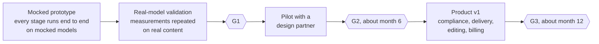

*Figure 8. Releases and gates. Real models are switched on only after every stage runs on mocks.*

| Release | It proves | Includes |
| --- | --- | --- |
| Mocked prototype | Every stage of the product runs end to end, at realistic volumes | The engine pipeline, pages, search and answers, the agent API, the business layer phase 1 and the web app, all on mocked models |
| Real-model validation (G1) | Quality with real models on real content | Real models, evaluation corpora in three languages, the permission red team, measured token use |
| Pilot (G2) | A design partner uses it every week | A real Feishu or Lark tenant, joint approval, Confluence and DingTalk, business layer phase 2 |
| Product v1 (G3) | It can be sold and delivered | Compliance packs, domestic infrastructure, air-gapped install, Artifact-level editing, billing |

**Not in scope for now:** Traditional Chinese, a dark theme, guests, the three-admin preset, and personal billing. The engine never handles accounts, sign-in or screens; those belong to the business layer.

| Gate | Criteria |
| --- | --- |
| G1, prototype | Citation entailment at or above 95%; zero leaks on the permission red-team set; conflict-queue precision at or above 50%; one procedure domain verified by its owners; agent tokens per task measured against a chunk-only baseline; an evaluation corpus in Chinese, Japanese and English |
| G2, pilot, about month 6 | A design partner with at least five owners active weekly; permission revocation reaches every reader within 15 minutes at p95; retrieval Recall@10 beats the chunk baseline on the partner's own set; signed commercial intent |
| G3, product v1, about month 12 | Classified protection level 3 control pack, domestic-infrastructure compatibility certificates (Kylin, Kunpeng or Hygon, KingbaseES, Ascend), air-gapped install in under one day, two paying customers |

G3 was written for private deployment in China; how the gates change for SaaS first is an open question.

## Part II. Technical architecture

## 9. Architecture at a glance

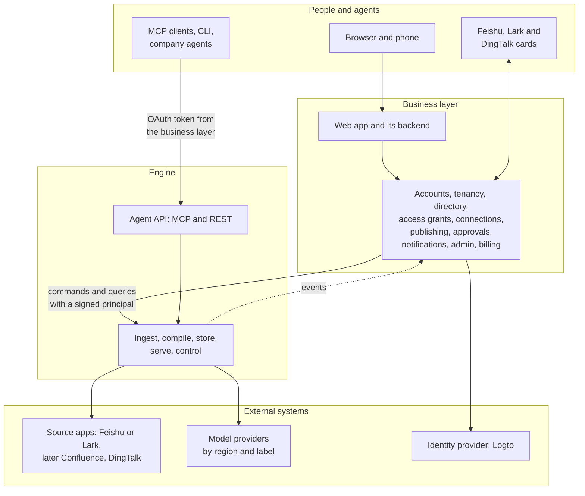

*Figure 9. Two layers. Calls go down from the business layer to the engine and events come up; the engine never calls the business layer.*

**The engine is a system of record for knowledge, with no screens.** Given a tenant and a principal, it answers four questions on its own: what is known, where it comes from, who may see it, and whether it is still true. It has no people, no interface and no commercial terms, so it behaves the same under our product, under a customer's own identity system in a private deployment, or with nothing but agents in front of it.

**The business layer is the product around it for people and companies:** who someone is, which companies they belong to, what those companies bought, how a person is asked, reminded and told, and what the screens look like. It turns human and commercial decisions into engine commands and engine events into messages people read, and it can change from market to market without touching knowledge.

**The whole system, with an external equivalent for each part.** Figure 10 shows every component and, for each one, products or projects that do a similar job. The mapping helps a reader place each part, and it records what we take from outside. We do not assemble these projects into one. Where a job is generic and the licence fits, we run an existing project as it is, sometimes behind a plugin so it can be replaced. Everywhere else we study the design and build our own, because that is where Inspiration adds something: verbatim evidence, fact slots, decisions by named people, and one permission model from the source to the answer.

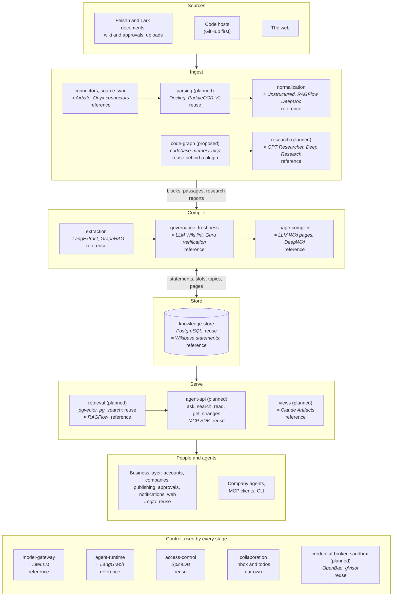

*Figure 10. The whole system. Each box names our component, and ≈ names an external product that does a similar job. Reuse means we run it as it is; behind a plugin means it can be replaced; reference means we studied its design and build our own. Components marked planned or proposed are not built yet.*

| Part | Our components | External equivalents | How we use them | Why |
| --- | --- | --- | --- | --- |
| Source integrations | connectors, source-sync | Airbyte, Onyx connectors, LlamaHub readers | Reference; vendor SDKs are used directly | We need versions, deletions, ACL snapshots, and one integration per vendor shared by sync and agent tools; Feishu and Lark are thin in those projects |
| Document parsing | parsing (planned) | Docling, PaddleOCR-VL, MinerU, RAGFlow DeepDoc | Reuse Docling and PaddleOCR-VL in a Python worker | Parsing is a commodity; a router picks the parser per document type |
| Blocks and passages | normalization | Unstructured's elements, Docling's document model, RAGFlow's chunking | Reference | Evidence needs block and passage IDs that stay stable across versions, and a diff per block; those tools rebuild a document from scratch |
| Code repositories | code-graph (proposed) | codebase-memory-mcp, CodeGraphContext, Sourcegraph SCIP; DeepWiki and Code Wiki | Reuse codebase-memory-mcp in the sandbox, behind the `code_indexers` plugin; generated wikis are not used | A graph per commit gives symbols to anchor evidence on and a diff at every merge; generated prose is not evidence ([code repositories](design/code-repositories.md)) |
| Deep research | research (planned) | OpenAI and Gemini Deep Research, GPT Researcher, LangChain's open_deep_research | Reference | A report must become a source, with verbatim evidence and assumptions that are re-checked when code or pages change |
| Extraction | extraction | LangExtract (extraction grounded in source offsets), GraphRAG and LightRAG (entity and claim extraction) | Reference | Evidence is checked as a verbatim substring, statements get fact-slot keys and supersede each other; graph summaries lose the evidence |
| Governance and freshness | governance, freshness | The LLM Wiki pattern (a model keeps a wiki from raw sources and lints it for contradictions and stale claims); verification in Guru and Confluence; ranks in Wikidata | Reference | In an LLM Wiki the model rewrites pages itself; we keep statements with their evidence, and named people settle disagreements, with deadlines and a record |
| Pages | page-compiler | LLM Wiki pages, DeepWiki, Notion AI | Reference | Pages are compiled from statements for one audience, every sentence cites, and every rebuild is a version |
| Knowledge store | knowledge-store | Wikibase (statements with references and qualifiers), XTDB and Datomic (history and time travel) | Reuse PostgreSQL; reference the models | One database a customer can run, with lineage and "known when" reads |
| Search and answers | retrieval (planned) | RAGFlow, Onyx, Glean | Reuse pgvector and pg_search (OpenSearch or Milvus later); reference RAGFlow's pipeline | Indexes over statements as well as blocks, filtered by readable spaces before ranking, and a reader status on every citation |
| Agent access | agent-api (planned) | The MCP servers of Glean and Notion | Reuse the MCP TypeScript SDK | Four task-shaped tools over the same permissions as the screens (section 18) |
| Interactive views | views (planned) | Claude Artifacts | Reference | Code and data kept apart, a render check and a person's approval, run in a sandboxed frame |
| Agent framework | agent-runtime | LangGraph, OpenAI Agents SDK, Claude Agent SDK | Reference; our own small loop is built | Tools are gated by our permissions and approvals; if research needs long, durable runs, LangGraph.js is the first candidate to adopt |
| Model gateway | model-gateway | LiteLLM, Portkey, OpenRouter | Reference | Routing by sensitivity label, budgets per company and member, versioned prompts and mocks are ours; LiteLLM can sit behind it as a provider adapter |
| Permissions | access-control | SpiceDB, OpenFGA (both modelled on Zanzibar) | Reuse SpiceDB | Relationship-based checks and search pre-filters at the scale of every statement |
| Inbox and decisions | collaboration | Review queues in Guru and Confluence | Our own | Todos grouped per topic and week under a budget are product, not infrastructure |
| Credentials | credential-broker (planned) | Nango, Composio; OpenBao, Vault | Reuse OpenBao Transit for keys; reference Nango for OAuth flows | Tokens never reach an agent; leases are short and per job |
| Sandbox | sandbox (planned) | E2B, Daytona; gVisor, Kata Containers, Firecracker | Reuse gVisor, then Kata Containers or Firecracker; reference E2B | One container per job for code we did not write |
| Events | eventbus (library) | Kafka, NATS JetStream | Reuse a Postgres outbox and Valkey Streams; NATS or Kafka in the product | Events commit with the data |
| Identity | accounts (business layer) | Logto, Keycloak, Auth0 | Reuse Logto | Standard; our own member IDs stay ours |
| Notifications | notifications (business layer) | Novu, Knock | Reference | Messages arrive as codes and parameters and are worded per recipient |
| Billing | billing (business layer) | Stripe, Lago | Reuse, later | Not needed before the pilot |

The whole product, rather than any one part, competes with Glean, Guru, Onyx, RAGFlow, Notion AI and the knowledge Q&A in Feishu (section 2).

**Where something goes.** Ask in order; the first yes decides.

1. Does it read, change, derive or enforce anything about knowledge, or decide whether a principal may see something? The engine.
2. Is it about a person as a person (sign-in, profile, language, sessions), a company as a customer (plan, seats, billing, domains), or a channel that reaches a person (email, IM, digests)? The business layer.
3. Is it a setting? The business layer owns its value and the screen that sets it; the engine owns what it means, its default and how it is enforced.
4. Is it a decision people make about knowledge? The engine owns the item (a todo, a publish request, a conflict), its state, who may decide and what follows. The business layer owns how people reach the decision: whom to ask, reminders, deadlines, escalation, votes and cards. It sends the result back as a command, and the engine checks it again.

**Never.** Each of these is held by a test or a review rule.

- The engine never calls the business layer, and never stores a user ID, a login identity, a session, a password, a plan or a payment detail.
- The business layer never stores knowledge (sources, statements, pages, embeddings) or a source credential, and never decides whether someone may see content: it asks the engine. Content it shows or sends is fetched from the engine for that recipient and not kept.
- The engine trusts only a signed token and its own copy of members, groups, roles and settings. A token can narrow what the engine allows, never widen it.
- The engine runs without the business layer: a stand-in that signs tokens and sends provisioning commands is enough for tests, evaluations and agent-only use.

**Shared concerns, split.**

| Concern | Engine | Business layer |
| --- | --- | --- |
| People | Members, groups, roles and clearances as an enforced copy; every permission check | Accounts, sign-in, invitations, directory sync, assigning roles |
| Companies | Tenants as isolation boundaries and data regions; provisioning, export and deletion on command | The company as a customer: name, domains, plan, seats, transfer and deletion flows |
| Settings | What `TenantPolicy` means, its defaults and its enforcement | The values a super admin picks, and the screens for them |
| Spaces and audiences | Spaces, audiences and the checks | The screens that change them |
| Todos and decisions | Todos, publish requests and conflicts: state, routing, weekly budgets, who may decide, the effect, the record | Getting people to decide: reminders, deadlines, escalation, votes, IM cards |
| Messages | Events with codes and parameters | Wording in each recipient's language, channels, digests, preferences, the inbox screen |
| Words | Knowledge in a language: pages, answers, summaries | Every word of the interface and of messages |
| Source connections | Credentials (credential broker), fetching, sync, source ACL snapshots | Connect and consent screens, which connections the settings allow |
| Agents | The agent API, token verification, scope enforcement, agent audit | OAuth server, client registry, device flow, consent, revocation |
| Usage | Metering model use per company, member and space; stopping at the limits it is given | Plans, seats, the usage pool, per-member caps, invoices |
| Audit | Reads of knowledge, permission changes, decisions, break-glass access | Sign-ins and account, admin and billing events; the console shows both |
| Search and reading | Retrieval, answers, citations, pages | The reading and search screens |

## 10. Repository and components

**One repository, a folder per layer.** Both layers are built in this monorepo.

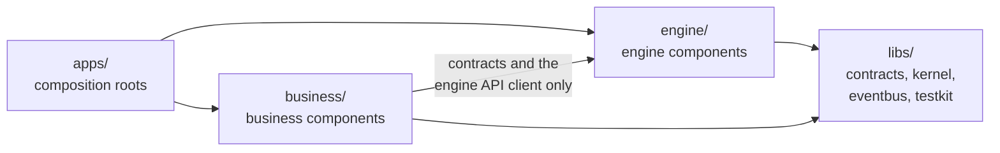

*Figure 11. Dependencies point one way. Nothing in `engine/` or `libs/` depends on `business/`, and the manifest test fails any change that tries.*

Each section of [`components.yaml`](../components.yaml) maps to one folder. A package depends only on the libraries and on the components listed in its `calls`. One toolchain and one `make check` cover both layers, so a contract change lands with both sides in one pull request, while the engine and the business backend deploy as separate processes. The packages moved from `packages/` into these folders in a rename-only pull request (#15).

**Engine components.** Each has one job. Its name is also its event producer name, its consumer group and the prefix of its model task names.

| Stage | Component | Job | State |
| --- | --- | --- | --- |
| Ingest | connectors | One integration per vendor: list, fetch, read ACLs, webhooks, agent tools. Built: local folders, Feishu documents and approvals (recorded fixtures) | Built |
| Ingest | source-sync | Versions, tombstones, ACL snapshots, polls and reconcile; later `fetch_now` and the Documents tree | Built |
| Ingest | parsing | Python worker for Office, PDF and scans (Docling, PaddleOCR-VL) behind an HTTP contract | Planned |
| Ingest | normalization | Canonical blocks and spans with stable IDs, block diff, duplicate documents; later mirror pages | Built |
| Ingest | research | Research agent over the agent API and approved web search; reports become sources | Planned |
| Ingest | code-graph | A git mirror per repository and a code graph per commit, built in the sandbox; `code.changed` at every merge ([code repositories](design/code-repositories.md)) | Proposed |
| Compile | extraction | Statements with verbatim evidence, fact-slot keys, governance levels, extract on use; later entities and procedures | Built |
| Compile | freshness | Review clocks, plan dates, copies, staleness, `review.due`; later the dependency graph and `artifact.dirty` | Built |
| Compile | governance | Slot values, conflict cases with a proposed value, todo requests, notes; later model-judge tiers and rules | Built |
| Compile | page-compiler | Topics and placements; later cited pages, the omission check, diagrams, snapshots | Topics built |
| Store | knowledge-store | The only owner of knowledge tables: lineage, bitemporal reads, slots, topics, page snapshots | Built |
| Serve | retrieval | Every search index; hybrid search, rerank, permission filters, grounded answers | Planned |
| Serve | agent-api | MCP server, REST and OpenAPI, Skills export, per-call audit | Planned |
| Serve | views | Interactive view templates, generation, render check, sandbox hosting | Planned |
| Control | collaboration | The inbox; later comments, overrides, publishing, decisions, releases | Inbox built |
| Control | access-control | Permissions on SpiceDB, search pre-filters, audit | Built; space and proof rules designed |
| Control | model-gateway | Every model call: routing by sensitivity, budgets, prompts, cache, metering | Built |
| Control | agent-runtime | The loop built-in agents run on: tools, limits, approval gates, traces | Built |
| Control | credential-broker | Tenant and member connections, encrypted secrets, refresh, short-lived leases | Designed |
| Control | sandbox | One isolated container per job for code we did not write | Designed |

**Business components.** One TypeScript service with its own database schema, plus the web app.

| Component | Owns | Phase |
| --- | --- | --- |
| accounts | Users, login identities, sessions, the identity-provider adapter (Logto; Keycloak as fallback) | 1 |
| tenancy | Tenants, members and member IDs, invitations, verified domains, company roles, sign-in policy, personal to team, transfers | 1 |
| directory | SSO connections, Feishu contacts (SCIM in phase 2), groups, departments, external identity links | 1 and 2 |
| access-grants | OAuth authorization server, client registry, device flow, personal tokens, company agents, revocation | 1 |
| connections | Connect flows for company and personal connections, consents | 1 |
| publishing | The publish wizard: target space, freshness choice, coverage, audience gap, approval routing | 1 |
| approvals | Single and joint approvals, deadlines, fallback deciders, decision records | 1 (joint in 2) |
| notifications | Inbox, email, Feishu, Lark and DingTalk cards, digests, preferences, message catalogs | 1 |
| admin | Space ownership, company settings, roles, audit and usage views | 1 |
| billing | Plans, seats, quotas, per-member limits, model budgets | 3 |
| web | The product web app and its backend for the frontend | 1 |

## 11. How components talk

There are exactly three paths, and the manifest test enforces that a package uses nothing else.

1. **Events.** A component writes its data and its events in one Postgres transaction (a transactional outbox). A relay moves them to Valkey Streams, one stream per event type, and each consuming component reads with its own consumer group. Delivery is at least once, so handlers are idempotent. Events that cannot be parsed, are newer than the consumer knows, or keep failing go to a dead-letter stream. Payloads carry IDs and codes, never sentences.
2. **The knowledge store's repository API.** No component reads another component's tables.
3. **Synchronous interfaces** from the contracts package: `AuthZ`, `ModelGateway`, `Retriever`, `AgentRuntime`, the blob store, and later `SourceSync.fetch_now`, `CredentialBroker` and `Sandbox`. Each has an in-process implementation and, where useful, an HTTP one with the same interface.

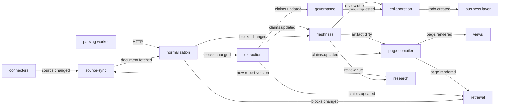

*Figure 12. The engine pipeline as events. Each component reacts only to the events it subscribes to.*

| Event | Published by | Consumed by | State |
| --- | --- | --- | --- |
| `source.changed` | connectors, source-sync, research | source-sync | Built |
| `document.fetched` | source-sync | normalization | Built |
| `acl.changed` | source-sync | access-control; collaboration for the source-restricted todo | Built |
| `blocks.changed` | normalization | extraction, freshness, retrieval | Built |
| `claims.updated` | extraction, governance, collaboration | freshness, governance, page-compiler, retrieval | Built |
| `artifact.dirty` | freshness | extraction, page-compiler, retrieval | Planned |
| `review.due` | freshness | collaboration, research | Built |
| `todo.requested` | governance; views and page-compiler (designed) | collaboration | Built |
| `todo.created` | collaboration | business layer | Built |
| `page.rendered` | page-compiler | collaboration, retrieval, views | Planned |
| `comment.created` | collaboration | extraction, collaboration | Planned |
| `unit.published` | collaboration | retrieval, agent-api, business layer | Planned |
| `connection.changed` | credential-broker | source-sync, collaboration, business layer | Designed |
| `source.tree_changed`, `source.moved` | source-sync, the publish step | access-control, retrieval, normalization, business layer | Designed |
| `todo.updated`, `publish_request.updated`, `decision.applied`, `member.offboarded`, `usage.recorded` | engine | business layer | Designed |

Only the engine publishes events. Business components read them as consumer groups; a product deployment adds a feed endpoint so the business layer is not tied to the transport.

## 12. Knowledge model and storage

Knowledge lives in three layers that never write into each other.

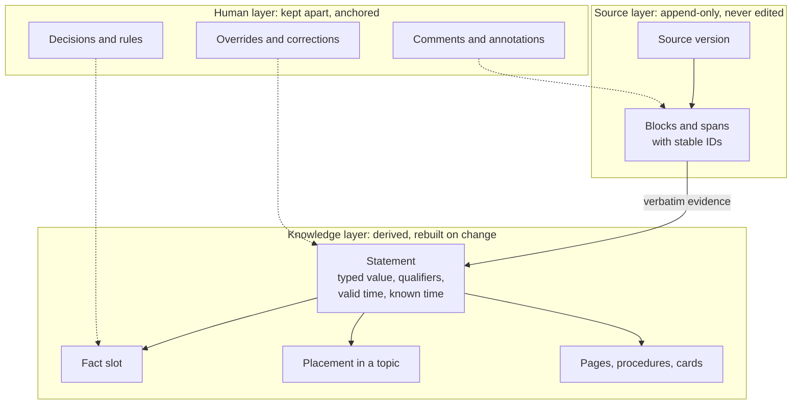

*Figure 13. Three layers. The source layer always matches the source; everything people add lives in its own layer, anchored to stable IDs.*

- **The source layer matches the source, always.** Each sync stores an immutable source version; a change adds a version and a deletion adds a "deleted" version. Nothing inside Inspiration edits it.
- **The knowledge layer is derived.** Statements, slots, topics and pages are computed from source versions and rebuilt when they change.
- **The human layer is kept apart.** Annotations, corrections, decisions, rules and statements a person added are stored separately, with author and time, anchored to stable IDs (Feishu block IDs, statement IDs). When a new version arrives, an annotation whose anchor is unchanged moves with it; a correction the source now agrees with retires itself; a correction the source contradicts gives its author a todo; an annotation whose anchor is gone is kept in the margin as orphaned. So the system can never drift away from the source in a way nobody can explain.

**Anatomy of a statement.** The Shenzhen hotel cap from the notice:

| Field | Value |
| --- | --- |
| Subject, predicate | Business travel, hotel cap per night |
| Value | 650 CNY per night (typed money) |
| Qualifiers | City tier: tier 1; grade: managers and below |
| Valid time | From 2026-10-01 |
| Known time | From the sync that read the notice |
| Class | Policy |
| Evidence | Verbatim quote from the notice, with its version and span |
| Slot key | Predicate + qualifiers, language-neutral |

**Statements carry knowledge; queries carry data at scale.** A statement is more than subject, predicate and object: its typed value, qualifiers that work as dimensions (city, grade, period) and valid time mean the statements of one predicate form a small fact table, such as hotel caps by city and grade, that stays cited and governed. That suits rules and facts, from hundreds to a few thousand per subject, because each can be reviewed. Business data at scale (daily sales, stock, transactions) is never turned into statements: it stays in its system of record and reaches a chart through a registered, parameterized query that a `data_providers` plugin runs with that system's permissions and caches as a snapshot the chart cites. A large table inside a document, such as a price list of thousands of items, stays a source whose rows can be cited; a row becomes a statement only when a page or an answer uses it.

| Layer | Holds | State |
| --- | --- | --- |
| Source version | One fetched revision, its hashes, sensitivity and governance level | Built |
| Block, span | Stable IDs, heading path, parent; spans content-addressed by block and text | Built |
| Statement and evidence | Subject, predicate, value, qualifiers, class, slot key, two time intervals, verbatim quotes | Built |
| Fact slot | Current variants with counts and representatives, and every value held over time | Built |
| Topic and placement | Taxonomy nodes with stable keys, status, owner and counts; one placement per statement | Built |
| Entity, relation | People, departments, products, suppliers; every edge backed by a statement | Planned |
| Procedure, model | Steps, roles, conditions; formulas and decision tables whose assumptions are statements | Planned |
| Page | `PageSpec` versions with sentences bound to statements; mirror pages for the Original view | Contract only |
| Source node | The Documents tree: each document's position in its source's hierarchy | Designed |

The knowledge store enforces four rules: a statement without evidence or a derivation is rejected; an evidence quote must be a verbatim substring of its span; statements are never deleted; page versions are immutable and increase by one. Reads are bitemporal: what was true at a time, as the system knew it at a time.

**Storage.** Everything lives in one PostgreSQL 16 instance (the ParadeDB image, with pgvector and pg_search). Each component that owns tables has its own schema: `kb` (knowledge store), `bus`, `gateway`, `agents`, `sync`, `normalization`, `extraction`, `freshness`, `governance`, `page_compiler` and `collaboration`; retrieval gets its own when it takes over indexes from `kb`. SpiceDB keeps its database on the same instance, Valkey carries the streams and the model response cache, and files go to a blob store. Each `kb` table keeps the full contract object in a `doc` column and copies only filterable fields into typed columns, so most contract changes need no migration.

## 13. The pipeline and incremental freshness

1. **Sync.** Source-sync lists a source, compares each item's content, metadata and ACL hashes with the last ones, fetches what changed, and writes the source version and ACL snapshot in one transaction. A permission change alone writes no new version, so nothing is re-parsed.
2. **Normalize.** Normalization parses the version (built-in parsers for text formats, the parsing worker for Office, PDF and scans), builds blocks and spans with stable IDs, diffs them against the previous version and detects duplicate documents. Every later stage works from this diff.
3. **Extract.** Extraction reads only added and changed blocks of governed documents, and of reference documents only those that name a known fact. Each window is one model call. A statement is kept only if its quote is verbatim; statements whose evidence disappeared are superseded, or held for their owner when the document was deleted.
4. **Govern.** Governance keeps each slot's values counted incrementally, proposes the value that holds, opens conflict cases for the others, and sends one todo request per slot. It is deterministic today; semantic and model-judge tiers come later for statements without a slot.
5. **Keep fresh.** Freshness keeps review clocks and publishes `review.due` once a day for what has fallen due. It asks no model and changes no knowledge, so a model outage or an exhausted budget never stops it.
6. **Organize and compile.** Page-compiler embeds the sections of governed documents, places statements in topics and re-clusters within the change budget. Next it writes cited pages and diagrams for their audience and snapshots every version.
7. **Ask people.** Collaboration is the only component that creates todos: it merges requests, routes them to owners and groups them on weekly cards.
8. **Serve.** Retrieval indexes blocks, statements and pages, and serves search and answers to the web app and the agent API.

**Why incremental works.** Blocks have stable IDs and every stage consumes the block diff, so a typical edit touches a handful of blocks. Re-extraction that yields the same statements changes nothing further. Engine-caused changes, such as a new prompt or model, stay silent while values stay the same and go to evaluation, not to inboxes, when they do not.

## 14. The governance engine

| Kind | Example | Decided by |
| --- | --- | --- |
| Edit collision | Two people edit the same paragraph | Merged live in drafts |
| Override conflict | A person's edit says 500, the source now says 600 | The override's author |
| Knowledge conflict in one scope | Two sources disagree on a price | That scope's owner (single by default) |
| Knowledge conflict across scopes | Finance says X, the Sales procedure says Y | Every affected owner (all by default); after the deadline the space owner, or across spaces an owner the super admin names |
| Assertion conflict | A comment states a fact that contradicts a verified statement | The scope's owner |

- **The engine proposes a value and says why.** For each slot, governance proposes the most authoritative value in force, unless a later dated statement changed it ("from 2026-10-01 the cap is 650"). Clear supersessions by archived documents settle without a person.
- **One trigger, one todo; one cause, one review.** Requests for the same slot or document merge into one todo, routed to the owner of its topic, else the nearest owner above, else the space owner. A cause that would produce more than 20 todos or touch more than 3 topics becomes one change review for the owner of the smallest scope that covers it, decided in bulk with a record per item. Connection problems go to the super admin, because they are not knowledge changes.
- **Weekly inbox cards.** An owner's todos about one topic in one week share one card of at most 20 items. Each owner gets at most 10 cards a week; the rest wait for the next week with room, except urgent ones. Notes sit on their own weekly card outside the budget. Reviews of copies ride on the card of the conflict that caused them.
- **Joint approval always finishes** (Figure 5). Each policy has a mode, a deadline (5 working days across scopes by default) and a fallback decider. While people decide, readers and agents get the last verified value marked Disputed (the default), both values, or nothing, as the company chooses.
- **Every decision is a record.** "Why this value?" shows who decided, when and on what. A decision can become a precedence rule, which governance applies to new conflicts of the same kind and reports weekly.
- **Owners must be able to read their whole scope,** or they would judge half a conflict. The console warns when they cannot, and such a conflict goes to the backup owner or the fallback decider.

## 15. Permissions

The engine makes every permission decision itself, from a copy of what the business layer provisions.

- **Two domains.** The member domain is each member's My space: only that member reads it, the super admin included, and no tenant or admin relation reaches into it. The tenant domain is every shared space. Knowledge enters the tenant domain only by publishing, and nothing is merged or compared across the boundary.
- **SpiceDB holds tenants, members, groups, departments and spaces,** keyed by tenant. Statements, pages and procedures are not written to it. A shared space's roles (`viewer`, `commenter`, `editor`, `steward`, `owner`) are granted top down and inherited down the space tree.
- **A unit is readable if its space is readable and its sensitivity label is at or below the reader's clearance.** Labels are `public`, `internal`, `confidential` and `secret`.
- **A statement also needs a proof the reader can read.** A proof shows why a statement is true. It is either an evidence quote from a document in a space the reader can read, or a derivation (a statement computed from other statements) whose every input the reader can read. Two documents that both state the Shenzhen cap are alternative proofs: either one is enough. A margin computed from a Sales price and a Finance cost needs both: someone who saw the margin and the price could work out the cost.

**Compiled knowledge is written for its audience** (proposed). Pages, procedures, topic summaries and answers combine statements from several spaces. Cutting them per reader distorts meaning, and blocking them because one input is restricted is unusable and abusable. The design keeps both promises with six principles: people set audiences and inputs never do; write for the audience, never cut per reader; an omission that changes the meaning needs a person; readers are told, never misled; `secret` material stays in its own space; alternative proofs only add visibility.

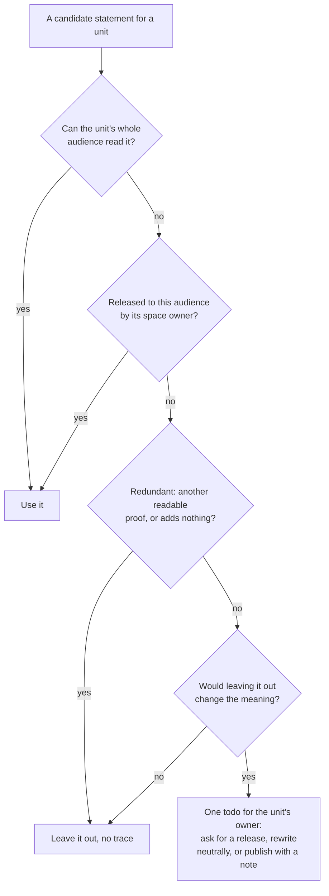

*Figure 14. How the compiler treats each input. A `secret` input never enters this flow outside its own space; if it contradicts a unit, the todo goes to the secret space's owner.*

- **The omission check.** Leaving an input out changes the meaning when it states a different value for a slot the unit uses, supersedes what the unit says, adds a condition or exception, or argues the other side of a point. The first three come from the knowledge model without a model call; the last needs the model task `page_compiler.check_omission`, with a deterministic mock in the prototype.
- **Releases are per statement.** A release opens one statement to one audience, records who approved it and when, and becomes a proof that audience can read. The evidence quote stays behind unless the release includes it. A later change gives the approver a todo to keep or withdraw it.
- **Answers** are written for one asker from what the asker can read. If material outside the asker's reach would change the answer, it says it may be incomplete and whom to ask, at `internal` and `confidential`; for `secret` material it says nothing.
- **The per-reader safety net** acts only on whole items (a document, a block, a row, a search result), never on words inside prose. When it would cut a paragraph, the unit is compiled again for that reader's set of readable spaces and cached for everyone who shares the set. Procedures are all or nothing.
- **Existence is hidden where it matters.** Unreadable spaces never appear in trees, search, counts or graphs, and a citation into a space the reader cannot read is left out with no marker when the statement stands on another proof.
- **Shared answer caches** are keyed by readable spaces and clearance; an entry is dropped when a unit it used changes label, proof or grant; an answer that used a unit readable only through the reader's own grant is never shared.
- **Search is filtered inside the index** by readable spaces and sensitivity, and every top result is checked again before it leaves the server.
- **Source ACLs are advisory.** Source-sync keeps ACL snapshots only for the audience-gap warning and the source-restricted todo.
- **Built today:** access-control on SpiceDB with tenant-keyed principals, source ACL mirroring, search scope filters and consistency tokens, and a lineage walk that accepts any one readable source. That is right for alternative evidence and too loose for jointly required inputs; nothing built writes such derivations yet. Replacing it with the space and proof rules is the next change to access-control.

The design, its abuse cases and eight acceptance tests are in [Permissions in compiled knowledge](design/compiled-knowledge-permissions.md).

## 16. Identity, tenancy and the request path

- **Three IDs.** Tenant `ten_`, user `usr_` (the account, business layer only) and member `mem_` (a user inside one tenant, the engine's only person ID). A member ID is unique only within its tenant, so anything that stores one outside a tenant's own rows stores the tenant with it. One function in the tenancy component assigns member IDs; nothing derives one ID from another.
- **One verification path.** Every call carries a JWT signed by the business layer: member, tenant, principal kind, the member an agent acts for, scopes, optional spaces and sensitivity limit, how the session signed in, and the interface `locale`. Web tokens live at most 5 minutes, OAuth access tokens 10 to 15. The engine verifies them against published keys and never sees a user ID or an identity-provider token.

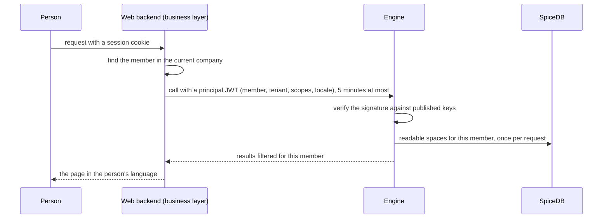

*Figure 15. A request carries only a short-lived signed principal. The engine checks permissions itself.*

- **Provisioning commands are idempotent** (an idempotency key, a version on directory objects) and return SpiceDB's consistency token, so the next read sees the change. A nightly directory snapshot repairs drift, and an hourly digest check catches it in between.
- **Contracts live in one place.** JSON Schema in this repository is the source of truth for both layers; business-only types sit in their own folder that engine packages never import.

## 17. Connectors, credentials and the sandbox

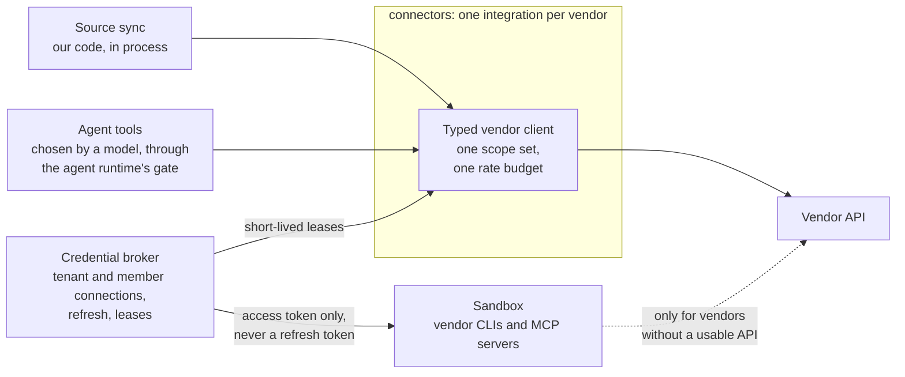

*Figure 16. Sync and agent tools share one vendor integration and one credential broker; only code we did not write runs in the sandbox.*

- **One integration per vendor serves both sync and agent tools.** Both face the same problems: whose identity a call uses, keeping tenants and members apart, token refresh, rate limits, consent, revocation and audit. So each vendor (Feishu first) has one typed client, with one scope set and one rate budget per connection. Sync uses it to follow changes; agent tools, registered as `agent_tools` plugins, use it to search, read and propose. Revoking a connection stops both. Interactive tool calls keep a reserved share of the rate budget, so a large sync never starves them.
- **The same identity rules for both.** Sync acts with the connection its publish chose. An agent tool always acts as the member it works for, with that member's own connection; a company connection is never leased to an agent run.
- **Different trust, different execution.** Sync is our own deterministic code and runs in process. A tool call is chosen by a model from content that may be hostile, so it passes the agent runtime's gate: allowed operations, validated arguments, read or propose only unless a member asked for an edit, and an audit record per call. Code we did not write (a vendor CLI such as lark-cli, or a vendor MCP server) runs only in the sandbox, gets a short-lived access token and never refreshes tokens itself, because Feishu refresh tokens are single-use and a second refresher would break the connection.
- **Anyone who holds a credential may import** (decided 2026-10-26). If a person can sign in to Feishu, DingTalk, WeCom or an OA system, that system's administrator has already let them read the content. Blocking the connection here would not be a security boundary: the same content can be exported through any third party and imported, and its origin can no longer be recognized. Members are governed upstream, through the source system's permissions and credentials. Verified email domains remain, only for joining a company automatically.
- **The credential broker owns every connection and its secrets.** A connection belongs to the tenant (the company's app, for shared spaces) or to a member (their own sign-in). Secrets are envelope-encrypted with a per-tenant data key; the key-encryption key is a deployment key in the prototype and OpenBao Transit or the customer's KMS in the product (SM4 where required). Refresh is proactive, single-flight per connection, with a daily keep-alive. A failed refresh marks the connection for re-authorization, pauses its sources and gives the owner a todo.
- **The sandbox runs one container per job:** read-only root, no volumes, egress through an allow-list proxy, never shared across tenants, nothing kept between jobs. Docker with gVisor in the prototype, Kata Containers or Firecracker in the product. Its profiles are vendor CLIs and MCP servers, and the view render check.

## 18. Models and agents

- **Every model call goes through the model gateway,** for completion, embedding, rerank and OCR, with `web_search` planned for research. A call names its task (`<component>.<verb_object>`, such as `extraction.extract_claims`), its budget key (`tenant:<id>/<component>`) and the highest sensitivity label of its content. The gateway refuses to send content to a provider that is not cleared for that label.
- **Prompts are versioned files.** The version is part of every artifact's inputs hash, so a prompt or model change shows exactly what to rebuild and what it would cost.
- **Until real models are configured, each model task ships a deterministic stand-in** (a `model_mocks` plugin), and the fake providers answer with it. Numbers measured on mocks describe the pipeline, not model quality.
- **The agent runtime** runs every built-in agent: an `AgentSpec` named `<component>.<agent>`, tools whose effect is read, propose or (on a member's request) edit, step and token limits, approval gates and run traces. Tool selection uses schema-constrained output over an OpenAI-compatible API, so swapping models does not change the agents.
- **Built-in agents:** the comment assistant, the Q&A assistant, the governance agents, the procedure writer, the publish check, the view generator and the research agent.
- **When an agent may change knowledge** (decided 2026-10-26). Running on its own (in the background, on a schedule or on an event), an agent only reads or proposes. When a member explicitly asks for a change in a conversation or a comment, that request is the approval: the agent edits where the member may edit, the change is recorded under the member's name, marked as made by the agent, and can be undone. Where the member may only propose, the agent proposes.

**The agent API.** A stateless MCP server on the current specification behind a plain load balancer, with REST and OpenAPI generated from the same operation schema. The business layer is the OAuth authorization server; the engine is the resource server, checks the token audience and never passes a client's token on. MCP clients sign in with OAuth and PKCE, the CLI with the device flow, and the super admin registers company agents.

**Scopes follow what a call does to knowledge,** in the usual `resource.action` form: `knowledge.read` has no side effects; `knowledge.propose` creates a proposal that goes through approval; `knowledge.write` edits directly with the member's own rights, as above; `comments.write` writes to the discussion, which is not knowledge itself. An agent's rights are always the member's rights cut down to its scopes and spaces.

**The tools** (proposed on 2026-10-27, replacing a first draft of ten). An agent chooses a tool by its name and description, so the tools follow what an agent is trying to do, not the shape of our knowledge model. Inside a call, the engine decides whether statements, procedures, entities or passages answer it.

| Tool | Use it when | Main inputs | Main outputs | Scope |
| --- | --- | --- | --- | --- |
| `ask` | You have a question, or a sentence to check | `question` or `claim`, `spaces`, `max_tokens` | An answer with a citation per sentence, and a note on conflicts, thin evidence or possible incompleteness; for a sentence, supported, contradicted or unsupported, with evidence; handles to read further | `knowledge.read` |
| `search` | You need to find or list material | `query`, `types`, `spaces`, `exclude_states` (such as stale, superseded), `limit` (10 by default, at most 50), `cursor` | Hits: handle, type, contextual heading, snippet of about 80 tokens, reader status, space, token estimate of the whole item; never full text | `knowledge.read` |
| `read` | You have a handle and need what is behind it | `id` (a page, section, procedure, card or passage), `outline` with `depth`, `max_tokens`, `cursor` | The content with a citation per sentence, or its heading tree with a token estimate per section; related cards and pages as handles; cut at the budget with a `cursor` to continue | `knowledge.read` |
| `get_changes` | You keep a copy, a cache or an index in step | `since` (the last `cursor`), `spaces`, `types` | Items added, changed and superseded, and a new `cursor` | `knowledge.read` |
| `report_feedback` | A result is wrong, outdated or missing | `target`, `kind` (wrong, outdated, missing), `note` | A todo for the owner of the scope | `comments.write` |

- **Where the first draft's tools went.** `get_outline` and `get_sop` are `read` on a page or a procedure; a procedure comes back as preconditions, steps, owners and exceptions in about 2,500 tokens or fewer. `get_entity` and `graph_neighbors` are the cards and links that `read` returns. `verify_claim` is `ask` with a sentence, and `answer` is `ask`.
- **The same permission rules as the screens.** What an agent can read is the member's readable spaces and clearance, cut to the agent's scopes and registered spaces. "No permission" and "does not exist" return the same `not_found`.
- **One response envelope.** Every result carries source, version, reader status, confidence, review status and a token estimate; each response carries a consistency token the agent passes back to read the same version.
- **Built for agents.** Ask or search first, then read: answers and hits return handles and token estimates, and the agent decides what to read within its budget. Handles are stable and work in every tool. Every result says what to do next ("read this handle for the full procedure"), and a refusal or a cut says which `cursor` or parameter to use. Every tool is stateless and the read tools are idempotent.
- **Measured, not assumed.** Before the API is fixed, the same task set runs with several models against these tools and against the first draft's ten, comparing tasks completed, calls and tokens.
- **Still open:** whether `search` ranks blocks and statements together by default, and whose budget pays for the model call inside `ask`.

## 19. Pages, views and search

The contracts for pages and views are in place; the compilers, the view host and retrieval are planned.

**From documents to knowledge** (decided 2026-10-27). People meet their own material first. After an import, a source opens as a mirror page: the document in its own shape, with its headings, paragraphs, lists and tables, close to the original even where it is not identical, much as a Claude Artifact renders a page. Knowledge is revealed from there one step at a time, from concrete to abstract: first the marks in the Annotated view, then, when someone selects a passage, the What this says panel (what the passage states, which other documents agree with it, differ from it or add to it, and the pages that use it), then the knowledge pages built from it. Someone new starts in their own documents, not in knowledge cards, and the Documents tree sits above the Knowledge tree. The UI principles call this "Concrete before abstract", and the design canvas draws it. Readers of a shared space stop at the marks and the pages, because statements and lineage belong to the Trace view; a member owns their own My space, so the Trace view is open to them there.

- **A page is a `PageSpec`:** an ordered list of 14 typed blocks (heading, paragraph, list, callout, quote, table, code, math, image, divider, diagram, chart, view, embed) whose sentences carry statement IDs. Every version is an immutable snapshot with its cause, and block keys stay stable so comments survive rebuilds and diffs can say what moved.
- **A page is written for its audience,** from statements its whole audience can read or that were released to it (section 15). Procedures are published only when their audience can read every step. When a space narrows later, the page is compiled again as a new version.
- **Diagrams are compiled from structure:** the model chooses what to show but never draws edges.
- **Charts** take their data from a `DataRef`: inline rows, statements (fixed or by query) or a registered query of a connected system, never free SQL. Rows built from statements keep their statement IDs.
- **Interactive views** separate code from data. A view version is a template or generated code that passes a headless render check (console errors, overflow at phone and desktop widths, both themes, empty and large data) and a person's approval. It runs in an iframe on a separate origin with a Content Security Policy that blocks all network access, and talks to the host only through a typed message protocol.
- **Mirror pages** render the Original view from blocks without a model, with per-block fidelity (exact, approximate, or a placeholder that says "open in source").
- **Retrieval owns every search index:** structure-aware chunks with contextual headers, embeddings, BM25 and vector indexes for blocks, statements, procedures and pages. Search is hybrid with reciprocal rank fusion and a reranker, pre-filtered by readable spaces and sensitivity. Each citation carries one reader status (fresh, aging, stale, at risk, superseded, disputed), which the UI maps to the four words readers see.
- **Citations never wait for extraction.** A citation is span-based. When a reference passage is cited for the first time, retrieval asks extraction to read it in full in the background (13 ms median on mocks).

## 20. Internationalization

| Where | Design | State |
| --- | --- | --- |
| Contracts | `Locale` (BCP 47) on documents, parse hints, statements, pages and view messages; events and todos carry codes and parameters, never sentences; the principal token carries the interface `locale` | Locale built; the rest designed |
| Language packs | Sentence and clause rules, full-width forms, number formats and heading patterns in per-language resource files (en, zh, ja), checked by a repo test | Built |
| Normalization | Language detected per document and per block | Designed |
| Extraction | Prompts state the source language; quotes stay verbatim; dates, eras, large-number units and currencies become typed values | Designed |
| Fact slots | Language-neutral predicate and qualifier keys with labels and aliases per language; entity names resolved across scripts | Keys and typed values built; the rest designed |
| Statements | A translation is linked to its original and counts with it; statements merge across languages after a model check | Designed |
| Retrieval | Multilingual embeddings (Qwen3-Embedding); BM25 with a tokenizer per language (jieba, a Japanese morphological tokenizer, English stemming) | Designed; a jieba index exists in the knowledge store |
| Page-compiler | A page's structure is built once; its canonical rendering is in the space's content language, and other languages are compiled from the same statements on request | Designed |
| Business layer | Account language, a company default for broadcasts, ICU MessageFormat catalogs (a missing string fails the build), localized sign-in, region per tenant | Designed |
| UI | Catalogs for en, zh-Hans and ja; a language tag on every block; fonts per script; locale formats and collation; input-method rules; pseudo-locale tests | Designed |
| Repository | No Chinese or Japanese in code or comments; docs in English with a Chinese copy under `docs/zh/` | Built (repo test) |

## 21. Feasibility: what is proven, what is not, and how we will find out

The prototype runs on mocked models on purpose: it proves the pipeline, the volumes and the boundaries, not model quality. Each hard part below says what the evidence is today and what will settle it.

| Hard part | Evidence today | Not yet proven | How we find out | If it falls short |
| --- | --- | --- | --- | --- |
| Extracting statements with verbatim evidence | The quote check is enforced by the store; extraction runs end to end on mocks | Quality and recall with real models on real documents | A capped probe, then the G1 evaluation (entailment at or above 95%) | Governance levels keep extraction to governed documents; low-confidence statements stay Reference |
| Fact slots across documents | 59% of statements land in a slot on the synthetic tenant; typed values built | How varied real predicates and qualifiers are | Run the probe on a real policy library; owners confirm the predicate catalogue | Statements without a slot are grouped by page section and still cited |
| Topics people can own | No statement moved without cause; first-review campaigns work | Topic size with real embeddings (fake embeddings made topics about ten times too big) | Re-measure with Qwen3-Embedding | The Trace view is designed for about 1,000 statements per topic; owners can split topics |
| Review load | Median 1, max 4 cards per owner per week over a simulated year | Real conflict rates and owner behaviour | Conflict precision at G1; weekly active owners at G2 | Levels, the weekly budget, precedence rules and change reviews |
| Incremental freshness at scale | 10,000 documents: 72 s to sync, 535 s to settle; 1 of 175 edits asked a person | Real change patterns, webhooks and rate limits in a live Feishu tenant | The pilot tenant | The nightly full listing catches whatever push and polls miss |
| Permissions without leaks or blank pages | SpiceDB checks, scope filters and consistency tokens built; the compiled-knowledge design has eight acceptance tests | Precision of the omission check, which needs a model for "the other side" | An evaluation set of balanced arguments and abuse cases; the red team | Three of the four triggers need no model; "publish with a note" is always available |
| Answers and agent efficiency | Contracts in place | Retrieval quality and tokens per task | Recall@10 and tokens per task against a chunk-only baseline (G1, G2) | Hybrid search with rerank; tools return handles before text |
| Knowledge across languages | Language packs and language-neutral keys built | Missed and wrong merges across languages | A three-language evaluation corpus | Unmerged statements stay duplicates, never false conflicts |
| Parsing Office, PDF and scans | Built-in text parsers | Throughput and layout quality, especially on domestic accelerators | Benchmark Docling and PaddleOCR-VL on the customer's hardware early in a pilot | A router with confidence escalation; placeholders that say "open in source" |
| Feishu and Lark in production | Connectors built against recorded fixtures; single-flight refresh designed | Rate limits and token refresh on a real tenant | The pilot tenant | Reserved rate share for interactive calls; re-authorization todos |
| Model cost | 5.6k model calls for 10,000 documents with governance levels, against 10k without | Tokens and money per document on real models | Measure in the probe | Levels, extract on use, the response cache and a flash-class model |
| Compliance in China | Known requirements: generative AI filing, ICP licence, classified protection | Time to certify | Start filings before G3 | Private deployment first for regulated buyers |

## 22. How we build

- **Contracts first.** `libs/contracts/schema/*.yaml` is the source of truth; types and validators are generated. Additive changes are fine in a branch; anything that removes, renames or tightens a field needs agreement first. See [contracts.md](contracts.md).
- **Boundaries are checked, not trusted.** A package sits in its layer's folder and depends only on the libraries and the components in its `calls`; dependencies between the layers point one way.
- **Plugins by registry.** Connectors, agent tools, parsers, diagram compilers, index backends, data providers, model providers, model mocks, view templates and migrations register by name in fixed plugin groups. A new source or model is a new plugin, not a core change.
- **Tests on both backends.** Unit tests use in-memory doubles; code with a Postgres, Valkey or SpiceDB implementation runs the same tests against the real stack. `make check` runs Biome, strict `tsc`, contract freshness and every test with the stack up.
- **A demo tenant and a scale generator.** `examples/corpus` is Qinghe Technology, with planted duplicates and conflicts; `pnpm engine synthesize` writes synthetic tenants of any size, and `pnpm engine ingest` prints a volume report.
- **Every change lands through a pull request.** The product owner's local Codex reviews it; findings are fixed and the PR is merged. Correctness comes first, then layering, clear component boundaries and explicit contracts.
- **Names describe what things do.** No plan numbers in code, docs or events. [AGENTS.md](../AGENTS.md) has the full rules for anyone, human or agent, building a component.

**Technology stack.**

| Concern | Prototype | Product |
| --- | --- | --- |
| Language | TypeScript on Node 22 everywhere; a Python worker only for document parsing | Same; Go only for single-binary pieces |
| Database | PostgreSQL 16 | PostgreSQL, or KingbaseES and openGauss through a narrow SQL subset |
| Search | pgvector and ParadeDB pg_search | Milvus, or Elasticsearch or OpenSearch where the customer runs it |
| Permissions | SpiceDB | SpiceDB, plus a policy engine for labels |
| Queue | Postgres outbox and Valkey Streams | NATS JetStream or Kafka |
| Models | Fake providers with mocks now; next one flash-class model (domestic in China), Qwen3-Embedding and Qwen3-Reranker | Routing across vLLM, SGLang and MindIE, per region and sensitivity |
| Parsing | Docling and PaddleOCR-VL on one GPU | A router with confidence escalation |
| Identity | Logto behind an OIDC adapter | Logto, Keycloak, or the customer's own identity provider |
| Secrets | Envelope encryption under a deployment key | OpenBao Transit or the customer's KMS or HSM |
| Sandbox | Docker with gVisor | Kata Containers or Firecracker with warm pools |
| Deployment | Docker Compose on one node | Helm, air-gapped bundle, amd64 and arm64 |

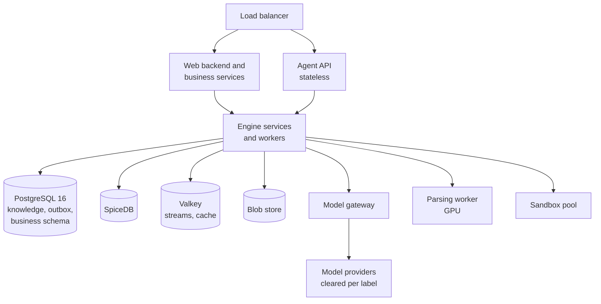

*Figure 17. One SaaS region. Each company's data stays in the region chosen when the company was created.*

- **Two deployment profiles from one codebase.** SaaS comes first: a company's region is fixed at creation, starting with mainland China and one global region. Public SaaS in mainland China needs a generative AI filing, an ICP licence and classified protection. Private deployment is the second profile, with domestic infrastructure (Kylin, Kunpeng or Hygon, KingbaseES, Ascend) as the target for certification.
- **Licences.** pg_search is AGPL-3.0; BM25 sits behind a plugin interface so an OpenSearch index can replace it where a customer needs that. Valkey (BSD) is used instead of Redis. See [licensing.md](licensing.md).

## Part III. Plan

## 23. Where we are

**Built and merged on `main`:** contracts, kernel, event bus, test kit, knowledge store, access control, model gateway, agent runtime, connectors, source sync, normalization, extraction, governance, freshness, tenant-scoped member IDs, and the engine process with its CLI, demo corpus and synthesizer (PRs #2 to #7); governance levels, fact-slot keys and extract on use, topics and placements, and the inbox (PRs #8 to #10); language rules in resource files for en, zh and ja with a repo test against Chinese and Japanese in code (PRs #12 and #13); the move into a folder per layer (PR #15); the design documents (PRs #11 and #14) and this overview as product requirements and technical architecture (PR #17); a value from statements not yet in effect lends no authority (PR #16); a control corpus whose cases each have one right answer, with the engine's known gaps recorded (PR #18); who owns vendor integrations, the tool gate and the sandbox in `components.yaml` (PR #19); a snapshot of the UI screens (PR #20); and the design for code repositories (PRs #21 to #23).

**Measured** on a synthetic tenant of 10,000 documents with the mocked model and fake embeddings (Postgres and Valkey). These numbers describe volumes and the pipeline, not model quality:

| Measure | Value |
| --- | --- |
| Documents governed / reference / search only | 1,366 / 5,530 / 3,104 |
| Statements extracted (before governance levels) | 39.9k (137.8k); 17.5k after merging |
| Statements in a fact slot | 59% |
| Model calls (before governance levels) | 5.6k (10k) |
| Conflict todos | 30 (28 normal, 2 high) |
| Source updates that asked a person anything | 1 of 175 in an edit round |
| Topics; statements per topic, median / max | 41; 1,143 / 6,206 |
| Statements that changed topic on a second re-clustering / after a round of edits | 0 of 25,660 / 0 of 25,683 |
| Inbox cards per owner per week, median / max (15 owners, one simulated year) | 1 / 4, with or without the budget of 10 |
| Day-one overdue reviews | 605, on 44 first-review campaign cards |
| First citation of a reference passage (mocked) | 13 ms median |
| Ingest time, with topics | 72 s to sync, 535 s to settle |

Topics come out about ten times larger than the design target of about 100 statements, because the synthetic tenant restates 30 subjects across many documents and fake embeddings cannot tell those sections apart. The budget never had to hold a todo back, because grouping by owner, topic and week already keeps every owner under it.

**Designed, not built:** the two-domain permission rule and the principal token, publishing, compiled-knowledge permissions, the credential broker and sandbox, the Documents tree and mirror pages, pages and views, retrieval and the agent API, research, the parsing worker, source deletions and change reviews, knowledge across languages, code repositories as a source (proposed), and the whole business layer and UI.

## 24. Next steps and effort

The rule is to mock every model call until each stage runs end to end, and only then switch on real models. The proposed order of the remaining stages, for discussion:

1. **Engine side of the business contract:** the principal token, provisioning and the seed command, the space and proof rules in access-control, and domain keys on slots and conflicts.
2. **Pages and views of sources:** cited page synthesis for an audience, `PageSpec` snapshots and diffs, the dependency graph with `artifact.dirty`, mirror pages and the Documents tree.
3. **Search and agents:** retrieval with its own indexes, grounded answers, the topic overview read, and the MCP server with its tools.
4. **Connections and parsing:** the credential broker, member connections, the parsing worker.
5. **Research, views and the sandbox.**
6. **Business layer phase 1 and the web app,** in parallel once the contract is in place.

| Scope | Person-weeks |
| --- | --- |
| Engine prototype: the 19 engine components and the web app | 70 |
| Knowledge views (Original, Annotated, Documents tree, split citation pane) | 6 |
| Pipeline boundaries (web connector, `fetch_now`, `web_search`, evidence registration) | 2 |
| Statements at scale (governance levels, fact slots, topics, grouped review) | 7.5 |
| Business layer, phases 1 and 2 | 16 |
| Engine work for the business boundary (net) | 4.5 |
| Internationalization (engine 3.5, UI 3, business 0.5) | 7 |
| Source changes (deletions, moves, change reviews) | 3 |
| Knowledge across languages (translations, cross-language merge, pages in another language) | 3.5 |
| Permissions in compiled knowledge (writing for an audience, the omission check, releases) | 3 |
| Code repositories (code-graph, research over code; proposed) | 8.5 |
| **Total** | **about 131** |

After that, pilot and product-v1 work for Artifact-level editing (templates, Word and PDF export, block editor, real-time co-editing, the view host API, mobile, share links) is about 19 to 27, and billing about 3. The first seven prototype stages were built by agents in two days, so calendar time depends more on review and integration than on these figures.

## 25. Risks

| Risk | Impact | Mitigation |
| --- | --- | --- |
| Extraction errors gain false authority | Wrong answers to people and agents | Verbatim quotes, entailment checks, confidence thresholds, governance levels |
| Oversharing at publishing | A restricted document becomes readable by a whole space | Audience-gap warning, sensitivity and personal-data scan, owner approval, source-restricted todo, audit |
| Omissions mislead readers | A page shows one side of an argument | The omission check, notes for readers, releases per statement |
| Review fatigue | Owners ignore their inbox | Governance levels, grouping per topic and week, weekly budget, change reviews, notes outside the budget, queue precision as a product metric |
| Topic churn and size | Topics too large or unstable to own | Stable keys, a change budget per run, owner confirmation; re-measured with real embeddings |
| Human edits lost on rebuild | Loss of trust | A separate human layer; pinned overrides a rebuild never overwrites; todos instead |
| Cross-language matching | The same fact in two languages is missed or wrongly merged | Language-neutral keys, aliases per language, translations linked to originals, a model check before any merge, a three-language evaluation corpus |
| Suites bundle similar features | Lost single-suite deals | Lead with cross-tool governance and the governed agent endpoint |
| Model throughput on domestic accelerators | Slow first index | Benchmark on the customer's hardware early in a pilot |

## 26. Decisions in force

| Decided | Decision |
| --- | --- |
| 2026-10-22 | Product name Inspiration; Artifact-level page presentation is committed scope; capabilities first, accepted through MCP, REST and the CLI |
| 2026-10-23 | TypeScript everywhere except a Python parsing worker; descriptive component names; every change through a PR reviewed by the product owner's local Codex |
| 2026-10-23 | A mocked end-to-end prototype of every stage first; real model access only after it runs; engine and UI iterate together on measured volumes |
| 2026-10-24 | Three IDs: tenant, user (account) and member |
| 2026-10-24 | Two knowledge domains: My space private, shared spaces governed top down; source permissions only warn; publishing moves knowledge; credentials decide freshness only |
| 2026-10-24 | Statements at scale: two outlines, governance levels, grouped review; uploads start as Reference; a weekly budget of 10; reference never blocks a governed statement |
| 2026-10-24 | Engine and business layer split; Logto as identity provider; SaaS first with private deployment as a second profile; My space locked on leaving and erased after 30 days; approvers see only a request's items |
| 2026-10-24 | Connectors on vendor APIs, vendor CLIs only in the sandbox, a credential broker |
| 2026-10-24 | Three views and two trees for reading |
| 2026-10-24 | Pipeline boundaries: normalization before extraction and indexing, retrieval owns every index, freshness emits signals only, collaboration owns every todo |
| 2026-10-24 | English, Chinese and Japanese from the first release; no Chinese in code or comments; docs in English with a Chinese copy |
| 2026-10-26 | Three product roles: super admin, owner (always named with its scope) and member; finer roles stay internal and product roles are bundles of them |
| 2026-10-26 | Usage follows mainstream AI products: seats fill a company pool, members have default caps, the super admin sees usage but never content; details come with billing |
| 2026-10-26 | Words: Company in English, 企业 in Chinese, 企業 in Japanese, never "workspace"; governance levels 严格, 宽松 and 仅检索 in Chinese |
| 2026-10-26 | Source changes: knowledge never disappears silently; a deleted source is kept and marked until its owner decides; a large change is reviewed once, as a whole |
| 2026-10-26 | Knowledge is language-neutral and language is only how it is expressed |
| 2026-10-26 | Anyone who holds a credential to a source may import from it; no blocking by email domain or Feishu organization; verified domains only for joining |
| 2026-10-26 | Agents running on their own only read or propose; a member's explicit request is the approval for an edit within that member's rights (`knowledge.write`) |
| 2026-10-26 | Engine and business layer in one monorepo, a folder per layer (`libs/`, `engine/`, `business/`, `apps/`), with one-way dependencies checked by the manifest test |
| 2026-10-26 | One integration per vendor serves both sync and agent tools; tools act as the member; only code we did not write runs in the sandbox |
| 2026-10-27 | Concrete before abstract: an imported source opens as a document in its own shape, and knowledge is revealed from it step by step, concrete to abstract; someone new starts in their documents, not in knowledge cards |
| 2026-10-27 | The Sources tree is called the Documents tree (文档树, ドキュメントツリー), the word people use for their material, although it also holds chats and sheets; a source is still a source wherever a page cites it |

## 27. Open questions

1. **Confirm the boundary between the super admin and owners, and the Chinese name 维护人** (section 4).
2. **Confirm the trade-off in compiled-knowledge permissions:** at `internal` and `confidential`, readers learn that relevant restricted material exists and whom to ask, never its content; `secret` material leaves no trace (section 15).
3. **Review the proposed Japanese terms** in the glossary.
4. **Which SaaS region opens first,** and how gates G2 and G3 change for SaaS first.
5. **Which model providers serve each region,** and at which sensitivity labels.
6. **Which connectors come second and third outside China** (for example Confluence, Notion, Google Drive, SharePoint), and which first design partner and industry the pilot targets.
7. **The order of the remaining prototype stages,** and whether a small, capped probe with a real model on real documents should run before every stage is mocked.
8. **Two details of the agent tools:** whether `search` ranks blocks and statements together by default, and whose budget pays for the model call inside `ask`.

## Appendix A. Glossary in three languages

One glossary feeds every status, button and empty state. The Chinese column is adopted except where marked; the Japanese column is proposed and waits for review.

<!-- glossary -->
| English | Chinese | Japanese |
| --- | --- | --- |
| Personal library | 我的知识库 (个人知识库 in the switcher) | マイライブラリ (個人ライブラリ in the switcher) |
| Company | 企业 | 企業 |
| Space, My space | 空间, 我的空间 | スペース, マイスペース |
| Member | 成员 | メンバー |
| Company connection, Personal connection | 企业连接, 个人连接 | 企業の接続, 個人の接続 |
| Source, Passage, Statement | 来源, 段落, 陈述 | ソース, 段落, 記述 |
| Topic, Knowledge page, Procedure, Card | 主题, 知识页, 流程, 卡片 | トピック, ナレッジページ, 手順, カード |
| Knowledge tree, Documents tree | 知识树, 文档树 | ナレッジツリー, ドキュメントツリー |
| Original, Annotated, Knowledge views | 原文, 批注, 知识 | 原文, 注釈, ナレッジ |
| Fresh, Review due, Outdated, Disputed | 有效, 待复核, 已过时, 有争议 | 有効, 要確認, 旧版, 異論あり |
| Space owner, Topic owner, Page owner, Procedure owner (proposed in Chinese); Super admin | 空间维护人、主题维护人、页面维护人、流程维护人；超级管理员 | スペース担当者、トピック担当者、ページ担当者、手順担当者；特権管理者 |
| Rule | 裁决规则 | 裁定ルール |
| Any one, Everyone (approval modes) | 或签, 会签 | いずれか承認, 全員承認 |
| Who can read this | 可见范围 | 公開範囲 |
| Inbox, Assistant | 待办, 助手 | 受信トレイ, アシスタント |
| Keep fresh with the company connection, Keep fresh with my connection, Publish a snapshot | 通过企业连接保持更新, 通过我的连接保持更新, 发布快照 | 企業の接続で最新に保つ, 自分の接続で最新に保つ, スナップショットを公開 |
| Some readers can't open the original | 部分读者无法打开原文 | 一部の閲覧者は原文を開けません |
| Source permissions tightened | 来源权限收紧 | ソースの権限が縮小されました |
| Governed, Reference, Search only | 严格, 宽松, 仅检索 | 規程, 参考, 検索のみ |
| Trace view | 追溯 | 追跡 |
| Release to | 放行到 | 公開を許可 |
| May be incomplete | 可能不完整 | 不完全な可能性があります |
<!-- /glossary -->

## Appendix B. Further reading

- [UI principles](design/ui-principles.md): interaction principles, visual system, key screens and the UI's internationalization rules.
- [Statements at scale](design/statements-at-scale.md): two outlines, fact slots, governance levels, grouped review and the measured volumes.
- [Business layer](design/business-layer.md): accounts, companies, publishing, governance roles, agent access and the business-layer plan.
- [Business layer and engine contract](design/business-engine-contract.md): the commands, events, principal token and schema changes between the two layers.
- [Source changes](design/source-changes.md): what happens when a source corrects itself, is deleted or changes at scale.
- [Knowledge and language](design/knowledge-and-language.md): translations, cross-language merge and pages in another language.
- [Permissions in compiled knowledge](design/compiled-knowledge-permissions.md): writing for an audience, omissions that change the meaning, releases, abuse cases and trade-offs.
- [Architecture](architecture.md): components, how they talk, storage and security as built.
- [Contracts](contracts.md): changing schemas, IDs, events, versioning.
- [PageSpec and views](pagespec.md): pages compared with Claude Artifacts, and the view sandbox.
- [Licensing](licensing.md): licences of the stack and what they mean for delivery.
- [`components.yaml`](../components.yaml): the component manifest.
- [AGENTS.md](../AGENTS.md): rules for building a component.
- [`examples/corpus`](../examples/corpus/README.md): the demo tenant and what it should produce.
