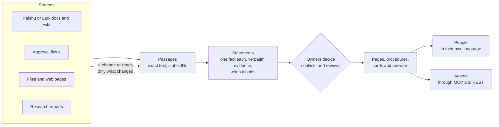
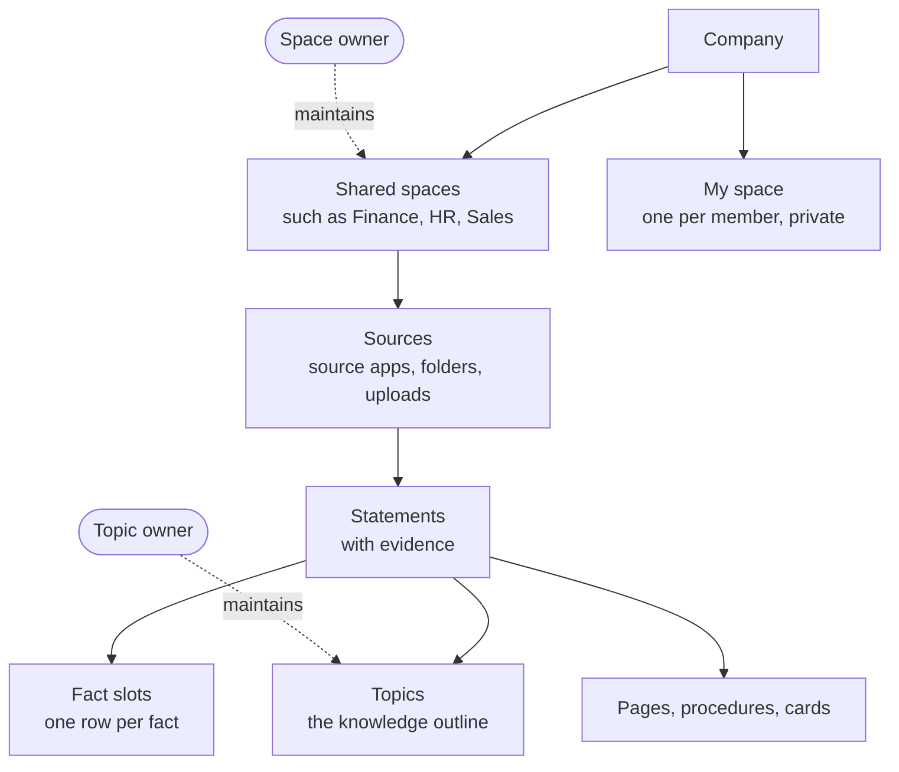
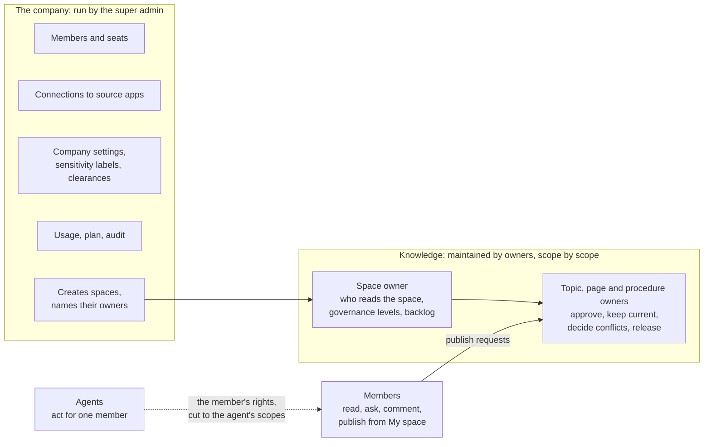
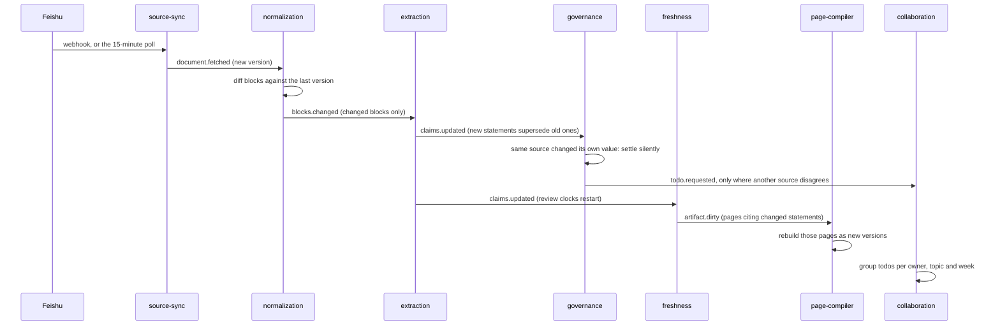
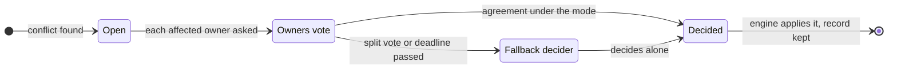
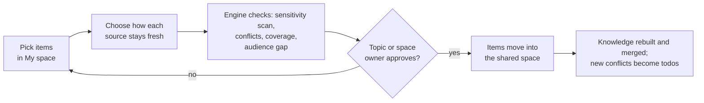
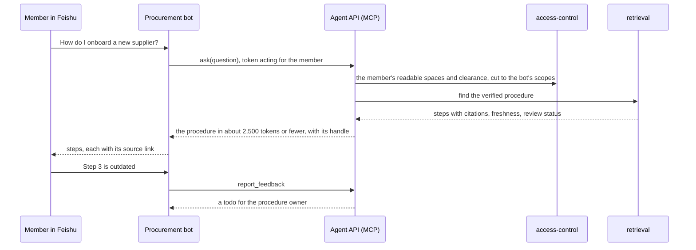
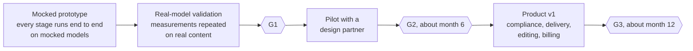
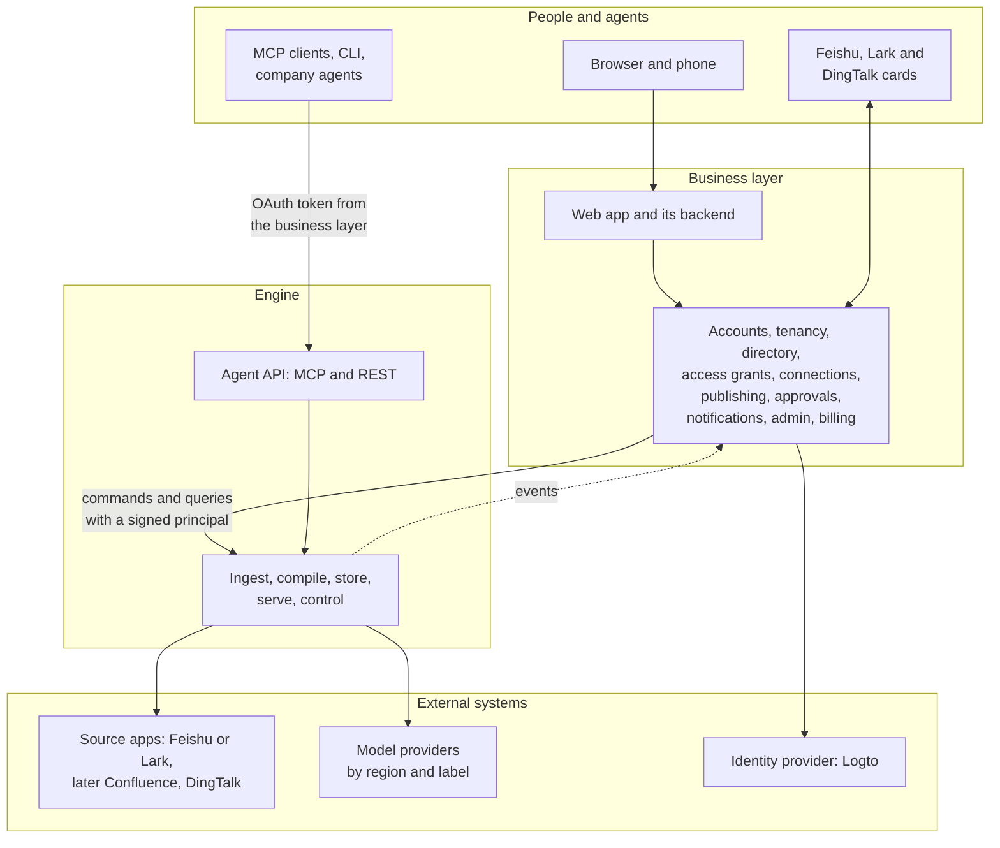
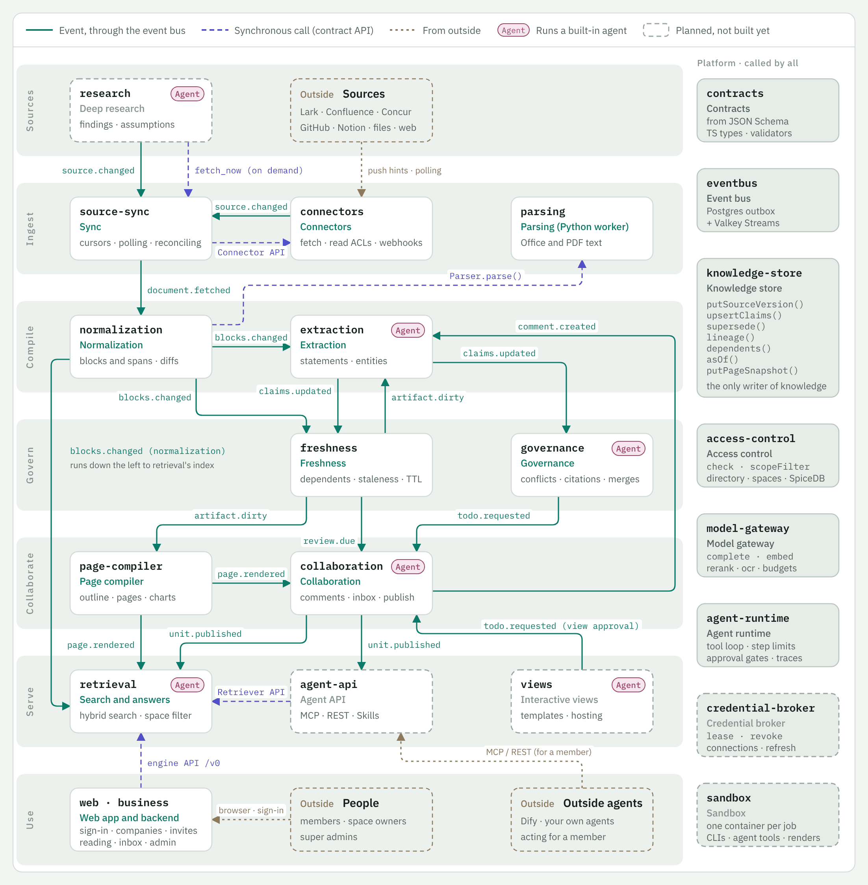

# Inspiration: product requirements and technical architecture

Version 2, as of 2026-10-27; the state of each part was brought up to date on 2026-11-05. This document replaces the first product and technical overview and folds in every discussion on it. Part I is the product requirements: who Inspiration is for, the scenarios it must handle and what it must do. Part II is the technical architecture at a glance and how we know the hard parts can work; [Architecture](architecture.md) has each part in detail. Part III is the plan: where we are, what comes next and the risks; the decisions in force and the open questions are in [Decisions](decisions.md). Every requirement and component says whether it is built, designed, proposed or still open. The design documents, listed in the [docs index](README.md), hold the details. A Chinese copy is in [zh/overview.md](zh/overview.md); if the two differ, this English version wins.

| If you want to know | Read |
| --- | --- |
| What the product is and why it should exist | 1 Summary, 2 The problem |
| Who uses it and what they do with it | 3 Key concepts, 4 Users and roles, 5 Scenarios |
| What exactly must be built | 6 Functional requirements, 7 Quality requirements, 8 Releases |
| How it works | 9 Architecture at a glance, then [Architecture](architecture.md) |
| Whether the hard parts can work | 10 Feasibility |
| What is being built now | 11 Where we are, and [the MVP](design/mvp.md) |
| What happens next, and what needs a decision | 12 Next steps, 13 Risks, and [Decisions and open questions](decisions.md) |

## 1. Summary

**Inspiration turns a company's scattered documents, approval flows and research into governed knowledge.** Every statement keeps its exact evidence, stays current as its sources change, has a person who maintains it, and reaches people as readable pages and agents through MCP, each within their own permissions.

*Figure 1. The knowledge lifecycle. Sources are read into passages, passages into statements, people settle what the statements disagree on, and everything people and agents read is built from statements. A change in a source flows through only as far as it matters.*

Four bets set Inspiration apart, each answering a failure of today's tools:

1. **Knowledge is stored as single statements, not as documents or chunks.** Each fact is stored once, with a verbatim quote from its source, the time it holds and the time the system learned it. Pages, procedures and answers are built from statements, so every sentence can be traced. A question such as "may I book a 650-yuan hotel in Shenzhen?" needs the one value in force and its source, not five passages from five versions.
2. **Freshness works like a build system.** A change re-reads only the passages that changed, updates only the statements they support, and rebuilds only what cites them. Policies change all the time; reading everything again is too slow and too costly, and asking a person about every change floods them.
3. **People decide, in amounts they can keep up with.** Agents detect, propose and answer; people decide. Most sources are never governed statement by statement, and reviews arrive grouped per topic and week, within a weekly budget. A governance product that floods its owners is abandoned within weeks.
4. **Knowledge moves from personal to shared under one rule.** Each member's My space is private. Publishing moves knowledge into a shared space, whose owner decides who reads it. Source permissions only warn. Permission arithmetic across merged sources cannot be done reliably, and the company, not each source app, should decide who reads company knowledge.

**Who it is for.** Teams and companies whose knowledge lives across several tools (Feishu or Lark, Confluence, approval systems, file shares, PDFs). It starts with one person's library and grows into teams and companies. The strongest early uses are governing procedures and policies across tools, and a governed knowledge endpoint for a company's own agents. It is sold as SaaS first, with private deployment as a second profile of the same code. English, Chinese and Japanese are supported from the first release, as one knowledge base: knowledge is language-neutral, and language is only how it is expressed.

**Where it stands.** The engine runs end to end: ingest, parsing, extraction, governance, freshness, governance levels, topics, the inbox, search and grounded answers, all merged on `main`, with its language rules in resource files. From 2026-10-27 to 2026-11-04 real models validated the knowledge core first: Inspiration answers more questions right than a mature RAG, from a smaller input, though short of the 10-point aim, and the product owner accepted that lead ([validation](design/validation.md)). Since 2026-11-05 the [MVP](design/mvp.md) is being built, one company's whole loop. Sign-in and companies, uploads and parsing, fast cited answers, "Decide for me" and agents over MCP are merged, and the trial comes next. Pages, publishing and the rest of the business layer are designed but not built.

**What is new in this version.** It is written as a PRD plus an architecture, with scenarios that say why each design exists and a feasibility section that says what is proven and what is not. It also takes in the decisions and proposals from the discussions since the first version:

- The super admin runs the company and owners run knowledge, with a sharper line between them (proposed, section 4).
- Compiled knowledge is written for its audience and never cut per reader; an omission that changes the meaning goes to a person (proposed, see [Permissions](architecture.md#permissions)).
- Anyone who holds a credential to a source may import from it; personal connections are no longer blocked by email domain or Feishu organization (decided, see [Connectors](architecture.md#connectors-credentials-and-the-sandbox)).
- Agents running on their own only read or propose; a member's explicit request is the approval for an edit under that member's own rights (decided, see [Models and agents](architecture.md#models-and-agents)).
- The agent tools: four shaped by what an agent is doing and one for feedback, with inputs, outputs and permissions (proposed, see [Models and agents](architecture.md#models-and-agents)).

## Part I. Product requirements

## 2. The problem

Take Hengyuan Machinery (恒远机械), the fictional company in our demo corpus. Its rules for business travel live in seven places:

| Where | What it says about a hotel in a tier-1 city such as Shenzhen |
| --- | --- |
| Travel reimbursement policy, edition 6, Finance policies | 600 yuan a night |
| Shenzhen hotel price list, Finance policies, written in October | 650 yuan a night in Shenzhen |
| Forwarded copy of the policy, HR folder | 600 yuan a night |
| Reimbursement FAQ, Finance team notes | 600 yuan a night |
| Travel FAQ, Feishu wiki | 600 yuan a night |
| Minutes of the August, September and October meetings | 600 yuan a night; in October, Shenzhen hotels cost about 650 and 600 holds until the policy is revised |
| Archived 2023 edition of the policy | 500 yuan a night |

The same company has four more planted disagreements: the meal allowance, the annual leave (the onboarding guide says 7 days, the HR policy 5), the loan settlement period (the loan FAQ says 30 days, the policy 15) and a budget deadline that only the meeting minutes moved. This is ordinary. What goes wrong today:

1. **Nobody can tell which value holds.** Search returns all seven documents. The reader has to work out that the price list is newer than the policy, and that the policy's owner has not decided yet.
2. **Assistants answer with confidence from whatever ranks first.** A chat assistant over chunks may quote the 2023 edition, or the copy in HR's folder.
3. **Nobody maintains a fact.** Documents have authors, but a fact restated in seven documents has no one responsible for it.
4. **Changes do not propagate.** When Finance revises the policy, nobody updates the HR copy, the FAQ or the minutes.
5. **Agents need the same answers, within the same permissions, in a token budget.** A procurement bot in Feishu or a coding agent needs the current procedure, with its sources, for the person it acts for.

How existing approaches handle this:

| Approach | Good at | Falls short when |
| --- | --- | --- |
| Knowledge bases inside one suite (Feishu wiki, Confluence) and their assistants | Writing and organizing pages inside that suite | Knowledge spans several tools; answers come from pages, not from facts that someone maintains |
| Enterprise search and retrieval over chunks (RAG) | Finding passages across tools quickly | Passages disagree: nothing decides which value holds or notices a stale copy |
| Verified knowledge cards | An owner vouches for a card on a schedule | Cards are written by hand, apart from their sources, and age silently between reviews |
| Inspiration | Statements tied to their sources across tools, a maintainer per scope, change propagation, one governed endpoint for people and agents | Extraction quality is still to be proven with real models (section 10) |

## 3. Key concepts

These words are used throughout. The engine uses a few more precise ones, which [Architecture](architecture.md#knowledge-model) lists.

| Concept | What it is |
| --- | --- |
| Company | One business or team using Inspiration. It is the unit of isolation and billing. Someone working alone has a personal library instead and never sees a company |
| Drive | The product's file-management layer, decided as a direction on 2026-11-13; knowledge-file granularity and original materials as files are being designed ([proposal](design/drive.md)) |
| Space, My space | A space is an area of a company with an audience, such as Finance or Procurement. Each member also has a private My space in every company |
| Source | A place material comes from, such as one Feishu wiki space, an upload folder or a research report |
| Passage | An exact piece of a source: a sentence, a table cell, a form field. Every citation points at one |
| Statement | One fact with its verbatim evidence, the time it holds, a status and a knowledge class (policy, pricing, process and so on) |
| Fact slot | All statements about one single-valued fact ("hotel cap, tier-1 city, managers and below"). Conflicts live inside one slot |
| Governance level | Per source or folder: Governed (fully read and maintained), Reference (read only where it touches a known fact or is cited) or Search only |
| Topic | A place in the knowledge outline (area, topic, subtopic). Every governed statement is filed under one |
| Page, procedure, card | What readers read, built only from statements: knowledge pages, procedures (SOPs) and cards about one thing, such as a city or a supplier |
| Todo, inbox | A todo asks a person to decide or review something. Todos arrive in one inbox, grouped into weekly cards |
| Owner | The person who maintains a scope: a space, topic, page or procedure. Always named with the scope, such as topic owner |
| Super admin | The person who runs the company: people, connections, settings, usage and audit |

*Figure 2. How the concepts fit. Sources belong to spaces; statements come from sources; slots, topics and pages organize statements; owners maintain spaces and topics.*

## 4. Users and roles

Most people only read. The product is built so that readers see a normal document and never the knowledge machinery behind it.

| Who | Main jobs | What they see |
| --- | --- | --- |
| Member | Read, ask, comment, keep material in My space, publish from it | Pages with small citation numbers. Only two marks appear in the text: Outdated and Disputed |
| Owner of a space, topic, page or procedure | Approve what is published into the scope, keep it current, decide its conflicts, release statements to wider audiences. A space owner also sets who reads the space and its governance levels | Their inbox, and the Trace view of statements, sources and lineage. A space owner also sees the space's backlog and first-review campaigns |
| Super admin | Members and seats, source connections, company settings, sensitivity labels and clearances, audit, agents, plan and usage. Creates spaces and names their owners | The admin console, with usage per member. Never anyone's My space, and never what anyone asked, read or researched |
| Agent developer (a member) | Connect agents through MCP or REST | Apps with access, scopes and audit |
| Someone working alone | Everything above for their own library | No company, spaces, members or publishing |
| An agent | Acts for one member, with that member's rights cut down to its scopes | The same knowledge the member could read, through tools |

*Figure 3. The super admin runs the company; owners maintain knowledge. The only link between the two sides is that the super admin names each space's owner.*

**The boundary between the super admin and owners** (proposed 2026-10-26, waiting for the product owner's confirmation):

- **The super admin decides who and how, never what.** Who is in the company, which apps are connected, what the company settings and sensitivity labels are, what it uses and pays. The super admin never decides what a statement says or which value holds.
- **Owners decide what knowledge says and who reads it.** They approve publishing, keep their scope current, decide conflicts and release statements to wider audiences. A space owner sets the space's audience and governance levels.
- **Every shared space always has an owner.** The super admin names one when creating the space, and names a new one before the last one leaves. Topics, pages and procedures without an owner fall to the nearest owner above, ending at the space owner, so nothing is ever unowned.
- **Where nobody would decide, the super admin names someone; they do not decide themselves.** A conflict across spaces that passes its deadline goes to an owner the super admin names for cross-space decisions. Until one is named, the value stays marked Disputed.
- **One safety lever stays with the super admin.** In a security incident the super admin can narrow any space's audience at once, which is audited. Widening an audience is always the space owner's call.
- **One person can hold both roles.** In a small team the super admin is often also a space owner; the two roles still act separately and are audited separately. Someone working alone holds all three.

**Names.** In English the role is Owner, always with its scope: Space owner, Topic owner, Page owner, Procedure owner. In Chinese it is 负责人 (空间负责人, 主题负责人, 页面负责人, 流程负责人), the word the product already uses; 维护人 was proposed on 2026-10-26, and the product owner kept 负责人 on 2026-11-05. The Japanese drafts are スペース担当者 and so on.

**Product roles are bundles of internal roles.** Inside, permissions are finer: a space has the internal roles `viewer`, `commenter`, `editor`, `steward` and `owner`, and topics and pages have owners. The super admin holds the company-level internal roles `owner`, `admin`, `security_admin` and `auditor` together. A later preset, such as the separate system, security and audit admins some Chinese buyers require, is a new bundle, not new code.

## 5. Scenarios

Each scenario says what happens, why the product works that way, and how far it is built. Together they cover every major feature.

### 5.1 A member asks a question

A sales manager asks: "May I book a 700-yuan hotel in Shenzhen next week?" The answer comes in the asker's language: "No. The cap for tier-1 cities is 650 yuan a night from 2026-11-01 [1], raised from 600 [2]." Citation 1 opens edition 7 of the policy beside the answer at the exact passage; citation 2 opens edition 6. The HR copy, the FAQ, the minutes and the 2023 edition are not cited, because their statements are superseded or are copies.

- **Why.** The hotel cap is one fact slot holding every value over time, so the answer takes the value in force on the travel date, with its evidence. Retrieval over chunks would return all seven documents and leave the reader to sort them out.
- **What the reader sees.** A plain answer and a page with small citation numbers. Only Outdated and Disputed appear in the text; Review due appears in the citation popover. If relevant material sits in a space the asker cannot read, the answer says it may be incomplete and whom to ask (see [Permissions](architecture.md#permissions)).
- **State.** Statements, slots and the proposal of 650 are built and run on the demo corpus. Search and answers that give the value that holds are built, on stand-ins for the models; taking the value in force on a given date and the reading UI are designed.

### 5.2 A policy changes

Finance publishes the revised travel policy (version 4) with the new cap and 40 other changes.

*Figure 4. A change flows through only as far as it matters. Each arrow is an event; nothing re-reads an unchanged block.*

- **What happens.** Only the changed blocks are read again. A value the policy changed itself is a correction, so it syncs silently and the Trace view keeps the history. Copies that now disagree (the HR copy, the FAQ) produce reviews that ride on one card. Because 41 changes from one cause would flood the topic owner, they become one change review: what happened, grouped by topic, with bulk actions such as "follow the source everywhere".
- **Why.** A source correcting itself is not a conflict; only sources that disagree need a person. A cause that would produce more than 20 todos or touch more than 3 topics is reviewed once, as a whole, with a record per item.
- **State.** Block diff, incremental extraction, silent self-correction and review clocks are built. In the measured edit round, 1 of 175 source updates asked a person anything. Change reviews and page rebuilds are designed.

### 5.3 Two departments disagree

Finance's policy says the tier-1 cap is 650. The Sales travel procedure still says 700 for client visits.

- **What happens.** Governance finds two values in one slot, proposes the more authoritative one in force and opens one conflict case. The card shows both sides with their evidence and how many distinct documents support each, with their authority ("4 documents say 650, 1 says 700"). The topic owners of both scopes decide together under a joint approval policy, by default everyone within 5 working days. Meanwhile readers and agents see the last verified value marked Disputed.
- **Why.** A conflict between scopes needs both owners, but a vote must never stall forever. One resolution is often "both, with their scopes made explicit": 650 in general, 700 for client visits approved by Sales. A decision can become a rule ("for prices in Finance, the price list outranks wiki pages") that settles later conflicts of the same kind.

*Figure 5. A joint approval always finishes. Modes are Single, Any one, Everyone and At least n. The fallback decider is the space owner, or across spaces an owner the super admin names.*

- **State.** Conflict cases, proposals and owner routing are built. Joint approval, votes and rules are designed.

### 5.4 A source is deleted upstream

Someone deletes the onboarding guide in Feishu.

- **What happens.** Nothing disappears. Statements stay, their citations say "Source deleted in Feishu on Oct 20", and the evidence still opens the last version. Statements that other sources also support are recalculated quietly. For the rest, the topic owner gets one todo per deleted document or folder with three choices: keep it as a snapshot, point it to a replacement, or retire it. Without a decision it is kept after 30 days, with a review date. If more than 10% of a source's documents, or more than 50, vanish in one sync, the cause is almost always lost access, so the source is paused and the super admin gets a connection todo instead.
- **Why.** Knowledge that silently vanishes breaks trust, and a governed fact may matter more than the document it was found in. Keeping is the safe default because it never changes who can see anything.
- **State.** Designed ([Source changes](design/source-changes.md)); about 3 person-weeks.

### 5.5 From one person to a team

A procurement specialist signs up alone, connects their own Feishu account and builds a library of supplier notes and research. Later the team adopts Inspiration.

*Figure 6. Publishing moves knowledge from My space into a shared space. Approvers read only the items in the request.*

- **What happens.** Inviting a colleague turns the library into a company; the specialist's material becomes their My space, private to them. To share the supplier onboarding notes, they publish them to the Procurement space. For each source they choose how it stays fresh: with the company's connection (the default), with their own (with consent), or as a snapshot with a review date. The engine checks the request, the topic owner approves, and the items move. From then on the Procurement space's audience reads them, and the source's own permissions only produce a warning if they tighten.
- **Why.** Personal knowledge should stay fully personal, and shared knowledge should be governable and mergeable. Merging inside one domain only means two members' drafts never collide, and they meet only after both publish.
- **State.** Designed in the [business layer](design/business-layer.md); the engine side of the two domains is the next engine change.

### 5.6 Knowledge that crosses departments

The all-staff travel guide uses HR's grades and Finance's hotel caps. Finance also holds a memo, readable only by Finance, that argues for cutting the cap, while a public document argues against.

- **What happens.** The guide is written for its whole audience from what that audience can read. HR and Finance make their grades and caps readable to all staff, so the guide uses them. The memo is not readable by all staff, and leaving it out would leave only one side of an argument, so the omission check fires. The guide's owner gets one todo: ask Finance to release the relevant statement, rewrite the section without taking a position, or publish with a note. A reader who cannot open the memo sees "Some material on this point is in a space you cannot open. Ask the Finance space owner." A Finance reader sees the full section.
- **Why.** Cutting text per reader distorts meaning, and hiding a whole page because one input is restricted is unusable and invites abuse: anyone could hide a page by linking a trivial restricted note to it. So people set audiences, inputs never do; units are written for their audience; and an omission that changes the meaning goes to a person (see [Permissions](architecture.md#permissions)).
- **When it applies.** A company with a single shared space never meets this. It starts to matter when a department such as Finance or HR narrows who can read its space.
- **State.** Proposed ([Permissions in compiled knowledge](design/compiled-knowledge-permissions.md)), waiting for the product owner to confirm the trade-off in the [open questions](decisions.md#open-questions); about 3 person-weeks.

### 5.7 A company agent uses the knowledge

A member asks the company's procurement bot in Feishu how to onboard a new supplier.

*Figure 7. An agent reads with the rights of the member it acts for, and its feedback reaches the owner as a todo.*

- **Why.** Agents fail on stale or conflicting context, and they pay for every token. A governed endpoint gives them the current procedure with sources, freshness and a token estimate, and never more than the member may read. A coding agent uses the same tools through MCP.
- **State.** The agent API and its tools are proposed (see [Models and agents](architecture.md#models-and-agents)); the agent runtime for built-in agents is built.

### 5.8 A member corrects knowledge with the assistant

A member comments on a page: "This is outdated; the cap has been 650 since October."

- **What happens.** The assistant checks the claim against the sources, finds the price list, and proposes an edit. If the member asked it to make the change and may edit the page, the assistant makes it at once, recorded under the member's name, marked as done by the assistant, and undoable. Where the member may only propose, it files a proposal for the owner. A person's edit is a pinned override that a rebuild never overwrites; if the sources later disagree with it, its author gets a todo.
- **Why.** Making people retype what they just asked an assistant to change is painful, and the request itself is the approval. Agents running on their own (in the background, on a schedule or on an event) still only read or propose, because nobody asked them.
- **State.** Decided; comments, overrides and the edit path are designed.

### 5.9 The same policy in Chinese and Japanese

Hengyuan's Japanese subsidiary keeps a Japanese travel regulation that repeats the hotel caps.

- **What happens.** The Japanese and Chinese statements of the same cap land in one fact slot, because slots key on language-neutral predicates, qualifiers and typed values, not on words. If the Japanese text is a translation, it counts with its original rather than as a second source. When the original changes and the translation does not, the translation gets a "translation out of date" review instead of a conflict. A Japanese reader reads pages in Japanese, compiled from the same statements, with quotes in their original language.
- **Why.** Knowledge is language-neutral; language is only how it is expressed. The same knowledge in two languages must never become a duplicate or a false conflict.
- **State.** Designed ([Knowledge and language](design/knowledge-and-language.md)); language packs for en, zh and ja are built.

### 5.10 An approval flow becomes a procedure

Hengyuan's travel request approval runs in Feishu.

- **What happens.** A procedure is built from the flow definition, from process mining over 90 to 180 days of approval logs, and from a model's write-up. Each step is tagged "from the definition", "mined" or "inferred", and the procedure owner approves it before anyone reads it. Agents get it with `ask`, or by reading its handle, and it can be exported as an Agent Skill.
- **Why.** The formal definition says who approves; the logs say what really happens (for example that amounts over 5,000 yuan always go to Finance). Tagging keeps inferred steps from passing as facts.
- **State.** The Feishu approval connector is built with recorded fixtures; procedure building is designed.

### 5.11 Research becomes a source

A buyer asks the research agent which suppliers in East China hold a given certification.

- **What happens.** The research agent works through the agent API and approved web search, and writes a report of conclusions, assumptions and evidence. The report is stored as a source like any other. Each assumption gets a re-check query and a date. When cited material changes or a date comes, only the affected conclusions are checked again, and a new version is written only if a conclusion changes.
- **State.** Designed.

## 6. Functional requirements

States: **Built** (on `main`, with tests), **Designed** (decided, not built), **Proposed** (waiting for a decision), **Planned** (agreed to build, not yet designed in detail), **Open** (not decided).

### 6.1 Bringing knowledge in

| ID | Requirement | State |
| --- | --- | --- |
| IN-1 | Connect Feishu documents, wiki and approvals and file uploads; serve Lark, Feishu's international edition, with the same connectors | Built (recorded fixtures) |
| IN-2 | Watch sources continuously: push events as hints, a 15-minute poll and a nightly full listing that also finds deletions | Built |
| IN-3 | Parse Office files, PDFs and scans into blocks with stable IDs | Built for the text layer of Word, PowerPoint, Excel and PDF (parsing worker); scans planned |
| IN-4 | Give every source or folder a governance level, inherited down the Documents tree; uploads and web pages start as Reference | Built |
| IN-5 | Build procedures from approval flows: definition, mined logs and a write-up, each step tagged by origin and approved by its owner | Designed |
| IN-6 | Store research reports as sources, with a re-check query and date per assumption | Designed |
| IN-7 | Add Confluence and DingTalk in the pilot; Notion and Jiandaoyun later; connectors outside China to be chosen | Planned / Open |

### 6.2 Statements and structure

| ID | Requirement | State |
| --- | --- | --- |
| ST-1 | Keep a statement only if its evidence quote is a verbatim substring of the cited passage | Built |
| ST-2 | Never delete statements: a newer one supersedes an older one and closes the interval in which it was known | Built |
| ST-3 | Key single-valued facts into fact slots with typed values (number with unit, range, date, money) | Built |
| ST-4 | Read reference documents only where they touch a known fact, and in full the first time a page or answer cites them | Built |
| ST-5 | File statements into topics at most three levels deep, with stable keys; at most 5% move in one re-clustering, and nothing a person placed ever moves | Built |
| ST-6 | Resolve entities (people, departments, products, suppliers) and relations, each backed by a statement | Planned |
| ST-7 | Treat translations as copies of their originals, and merge the same statement across languages after a model check | Built for translations the source states; the merge designed |
| ST-8 | Never merge or compare knowledge across domains: a member's My space and the company's shared spaces | Designed |

### 6.3 Reading and asking

| ID | Requirement | State |
| --- | --- | --- |
| RD-1 | Three views with shared IDs: Original (as written), Annotated (with marks) and Knowledge (topic pages). A newly imported source opens in the Original view, and knowledge is revealed from there, concrete to abstract (see [Pages, views and search](architecture.md#pages-views-and-search)) | Designed |
| RD-2 | Documents and Knowledge provide document-first and topic-first navigation; the Documents tree manages files within the decided Drive direction (section 6.10). A folder or space the reader cannot open is never shown, not even as a count | Designed for two trees; Drive interactions proposed |
| RD-3 | Pages as `PageSpec` with 14 block types, every sentence citing statements, every rebuild a version with a diff | Contract built, compiler planned |
| RD-4 | A citation opens the source beside the page at the exact passage and version, and says so when the passage changed since | Designed |
| RD-5 | Four statuses in words, never colour alone: Fresh, Review due, Outdated, Disputed; only Outdated and Disputed in the text | Designed |
| RD-6 | Answers grounded in statements, citing passages, in the asker's language; an answer that may be incomplete says so | Designed |
| RD-7 | Comments go to the assistant, which answers with citations or proposes an edit; a person's edit is a pinned override | Designed |
| RD-8 | Charts from statements or registered queries, never free SQL; interactive views from templates, run in a sandbox | Designed |

### 6.4 Freshness and source changes

| ID | Requirement | State |
| --- | --- | --- |
| FR-1 | Re-read only changed blocks, supersede only statements whose evidence changed, rebuild only what cites them | Built to extraction; rebuilds planned |
| FR-2 | A source that changes its own value syncs silently, with history kept | Built |
| FR-3 | Review clocks from knowledge classes (for example yearly for policy, 180 days for process), plan dates and copies left behind | Built |
| FR-4 | A deleted source keeps its knowledge, marked; one todo per document or folder: keep as snapshot, point to a replacement, or retire; kept by default after 30 days | Designed |
| FR-5 | When more than 10% of a source's documents, or more than 50, vanish in one sync, pause the source and ask the super admin about the connection | Designed |
| FR-6 | Re-check research when cited material changes or an assumption's date comes; write a new version only if a conclusion changes | Designed |
| FR-7 | Start a new company with first-review campaigns per topic for the space owner, not a flood of overdue reviews | Built |

### 6.5 Governance and the inbox

| ID | Requirement | State |
| --- | --- | --- |
| GV-1 | For each fact slot, propose the most authoritative value in force and say why | Built |
| GV-2 | One trigger, one todo, routed to the nearest owner; nothing is ever unowned | Built |
| GV-3 | One cause, one review: a cause that would give more than 20 todos or touch more than 3 topics becomes one change review | Designed |
| GV-4 | Weekly cards: at most 20 todos per card and 10 cards per owner per week; notes on their own card outside the budget | Built |
| GV-5 | Conflict cards show how many distinct documents support each value, and their authority | Designed |
| GV-6 | Joint approval with a mode, a deadline and a fallback decider; the company chooses what readers see meanwhile | Designed |
| GV-7 | Every decision is a record, and can become a precedence rule that governance applies to later conflicts | Designed |

### 6.6 Domains, publishing and permissions

| ID | Requirement | State |
| --- | --- | --- |
| PB-1 | Someone working alone sees no company; inviting someone creates a new company, and the personal library (one per account) stays as it was | Designed |
| PB-2 | My space is private to its member, the super admin included | Designed |
| PB-3 | Publishing moves items from My space into a shared space after checks and an owner's approval; approvers read only the request's items | Designed |
| PB-4 | Each published source chooses how it stays fresh: company connection (default), the member's own connection (with consent), or a snapshot | Designed |
| PB-5 | Source permissions only warn: the audience gap at publishing, and a todo when they later tighten | Designed |
| PB-6 | A unit is readable when its space is readable at the reader's clearance; a statement also needs one proof the reader can read | Designed; an older rule is built |
| PB-7 | Compiled knowledge is written for its audience; an omission that changes the meaning goes to a person; readers are told, never misled; releases are per statement | Proposed |
| PB-8 | Anyone who holds a credential to a source may import from it; no blocking by email domain or Feishu organization | Decided |
| PB-9 | A member who leaves: published knowledge stays with the company; My space is locked and erased after 30 days | Designed |

### 6.7 Agents

| ID | Requirement | State |
| --- | --- | --- |
| AG-1 | One governed endpoint: a remote MCP server and a REST API from one schema; verified procedures exportable as Agent Skills | Planned |
| AG-2 | Four tools shaped by what an agent is doing (`ask`, `search`, `read`, `get_changes`) and one for feedback, sized for agent budgets, every result carrying source, version, freshness, confidence, review status and a token estimate | Proposed |
| AG-3 | An agent always acts for a member, with that member's rights cut down to its scopes and spaces | Designed |
| AG-4 | Agents running on their own only read or propose; a member's explicit request is the approval for an edit within that member's rights, and so is a standing "Decide for me" the member set up and can pause | Decided |
| AG-5 | OAuth with PKCE for MCP clients, the device flow for the CLI; company agents registered by the super admin | Designed |

### 6.8 Administration and usage

| ID | Requirement | State |
| --- | --- | --- |
| AD-1 | Three product roles (member, owner by scope, super admin), each a bundle of internal roles | Decided; boundary proposed |
| AD-2 | Lifecycle: sign-up, invitations (links expire after 7 days), joining by verified email domain, SSO with directory sync, personal to company, leaving, account deletion, company deletion (30 days of grace with export) | Designed |
| AD-3 | Seats fill one usage pool; each member has a default cap the super admin can raise; the super admin sees usage per member and kind of work, never content | Direction decided; details with billing |
| AD-4 | Audit of reads of knowledge, permission changes, decisions and break-glass access | Designed |
| AD-5 | Before a label rises or an audience narrows, show how many units and readers it affects | Proposed |

### 6.9 Languages

| ID | Requirement | State |
| --- | --- | --- |
| LN-1 | English, Simplified Chinese and Japanese are equal from the first release; Traditional Chinese later | Designed; language packs built |
| LN-2 | One unit of knowledge per piece of knowledge, with an expression per language | Designed |
| LN-3 | Interface language per account; a company default for messages to many people; a content language per space | Designed |
| LN-4 | Answers in the asker's language; quotes verbatim; translation on request, labelled as machine translation | Designed |
| LN-5 | Type per script, input-method-safe shortcuts, locale formats and collation | Designed |

### 6.10 Drive and file management

The 2026-11-13 direction adds a product-wide layer for organizing and using content. The [Drive proposal](design/drive.md) develops its file model and interactions; it does not mark them built or change the adopted MVP gates.

| ID | Requirement | State |
| --- | --- | --- |
| DR-1 | Provide a Drive layer where the Documents tree manages content as files, with interaction design for working with content as well as storing it | Planned; direction decided |
| DR-2 | Materialize knowledge at a useful granularity as typed files, retaining shared statements, evidence and versions | Proposed |
| DR-3 | Manage original uploads and connected documents as files alongside knowledge, with distinct readers and update behavior | Proposed |
| DR-4 | Support contextual preview, organization, bulk actions, scoped questions, source-to-knowledge navigation and visible update/removal impacts within existing permission and governance rules | Proposed |

## 7. Quality requirements

| Quality | Requirement | How it is checked | State |
| --- | --- | --- | --- |
| Evidence | Every statement carries a verbatim quote; the store rejects anything else | Store rules and tests | Built |
| Faithfulness | Citation entailment at or above 95% | G1 evaluation set | Target |
| Permission safety | Zero leaks on the red-team set: personal-space isolation, cross-space citations and derivations, shared answers, graph paths, omissions | G1 red team and acceptance tests | Target |
| Revocation | A revoked permission reaches every reader within 15 minutes at p95 | G2 | Target |
| Change detection | A change is seen within 15 minutes by the poll, sooner by push; deletions by the nightly listing | Source-sync tests | Built |
| Review load | At most 10 inbox cards per owner per week | Synthetic year: median 1, max 4 | Measured |
| Conflict precision | At least half of conflict todos are real conflicts | G1, then a pilot metric | Target |
| Scale | 10,000 documents sync in about 72 s and settle in about 9 minutes on one node, on mocks | Volume report | Measured |
| Topic stability | Statements do not change topic without cause | 0 of 25,660 moved on a re-clustering | Measured |
| Agent efficiency | A structured procedure stays under about 2,500 tokens; tokens per task beat a chunk-only baseline | G1 | Target |
| Retrieval | Recall@10 beats a chunk-only baseline on the partner's own questions | G2 | Target |
| Privacy | The super admin never reads My space, questions, answers or research | Permission tests | Designed |
| Model routing | Content reaches only providers cleared for its sensitivity label | Gateway tests | Built |
| Residency | A company's data stays in the region chosen at creation | Deployment checks | Designed |
| Languages | Every screen in three languages; a missing string fails the build; pseudo-locale tests | Build checks | Designed |
| Delivery | Air-gapped install in under one day; domestic infrastructure certificates | G3 | Target |

## 8. Releases, scope and success measures

*Figure 8. Releases and gates. Real models are switched on only after every stage runs on mocks.*

| Release | It proves | Includes |
| --- | --- | --- |
| Mocked prototype | Every stage of the product runs end to end, at realistic volumes | The engine pipeline, pages, search and answers, the agent API, the business layer phase 1 and the web app, all on mocked models |
| Real-model validation (G1) | Quality with real models on real content | Real models, evaluation corpora in three languages, the permission red team, measured token use |
| Pilot (G2) | A design partner uses it every week | A real Feishu or Lark tenant, joint approval, Confluence and DingTalk, business layer phase 2 |
| Product v1 (G3) | It can be sold and delivered | Compliance packs, domestic infrastructure, air-gapped install, Artifact-level editing, billing |

**Not in scope for now:** Traditional Chinese, a dark theme, guests, the three-admin preset, and personal billing. The engine never handles accounts, sign-in or screens; those belong to the business layer.

| Gate | Criteria |
| --- | --- |
| G1, prototype | Citation entailment at or above 95%; zero leaks on the permission red-team set; conflict-queue precision at or above 50%; one procedure domain verified by its owners; agent tokens per task measured against a chunk-only baseline; an evaluation corpus in Chinese, Japanese and English |
| G2, pilot, about month 6 | A design partner with at least five owners active weekly; permission revocation reaches every reader within 15 minutes at p95; retrieval Recall@10 beats the chunk baseline on the partner's own set; signed commercial intent |
| G3, product v1, about month 12 | Classified protection level 3 control pack, domestic-infrastructure compatibility certificates (Kylin, Kunpeng or Hygon, KingbaseES, Ascend), air-gapped install in under one day, two paying customers |

G3 was written for private deployment in China; how the gates change for SaaS first is an open question.

## Part II. Technical architecture

This part gives the architecture at a glance and says what is proven so far. [Architecture](architecture.md) has each part in detail: the request path, the repository and its components, how components talk, the knowledge model, the pipeline, governance and the inbox, storage, permissions, connectors and credentials, models and agents, pages and search, internationalization, how we build, and deployment.

## 9. Architecture at a glance

*Figure 9. Two layers. Calls go down from the business layer to the engine and events come up; the engine never calls the business layer.*

**The engine is a system of record for knowledge, with no screens.** Given a tenant and a principal, it answers four questions on its own: what is known, where it comes from, who may see it, and whether it is still true. It has no people, no interface and no commercial terms, so it behaves the same under our product, under a customer's own identity system in a private deployment, or with nothing but agents in front of it.

**The business layer is the product around it for people and companies:** who someone is, which companies they belong to, what those companies bought, how a person is asked, reminded and told, and what the screens look like. It turns human and commercial decisions into engine commands and engine events into messages people read, and it can change from market to market without touching knowledge.

**The whole system, with an external equivalent for each part.** Figure 10 shows every component, and the table after it names, for each one, products or projects that do a similar job. The mapping helps a reader place each part, and it records what we take from outside. We do not assemble these projects into one. Where a job is generic and the licence fits, we run an existing project as it is, sometimes behind a plugin so it can be replaced. Everywhere else we study the design and build our own, because that is where Inspiration adds something: verbatim evidence, fact slots, decisions by named people, and one permission model from the source to the answer.

<picture>
<source media="(prefers-color-scheme: dark)" srcset="assets/components.en.dark.png">

</picture>

*Figure 10. The whole system: every component by stage, with the events (solid lines) and synchronous calls (dashed lines) between them; the platform services on the right serve all of them. Dashed boxes are planned. In the table below, reuse means we run a project as it is, behind a plugin means it can be replaced, and reference means we studied its design and build our own. The figure is drawn from [assets/components.html](assets/components.html).*

| Part | Our components | External equivalents | How we use them | Why |
| --- | --- | --- | --- | --- |
| Source integrations | connectors, source-sync | Airbyte, Onyx connectors, LlamaHub readers | Reference; vendor SDKs are used directly | We need versions, deletions, ACL snapshots, and one integration per vendor shared by sync and agent tools; Feishu and Lark are thin in those projects |
| Document parsing | parsing | Docling, PaddleOCR-VL, MinerU, RAGFlow DeepDoc | Reuse python-docx, python-pptx, openpyxl and pdfminer.six in a Python worker for the text layer; Docling or PaddleOCR-VL later for scans and complex layouts | Parsing is a commodity; a router picks the parser per document type |
| Blocks and passages | normalization | Unstructured's elements, Docling's document model, RAGFlow's chunking | Reference | Evidence needs block and passage IDs that stay stable across versions, and a diff per block; those tools rebuild a document from scratch |
| Code repositories | code-graph (proposed) | codebase-memory-mcp, CodeGraphContext, Sourcegraph SCIP; DeepWiki and Code Wiki | Reuse codebase-memory-mcp in the sandbox, behind the `code_indexers` plugin; generated wikis are not used | A graph per commit gives symbols to anchor evidence on and a diff at every merge; generated prose is not evidence ([code repositories](design/code-repositories.md)) |
| Deep research | research (planned) | OpenAI and Gemini Deep Research, GPT Researcher, LangChain's open_deep_research | Reference | A report must become a source, with verbatim evidence and assumptions that are re-checked when code or pages change |
| Extraction | extraction | LangExtract (extraction grounded in source offsets), GraphRAG and LightRAG (entity and claim extraction) | Reference | Evidence is checked as a verbatim substring, statements get fact-slot keys and supersede each other; graph summaries lose the evidence |
| Governance and freshness | governance, freshness | The LLM Wiki pattern (a model keeps a wiki from raw sources and lints it for contradictions and stale claims); verification in Guru and Confluence; ranks in Wikidata | Reference | In an LLM Wiki the model rewrites pages itself; we keep statements with their evidence, and named people settle disagreements, with deadlines and a record |
| Pages | page-compiler | LLM Wiki pages, DeepWiki, Notion AI | Reference | Pages are compiled from statements for one audience, every sentence cites, and every rebuild is a version |
| Knowledge store | knowledge-store | Wikibase (statements with references and qualifiers), XTDB and Datomic (history and time travel) | Reuse PostgreSQL; reference the models | One database a customer can run, with lineage and "known when" reads |
| Search and answers | retrieval | RAGFlow, Onyx, Glean | Reuse pgvector and pg_search (OpenSearch or Milvus later); reference RAGFlow's pipeline | Indexes over statements as well as blocks, filtered by readable spaces before ranking, and a reader status on every citation |
| Agent access | agent-api | The MCP servers of Glean and Notion | Reference; a small stateless server is built, since it answers four JSON-RPC methods with one JSON reply each | Four task-shaped tools over the same permissions as the screens (see [Models and agents](architecture.md#models-and-agents)) |
| Interactive views | views (planned) | Claude Artifacts | Reference | Code and data kept apart, a render check and a person's approval, run in a sandboxed frame |
| Agent framework | agent-runtime | LangGraph, OpenAI Agents SDK, Claude Agent SDK | Reference; our own small loop is built | Tools are gated by our permissions and approvals; if research needs long, durable runs, LangGraph.js is the first candidate to adopt |
| Model gateway | model-gateway | LiteLLM, Portkey, OpenRouter | Reference | Routing by sensitivity label, budgets per company and member, versioned prompts and mocks are ours; LiteLLM can sit behind it as a provider adapter |
| Permissions | access-control | SpiceDB, OpenFGA (both modelled on Zanzibar) | Reuse SpiceDB | Relationship-based checks and search pre-filters at the scale of every statement |
| Inbox and decisions | collaboration | Review queues in Guru and Confluence | Our own | Todos grouped per topic and week under a budget are product, not infrastructure |
| Credentials | credential-broker (planned) | Nango, Composio; OpenBao, Vault | Reuse OpenBao Transit for keys; reference Nango for OAuth flows | Tokens never reach an agent; leases are short and per job |
| Sandbox | sandbox (planned) | E2B, Daytona; gVisor, Kata Containers, Firecracker | Reuse gVisor, then Kata Containers or Firecracker; reference E2B | One container per job for code we did not write |
| Events | eventbus (library) | Kafka, NATS JetStream | Reuse a Postgres outbox and Valkey Streams; NATS or Kafka in the product | Events commit with the data |
| Identity | accounts (business layer) | Logto, Keycloak, Auth0 | Reuse Logto | Standard; our own member IDs stay ours |
| Notifications | notifications (business layer) | Novu, Knock | Reference | Messages arrive as codes and parameters and are worded per recipient |
| Billing | billing (business layer) | Stripe, Lago | Reuse, later | Not needed before the pilot |

The whole product, rather than any one part, competes with Glean, Guru, Onyx, RAGFlow, Notion AI and the knowledge Q&A in Feishu (section 2).

**Where something goes.** Ask in order; the first yes decides.

1. Does it read, change, derive or enforce anything about knowledge, or decide whether a principal may see something? The engine.
2. Is it about a person as a person (sign-in, profile, language, sessions), a company as a customer (plan, seats, billing, domains), or a channel that reaches a person (email, IM, digests)? The business layer.
3. Is it a setting? The business layer owns its value and the screen that sets it; the engine owns what it means, its default and how it is enforced.
4. Is it a decision people make about knowledge? The engine owns the item (a todo, a publish request, a conflict), its state, who may decide and what follows. The business layer owns how people reach the decision: whom to ask, reminders, deadlines, escalation, votes and cards. It sends the result back as a command, and the engine checks it again.

**Never.** Each of these is held by a test or a review rule.

- The engine never calls the business layer, and never stores a user ID, a login identity, a session, a password, a plan or a payment detail.
- The business layer never stores knowledge (sources, statements, pages, embeddings) or a source credential, and never decides whether someone may see content: it asks the engine. Content it shows or sends is fetched from the engine for that recipient and not kept.
- The engine trusts only a signed token and its own copy of members, groups, roles and settings. A token can narrow what the engine allows, never widen it.
- The engine runs without the business layer: a stand-in that signs tokens and sends provisioning commands is enough for tests, evaluations and agent-only use.

**Shared concerns, split.**

| Concern | Engine | Business layer |
| --- | --- | --- |
| People | Members, groups, roles and clearances as an enforced copy; every permission check | Accounts, sign-in, invitations, directory sync, assigning roles |
| Companies | Tenants as isolation boundaries and data regions; provisioning, export and deletion on command | The company as a customer: name, domains, plan, seats, transfer and deletion flows |
| Settings | What `TenantPolicy` means, its defaults and its enforcement | The values a super admin picks, and the screens for them |
| Spaces and audiences | Spaces, audiences and the checks | The screens that change them |
| Todos and decisions | Todos, publish requests and conflicts: state, routing, weekly budgets, who may decide, the effect, the record | Getting people to decide: reminders, deadlines, escalation, votes, IM cards |
| Messages | Events with codes and parameters | Wording in each recipient's language, channels, digests, preferences, the inbox screen |
| Words | Knowledge in a language: pages, answers, summaries | Every word of the interface and of messages |
| Source connections | Credentials (credential broker), fetching, sync, source ACL snapshots | Connect and consent screens, which connections the settings allow |
| Agents | The agent API, token verification, scope enforcement, agent audit | OAuth server, client registry, device flow, consent, revocation |
| Usage | Metering model use per company, member and space; stopping at the limits it is given | Plans, seats, the usage pool, per-member caps, invoices |
| Audit | Reads of knowledge, permission changes, decisions, break-glass access | Sign-ins and account, admin and billing events; the console shows both |
| Search and reading | Retrieval, answers, citations, pages | The reading and search screens |

## 10. Feasibility: what is proven, what is not, and how we will find out

The prototype runs on mocked models on purpose: it proves the pipeline, the volumes and the boundaries, not model quality. Each hard part below says what the evidence is today and what will settle it. How the knowledge core is validated on real documents, with pass bars, a plain-RAG baseline and the results that would change the design, is in [Validating the knowledge core](design/validation.md).

| Hard part | Evidence today | Not yet proven | How we find out | If it falls short |
| --- | --- | --- | --- | --- |
| Extracting statements with verbatim evidence | The quote check is enforced by the store; on the company drive a real model reads 77% of keyed values at 53% precision, against bars of 85% and 90% ([validation](design/validation.md)) | Quality and recall with real models on real documents | A capped probe, then the G1 evaluation (entailment at or above 95%) | Governance levels keep extraction to governed documents; low-confidence statements stay Reference |
| Fact slots across documents | 59% of statements land in a slot on the synthetic tenant; typed values built | How varied real predicates and qualifiers are | Run the probe on a real policy library; owners confirm the predicate catalogue | Statements without a slot are grouped by page section and still cited |
| Topics people can own | No statement moved without cause; first-review campaigns work | Topic size with real embeddings (fake embeddings made topics about ten times too big) | Re-measure with Qwen3-Embedding | The Trace view is designed for about 1,000 statements per topic; owners can split topics |
| Review load | Median 1, max 4 cards per owner per week over a simulated year | Real conflict rates and owner behaviour | Conflict precision at G1; weekly active owners at G2 | Levels, the weekly budget, precedence rules and change reviews |
| Incremental freshness at scale | 10,000 documents: 72 s to sync, 535 s to settle; 1 of 175 edits asked a person | Real change patterns, webhooks and rate limits in a live Feishu tenant | The pilot tenant | The nightly full listing catches whatever push and polls miss |
| Permissions without leaks or blank pages | SpiceDB checks, scope filters and consistency tokens built; the compiled-knowledge design has eight acceptance tests | Precision of the omission check, which needs a model for "the other side" | An evaluation set of balanced arguments and abuse cases; the red team | Three of the four triggers need no model; "publish with a note" is always available |
| Answers and agent efficiency | Answers built and measured on real models: of 150 questions on the company drive, a mature RAG 137, Inspiration 134 with 5,538 input tokens per answer against 9,936, compact answers 128 with 2,075 ([validation](design/validation.md)); the MCP server is built, with search, ask and read | Retrieval quality and tokens per task | Recall@10 and tokens per task against a chunk-only baseline (G1, G2) | Hybrid search with rerank; tools return handles before text |
| Knowledge across languages | Language packs and language-neutral keys built | Missed and wrong merges across languages | A three-language evaluation corpus | Unmerged statements stay duplicates, never false conflicts |
| Parsing Office, PDF and scans | Built-in text parsers, and the parsing worker for the text layer of Word, PowerPoint, Excel and PDF | Throughput and layout quality, especially on domestic accelerators | Benchmark Docling and PaddleOCR-VL on the customer's hardware early in a pilot | A router with confidence escalation; placeholders that say "open in source" |
| Feishu and Lark in production | Connectors built against recorded fixtures; single-flight refresh designed | Rate limits and token refresh on a real tenant | The pilot tenant | Reserved rate share for interactive calls; re-authorization todos |
| Model cost | 5.6k model calls for 10,000 documents with governance levels, against 10k without | Tokens and money per document on real models | Measure in the probe | Levels, extract on use, the response cache and a flash-class model |
| Compliance in China | Known requirements: generative AI filing, ICP licence, classified protection | Time to certify | Start filings before G3 | Private deployment first for regulated buyers |

## Part III. Plan

## 11. Where we are

**What is built** is listed component by component in [`components.yaml`](../components.yaml), where each built component's `owns` line ends with what is still planned, and in the component table of [Architecture](architecture.md#layers-and-components). In short: the engine runs end to end on `main`, from ingest and parsing through extraction, governance, freshness, topics and the inbox to search, grounded answers and an MCP server for agents, with its language rules in resource files for English, Chinese and Japanese. Real models validated the knowledge core from 2026-10-27 to 2026-11-04 ([validation](design/validation.md)).

**What is being built now** is the [MVP](design/mvp.md), one company's whole loop, adopted on 2026-11-05. Its first five slices are merged on the engine, business and web sides (identity and companies, documents in, fast cited answers, "Decide for me", agents over MCP), all but reading on demand; the trial comes next. The [README's roadmap](../README.md#roadmap) shows each slice's state.

**Measured** on a synthetic tenant of 10,000 documents with the mocked model and fake embeddings (Postgres and Valkey). These numbers describe volumes and the pipeline, not model quality:

| Measure | Value |
| --- | --- |
| Documents governed / reference / search only | 1,366 / 5,530 / 3,104 |
| Statements extracted (before governance levels) | 39.9k (137.8k); 17.5k after merging |
| Statements in a fact slot | 59% |
| Model calls (before governance levels) | 5.6k (10k) |
| Conflict todos | 30 (28 normal, 2 high) |
| Source updates that asked a person anything | 1 of 175 in an edit round |
| Topics; statements per topic, median / max | 41; 1,143 / 6,206 |
| Statements that changed topic on a second re-clustering / after a round of edits | 0 of 25,660 / 0 of 25,683 |
| Inbox cards per owner per week, median / max (15 owners, one simulated year) | 1 / 4, with or without the budget of 10 |
| Day-one overdue reviews | 605, on 44 first-review campaign cards |
| First citation of a reference passage (mocked) | 13 ms median |
| Ingest time, with topics | 72 s to sync, 535 s to settle |

Topics come out about ten times larger than the design target of about 100 statements, because the synthetic tenant restates 30 subjects across many documents and fake embeddings cannot tell those sections apart. The budget never had to hold a todo back, because grouping by owner, topic and week already keeps every owner under it.

**Designed, not built:** the member's own space (My space) and the proof rule, publishing, compiled-knowledge permissions, the credential broker and sandbox, mirror pages, pages and views, research, scans and complex layouts, source deletions and change reviews, cross-language merge and pages in another language, code repositories as a source (proposed), and the rest of the business layer (directory, connections, publishing, approvals, notifications, billing) and of the UI.

## 12. Next steps and effort

The rule was to mock every model call until each stage runs end to end, and only then switch on real models. On 2026-10-27 the product owner put validating the knowledge core with real models first ([validation](design/validation.md)); the stages below follow its result. Since 2026-11-05 the next steps are the [MVP](design/mvp.md)'s six slices, which take from these stages what one company's whole loop needs; the rest follows after it. The order proposed before the MVP was:

1. **Engine side of the business contract:** the principal token, provisioning and the seed command, the space and proof rules in access-control, and domain keys on slots and conflicts.
2. **Pages and views of sources:** cited page synthesis for an audience, `PageSpec` snapshots and diffs, the dependency graph with `artifact.dirty`, mirror pages and the Documents tree.
3. **Search and agents:** retrieval with its own indexes, grounded answers, the topic overview read, and the MCP server with its tools.
4. **Connections and parsing:** the credential broker, member connections, the parsing worker.
5. **Research, views and the sandbox.**
6. **Business layer phase 1 and the web app,** in parallel once the contract is in place.

| Scope | Person-weeks |
| --- | --- |
| Engine prototype: the 19 engine components and the web app | 70 |
| Knowledge views (Original, Annotated, Documents tree, split citation pane) | 6 |
| Pipeline boundaries (web connector, `fetch_now`, `web_search`, evidence registration) | 2 |
| Statements at scale (governance levels, fact slots, topics, grouped review) | 7.5 |
| Business layer, phases 1 and 2 | 16 |
| Engine work for the business boundary (net) | 4.5 |
| Internationalization (engine 3.5, UI 3, business 0.5) | 7 |
| Source changes (deletions, moves, change reviews) | 3 |
| Knowledge across languages (translations, cross-language merge, pages in another language) | 3.5 |
| Permissions in compiled knowledge (writing for an audience, the omission check, releases) | 3 |
| Code repositories (code-graph, research over code; proposed) | 8.5 |
| **Total** | **about 131** |

After that, pilot and product-v1 work for Artifact-level editing (templates, Word and PDF export, block editor, real-time co-editing, the view host API, mobile, share links) is about 19 to 27, and billing about 3. The first seven prototype stages were built by agents in two days, so calendar time depends more on review and integration than on these figures.

## 13. Risks

| Risk | Impact | Mitigation |
| --- | --- | --- |
| Extraction errors gain false authority | Wrong answers to people and agents | Verbatim quotes, entailment checks, confidence thresholds, governance levels |
| Oversharing at publishing | A restricted document becomes readable by a whole space | Audience-gap warning, sensitivity and personal-data scan, owner approval, source-restricted todo, audit |
| Omissions mislead readers | A page shows one side of an argument | The omission check, notes for readers, releases per statement |
| Review fatigue | Owners ignore their inbox | Governance levels, grouping per topic and week, weekly budget, change reviews, notes outside the budget, queue precision as a product metric |
| Topic churn and size | Topics too large or unstable to own | Stable keys, a change budget per run, owner confirmation; re-measured with real embeddings |
| Human edits lost on rebuild | Loss of trust | A separate human layer; pinned overrides a rebuild never overwrites; todos instead |
| Cross-language matching | The same fact in two languages is missed or wrongly merged | Language-neutral keys, aliases per language, translations linked to originals, a model check before any merge, a three-language evaluation corpus |
| Suites bundle similar features | Lost single-suite deals | Lead with cross-tool governance and the governed agent endpoint |
| Model throughput on domestic accelerators | Slow first index | Benchmark on the customer's hardware early in a pilot |

## Appendix A. Glossary in three languages

One glossary feeds every status, button and empty state. The Chinese column is adopted except where marked; the Japanese column is proposed and waits for review.

<!-- glossary -->
| English | Chinese | Japanese |
| --- | --- | --- |
| Personal library | 个人知识库 | 個人ライブラリ |
| Company | 企业 | 企業 |
| Space, My space | 空间, 我的空间 | スペース, マイスペース |
| Member | 成员 | メンバー |
| Source connection: company, personal | 来源连接：企业、个人 | ソース接続：企業、個人 |
| Apps with access (proposed) | 使用知识的应用 | アクセスを許可したアプリ |
| Source, Passage, Statement | 来源, 段落, 陈述 | ソース, 段落, 記述 |
| Topic, Knowledge page, Procedure, Card | 主题, 知识页, 流程, 卡片 | トピック, ナレッジページ, 手順, カード |
| Knowledge tree, Documents tree | 知识树, 文档树 | ナレッジツリー, ドキュメントツリー |
| Original, Annotated, Knowledge views | 原文, 批注, 知识 | 原文, 注釈, ナレッジ |
| Fresh, Review due, Outdated, Disputed | 有效, 待复核, 已过时, 有争议 | 有効, 要確認, 旧版, 異論あり |
| Space owner, Topic owner, Page owner, Procedure owner; Super admin | 空间负责人、主题负责人、页面负责人、流程负责人；超级管理员 | スペース担当者、トピック担当者、ページ担当者、手順担当者；特権管理者 |
| Rule | 裁决规则 | 裁定ルール |
| Any one, Everyone (approval modes) | 或签, 会签 | いずれか承認, 全員承認 |
| Who can read this | 可见范围 | 公開範囲 |
| Inbox, Assistant | 待办, 助手 | 受信トレイ, アシスタント |
| Keep fresh with the company connection, Keep fresh with my connection, Publish a snapshot | 通过企业连接保持更新, 通过我的连接保持更新, 发布快照 | 企業の接続で最新に保つ, 自分の接続で最新に保つ, スナップショットを公開 |
| Some readers can't open the original | 部分读者无法打开原文 | 一部の閲覧者は原文を開けません |
| Source permissions tightened | 来源权限收紧 | ソースの権限が縮小されました |
| Governed, Reference, Search only | 严格, 宽松, 仅检索 | 規程, 参考, 検索のみ |
| Trace view | 追溯 | 追跡 |
| Release to | 放行到 | 公開を許可 |
| May be incomplete | 可能不完整 | 不完全な可能性があります |
<!-- /glossary -->

## Appendix B. Further reading

Every doc, with its status and what it covers, is listed in the [docs index](README.md). Beside the docs:

- [`components.yaml`](../components.yaml): the component manifest, with what each component owns and what is still planned.
- [AGENTS.md](../AGENTS.md): rules for building a component.
- [`examples/`](../examples/README.md): the corpora, the demo tenant among them, and what each should produce.
