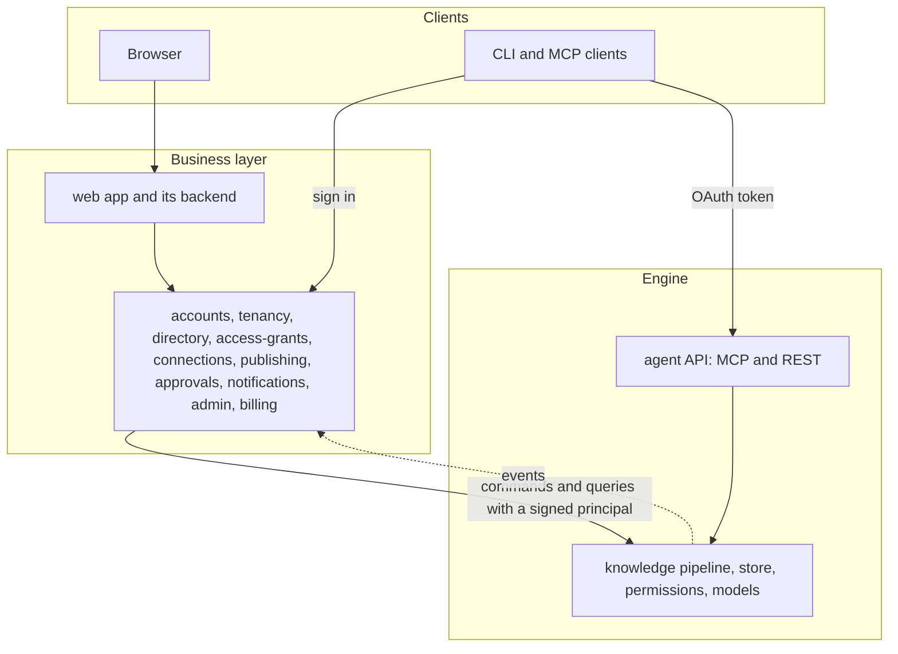
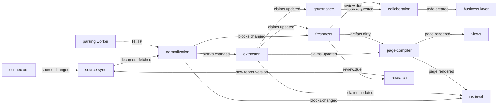

# Inspiration: product and technical overview

As of 2026-10-26. This is the one document to read first. It describes the product as decided
and the engineering as built, and it says plainly which parts are built and which
are designed but not built yet. A Chinese copy is in [zh/overview.md](zh/overview.md);
if the two differ, this English version wins.

## In one page

**Inspiration turns a company's scattered documents, approval flows and research into governed
knowledge.** Every statement keeps its exact evidence, stays fresh as its sources change, has a
person who owns it, and is served to people as readable pages and to agents through MCP, each
within their own permissions.

Four things set it apart:

1. **Knowledge at the level of single statements.** Each fact is stored once, with a verbatim
   quote from its source, the time it is true and the time the system learned it. Pages, procedures
   and answers are built from these statements, so every sentence can be traced.
2. **Freshness works like a build system.** A change in a source re-reads only the passages that
   changed, updates only the statements they support, and rebuilds only what cites them. Review
   dates come from what kind of knowledge it is.
3. **Knowledge flows from personal to shared under one simple rule.** Each member's own space is
   private. Publishing moves knowledge into the company, where the super admin and space owners decide who reads it.
   Source permissions only raise warnings, so merged knowledge never needs per-source permission
   arithmetic.
4. **People and agents govern together, in amounts a person can keep up with.** Agents detect,
   propose and answer; people decide. Most sources are not governed statement by statement, and
   reviews arrive grouped per topic and week, within a weekly budget.

**Who it is for.** Teams and companies whose knowledge lives across several tools (Feishu or
Lark, Confluence, approval systems, file shares, PDFs), starting with one person's library and
growing into teams and companies. The strongest early uses are procedure and policy
governance across tools, and a governed knowledge endpoint for a company's own agents. It is sold
as SaaS first, with private deployment as a second profile of the same code. English, Chinese and
Japanese are supported from the first release, as one knowledge base: knowledge is language-neutral,
and language is only how it is expressed.

**Where it stands.** The engine runs end to end on a mocked model through seven stages: ingest,
extraction, governance, freshness, governance levels, topics and the inbox, all merged on `main`.
Pages, search, the agent API, the business layer and the UI are designed but not built.
Real models are switched on after the mocked pipeline covers every stage.

## Core concepts

These are the words the rest of this document uses. The UI uses friendlier words for some of
them; the [glossary](#languages) lists those in all three languages.

| Concept | What it is | Shown to people as |
| --- | --- | --- |
| Tenant | The unit of isolation, policy and billing. Nothing crosses from one tenant to another except an explicit transfer | Company (never shown for one person working alone) |
| User | A person's account. It exists only in the business layer | Account |
| Member | A user inside one tenant. All activity in a tenant is done by a member, and the member is the only person the engine knows | Member |
| Space | A container of knowledge with an audience. Each member has a private personal space in every tenant; every other space is shared and has an audience set by the super admin or the space's owner | My space; Space |
| Domain | The member domain is one member's personal space. The tenant domain is all shared spaces. Knowledge is never merged or compared across domains | (not shown) |
| Source | A connected system or folder, such as one Feishu wiki space, an upload folder or a research report | Source |
| Source version | One fetched revision of one document in a source | (version history) |
| Block and span | A block is one paragraph, heading, table row or form section of a version, with a stable ID. A span is an exact passage inside a block: a sentence, a table cell, a form field | Passage |
| Claim | One atomic statement with verbatim evidence from spans, a time it is true, a time it was known, a knowledge class (policy, pricing, process, ...) and a status | Statement |
| Fact slot | The key subject + predicate + qualifiers ("Shenzhen, hotel cap, managers and below"). All claims about one single-valued fact share a slot, which keeps every version and every variant | (owners only) |
| Governance level | Set per source or folder: governed (fully extracted and owned), reference (read only where it touches a known fact or when it is cited) or search only (never extracted) | Governed, Reference, Search only |
| Topic and placement | Topics form the knowledge outline (area, topic, subtopic). A placement puts a statement under a topic; a statement without one is unfiled | Topic |
| Page, procedure, card | The readable forms built from statements: knowledge pages, procedures (SOPs) and cards about one thing (a city, a supplier, a role) | Knowledge page, Procedure, Card |
| Todo and note | A todo asks a person to decide or review something. A note tells an owner something without asking for a decision | Inbox |
| Owner, super admin | An owner is named for a space, topic, page or procedure: they approve what is published there, keep it current and decide its conflicts, and the nearest owner above takes anything that has none. The super admin runs the company and is the last fallback | Space owner, Topic owner, Page owner, Procedure owner (never a bare Owner); Super admin |

## Functional design

### Who uses it, and what each person sees

Most people only read. The product is designed so that readers see a normal document and never
the knowledge machinery behind it.

| Person | Main jobs | What they see |
| --- | --- | --- |
| Member | Read, ask, comment, publish from My space | Pages with small citation numbers. Only two marks appear in the text: Outdated and Disputed |
| Space, topic, page or procedure owner | Approve publishing into their scope, keep it current, decide its conflicts | Their inbox, and the Trace view of statements, sources and lineage. A space owner also sees the space's backlog and first-review campaigns |
| Super admin | Members, spaces and audiences, connections, policies, sensitivity labels, audit, agents, plan and usage | The admin console, with usage per member. Never anyone's My space, and never what anyone asked, read or researched |
| Agent developer (a member) | Connect agents through MCP or REST | Connected apps, scopes and audit |

These are the product's only roles. Inside, permissions are finer: a space has the internal roles `viewer`,
`commenter`, `editor`, `steward` and `owner`, and topics and pages have owners. A product role is a
bundle of them, so a later preset, such as the separate system, security and audit admins some
Chinese buyers require, is a new bundle rather than new code.

The Trace view is opened on purpose (from a page's menu, the command palette or the CLI). It
shows a topic or page as fact slots first, then the pages that use them, then everything else
folded by source document with counts, so it stays usable when a topic holds a thousand
statements.

### Bringing knowledge in

- **Connected sources, watched continuously.** Feishu documents, wiki and approvals plus file
  uploads come first. Lark, Feishu's international edition, has almost the same API, so the same
  connectors serve it. Confluence
  and DingTalk follow in the pilot, Notion and Jiandaoyun later. Push events are treated as hints;
  a 15-minute poll and a nightly full listing catch everything they miss, including deletions.
- **Approval flows become procedures.** A procedure is built from the flow definition, from
  process mining over 90 to 180 days of approval logs, and from a model's write-up. Every step is
  tagged as "from the definition", "mined" or "inferred", and a person approves it.
- **Research reports are sources too.** A member asks a question, a research agent produces a
  report of conclusions, assumptions and evidence, and the report is stored as a source. Each
  assumption gets a re-check query and a date.
- **Not everything is governed.** Each source or folder has a governance level, inherited down the
  Sources tree:

| Level | Typical sources | What is extracted | Owners, reviews, conflicts |
| --- | --- | --- | --- |
| Governed | Policies, price lists, SOPs, approval flows, official specs | Everything | Owned by a topic owner, reviewed on a cycle, conflicts become todos |
| Reference | Papers, minutes, articles, FAQs, vendor documents | Only blocks that state a known fact, and a whole passage the first time a page or an answer cites it | No owner, no review cycle. A value that disagrees with a governed one becomes a note, never a blocking todo |
| Search only | Chats, drafts, weekly reports, large archives | Nothing | None; searchable only |

Uploads and web pages start as reference. The super admin picks the level for each wiki space
when connecting it, and the space owner can change any folder later.

### From sources to statements

- **A statement always has evidence.** Extraction keeps a statement only if its quote is a
  verbatim substring of the cited passage. Statements are never deleted: a newer one supersedes
  an older one and closes the interval in which the older one was known.
- **Facts about the same thing collapse into one fact slot.** Ten statements from three
  documents and four versions are one row to maintain, and a conflict lives inside one slot.
  Numbers, dates, limits and owners slot well; free-text rules stay grouped by page section.
- **Every statement has two outlines.** The source outline (document, heading path, passage)
  comes from its evidence. The knowledge outline (space, area, topic, subtopic) comes from its
  placement. Topics are clustered automatically, at most three levels deep, and keep stable keys.
  At most 5% of statements may change topic in one re-clustering, and nothing a person placed or
  confirmed ever moves. Topics an owner has not confirmed are never shown to readers.
- **Merging stays inside one domain.** Two members' private knowledge never mixes; it meets only
  after both publish it.

### Reading

One body of knowledge has three views that share the same passage and statement IDs, and two
trees to browse it:

| View | Shows | Built with a model? |
| --- | --- | --- |
| Original | Each source as written, in its own structure. PDFs and scans as page images with a text layer | No |
| Annotated | Original plus marks on passages: cited, outdated, superseded, in conflict, corrected by a person | No |
| Knowledge | Topic pages whose every sentence cites statements, procedure views, cards, and a small Related panel (one or two hops) | Yes |

- **Sources tree and Knowledge tree.** The Sources tree is one file system over every connected
  source, in each source's own order. The Knowledge tree holds topics, each with its freshness
  owner. A folder or space a reader cannot open is not shown, not even as a count.
- **Pages read like Claude Artifacts.** A page is structured data with 14 block types, including
  diagrams compiled from structure (the model chooses what to show but never draws edges), charts
  bound to statements or to registered queries, and interactive views built from templates and run
  in a sandbox. Every rebuild is a version with a diff.
- **Citations open the source beside the page,** at the exact passage, with its version, and say
  so if the passage changed after the statement was extracted.
- **Readers see four statuses in words, never colour alone:** Fresh, Review due, Outdated and
  Disputed. Only Outdated and Disputed appear in the text; Review due appears in the citation
  popover and the Trace view.
- **Comments go to the assistant.** It answers a question with citations, checks a correction
  against the sources and proposes an edit, which the owner accepts. A person's edit is kept as a
  pinned override that a rebuild never overwrites; if sources later disagree with it, its author
  gets a todo.
- **Ask.** Answers are grounded in statements, cite their passages and come in the asker's
  language.

### Keeping knowledge fresh

- **Changes propagate only as far as they matter.** A new source version is diffed block by block.
  Only changed blocks are read again, only statements whose evidence changed are superseded, and
  only pages that cite them are rebuilt. If a re-read yields the same statements, nothing further
  happens.
- **A source that corrects itself syncs silently.** When one document changes its own value, the
  new statement supersedes the old one and nobody is asked; the Trace view keeps both. Only sources
  that disagree with each other need a person, and the conflict shows how many distinct documents
  support each value, with their authority.
- **Deleted sources keep their knowledge until someone decides.** Knowledge never disappears
  silently. Statements stay, with "Source deleted" on their citations, and each affected topic
  owner gets one todo per deleted document or folder: keep it as a snapshot (the default, also
  after 30 days without a decision), point it to a replacement, or retire it. Moves within one
  permission boundary are followed silently; a move to a wider audience, or between My space and a
  shared space, goes through publishing. A default keep never changes who can see the knowledge.
  Many documents vanishing at once is treated as a lost connection, not as deletions. See
  [Source changes](design/source-changes.md).
- **Review dates come from the knowledge itself.** Each governed document gets a review clock from
  the classes of its statements (for example yearly for policy, every 180 days for process), a
  review on each date a plan names, and an immediate review for copies an edit left behind.
- **Research is re-checked, not re-run.** When cited material changes or an assumption's date
  comes, only the affected conclusions are checked again. A new report version is written only if
  a conclusion changes.
- **A new company starts with a backlog, not a flood.** Reviews already overdue on the first day
  go to the space owner as a first-review campaign per topic, not into topic owners' inboxes.

### Governing: people decide, in amounts they can keep up with

- **The engine proposes a value and says why.** For each fact slot, governance proposes the most
  authoritative value in force, unless a later dated statement changed it ("from 2026-10-01 the cap
  is 650"). Clear supersessions by archived documents settle without a person.
- **One trigger, one todo.** Requests for the same slot or document merge into one todo, which is
  routed to the owner of its topic, else the nearest owner above it, else the space owner, else
  the super admin. Nothing is ever unowned.
- **One cause, one review.** A cause that would produce more than 20 todos or touch more than 3
  topics, such as a policy's new version or a reorganized folder, becomes one change review for the
  owner of the smallest scope that covers it. It is decided in bulk, with a record per item. Engine
  causes such as a model upgrade stay silent while values stay the same, and go to evaluation, not
  to inboxes, when they do not.
- **Weekly inbox cards.** An owner's todos about one topic in one week share one inbox card of at
  most 20 items. Each owner gets at most 10 cards a week; the rest wait for the next week with
  room, except urgent ones. Notes sit on their own weekly card outside the budget and are
  acknowledged with one action. Reviews of copies ride on the card of the conflict that caused
  them, even past the budget.
- **Only some conflicts need more than one person:**

| Kind | Example | Decided by |
| --- | --- | --- |
| Edit collision | Two people edit the same paragraph | Merged live in drafts |
| Override conflict | A person's edit says 500, the source now says 600 | The override's author |
| Knowledge conflict in one scope | Two sources disagree on a price | That scope's owner (single by default) |
| Knowledge conflict across scopes | Finance says X, the Sales procedure says Y | Every affected owner (all by default); after the deadline the space owner, or the super admin across spaces |
| Assertion conflict | A comment states a fact that contradicts a verified statement | The scope's owner |

- **Joint approval always finishes.** Each policy has a mode (single, any one, everyone, at least
  n), a deadline (5 working days across scopes by default) and a fallback decider when it passes:
  the space owner, or the super admin across spaces. While people decide,
  readers and agents get the last verified value marked Disputed (the default), both values, or
  nothing, as the company chooses.
- **Every decision is a record.** "Why this value?" shows who decided, when and on what. A decision
  can become a precedence rule ("for prices in Finance, the price list outranks wiki pages"), which
  governance then applies to new conflicts of the same kind and reports weekly.

### From personal to team: two domains and publishing

- **Solo use shows no company.** Sign-up creates a personal library. Inviting someone, or turning
  on collaboration, turns it into a company; creating a company starts a new one.
  Either way nothing is shared until it is published.
- **My space is private.** In every company, each member has a My space for drafts, personal
  connections and experiments. Nobody else can read it, the super admin included.
- **Shared spaces are governed top down.** The super admin and space owners set who reads each shared space by
  space roles and sensitivity labels. The person who published something keeps access to it.
- **Publishing moves knowledge; it does not copy it:**
  1. The member picks pages, procedures, sources or folders in My space and a target space.
  2. For each source they choose how it stays fresh: with the company connection (the default),
     with their own connection (needs their consent; the super admin can turn it off), or as a
     snapshot with a review date.
  3. The engine checks the request: a sensitivity and personal-data scan, a preview of conflicts
     with knowledge already published, what the company connection can and cannot reach, and
     how many people in the audience cannot open the originals in the source system.
  4. The target topic's owner approves, or the space owner. Approvers can read the items in the
     request and nothing else in My space. The super admin sees the request but not the items.
  5. The items move into the tenant domain with their human work (uploads, edits, overrides,
     comments). Derived knowledge is rebuilt there and merged with what is already published; new
     conflicts become todos.
  6. From then on the space's audience reads it. Source permissions play no part.
- **Source permissions only warn.** At publishing they produce the "some readers can't open the
  original" warning, which never blocks. If a published document's permissions later tighten in
  the source, the space owner gets a todo; a company setting chooses notify (the default) or hide
  the affected knowledge until the space owner decides.
- **Company data stays in the company.** A company verifies its email domain and its Feishu
  organization. Policy then blocks personal connections to it outside the company, or
  requires approval.
- **Leaving.** Published knowledge stays with the company and passes to the space owner. The
  member's My space is locked so nobody can read it and is erased after 30 days. Their
  connections and agent grants are revoked, and sources kept fresh by their connection pause until
  their owner switches or freezes them.
- **Moving between companies** is a separate, explicit transfer that re-creates sources in the
  target and rebuilds derived knowledge there.

### Agents as consumers

- **One governed endpoint.** A remote MCP server and a REST API generated from the same schema.
  Verified procedures can also be exported as Agent Skills.
- **Tools designed for agent budgets:** `search`, `get_outline`, `read`, `get_sop`, `get_entity`,
  `graph_neighbors`, `answer`, `get_changes`, `verify_claim` and `report_feedback`. Each response
  carries source, version, freshness, confidence, review status and a token estimate. A structured
  `get_sop` answer is meant to stay under about 2,500 tokens.
- **Sign-in.** MCP clients use OAuth with PKCE, the CLI uses the device flow, and the super admin
  registers company agents. Scopes are `knowledge.read`, `knowledge.propose` and `comments.write`. An agent
  always acts for a member, and its rights are that member's rights cut down to its scopes and
  spaces.
- **Built-in agents only read or propose.** The comment assistant, the Q&A assistant, the
  governance agents, the procedure writer, the publish check, the view generator and the research
  agent all run on one runtime. Nothing an agent does changes knowledge without a person
  approving it.

### Administration

- **Three roles.** The super admin runs the company: members, spaces, connections, policies,
  sensitivity labels, audit, agents, plan and usage. Owners run the content of their scope, and
  everyone else is a member. In solo use the one person holds all three.
- **Lifecycle flows** cover sign-up, invitation (links expire after 7 days), joining by verified
  email domain, SSO with directory sync, personal to team, member leaving, account deletion
  (erases the personal library) and company deletion (30 days of grace with export, then the
  data key is destroyed).
- **Limits and usage.** The company is the billing unit. As in mainstream AI products, seats
  fill one usage pool for the company, each member has a default cap the super admin can raise,
  and the engine meters model use per company, member and space. The super admin sees usage per
  member and per kind of work, never what anyone asked, read or researched. Credits per seat and
  what happens when the pool runs out are settled with billing. Besides connection policy, limits
  are the company's only say over a member's My space.

### Languages

English, Simplified Chinese and Japanese are equal from the first release. Traditional Chinese
comes later.

- **Interface language belongs to the account,** because a person's language does not change per
  company. Its first value comes from the browser at sign-up. Each company has a default
  language for messages sent to many people.
- **Knowledge is language-neutral; language is how it is expressed.** A statement, fact slot,
  entity, topic, procedure or page has one identity in every language. The same knowledge written
  in two languages is one unit with two expressions, never a duplicate and never a conflict. A
  translation counts with its original, and when it falls behind, it gets a "translation out of
  date" review instead of a conflict. See [Knowledge and language](design/knowledge-and-language.md).
- **Sources keep their language.** Sources and quotes are never translated silently. Each space has
  a content language, set by its space owner, for the canonical rendering of its pages. A reader
  can ask for a page in their own language: it is compiled from the same statements and labelled
  machine-written.
- **Answers follow the asker.** Answers come in the asker's interface language and cite passages
  in their original language. The citation popover can translate a passage on request, labelled as
  machine translation, with the original one click away. What people type is never machine
  translated.
- **The same fact in different languages is one fact.** Fact slots key on entities, predicates and
  qualifiers, not on wording, and values are typed, so a Japanese and a Chinese statement of the
  same limit land in one slot. Plain statements merge across languages after a model confirms they
  mean the same, and each keeps its quotes in their own language.
- **Typography and input.** Every block carries its language tag so shared Han characters render
  with Chinese or Japanese glyphs as appropriate. Labels wrap instead of truncating (English runs
  about 1.5 to 2 times as wide as Chinese). Dates, numbers, currencies and plurals follow locale
  rules. Pressing Enter while an input method is composing never submits.
- **Notifications** go out in each recipient's language: Feishu and DingTalk cards in China, Lark
  elsewhere, email and the in-app inbox everywhere.
- **Regions.** A company's region is set when it is created, and its data stays there. The plan
  is mainland China plus one global region.

One glossary feeds every status, button and empty state. The Chinese column is adopted; the
Japanese column is proposed and waits for review.

<!-- glossary -->
| English | Chinese | Japanese |
| --- | --- | --- |
| Personal library | 我的知识库 (个人知识库 in the switcher) | マイライブラリ (個人ライブラリ in the switcher) |
| Company | 企业 | 企業 |
| Space, My space | 空间, 我的空间 | スペース, マイスペース |
| Member | 成员 | メンバー |
| Company connection, Personal connection | 企业连接, 个人连接 | 企業の接続, 個人の接続 |
| Source, Passage, Statement | 来源, 段落, 陈述 | ソース, 段落, 記述 |
| Topic, Knowledge page, Procedure, Card | 主题, 知识页, 流程, 卡片 | トピック, ナレッジページ, 手順, カード |
| Knowledge tree, Sources tree | 知识树, 来源树 | ナレッジツリー, ソースツリー |
| Original, Annotated, Knowledge views | 原文, 批注, 知识 | 原文, 注釈, ナレッジ |
| Fresh, Review due, Outdated, Disputed | 有效, 待复核, 已过时, 有争议 | 有効, 要確認, 旧版, 異論あり |
| Space owner, Topic owner, Page owner, Procedure owner; Super admin | 空间负责人、主题负责人、页面负责人、流程负责人；超级管理员 | スペース担当者、トピック担当者、ページ担当者、手順担当者；特権管理者 |
| Rule | 裁决规则 | 裁定ルール |
| Any one, Everyone (approval modes) | 或签, 会签 | いずれか承認, 全員承認 |
| Who can read this | 可见范围 | 公開範囲 |
| Inbox, Assistant | 待办, 助手 | 受信トレイ, アシスタント |
| Keep fresh with the company connection, Keep fresh with my connection, Publish a snapshot | 通过企业连接保持更新, 通过我的连接保持更新, 发布快照 | 企業の接続で最新に保つ, 自分の接続で最新に保つ, スナップショットを公開 |
| Some readers can't open the original | 部分读者无法打开原文 | 一部の閲覧者は原文を開けません |
| Source permissions tightened | 来源权限收紧 | ソースの権限が縮小されました |
| Governed, Reference, Search only | 严格, 宽松, 仅检索 | 規程, 参考, 検索のみ |
| Trace view | 追溯 | 追跡 |
<!-- /glossary -->

## Technical design

### Two layers: the engine and the business layer

**The design philosophy.** The engine is a system of record for knowledge, with no screens.
Given a tenant and a principal, it answers four questions on its own: what is known, where it
comes from, who may see it, and whether it is still true. It has no people, no interface and no
commercial terms, so it behaves the same under our product, under a customer's own identity
system in a private deployment, or with nothing but agents in front of it. The business layer is
the product around it for people and companies: who someone is, which companies they belong to,
what those companies bought, how a person is asked, reminded and told, and what the screens look
like. It turns human and commercial decisions into engine commands and engine events into
messages people read, and it can change from market to market without touching knowledge.

Calls go down and events come up: the business layer sends commands and queries, the engine
answers and publishes events, and the engine never calls the business layer. That one rule keeps
the engine usable on its own through MCP, REST and the CLI, and lets either side be tested against
a fake of the other.

**Where something goes.** Ask in order; the first yes decides.

1. Does it read, change, derive or enforce anything about knowledge, or decide whether a
   principal may see something? The engine.
2. Is it about a person as a person (sign-in, profile, language, sessions), a company as a
   customer (plan, seats, billing, domains), or a channel that reaches a person (email, IM,
   digests)? The business layer.
3. Is it a setting? The business layer owns its value and the screen that sets it; the engine
   owns what it means, its default and how it is enforced.
4. Is it a decision people make about knowledge? The engine owns the item (a todo, a publish
   request, a conflict), its state, who may decide and what follows the decision. The business
   layer owns how people reach the decision: whom to ask, reminders, deadlines, escalation, votes
   and cards. It sends the result back as a command, and the engine checks it again.

**Never.** Each of these is held by a test or a review rule.

- The engine never calls the business layer, and never stores a user ID, a login identity, a
  session, a password, a plan or a payment detail.
- The business layer never stores knowledge (sources, statements, pages, embeddings) or a source
  credential, and never decides whether someone may see content: it asks the engine, which
  checks. Content it shows or sends is fetched from the engine for that recipient, and the
  business layer does not keep it.
- The engine trusts only a signed token and its own copy of members, groups, roles and settings.
  A token can narrow what the engine allows, never widen it.
- The engine must run without the business layer: a stand-in that signs tokens and sends
  provisioning commands is enough for tests, evaluations and agent-only use.

**Shared concerns, split.** Where both layers take part, each owns one side:

| Concern | Engine | Business layer |
| --- | --- | --- |
| People | Members, groups, roles and clearances as an enforced copy; every permission check | Accounts, sign-in, invitations, directory sync, and assigning roles |
| Companies | Tenants as isolation boundaries and data regions; provisioning, export and deletion on command | The company as a customer: name, domains, plan, seats, and the transfer and deletion flows |
| Settings | What `TenantPolicy` means, its defaults and its enforcement | The values a super admin picks, and the screens for them |
| Spaces and audiences | Spaces, audiences and the checks | The admin screens that change them |
| Todos and decisions | Todos, publish requests and conflicts: their state, routing to the owner of the scope, weekly budgets, who may decide, what a decision does and the record of what was decided | Getting people to decide: reminders, deadlines, escalation, joint approval votes and who voted how, cards in Feishu and other IM |
| Messages | Events with codes and parameters | Wording in each recipient's language, channels, digests, preferences and the inbox screen |
| Words | Knowledge in a language: pages, answers, summaries | Every word of the interface and of messages |
| Source connections | Credentials (credential broker), fetching, sync and source ACL snapshots | Connect and consent screens, which connections the settings allow, claims on external tenants |
| Agents | The agent API (MCP and REST), token verification, scope enforcement, agent audit | OAuth server, client registry, device flow, consent and revocation |
| Usage | Metering model use per company, member and space, and stopping at the limits it is given | Plans, seats, the usage pool, per-member caps and invoices |
| Audit | Reads of knowledge, permission changes, decisions and break-glass access | Sign-ins and account, admin and billing events; the admin console shows both |
| Search and reading | Retrieval, answers, citations and pages | The reading and search screens |

- **Three IDs.** Tenant `ten_`, user `usr_` (the account, business layer only) and member `mem_`
  (a user inside one tenant, the engine's only person ID). A member ID is unique only within its
  tenant, so everything that stores one outside a tenant's own rows stores the tenant with it
  (`<ten_...>|<mem_...>` in SpiceDB, caches, audit, exports). One function in the tenancy
  component assigns member IDs; nothing derives one ID from another or reads meaning into an ID.
- **One verification path.** Every call carries a JWT signed by the business layer: member,
  tenant, principal kind, the member an agent acts for, scopes, optional spaces and sensitivity
  limit, how the session signed in, and the interface `locale`. Web tokens live at most 5 minutes,
  OAuth access tokens 10 to 15. The engine verifies them against published keys and never sees a
  user ID or an identity-provider token. A token can only narrow the clearance the engine already
  holds.
- **Commands are idempotent** (an idempotency key, a version on directory objects) and return the
  permission system's consistency token, so the next read sees the change. A nightly directory
  snapshot repairs drift, and an hourly digest check catches it in between.
- **Contracts live in one place.** JSON Schema in this repository is the source of truth for both
  layers. Business-only types go in their own folder that engine packages never import.
- **One repository, a folder per layer.** Both layers are built in this monorepo: shared libraries
  in `libs/`, engine components in `engine/`, business components in `business/`, and
  composition roots in `apps/`. Each section of `components.yaml` maps to one folder, and the manifest test
  fails anything in `engine/` or `libs/` that depends on `business/`. A business component reaches
  the engine only through the contracts and the engine's API client. One toolchain and one
  `make check` cover both layers, so a contract change lands with both sides in one pull request,
  while the engine and the business backend still deploy as separate processes. See
  [architecture.md](architecture.md#one-repository-a-folder-per-layer).

### Components

The engine has 19 components, each a package `packages/<name>` with one job, plus four shared
libraries (contracts, kernel, eventbus, testkit) and one composition root (`apps/engine`). The
name of a component is also its event producer name, its consumer group and the prefix of its
model task names. [`components.yaml`](../components.yaml) is the authoritative manifest of what
is built and planned; credential-broker and sandbox join it when they are built, and its `web`
entry moves to the business layer.

| Layer | Component | Job | State |
| --- | --- | --- | --- |
| Ingest | connectors | Source plugins: list, fetch, read ACLs, webhooks. Built: local folders, Feishu documents and approvals (recorded fixtures) | Built |
| Ingest | source-sync | Versions, tombstones, ACL snapshots, polls and reconcile; later `fetch_now` for research and the source tree | Built |
| Ingest | parsing | Python worker for Office, PDF and scans (Docling, PaddleOCR-VL) behind an HTTP contract | Planned |
| Ingest | normalization | Canonical blocks and spans with stable IDs, block diff, duplicate documents; later mirror pages for the Original view | Built |
| Ingest | research | Research agent over the agent API and approved web search; reports become sources | Planned |
| Compile | extraction | Statements with verbatim evidence, fact-slot keys, governance levels and extract on use. Later entities, procedures, approval mining | Built |
| Compile | freshness | Review clocks, plan days, copies, staleness scores, `review.due`. Later the dependency graph and `artifact.dirty` | Built |
| Compile | governance | Slot values, conflict cases with a proposed value, todo requests, notes. Later semantic and model-judge tiers, precedence rules | Built |
| Compile | page-compiler | Topics and placements; later cited pages, diagrams, page snapshots | Topics built |
| Store | knowledge-store | The only owner of knowledge tables: lineage, bitemporal reads, slots, topics, page snapshots | Built |
| Serve | retrieval | Owns chunks, embeddings and every search index; hybrid search, rerank, permission filters, grounded answers | Planned |
| Serve | agent-api | MCP server, REST and OpenAPI, Skills export, per-call audit | Planned |
| Serve | views | Interactive view templates, view generation, render check, sandbox hosting | Planned |
| Control | collaboration | The inbox; later comments, agent replies, overrides, publishing, decisions | Inbox built |
| Control | access-control | Permissions on SpiceDB, search pre-filters, audit | Built; two-domain rule designed |
| Control | model-gateway | Every model call: routing by sensitivity, budgets, prompts, cache, metering; library and HTTP service | Built |
| Control | agent-runtime | The loop built-in agents run on: tools, limits, approval gates, traces | Built |
| Control | credential-broker | Connections owned by the tenant or a member, encrypted secrets, refresh, short-lived leases | Designed |
| Control | sandbox | One isolated container per job for vendor CLIs, agent tools and view render checks | Designed |

The business layer is one TypeScript service with its own database schema, plus the web app. It
shares the contracts, eventbus and testkit libraries with the engine.

| Component | Owns | Phase |
| --- | --- | --- |
| accounts | Users, login identities, sessions, the identity-provider adapter (Logto; Keycloak as fallback) | 1 |
| tenancy | Tenants, members and member IDs, invitations, verified domains, company roles, sign-in policy, personal to team, transfers | 1 |
| directory | SSO connections, Feishu contacts (SCIM in phase 2), groups, departments, external identity links | 1 and 2 |
| access-grants | OAuth authorization server, client registry, device flow, personal tokens, company agents, revocation | 1 |
| connections | Connect flows for company and personal connections, consents, claims on external organizations | 1 (claims in 2) |
| publishing | The publish wizard: target space, freshness choice, coverage, audience gap, approval routing | 1 |
| approvals | Single and joint approvals, deadlines, fallback deciders, decision records | 1 (joint in 2) |
| notifications | Inbox, email, Feishu, Lark and DingTalk cards, digests, preferences, message catalogs | 1 |
| admin | Space audiences, policies, roles, ownership assignments, audit and usage views | 1 |
| billing | Plans, seats, quotas, per-member limits, model budgets | 3 |
| web | The product web app and its backend for the frontend | 1 |

### How components talk

There are exactly three paths, and the manifest test enforces that a package depends on nothing
else.

1. **Events.** A component writes its data and its events in one Postgres transaction (a
   transactional outbox). A relay moves them to Valkey Streams, one stream per event type, and
   each consuming component reads with its own consumer group. Delivery is at least once, so
   handlers are idempotent. Events that cannot be parsed, are newer than the consumer knows, or
   keep failing go to a dead-letter stream. Payloads carry IDs and codes, never sentences.
2. **The knowledge store's repository API.** No component reads another component's tables.
3. **Synchronous interfaces** from the contracts package: `AuthZ`, `ModelGateway`, `Retriever`,
   `AgentRuntime`, the blob store, and later `SourceSync.fetch_now`, `CredentialBroker` and
   `Sandbox`. Each has an in-process implementation and, where useful, an HTTP one with the same
   interface.

| Event | Published by | Consumed by | State of the publisher |
| --- | --- | --- | --- |
| `source.changed` | connectors, source-sync, research | source-sync | Built |
| `document.fetched` | source-sync | normalization | Built |
| `acl.changed` | source-sync | access-control; collaboration for the source-restricted todo (designed) | Built |
| `blocks.changed` | normalization | extraction, freshness, retrieval | Built |
| `claims.updated` | extraction, governance, collaboration | freshness, governance, page-compiler, retrieval | Built |
| `artifact.dirty` | freshness | extraction, page-compiler, retrieval | Planned |
| `review.due` | freshness | collaboration, research | Built |
| `todo.requested` | governance; views (designed) | collaboration | Built |
| `todo.created` | collaboration | business layer (notifications, approvals, web) | Built |
| `page.rendered` | page-compiler | collaboration, retrieval, views | Planned |
| `comment.created` | collaboration | extraction, collaboration | Planned |
| `unit.published` | collaboration | retrieval, agent-api, business layer | Planned |
| `connection.changed` | credential-broker | source-sync, collaboration, business layer | Designed |
| `source.tree_changed` | source-sync | access-control, retrieval, business layer | Designed |
| `source.moved` | the publish step | normalization, which rebuilds the moved sources in the target space | Designed |
| `todo.updated`, `publish_request.updated`, `decision.applied`, `member.offboarded`, `usage.recorded` | engine | business layer | Designed |

Only the engine publishes events. Business components read them as consumer groups; a product
deployment adds a feed endpoint so the business layer is not tied to the transport.

### The pipeline, end to end

1. **Sync.** Source-sync lists a source, compares each item's content, metadata and ACL hashes
   with the last ones, fetches what changed, and writes the source version and ACL snapshot in one
   transaction. A permission change alone writes no new version, so nothing is re-parsed.
2. **Normalize.** Normalization parses the version (built-in parsers for text formats, the parsing
   worker for Office, PDF and scans), builds blocks and spans with stable IDs, diffs them against
   the previous version and detects duplicate documents. Every later stage works from this diff.
3. **Extract.** Extraction reads only added and changed blocks of governed documents, and of
   reference documents only those that name a known fact. Each window is one model call. A
   statement is kept only if its quote is verbatim; statements whose evidence disappeared are
   superseded or retracted. Under the source-changes design, a deleted document's statements are
   held until their owner decides.
4. **Govern.** Governance keeps each slot's values counted incrementally, proposes the value that
   holds, opens conflict cases for the others, and sends one todo request per slot. It is
   deterministic today; semantic, NLI and model-judge tiers come later for statements without a
   slot.
5. **Keep fresh.** Freshness keeps review clocks and publishes `review.due` once a day for what has
   fallen due. It asks no model and changes no knowledge, so a model outage or an exhausted budget
   never stops it.
6. **Organize and compile.** Page-compiler embeds the sections of governed documents, places
   statements in topics and re-clusters within the change budget. Next it writes cited pages and
   diagrams and snapshots every version.
7. **Ask people.** Collaboration is the only component that creates todos: it merges requests,
   routes them to owners and groups them on weekly cards.
8. **Serve.** Retrieval indexes blocks, statements and pages, and serves search and answers to the
   web app and the agent API.

### Knowledge model and storage

| Layer | Holds | State |
| --- | --- | --- |
| Source version | One fetched revision, its hashes, sensitivity and governance level | Built |
| Block, span | Stable IDs, heading path, parent; spans are content-addressed by block and text | Built |
| Claim and evidence | Statement, subject, predicate, value, qualifiers, class, slot key, two time intervals, verbatim quotes | Built |
| Fact slot | Current variants with counts and representatives, and every value held over time | Built |
| Topic and placement | Taxonomy nodes with stable keys, status, owner and counts; one placement per statement | Built |
| Entity, relation | Resolved people, departments, products, suppliers; every edge backed by a statement | Planned |
| Procedure, model | Steps, roles, conditions; formulas and decision tables whose assumptions are statements | Planned |
| Page | PageSpec versions with sentences bound to statements; mirror pages for the Original view | Contract only |
| Source node | The Sources tree: the position of each document in its source's hierarchy | Designed |

Rules the knowledge store enforces: a claim without supporting evidence or a derivation is
rejected; an evidence quote must be a verbatim substring of its span; claims are never deleted;
page versions are immutable and increase by one. Reads are bitemporal: what was true at a time, as
the system knew it at a time.

Everything lives in one Postgres 16 instance (the ParadeDB image, with pgvector and pg_search).
Each component that owns tables has its own schema: `kb` (knowledge store), `bus` (event bus),
`gateway`, `agents`, `sync`, `normalization`, `extraction`, `freshness`, `governance`,
`page_compiler` and `collaboration`. Retrieval will get its own schema when it takes over chunks,
embeddings and indexes from `kb`. SpiceDB keeps its own database on the same instance, Valkey
carries the streams and the model response cache, and files go to a blob store. Each `kb` table
keeps the full contract object in a `doc` column and copies only filterable fields into typed
columns, so most contract changes need no migration.

### Permissions

The engine makes every permission decision itself, from a copy of what the business layer
provisions.

- **SpiceDB holds tenants, members, groups, departments and spaces,** keyed by tenant. Statements,
  pages and procedures are not written to it.
- **A unit is readable if its own space is readable and its sensitivity label is at or below the
  reader's clearance.** A personal space has only its owner (plus a service relation for engine
  workers); no tenant or admin relation reaches into it. A shared space's roles (`viewer`,
  `commenter`, `editor`, `steward`, `owner`; a space owner holds `owner` and `steward`) are granted top down and inherited
  down the space tree. The
  publisher of a unit keeps a grant on it, and a publish request's approvers can read only its
  items.
- **A statement also needs a proof the reader can read.** A proof is what shows a statement is
  true, and there are two kinds: an evidence quote from a document in a space the reader can read,
  or a derivation, a statement computed from other statements, whose every input the reader can
  read. If two documents both say the Shenzhen hotel cap is 600, either one proves it, so a reader
  who can read either sees the statement. A margin computed from a price in Sales and a cost in
  Finance needs both: a reader who could see the margin and the price but not the cost could work
  the cost out, so the margin is shown only to readers who can read both.
- **Crossing audiences takes an approval.** A derivation whose inputs sit in spaces with different
  audiences is seen only by readers who can read every input. To show it to the whole audience of
  its space, the owners of the input spaces that audience cannot read approve a publish request
  for it. If one of those spaces later narrows its audience, its owner gets a todo to keep or
  withdraw the approval.
- **Citations across spaces.** A citation into another space is shown only if the reader can read
  that space; otherwise it shows as restricted. A statement with no readable proof is hidden, and
  so is everything built from it: a proposed value, a conflict variant, a page sentence, an answer.
  The readable-space set is looked up once per request and memoized.
- **No existence leaks.** Hidden citations, counts and graph edges are dropped, never shown as "3
  hidden". Shared answer caches are keyed by readable spaces and clearance, an entry is dropped
  when a unit it used changes label, proof or grant, and an answer that used a unit readable only
  through the reader's own grant (as publisher or approver) is never shared.
- **Search is filtered inside the index** by readable spaces and sensitivity, and every top result
  is checked again before it leaves the server.
- **Source ACLs are advisory.** Source-sync keeps ACL snapshots and identity links only for the
  audience-gap warning and the source-restricted todo.
- **Built today:** access-control on SpiceDB with tenant-keyed principals, source ACL mirroring,
  search scope filters and consistency tokens, and a lineage walk that decides derived units from
  their source documents. That walk accepts any one readable source, which is right for alternative
  evidence and too loose for jointly required inputs; nothing built writes such derivations yet.
  Replacing it with the space and proof rules above is the next change to access-control;
  retrieval is not built yet, so nothing else depends on the old rule.

### Models and agents

- **Every model call goes through the model gateway,** for completion, embedding, rerank and OCR,
  with `web_search` planned for research. A call names its task (`<component>.<verb_object>`,
  such as `extraction.extract_claims`), its budget key (`tenant:<id>/<component>`) and the highest
  sensitivity label of its content. The gateway refuses to send content to a provider that is not
  cleared for that label, so confidential content reaches only models inside the customer's
  network.
- **Prompts are versioned files.** The version is part of every artifact's inputs hash, so a prompt
  or model change shows exactly what to rebuild and what it would cost.
- **Until real models are configured, each model task ships a deterministic stand-in** (a
  `model_mocks` plugin), and the fake providers answer with it. Numbers measured on mocks describe
  the pipeline, not model quality.
- **The agent runtime** runs every built-in agent: an `AgentSpec` named `<component>.<agent>`,
  tools whose effect is only read or propose, step and token limits, approval gates and run traces.
  Tool selection uses schema-constrained output over an OpenAI-compatible API, so swapping models
  does not change the agents.

### Connectors, credentials and sandboxes

- **Sync uses each vendor's API in process,** through its SDK, because sync needs webhooks, ACL
  reads, rate budgets and stable block IDs. Vendor CLIs (such as lark-cli) run only in the sandbox:
  as agent tools from the pilot on, and as a connector transport only for a source with no usable
  API.
- **The credential broker owns every connection and its secrets.** A connection belongs to the
  tenant (the company's app, for team spaces) or to a member (their own sign-in). Secrets are
  envelope-encrypted with a per-tenant data key; the key-encryption key is a deployment key in the
  prototype and OpenBao Transit or the customer's KMS in the product (SM4 where required). Refresh
  is proactive with a daily keep-alive and single-flight per connection. Other components get only
  short-lived leases holding an access token, and a tenant connection is never leased to an agent
  run. A failed refresh marks the connection for re-authorization, pauses its sources and gives the
  owner a todo.
- **The sandbox runs one container per job:** read-only root, no volumes, egress through an
  allow-list proxy, never shared across tenants, nothing kept between jobs. Docker with gVisor in
  the prototype, Kata Containers or Firecracker in the product. Its three profiles are connector
  CLIs, agent tools and the view render check.

### Pages and views

The contracts for pages and views are in place; the compilers, the view host and the sandbox are
planned.

- **A page is a `PageSpec`:** an ordered list of 14 typed blocks (heading, paragraph, list,
  callout, quote, table, code, math, image, divider, diagram, chart, view, embed) whose sentences
  carry statement IDs. Readers who cannot see a statement do not see its sentence. Every version is
  an immutable snapshot with its cause, and block keys stay stable so comments survive rebuilds and
  diffs can say what moved.
- **Charts** take their data from a `DataRef`: inline rows, statements (fixed or by query) or a
  registered query of a connected system, never free SQL. Rows keep their statement IDs, so rows a
  reader may not see are dropped before rendering.
- **Interactive views** separate code from data. A view version is a template or generated code
  that passes a headless render check (console errors, overflow at phone and desktop widths, both
  themes, empty and large data) and a person's approval. It runs in an iframe on a separate origin
  with a Content Security Policy that blocks all network access, and talks to the host only through
  a typed message protocol. Until approved, readers see the block's static fallback.
- **Mirror pages** render the Original view from blocks without a model, with per-block fidelity
  (exact, approximate, or a placeholder that says "open in source").

### Search and the agent API

Planned, with contracts in place:

- **Retrieval owns every search index:** structure-aware chunks with contextual headers,
  embeddings, BM25 and vector indexes for blocks, statements, procedures and pages. Search is
  hybrid with reciprocal rank fusion and a reranker, pre-filtered by readable spaces and
  sensitivity. Each citation carries one reader status (fresh, aging, stale, at risk, superseded,
  disputed) that the UI maps to the four words readers see.
- **Citations never wait for extraction.** A citation is span-based. When a reference passage is
  cited for the first time, retrieval asks extraction to read it in full in the background.
- **The agent API** is a stateless MCP server on the current specification behind a plain load
  balancer, with REST and OpenAPI generated from the same operation schema. The business layer is
  the OAuth authorization server; the engine is the resource server, checks the token audience and
  never passes a client's token on.

### Internationalization

| Where | Design | State |
| --- | --- | --- |
| Contracts | `Locale` (BCP 47) on documents, parse hints, claims, pages and view messages | Built |
| Contracts | Events and todos carry codes and parameters, never sentences. The principal token carries the interface `locale` | Designed |
| Normalization | Language detected per document and per block. Sentence and clause rules, full-width forms and number formats come from per-language resource files (en, zh, ja), not from code | Designed |
| Extraction | Prompts state the source language. Evidence quotes stay verbatim in the original language. Dates, eras (such as Japanese era years), large-number units and currencies are normalized into typed values | Designed |
| Fact slots | Predicate and qualifier keys are language-neutral, with labels and aliases per language, and entity names are resolved across scripts, so the same fact in different languages lands in one slot | Designed; predicate keys and typed values are built |
| Statements | A translation is linked to its original and counts with it; statements merge across languages after a model check, keeping each quote in its language | Designed |
| Retrieval | Multilingual embeddings (Qwen3-Embedding); BM25 with a tokenizer per language (jieba for Chinese, a Japanese morphological tokenizer, stemming for English); cross-language queries through the embedding side | Designed; the jieba index exists in the knowledge store today |
| Page-compiler | A page's structure is built once; its canonical rendering is in the space's content language, and a rendering in another language is compiled from the same statements on request; answers in the asker's locale | Designed |
| Business layer | Account language, company default for broadcasts, ICU MessageFormat catalogs (a missing string fails the build), localized sign-in pages, region per tenant | Designed |
| UI | Catalogs for en, zh-Hans and ja; a language tag on every block; fonts per script; locale formatting and collation; input-method rules; pseudo-locale tests | Designed |
| Repository | No Chinese or Japanese in code or comments; language data in resource files; documentation in English with a Chinese copy under `docs/zh/`. A repo test enforces it | Next |

### Technology stack and deployment

| Concern | Prototype | Product |
| --- | --- | --- |
| Language | TypeScript on Node 22 everywhere; a Python worker only for document parsing | Same; Go only for single-binary pieces |
| Database | PostgreSQL 16 | PostgreSQL, or KingbaseES and openGauss through a narrow SQL subset |
| Search | pgvector and ParadeDB pg_search | Milvus, or Elasticsearch or OpenSearch where the customer runs it |
| Permissions | SpiceDB | SpiceDB, plus a policy engine for labels |
| Queue | Postgres outbox and Valkey Streams | NATS JetStream or Kafka |
| Models | Fake providers with mocks now; next one flash-class model (domestic in China), Qwen3-Embedding and Qwen3-Reranker | Routing across vLLM, SGLang and MindIE, per region and sensitivity |
| Parsing | Docling and PaddleOCR-VL on one GPU | A router with confidence escalation |
| Identity | Logto behind an OIDC adapter | Logto, Keycloak, or the customer's own identity provider |
| Secrets | Envelope encryption under a deployment key | OpenBao Transit or the customer's KMS or HSM |
| Sandbox | Docker with gVisor | Kata Containers or Firecracker with warm pools |
| Deployment | Docker Compose on one node | Helm, air-gapped bundle, amd64 and arm64 |

- **Two deployment profiles from one codebase.** SaaS comes first: a company's region is fixed at
  creation, starting with mainland China and one global region. Public SaaS in mainland China needs
  a generative AI filing, an ICP licence and classified protection. Private deployment is the
  second profile, with domestic infrastructure (Kylin, Kunpeng or Hygon, KingbaseES, Ascend) as
  the target for certification.
- **Licences.** pg_search is AGPL-3.0; BM25 sits behind a plugin interface so an OpenSearch index
  can replace it where a customer needs that. Valkey (BSD) is used instead of Redis. See
  [licensing.md](licensing.md).

### How we build

- **Contracts first.** `packages/contracts/schema/*.yaml` is the source of truth; types and
  validators are generated. Additive changes are fine in a branch; anything that removes, renames
  or tightens a field needs agreement first. See [contracts.md](contracts.md).
- **Boundaries are checked, not trusted.** Engine modules and business levels share one
  repository, so their boundaries are tests: a package sits in its layer's folder and depends only
  on the libraries and the components in its `calls`, and dependencies between the layers point
  one way.
- **Plugins by registry.** Connectors, parsers, diagram compilers, index backends, model providers,
  model mocks, view templates and migrations register by name in fixed plugin groups. A new source
  or model is a new plugin, not a core change.
- **Tests on both backends.** Unit tests use in-memory doubles; code with a Postgres, Valkey or
  SpiceDB implementation runs the same tests against the real stack. `make check` runs Biome,
  strict `tsc`, contract freshness and every test with the stack up.
- **A demo tenant and a scale generator.** `examples/corpus` is a fictional company with planted
  duplicates and conflicts; `pnpm engine synthesize` writes synthetic tenants of any size, and
  `pnpm engine ingest` prints a volume report.
- **Every change lands through a pull request.** The product owner's local Codex reviews it; findings are
  fixed and the PR is merged. Correctness comes first, then layering, clear component boundaries and
  explicit contracts.
- **Names describe what things do.** No plan numbers in code, docs or events. [AGENTS.md](../AGENTS.md)
  has the full rules for anyone, human or agent, building a component.

## Where we are

**Built and merged on `main`** (PRs #2 to #7, 2026-10-23 and 2026-10-24): contracts, kernel, event
bus, test kit, knowledge store, access control, model gateway, agent runtime, connectors, source
sync, normalization, extraction, governance, freshness, tenant-scoped member IDs, and the engine
process with its CLI, demo corpus and synthesizer.

**Statements at scale**, merged on 2026-10-26 after two Codex rounds:

| PR | Adds |
| --- | --- |
| [#8](https://github.com/AngelMsger/Inspiration/pull/8) | Governance levels, fact-slot keys and the slot read, extract on use |
| [#9](https://github.com/AngelMsger/Inspiration/pull/9) | Topics and placements in page-compiler: the knowledge outline |
| [#10](https://github.com/AngelMsger/Inspiration/pull/10) | The inbox in collaboration: owner routing, weekly cards, budget, notes, campaigns; topic owners |

**Measured** on a synthetic tenant of 10,000 documents with the mocked model and fake embeddings
(Postgres and Valkey). These numbers describe volumes and the pipeline, not model quality:

| Measure | Value |
| --- | --- |
| Documents governed / reference / search only | 1,366 / 5,530 / 3,104 |
| Statements extracted (before governance levels) | 39.9k (137.8k); 17.5k after merging |
| Statements in a fact slot | 59% |
| Model calls (before governance levels) | 5.6k (10k) |
| Conflict todos | 30 (28 normal, 2 high) |
| Source updates that asked a person for anything | 1 of 175 in an edit round |
| Topics; statements per topic, median / max | 41; 1,143 / 6,206 |
| Statements that changed topic on a second re-clustering / after a round of edits | 0 of 25,660 / 0 of 25,683 |
| Inbox cards per owner per week, median / max (15 owners, one simulated year) | 1 / 4, with or without the budget of 10 |
| Day-one overdue reviews | 605, on 44 first-review campaign cards |
| First citation of a reference passage (mocked) | 13 ms median |
| Ingest time, with topics | 72 s to sync, 535 s to settle |

Topics come out about ten times larger than the design target of about 100 statements, because the
synthetic tenant restates 30 subjects across many documents and fake embeddings cannot tell those
sections apart. Splitting can only be judged with real embeddings, so the Trace view is designed
for about 1,000 statements per topic. The budget never had to hold a todo back, because grouping
by owner, topic and week already keeps every owner under it.

**Designed and decided, not built:** the two-domain permission rule and the principal token,
publishing, credential broker and sandbox, the Sources tree and mirror pages, pages and views,
retrieval and the agent API, research with `fetch_now` and `web_search`, the parsing worker,
source deletions and change reviews, knowledge across languages, internationalization, and the
whole business layer and UI.

## Plan

### Next: finish the mocked end-to-end prototype

The rule is to mock every model call until each stage of the product runs end to end, and only
then switch on real models. A proposed order for the remaining stages, for discussion:

1. **The language cleanup:** language rules into resource files, the repo test against Chinese and
   Japanese in code, and Chinese copies of the other docs.
2. **Engine side of the business contract:** the principal token, provisioning and the seed
   command, the two-domain space and proof rules in access-control, and domain keys on slots and
   conflicts. A permission fixture covers four cases: alternative proofs, jointly required inputs,
   an approved cross-space publication, and a later narrowing of an input space.
3. **Pages and views of sources:** cited page synthesis, PageSpec snapshots and diffs, the
   dependency graph with `artifact.dirty`, mirror pages and the Sources tree.
4. **Search and agents:** retrieval with its own indexes, grounded answers, the topic overview read,
   and the MCP server.
5. **Connections and parsing:** the credential broker, member connections, the parsing worker.
6. **Research, views and the sandbox.**
7. **Business layer phase 1 and the web app,** in parallel once the contract (week 1) is in place.

### Then: real models, and the gates

When the mocked pipeline covers every stage, real model access is requested and the measurements
are repeated on real content. The gates are targets to calibrate on pilot data:

| Gate | When | Criteria |
| --- | --- | --- |
| G1, prototype | End of real-model validation | Citation entailment at or above 95%; zero leaks on the permission red-team set (personal-space isolation, cross-space citations and derivations, shared answers, graph paths); conflict-queue precision at or above 50%; one procedure domain verified by its owners; agent tokens per task measured against a chunk-only baseline; and, added for internationalization, an evaluation corpus in Chinese, Japanese and English |
| G2, pilot | About month 6 | A design partner runs it with at least five owners active weekly; permission revocation reaches every reader within 15 minutes at p95; retrieval Recall@10 beats the chunk baseline on the partner's own set; signed commercial intent |
| G3, product v1 | About month 12 | Classified protection level 3 control pack, domestic-infrastructure compatibility certificates (Kylin, Kunpeng or Hygon, KingbaseES, Ascend), air-gapped install in under one day, two paying customers |

### Effort

Estimates in person-weeks, from the design documents; the internationalization figure is this
document's estimate.

| Scope | Person-weeks |
| --- | --- |
| Engine prototype: the 19 engine components and the web app | 70 |
| Knowledge views (Original, Annotated, Sources tree, split citation pane) | 6 |
| Pipeline boundaries (web connector, `fetch_now`, `web_search`, evidence registration) | 2 |
| Statements at scale (governance levels, fact slots, topics, grouped review) | 7.5 |
| Business layer, phases 1 and 2 | 16 |
| Engine work for the business boundary (net) | 4.5 |
| Internationalization (engine 3.5, UI 3, business 0.5) | 7 |
| Source changes (deletions, moves, change reviews) | 3 |
| Knowledge across languages (translations, cross-language merge, pages in another language) | 3.5 |
| **Total** | **about 120** |

After that, pilot and product-v1 work for Artifact-level editing (templates, Word and PDF export,
block editor, real-time co-editing, the view host API, mobile, share links) is about 19 to 27, and
billing about 3. The first seven prototype stages were built by agents in two days, so calendar
time depends more on review and integration than on these person-week figures.

## Risks

| Risk | Impact | Mitigation |
| --- | --- | --- |
| Extraction errors gain false authority | Wrong answers to people and agents | Verbatim quotes, entailment checks, confidence thresholds, governance levels |
| Oversharing at publishing | A restricted document becomes readable by a whole space | Audience-gap warning, sensitivity and personal-data scan, owner approval, source-restricted todo, audit |
| Review fatigue | Owners ignore their inbox | Governance levels, grouping per topic and week, weekly budget, notes outside the budget, queue precision as a product metric |
| Topic churn and size | Topics too large or unstable to own | Stable keys, a change budget per run, owner confirmation; to be re-measured with real embeddings |
| Human edits lost on rebuild | Loss of trust | Pinned overrides that a rebuild never overwrites; todos instead |
| Cross-language matching | The same fact in two languages is missed or wrongly merged | Language-neutral keys, per-language aliases, translations linked to their originals, a model check before any merge, a multilingual evaluation corpus |
| Suites bundle similar features | Lost single-suite deals | Lead with cross-suite governance and the governed agent endpoint |
| Model throughput on domestic accelerators | Slow first index | Benchmark on the customer's hardware early in a pilot |

## Decisions in force

| Decided | Decision |
| --- | --- |
| 2026-10-22 | Product name Inspiration; Artifact-level page presentation is committed scope; underlying capabilities first, accepted through MCP, REST and the CLI |
| 2026-10-23 | TypeScript everywhere except a Python parsing worker; descriptive component names; every change through a PR reviewed by the product owner's local Codex |
| 2026-10-23 | A mocked end-to-end prototype of every stage first; real model access only after it runs; engine and UI iterate together on measured volumes |
| 2026-10-24 | Three IDs: tenant, user (account) and member |
| 2026-10-24 | Two knowledge domains: My space private, shared spaces top down; source permissions only warn; publishing moves knowledge; credentials decide freshness only |
| 2026-10-24 | Statements at scale: two outlines, governance levels, grouped review; uploads start as reference, a weekly budget of 10, reference never blocks a governed statement |
| 2026-10-24 | Engine and business layer split, with the protocol above; Logto as identity provider; SaaS first with private deployment as a second profile; My space locked on leaving and erased after 30 days; approvers see only a request's items; every publish gets a sensitivity scan and owner approval |
| 2026-10-24 | Connectors on vendor APIs, CLIs only in the sandbox, a credential broker |
| 2026-10-24 | Three views and two trees for reading |
| 2026-10-24 | Pipeline boundaries: normalization before extraction and indexing, retrieval owns every index, freshness emits signals only, collaboration owns every todo |
| 2026-10-24 | English, Chinese and Japanese from the first release; no Chinese in code or comments; docs in English with a Chinese copy |
| 2026-10-26 | Three product roles: super admin, owner (of a space, topic, page or procedure) and member; finer roles stay internal and product roles are bundles of them. An owner is always named with its scope, such as topic owner, never a bare Owner |
| 2026-10-26 | Usage follows mainstream AI products: seats fill a company pool, members have default caps, the super admin sees usage but never content; details come with billing |
| 2026-10-26 | Chinese terms: the company is 企业, the governance levels are 严格, 宽松 and 仅检索. English says Company and Japanese 企業 to match 企业; never "workspace" |
| 2026-10-26 | Source changes: knowledge never disappears silently; a deleted source is kept and marked until its owner decides; a large change is reviewed once, as a whole |
| 2026-10-26 | Knowledge is language-neutral and language is only how it is expressed: one unit per piece of knowledge in every language, translations count with their originals, quotes stay verbatim, readers read in their own language |
| 2026-10-26 | Engine and business layer in one monorepo, a folder per layer (`libs/`, `engine/`, `business/`, `apps/`); boundaries between engine modules and business levels are enforced by the manifest test; the two layers still deploy separately |

## Open questions for the next discussion

- Review the proposed Japanese terms in the glossary.
- Which SaaS region opens first, and how gates G2 and G3 change for SaaS first (G3 was written for
  private deployment in China).
- Which model providers serve each region, and at which sensitivity labels.
- Which connectors come second and third outside China (for example Confluence, Notion, Google
  Drive, SharePoint), and which first design partner and industry the pilot targets.
- The order of the remaining prototype stages proposed above, and whether a small, capped probe
  with a real model on real documents should run before every stage is mocked.

## Further reading

- [UI principles](design/ui-principles.md): interaction principles, visual system, key screens and the
  UI's internationalization rules.
- [Statements at scale](design/statements-at-scale.md): two outlines, fact slots, governance levels,
  grouped review and the measured volumes.
- [Business layer](design/business-layer.md): accounts, companies, publishing, governance roles,
  agent access and the business-layer plan.
- [Business layer and engine contract](design/business-engine-contract.md): the commands, events,
  principal token and schema changes between the two layers.
- [Source changes](design/source-changes.md): what happens when a source corrects itself, is
  deleted or changes at scale, and when a person is asked.
- [Knowledge and language](design/knowledge-and-language.md): knowledge is language-neutral;
  translations, cross-language merge and pages in another language.
- [Architecture](architecture.md): components, how they talk, storage and security as built.
- [Contracts](contracts.md): changing schemas, IDs, events, versioning.
- [PageSpec and views](pagespec.md): pages compared with Claude Artifacts, and the view sandbox.
- [Licensing](licensing.md): licences of the stack and what they mean for delivery.
- [`components.yaml`](../components.yaml): the component manifest.
- [AGENTS.md](../AGENTS.md): rules for building a component.
- [`examples/corpus`](../examples/corpus/README.md): the demo tenant and what it should produce.
