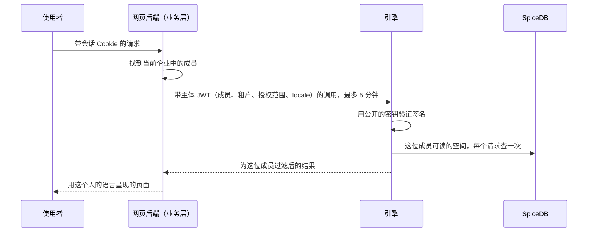
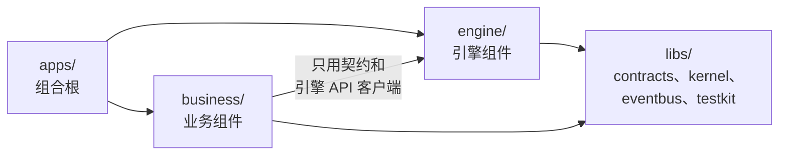
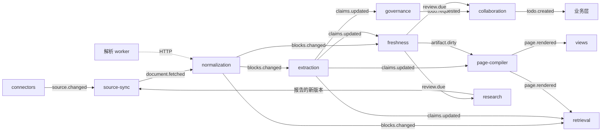
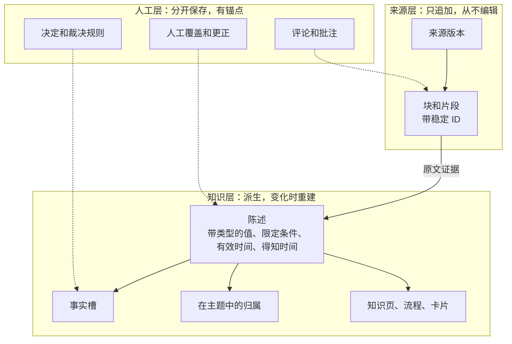
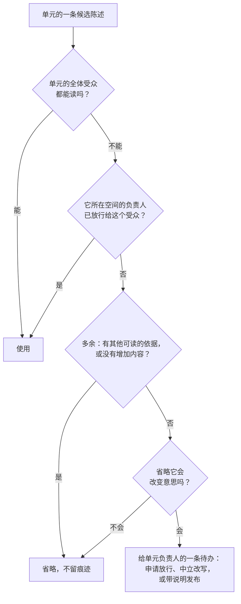
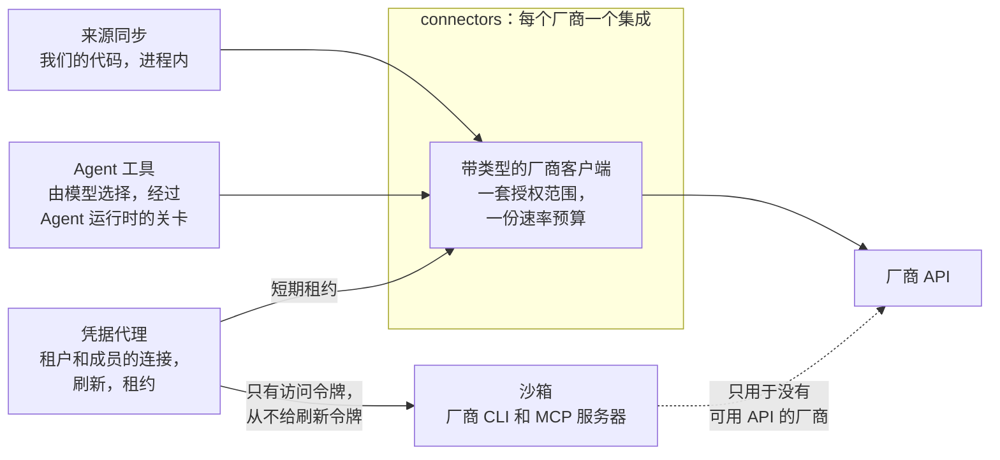

# 架构

Inspiration 是围绕一个知识存储的一组组件。每个组件只负责一件事，通过少数几条明确的路径与其他组件通信，并且可以单独构建和测试。[`components.yaml`](../../components.yaml) 是权威清单；本页说明各部分如何配合，从两层和请求路径，到知识模型、权限、模型与 Agent，以及系统如何构建和部署。[总览](overview.md)的第二部分给出架构概览和目前已经证明的部分。本文是英文版 [architecture.md](../architecture.md) 的中文副本，两者不一致时以英文版为准。

## 引擎与业务层

**引擎**负责连接器、知识流水线、存储、权限、模型访问和 Agent API。它通过 ID 认识租户、空间和主体，
并自行执行每一项权限检查，但它没有账户、登录、邀请或计费。

**业务层**负责人和租户：外部身份提供方、可以是多个租户成员的账户、个人租户、发布策略和
管理治理。它通过引擎命令为引擎开通资源（成员、组、空间、策略），并对引擎事件作出反应。调用向下，事件向上：
引擎从不调用业务层。两层的设计哲学、一件事放在哪一层的判断方法、两层各自绝不做的事，以及两层都参与的事怎样划分，
见总览（[overview.md](overview.md)）的“9. 架构概览”一节。

引擎 API 感知租户和成员身份，且不涉及界面问题，所以业务层、它的 Web 应用和 Agent 都使用同一套接口。

Web 应用通过引擎的 HTTP API（第 0 版，`apps/engine/src/http.ts`）读取引擎：成员能读的空间、一个空间的文档树、一篇文档及其标注视图里的标记、搜索和回答，一个空间的知识大纲和每个主题里各个事实的现行值，成员的待办和每个待办可供选择的结果，以及给空间负责人（或租户管理员）看的空间概览：空间里待处理的工作、读者看到有争议的事实、按治理级别统计的文档和最近的变化。目前写入知识的操作有处理待办，以及空间负责人立即同步一个来源；两者都在引擎读完它们引起的一切之后才返回。业务层的租户服务把租户和成员写入引擎保存的目录副本（访问控制的 `Directory`），空间也通过同一个 API 管理：超级管理员创建空间并指定空间负责人，空间负责人改名并设置谁能阅读，超级管理员可以移除读者但不能添加。`GET /v0/me` 告诉 Web 应用该成员是否是超级管理员，`GET /v0/spaces?manage=true` 列出该成员能管理的空间。`GET /v0/usage` 向超级管理员提供企业一个月的用量：模型费用与预算的对比、回答数及耗时、待办以及助手代为做出的决定，按成员、空间和日期统计，数据来自模型网关的用量记录，其中每次调用都记在提问的成员或所读文档的空间名下；只有计数、耗时和费用，从不包含内容。只有当目录中的成员和租户都处于启用状态时，成员的请求才会被接受。每次读取都按成员的权限检查，成员不能读的内容一律当作不存在来回答。请求携带主体令牌：业务层用 Ed25519 签名的 JWT（内核中的 `signJwt`，两层共用这一实现），由访问控制按业务层公布的公钥验证（`TokenVerifier`）；令牌的作用域限定请求能做什么。开发时，`--dev-identity` 还允许请求用 `x-inspiration-tenant` 和 `x-inspiration-member` 两个请求头说明租户和成员，用 `x-inspiration-locale` 说明成员的语言；这是开发用的替身，只监听本机。Web 应用自己的后端也是替身（`apps/web/src/backend.ts`）：使用者选择以谁的身份操作，只有后端设置这两个请求头。`pnpm demo` 在演示租户上同时运行两者；`pnpm snapshot` 通过两者把演示脚本录下来，生成一个从录像作答的静态页面（`apps/web/src/replay.ts`）。

业务后端（`apps/business`）是浏览器真正的服务端，与网站同源。它通过 Logto 让用户登录（OIDC，在 `business/accounts` 里），保存他们的企业、成员和邀请链接（`business/tenancy`），以租户服务的身份把每次变更写入引擎，并把页面的 `/api/v0/` 调用转给引擎的 `/v0/`，附上它为该成员签发的主体令牌；它在 `/.well-known/jwks.json` 公布自己的公钥。MCP 客户端带着成员的个人访问令牌（`business/access-grants`）调用它的 `/mcp`，它再以代表该成员的智能体身份把调用转给引擎。它也提供构建好的 Web 应用。它的路由列在 `apps/business/src/index.ts` 里。

source-sync 统一管理完整同步的执行、持久化状态和重启恢复；HTTP 层只检查权限并启动或等待
同一个任务。检索组件统一管理 HTTP 与 MCP 的回答流程，其可选阅读回调把已授权引用交给提取
组件，按引用指定的文档版本读取，再把原始已提交事件交给已有的幂等治理与新鲜度处理器。
其他事件消费者在后台运行，回答不排空引擎的全局队列。目录发现是提取组件的选项，与按需阅读、
负责人路由和主题组织独立。

## 身份、租户与请求路径

共有三种 ID：租户（`ten_`）、业务层的用户，也就是账户（`usr_`），以及成员（`mem_`），即一个租户内的一位用户。
用户 ID 从不进入引擎；引擎唯一的人员 ID 是成员 ID。成员 ID 只在其租户内唯一（业务层可以让一个人在其加入的每个
租户里使用相同的成员 ID），没有任何 ID 由另一个 ID 推导而来，也不从 ID 的内容中解读含义。因此，引擎在租户自身的
行之外保存的所有内容都按租户来标识主体：权限图（`<ten_…>|<mem_…>`，服务、组和部门同理）、索引中的主体令牌，
以及 Agent 运行记录。tenancy 组件中的一个函数分配成员 ID。

- **一条验证路径。** 每次调用都带一个业务层签名的 JWT：成员、租户、主体类型、Agent 所代表的成员、授权范围、可选的空间和敏感度上限、会话的登录方式，以及界面 `locale`。网页令牌最多有效 5 分钟，OAuth 访问令牌 10 到 15 分钟。引擎用公开的密钥验证它们，从不看到用户 ID 或身份提供方的令牌。



*图 1. 请求只携带一个短期的签名主体。引擎自己检查权限。*

- **开通命令是幂等的**（幂等键，目录对象带版本），并返回 SpiceDB 的一致性令牌，让下一次读取能看到变化。每晚的目录快照修复偏差，每小时的摘要检查在两次之间发现偏差。
- **契约只在一个地方。** 这个仓库中的 JSON Schema 是两层共同的事实来源；只属于业务的类型放在自己的文件夹里，引擎包从不导入。

## 一个仓库，每层一个目录

两层都在本仓库里构建，同属一个 pnpm workspace，每层有自己的目录：

```
libs/<name>       两层共用的共享库：contracts、kernel、eventbus、testkit
engine/<name>     引擎组件，每个组件一个包
business/<name>   业务层组件，每个组件一个包
apps/<name>       组装根：引擎进程、它的测量工具、业务后端和 Web 应用
```



*图 2. 依赖只朝一个方向。`engine/` 和 `libs/` 里的任何东西都不依赖 `business/`，任何试图这样做的改动都会让清单测试失败。*

包名仍是 `@inspiration/<name>`。

同一个仓库意味着边界靠检查保证，而不是靠仓库之间的隔离：

- **依赖只能单向。** `engine/` 和 `libs/` 中的任何东西都不依赖 `business/`。业务组件只通过契约（类型、接口和引擎的
  API 客户端）使用引擎，从不直接引用引擎组件。这样引擎仍能单独运行，任何一方也都能对着另一方的替身测试。
- **层内只用声明过的依赖。** 一个包只依赖共享库和 `calls` 中列出的组件，和现在一样。业务层也有自己的层级：业务组件、
  组装这些组件并为 Web 应用提供服务的后端，以及只与这个后端通信的 Web 应用。
- **应用负责组装，包不负责。** 一个应用可以组装两层的组件，例如单进程的开发服务器；任何包都不依赖应用。唯一的例外是测量工具（`apps/bench`），它运行它所测量的引擎进程。
- **一份清单，一个检查。** [`components.yaml`](../../components.yaml) 的每一节对应一个目录：`components` 对应
  `engine/`，`libraries` 对应 `libs/`，`business` 对应 `business/`，`apps` 对应 `apps/`。
  引擎组件的 `layer` 字段仍表示它所在的阶段（ingest、compile、store、serve、control）。`test/manifest.test.ts`
  会拒绝不在所属一节目录里的包，以及 `engine/` 或 `libs/` 中任何依赖 `business/` 的东西。
- **一棵 Schema 树。** 只属于业务层的类型放在契约中单独的目录里（`libs/contracts/schema/business/`），生成到单独的入口
  （`@inspiration/contracts/business`），`engine/` 和 `libs/` 里的任何代码都不引入它。
- **一套工具链，分开部署。** 一个锁文件，一套 Biome、`tsc` 和 Vitest 配置，一个 `make check`，所以契约变更和两侧的
  改动在同一个拉取请求里合入。引擎的 API 照样有版本，因为外部 Agent 也在使用。引擎和业务后端仍作为独立的进程部署：
  monorepo 关乎源代码，而不是运行时。等到不同的团队分别负责两层时，`CODEOWNERS` 按目录划分，CI 也可以只运行受改动
  影响的包。

## 分层与组件

<picture>
<source media="(prefers-color-scheme: dark)" srcset="../assets/components.zh.dark.png">

</picture>

*图 3. 按阶段画出每个组件：组件之间的事件用实线，同步调用用虚线；右侧的平台服务供所有组件使用。虚线框表示计划中。*

**引擎组件。** 每个组件只做一件事。它的名字也是它的事件生产者名、消费者组名和模型任务名的前缀。

| 阶段 | 组件 | 职责 | 状态 |
| --- | --- | --- | --- |
| 导入 | connectors | 每个厂商一个集成：列举、抓取、读取 ACL、Webhook、Agent 工具。已构建：本地文件夹、自建 Confluence 空间页面、飞书 docx／知识库页面链接，以及录制的飞书审批测试数据 | 已构建 |
| 导入 | source-sync | 版本、删除标记、ACL 快照、轮询和对账；之后是 `fetch_now` 和文档树 | 已构建；轮询和对账的定时调度已计划（目前在被调用时同步） |
| 导入 | parsing | 处理 Word、PowerPoint、Excel 和 PDF 的 Python worker，通过 HTTP 契约调用；之后通过 OCR 和版面模型处理扫描件 | 文本层已构建 |
| 导入 | normalization | 带稳定 ID 的规范块和片段、块差异、重复文档；之后是镜像页 | 已构建 |
| 导入 | research | 基于 Agent API 和经批准的网络搜索的研究 Agent；报告成为来源 | 已计划 |
| 导入 | code-graph | 每个仓库一个 git 镜像，每个提交一张代码图，在沙箱中构建；每次合并发出 `code.changed`（[代码仓库](design/code-repositories.md)） | 提议中 |
| 编译 | extraction | 带原文证据的陈述、事实槽键、治理级别、按需抽取；之后是实体和流程 | 已构建 |
| 编译 | freshness | 复核时钟、计划日期、副本、过时判断、`review.due`；之后是依赖图和 `artifact.dirty` | 已构建 |
| 编译 | governance | 事实槽取值、带提议值的冲突案例、待办请求、备注；之后是模型裁判层级和裁决规则 | 已构建 |
| 编译 | page-compiler | 主题和归属；之后是带引用的页面、省略检查、图示、快照 | 主题已构建 |
| 存储 | knowledge-store | 知识表的唯一所有者：来龙去脉、双时态读取、事实槽、主题、页面快照 | 已构建 |
| 服务 | retrieval | 所有搜索索引；混合搜索、重排、权限过滤、有依据的回答 | 段落已构建，段落引用的陈述在查询时一并带出；还有用来对照回答的对手（成熟 RAG、长上下文）、治理后的长上下文和精简回答；自己的分块表（目前在 `kb`）以及页面、流程和实体索引已计划 |
| 服务 | agent-api | MCP 服务器、REST 和 OpenAPI、Skill 导出、逐次调用审计 | MCP 服务器已构建，提供 search、ask 和 read，以成员身份行事；其余已计划 |
| 服务 | views | 交互视图模板、生成、渲染检查、沙箱托管 | 已计划 |
| 控制 | collaboration | 待办箱；之后是评论、人工覆盖、发布、决定、放行 | 待办箱已构建 |
| 控制 | access-control | 基于 SpiceDB 的权限、搜索预过滤、审计 | 已构建；空间和依据规则已设计 |
| 控制 | model-gateway | 每一次模型调用：按敏感度路由、预算、提示词、缓存、计量 | 已构建 |
| 控制 | agent-runtime | 内置 Agent 运行的循环：工具、限制、审批关卡、运行轨迹 | 已构建；还没有内置 Agent 在上面运行 |
| 控制 | credential-broker | 租户和成员的连接、加密的密钥、刷新、短期租约 | 已设计 |
| 控制 | sandbox | 为不是我们写的代码，每个任务一个隔离容器 | 已设计 |

**业务组件。** 一个有自己数据库 schema 的 TypeScript 服务，加上网页应用。

| 组件 | 拥有 | 阶段 |
| --- | --- | --- |
| accounts | 用户、登录身份、会话、身份提供方适配器（Logto；Keycloak 作为备选） | 1；MVP 所需部分已构建 |
| tenancy | 租户、成员和成员 ID、邀请、已验证的域名、企业角色、登录策略、从个人到企业、转移 | 1；MVP 所需部分已构建 |
| directory | SSO 连接、飞书通讯录（第二阶段加 SCIM）、群组、部门、外部身份关联 | 1 和 2 |
| access-grants | OAuth 授权服务器、客户端注册、设备授权流程、个人令牌、企业 Agent、撤销 | 1 |
| connections | 企业连接和个人连接的连接流程、同意 | 1 |
| publishing | 发布向导：目标空间、保鲜方式、覆盖范围、受众差异、审批分派 | 1 |
| approvals | 单人和联合审批、截止日期、兜底裁决人、决定记录 | 1（联合审批在 2） |
| notifications | 待办箱、邮件、飞书、Lark 和钉钉卡片、摘要、偏好、消息目录 | 1 |
| admin | 空间负责人、企业设置、角色、审计和用量视图 | 1 |
| billing | 套餐、席位、配额、每位成员的上限、模型预算 | 3 |
| web | 产品网页应用及其面向前端的后端 | 1；构建中 |

共享库位于所有组件之下：**contracts**（类型、校验器、事件目录、组件接口）、**kernel**（设置、日志、插件、
迁移、Blob 存储、数据库连接池、语言包）、**eventbus**（发件箱、中继、消费者）和 **testkit**（面向 compose 栈的测试夹具
和测试数据）。

除了 **parsing** 之外全部是运行在 Node 22 上的 TypeScript。parsing 是一个 Python 工作进程，负责繁重的文档解析
（Office、PDF、扫描件），normalization 通过 HTTP 契约调用它。

## 组件之间如何通信

只有三条路径。

1. **事件。** 组件在同一个 Postgres 事务中写入数据和它的事件（`tx.publish` 写入 `bus.outbox`）。中继把发件箱中的
   行搬到 Valkey Streams，每种事件类型一个流。每个消费组件用以自己命名的消费者组读取，所以每个组件都会看到每个事件
   一次（失败时至少一次）。无法解析的事件、版本比消费者所知更新的事件，以及一再失败的事件，会进入每个消费者组的
   死信流。载荷携带 ID 和代码，从不携带句子。
2. **知识存储的仓储 API。** 对知识的读写都经过 `KnowledgeStore`。任何组件都不读取其他组件的表。
3. **同步调用** `libs/contracts/src/interfaces.ts` 中的接口：`AuthZ`（access-control）、`ModelGateway`
   （model-gateway）、`Retriever`（retrieval）、`AgentRuntime`（agent-runtime）、Blob 存储，以及 retrieval 在回答时
   读取的 `SlotVerdicts`（governance，一个槽里成立的值）和 `StalenessReader`（freshness，一个单元有多陈旧）。之后还有 `SourceSync.fetch_now`、`CredentialBroker` 和 `Sandbox`。
   每个接口都有进程内实现，在有用的地方还有接口相同的 HTTP 实现（model gateway 目前两者都有）。`components.yaml` 列出每个组件可以
   发起哪些调用，清单测试检查一个包不依赖其他任何东西。



*图 4. 以事件表示的引擎流水线。每个组件只对它订阅的事件作出反应。*

引擎的每日定时任务还做两件事：freshness 发布到期的复核，governance 重新检查日期已到的变更。

| 事件 | 发布者 | 消费者 | 状态 |
| --- | --- | --- | --- |
| `source.changed` | connectors、source-sync、research | source-sync | 消费方已构建；发布方已计划（Webhook、轮询、research），所以目前在被调用时同步 |
| `document.fetched` | source-sync | normalization | 已构建 |
| `acl.changed` | source-sync | collaboration（来源权限收紧待办，已计划）；ACL 快照仅供参考，所以没有其他消费者 | 已构建 |
| `blocks.changed` | normalization | extraction、freshness、retrieval | 已构建 |
| `claims.updated` | extraction；governance 和 collaboration（已计划） | freshness、governance、page-compiler；retrieval（已计划） | 已构建 |
| `artifact.dirty` | freshness | extraction、page-compiler、retrieval | 已计划 |
| `review.due` | freshness | collaboration、research | 已构建 |
| `todo.requested` | extraction、governance；views 和 page-compiler（已设计） | collaboration | 已构建 |
| `todo.created` | collaboration | 业务层 | 已构建 |
| `page.rendered` | page-compiler | collaboration、retrieval、views | 已计划 |
| `comment.created` | collaboration | extraction、collaboration | 已计划 |
| `unit.published` | collaboration | retrieval、agent-api、业务层 | 已计划 |
| `connection.changed` | credential-broker | source-sync、collaboration、业务层 | 已设计 |
| `source.tree_changed`、`source.moved` | source-sync、发布步骤 | access-control、retrieval、normalization、业务层 | 已设计 |
| `todo.updated`、`publish_request.updated`、`decision.applied`、`member.offboarded`、`usage.recorded` | 引擎 | 业务层 | 已设计 |

只有引擎发布事件。业务组件以消费者组的方式读取它们；产品部署会增加一个订阅端点，让业务层不绑定于传输方式。

## 知识模型

知识分布在三层里，三层之间从不互相写入。



*图 5. 三层。来源层始终与来源一致；人添加的一切都在自己的层里，锚定在稳定的 ID 上。*

- **来源层始终与来源一致。** 每次同步保存一个不可变的来源版本；变化增加一个版本，删除增加一个“已删除”版本。Inspiration 内部没有任何东西编辑它。
- **知识层是派生的。** 陈述、事实槽、主题和页面由来源版本计算得出，在来源版本变化时重建。
- **人工层分开保存。** 批注、更正、决定、裁决规则以及人添加的陈述单独存储，带作者和时间，锚定在稳定的 ID 上（飞书块 ID、陈述 ID）。新版本到来时，锚点未变的批注随之移动；来源现在认同的更正自行退役；来源与之矛盾的更正让其作者收到待办；锚点已经消失的批注作为孤立批注保留在页边。所以系统永远不会以一种无人能解释的方式偏离来源。

**一条陈述的构成。** 来自价目表的深圳住宿上限：

| 字段 | 值 |
| --- | --- |
| 主语、谓词 | 差旅，每晚住宿上限 |
| 值 | 每晚 650 元人民币（带类型的金额） |
| 限定条件 | 城市级别：一线；职级：经理及以下 |
| 有效时间 | 自 2026-10-18 起 |
| 得知时间 | 自读取这份价目表的那次同步起 |
| 类别 | 制度 |
| 证据 | 来自价目表的原文引文，带版本和片段 |
| 事实槽键 | 谓词 + 限定条件，与语言无关 |

**陈述承载知识，查询承载大规模数据。** 一条陈述不只是主语、谓词和宾语：它带类型的值、作为维度使用的限定条件（城市、职级、期间）和有效时间，让同一谓词的陈述构成一张小事实表，例如按城市和职级划分的住宿上限，而且始终带引用、受治理。这适合规则和事实，每个对象从几百条到几千条，因为每一条都可以复核。大规模的业务数据（每日销售、库存、交易）从不变成陈述：它留在自己的记录系统里，通过一个已登记、参数化的查询到达图表；这个查询由 `data_providers` 插件以该系统的权限运行，并缓存为图表引用的快照。文档里的大表，例如有几千个条目的价目表，仍然是一个可以按行引用的来源；只有当页面或回答用到某一行时，这一行才成为陈述。

| 层 | 保存 | 状态 |
| --- | --- | --- |
| 来源版本 | 一次抓取的修订版、它的哈希、敏感度和治理级别 | 已构建 |
| 块、片段 | 稳定 ID、标题路径、父级；片段按块和文本内容寻址 | 已构建 |
| 陈述和证据 | 主语、谓词、值、限定条件、类别、事实槽键、两个时间区间、原文引文 | 已构建 |
| 事实槽 | 当前的变体及其计数和代表，以及历来的每个值 | 已构建 |
| 主题和归属 | 带稳定键、状态、负责人和计数的分类节点；每条陈述一个归属 | 已构建 |
| 实体、关系 | 人员、部门、产品、供应商；每条边都有陈述支撑 | 已计划 |
| 流程、模型 | 步骤、角色、条件；假设本身是陈述的公式和决策表 | 已计划 |
| 页面 | `PageSpec` 版本，句子绑定到陈述；用于原文视图的镜像页 | 只有契约 |
| 来源节点 | 文档树：每份文档在其来源层级中的位置 | 已设计 |

知识存储执行四条规则：没有证据或推导的陈述被拒绝；证据引文必须是其片段的原文子串；陈述从不删除；页面版本不可变，并且每次加一。读取是双时态的：某个时间点上什么为真，以及系统在某个时间点上知道什么。

## 治理级别与事实槽

并非每份文档都值得负责人关注。一个来源，或其中的文件夹或条目，有一个治理级别，source sync 会把它解析到每个
版本上（`SourceVersion.governance_level`；上传文件和网页一开始是 `reference`）：

| 级别 | 抽取 | 治理 | 保鲜 |
| --- | --- | --- | --- |
| `governed`（制度） | 完整抽取 | 它的取值决定事实槽；负责人收到待办 | 复核时钟和副本复核 |
| `reference`（参考） | 块中提到目录里的事实时，只抽取事实槽陈述；页面或回答用到某个段落时再完整抽取该段落 | 它的取值从不压过或阻挡受治理的取值，只有一种例外：它注明了日期、已经生效、并且晚于受治理取值的变更（页面还没跟上的公告）会成立，并请页面的负责人处理；只有它陈述的取值是一条备注 | 无 |
| `search_only`（仅检索） | 从不抽取 | 无 | 无 |

关于同一个单值事实的陈述共享一个事实槽键（`Claim.slot_key`：已解析时的主体实体、谓词和排序后的限定词）。
`KnowledgeStore.slot()` 无论一个事实槽有多少条陈述，都只用少量几行读出它：当前的取值及其计数和代表陈述，
以及它在各个时期的取值。

## 知识大纲

每条陈述有两个大纲。来源大纲（文档、标题路径、段落）来自它的证据片段。知识大纲（空间、领域、主题、子主题）
来自一条归属（`Placement`：陈述、主题键、页面块、placed_by、confirmed）。

- page-compiler 按空间把当前受治理文档的章节聚类成主题。主题是 `TaxonomyNode`，最多三层，键在一次次重新聚类
  之间保持不变。
- 带事实槽的陈述放在其事实槽多数陈述所在的位置。这也是参考文档的陈述获得归属的唯一方式。
- 没有主题的受治理陈述是未归类的，显示在它的来源章节之下。
- 聚类提出主题，由负责人确认。已确认的主题，以及由人或页面放置或确认的归属，从不移动。一次重新聚类最多有
  `budget`（5%）的已归属陈述更换主题。
- `KnowledgeStore.topics()`、`placementsOf()` 和 `placementsIn()` 读取大纲。

## 流水线与增量保鲜

1. **同步。** source-sync 列举一个来源，把每个条目的内容、元数据和 ACL 哈希与上一次比较，抓取变了的部分，并在一个事务中写入来源版本和 ACL 快照。只有权限变化时不写新版本，所以不会重新解析任何东西。
2. **规范化。** normalization 解析版本（文本格式用内置解析器，Office、PDF 和扫描件用解析 worker），构建带稳定 ID 的块和片段，与上一版比较差异，并发现重复文档。之后的每个阶段都基于这份差异工作。
3. **抽取。** extraction 只读取严格级别文档中新增和变化的块；宽松级别的文档只读取提到已知事实的块。每个窗口一次模型调用。只有引文是原文时才保留陈述；证据消失的陈述被取代，如果文档已被删除，则留给其负责人处理。
4. **治理。** governance 增量地统计每个事实槽的取值，提议有效的值，为其他值开冲突案例，并为每个事实槽发出一条待办请求。目前它是确定性的；针对没有事实槽的陈述，语义层级和模型裁判层级之后加入。
5. **保鲜。** freshness 维护复核时钟，每天为已到期的内容发布一次 `review.due`。它不调用模型，也不修改知识，所以模型故障或预算耗尽都不会让它停下。
6. **组织和编译。** page-compiler 为严格级别文档的小节生成向量，把陈述放进主题，并在变化预算内重新聚类。接下来，它为受众编写带引用的页面和图示，并为每个版本保存快照。
7. **询问人。** collaboration 是唯一创建待办的组件：它合并请求，分派给负责人，并按周归入卡片。
8. **服务。** retrieval 为块、陈述和页面建索引，并为网页应用和 Agent API 提供搜索和回答。

**为什么增量可行。** 块有稳定的 ID，每个阶段都消费块差异，所以一次典型的编辑只涉及少数几个块。重新抽取得到相同的陈述时，后面什么都不会改变。引擎自身引起的变化，例如新的提示词或模型，在值不变时保持静默；值变了时进入评测，而不是进入待办箱。

## 治理引擎

| 类型 | 例子 | 由谁决定 |
| --- | --- | --- |
| 编辑冲突 | 两个人编辑同一段 | 在草稿中实时合并 |
| 覆盖冲突 | 人的修改是 500，来源现在是 600 | 修改的作者 |
| 同一范围内的知识冲突 | 两个来源对一个价格的说法不同 | 该范围的负责人（默认单人） |
| 跨范围的知识冲突 | 财务说 X，销售的流程说 Y | 每位受影响的负责人（默认全员）；截止日期之后由空间负责人决定，跨空间时由超级管理员指定的一位负责人决定 |
| 断言冲突 | 一条评论陈述的事实与已核实的陈述矛盾 | 该范围的负责人 |

- **引擎提议一个值，并说明理由。** 对每个事实槽，治理提议当前有效、最权威的值，除非之后某条带日期的陈述改变了它（“自 2026-10-01 起上限为 650 元”）。被已归档文档明确取代的情况，不需要人就能处理。
- **一个触发，一条待办；一个原因，一次审阅。** 关于同一事实槽或同一文档的请求合并成一条待办，交给它所在主题的负责人；没有时交给上方最近的负责人，再没有时交给空间负责人。一个会产生 20 条以上待办或涉及 3 个以上主题的原因，成为一次批量变更审阅，交给覆盖它的最小范围的负责人，整体决定，每一项仍留记录。连接问题交给超级管理员，因为它们不是知识变化。
- **联合审批总会结束**（[场景 5.3](overview.md#53-两个部门意见不一)）。每个策略都有审批方式、截止日期（跨范围默认 5 个工作日）和兜底裁决人。在人做决定期间，读者和 Agent 看到的是标为“有争议”的最近一次核实的值（默认）、两个值都显示，或者什么都不显示，由企业选择。
- **每个决定都是一条记录。** “为什么是这个值？”会显示谁、在何时、依据什么做出决定。一个决定可以成为裁决规则，治理会把它用于同类的新冲突，并每周报告。
- **负责人必须能读到自己的整个范围**，否则只能判断半个冲突。负责人读不到时，控制台会提醒，这样的冲突交给备份负责人或兜底裁决人。

## 待办箱

collaboration 把 `todo.requested` 和 `review.due` 变成待办，并以一个人能跟得上的数量，把它们放到负责相关主题的
人面前。

- 每个去重键只有一个打开的待办。之后的请求会更新它，标记为撤回（其原因已消失）的请求会把它关闭。
- 待办的主题来自其陈述的归属。它的处理人是该主题的负责人，或者在其上方最近的负责人。业务层指定负责人，主题会
  保留他们（`TaxonomyNode.owner_id`）。
- 一位负责人在一个 ISO 周内关于一个主题的待办共享一张卡片（`Todo.batch_key`），每张最多 20 个。一位负责人每周
  最多 10 张卡片；其余的顺延到之后第一个有空位的周，高优先级和紧急的待办除外。预算是软上限：冲突和它的复核副本
  也会一起留在它们的周里，必要时超出预算。
- 备注（参考文档陈述的取值与受治理的取值不同）放在预算之外的每周备注卡片上，一个操作即可确认它们。
- 复核副本挂在其源更新打开的冲突的卡片上（卡片满时放在它的续卡上），无论两者以什么顺序到达，直到该冲突关闭。
  首次看到某份文档时已经到期的复核，进入按主题划分的首次复核专项。无人负责的主题的待办交给该空间的知识管理员。
- 待办可以提供几种处理结果，每种带一个由发起方执行的效果：冲突为每个取值提供一种。处理待办时，在同一个事务里发布
  带有所选结果的 `todo.resolved`。随后治理以所选取值为现行值（`SlotVerdict.chosen_by`），把其他取值都标为已过时，
  并保持这个选择，直到出现新的取值。如果冲突在提出之后已经变化，基于旧冲突做出的选择会被重新提出。

## 存储

一个 Postgres 实例（ParadeDB 镜像：带 pgvector 和 pg_search 的 Postgres 16）保存：

| Schema | 所有者 | 内容 |
| --- | --- | --- |
| `kb` | knowledge-store | 来源版本、来源块、片段、分块（BM25 索引）、向量（HNSW）、陈述、证据、推导、依赖、页面快照、ACL 快照 |
| `bus` | eventbus | 发件箱和收件箱 |
| `gateway` | model-gateway | 用量记录（预算是对它们的求和） |
| `agents` | agent-runtime | Agent 运行轨迹 |
| `authz` | access-control | 业务层目录的副本（租户、成员及其版本）；空间及其负责人和受众；创建空间的幂等键。它们授予的关系图保存在 SpiceDB 中 |
| `sync` | source-sync | 已注册的来源；每个条目的连接器版本哈希以及它们变成的来源版本 |
| `normalization` | normalization | 每份文档最近一次保存为块的版本（差异比较的基准）、它的解析器和指纹；用于查重的 SimHash 分段索引 |
| `extraction` | extraction | 每份文档最近抽取的版本 |
| `freshness` | freshness | 每份文档的复核时钟、陈述类别和计划日；副本；按日期到期的复核；已删除的文档 |
| `governance` | governance | 事实槽成员和取值分组、冲突案例、每个事实槽最近一次的请求和留下的备注、重新检查的日期 |
| `page_compiler` | page-compiler | 章节及其向量和主题、上一次聚类的主题和质心、每个事实槽所在的主题、更新尚未完成的存储写入 |
| `collaboration` | collaboration | 待办箱：每个待办及其去重键、卡片、所在周和到期周 |
| `retrieval` | retrieval | 每份文档的切块所属的版本；规范化报告的、属于同一文本不同版本的文档 |
| `public.inspiration_migrations` | kernel | 带校验和的迁移台账 |

SpiceDB 把自己的数据存放在同一实例上单独的 `spicedb` 数据库中。Valkey 承载事件流和模型响应缓存。二进制文件
进入 Blob 存储（原型中是一个本地目录，之后是对象存储）。

每个 `kb` 表都把完整的契约对象保存在 `doc` 列中，只把查询要过滤的字段复制到有类型的列，所以契约变更很少需要
迁移。

原型中检索在 Postgres 内运行：BM25 通过 pg_search 和 jieba 分词器（搜索模式、去除空白、繁体折叠为简体），向量
通过 pgvector。两者都在 `VectorIndex` 和 `KeywordIndex` 接口之后，所以部署可以换成 Milvus 或 OpenSearch 而不改动
retrieval。

## 权限

引擎根据业务层开通的副本，自己做出每一个权限决定。可见性来自一个单元所在的空间，从不来自来源权限（已采纳的权限模型，见[业务层与引擎契约](design/business-engine-contract.md)）。

**已构建。**

- **空间决定谁能读。** 一个来源属于一个空间，它的文档由能读这个空间的人读取：空间的受众（成员、群组、部门或整个
  租户），角色从查看者到负责人，每个角色在下层所有空间中同样有效。超级管理员管理每个空间（名称、负责人和受众），
  但只能读受众包括自己的空间。来源 ACL 不决定任何事：source-sync 把它们作为仅供参考的快照保存，用于发布时的
  受众缺口提示。
- **SpiceDB 保存租户、成员、群组、部门和空间**，以租户为键。陈述、页面和流程不写入 SpiceDB。共享空间的角色（`viewer`、`commenter`、`editor`、`steward`、`owner`）自上而下授予，并沿空间树向下继承。
- **空间可读，且敏感标签不高于读者的许可级别时，单元可读。** 标签有 `public`、`internal`、`confidential` 和 `secret`。
- **派生知识跟随其来源。** 一条陈述、一个页面或一个 SOP，只有通过查看者当前能读的来源文档才可读。access-control
  在读取时沿支持路径（支持证据、推导、依赖）遍历血缘来判定，所以它跟随查看者当前能读的空间；反驳或限定一条陈述的
  证据从不会让它变得可读。隐藏的支持从不被计数或指名。一次请求中的来源检查会批量发往 SpiceDB 并做记忆化。
- **检索预过滤。** `scopeFilter` 为每个索引提供查看者可读的空间、所在租户的令牌和许可级别，所以 top-k 只在查看者
  可见的行中选取。结果离开服务器前还会再检查一次。
- **写入之后的新鲜读取。** 每次权限写入都返回 SpiceDB 的一致性令牌（ZedToken）。判定结果把它带在
  `consistency_token` 中，调用方可以要求之后的读取至少同样新鲜。
- **按敏感度路由。** 每次模型调用都带有其内容的最高敏感度标签。每个模型提供方有一个最高标签；机密和绝密内容只会
  发往客户网络内的模型。
- **Agent 代表成员行事。** Agent 主体必须带有 `on_behalf_of`，即其租户的一位成员。它的权限是该成员的权限再按它的
  作用域（默认只读）和空间收窄。内置 Agent 工具只读取或提议；Agent 做的任何事情，都要有人批准才会改变知识。
  外部 Agent 只能通过 MCP 端点（`POST /v0/mcp`，即 agent API）访问引擎，所用令牌由业务层根据它持有的个人令牌为它签发，
  并且只在它代表的成员处于启用状态时有效。

**已设计，尚未构建。**

- **两个域。** 成员域是每位成员的“我的空间”：只有该成员能读，超级管理员也不能，任何租户或管理关系都伸不进去。租户域是所有共享空间。知识只能通过发布进入租户域，跨越边界的东西从不合并或比较。
- **陈述还需要一个读者能读的依据。** 依据说明一条陈述为什么成立。它要么是来自读者可读空间中某份文档的证据引文，要么是一个推导（由其他陈述计算出的陈述），且读者能读它的所有输入。两份都写明深圳上限的文档是可替代的依据：有一个就够。由销售价格和财务成本算出的毛利需要两者都可读：看到了毛利和价格的人，就能算出成本。目前的血缘遍历接受任意一个可读来源：这对可替代的证据是对的，对共同必需的输入则过于宽松；目前已构建的部分还不会写入这种推导。

**汇编知识为它的受众而写**（提议）。页面、流程、主题摘要和回答会组合多个空间的陈述。按读者删减会扭曲原意，因为一个输入受限就屏蔽则既不可用、也会被滥用。这个设计用六条原则同时守住两个承诺：受众由人设定，从不由输入决定；为受众而写，从不按读者删减；改变意思的省略需要人来决定；告诉读者，不误导读者；`secret` 材料留在自己的空间里；可替代的依据只会增加可见性。



*图 6. 编译器如何处理每个输入。`secret` 输入在它自己的空间之外从不进入这个流程；如果它与某个单元矛盾，待办发给该机密空间的负责人。*

- **省略检查。** 省略一个输入会改变意思，是指它为单元用到的事实槽给出了不同的值、取代了单元所说的内容、增加了条件或例外，或者论述了某个观点的另一面。前三种不需要模型调用，从知识模型就能得出；最后一种需要模型任务 `page_compiler.check_omission`，原型里有确定性的模拟实现。
- **按陈述放行。** 一次放行把一条陈述开放给一个受众，记录谁、在何时批准，并成为该受众能读的依据。证据引文默认不随之开放，除非放行时一并包含。之后的变化会让批准人收到一条待办，决定保留还是撤回。
- **回答**是为一位提问者、用这位提问者能读的内容写成的。如果提问者读不到的材料会改变回答，在 `internal` 和 `confidential` 级别，回答会说明它可能不完整以及可以问谁；对于 `secret` 材料，它什么也不说。
- **按读者的安全网**只作用于完整的条目（一篇文档、一个块、一行、一条搜索结果），从不作用于行文中的字句。当它不得不去掉一个段落时，单元会按这位读者的可读空间集合重新编译，并为共享同一集合的所有人缓存。流程要么完整，要么不给。
- **在要紧的地方隐藏存在。** 不可读的空间从不出现在树、搜索、计数或图里；当陈述还有其他依据时，指向读者读不到的空间的引用会被去掉，不留标记。
- **共享的回答缓存**以可读空间和许可级别为键；当它用到的单元改变标签、依据或授权时，缓存条目被丢弃；用到只因读者自己的授权才可读的单元的回答，从不共享。

设计、滥用场景和八个验收测试见[汇编知识的权限](design/compiled-knowledge-permissions.md)。

## 连接器、凭据与沙箱



*图 7. 同步和 Agent 工具共用一个厂商集成和一个凭据代理；只有不是我们写的代码才在沙箱里运行。*

- **每个厂商一个集成，同时服务同步和 Agent 工具。** 两者面对同样的问题：调用用谁的身份、租户和成员之间的隔离、令牌刷新、速率限制、同意、撤销和审计。所以每个厂商（先是飞书）只有一个带类型的客户端，每个连接一套授权范围、一份速率预算。同步用它跟踪变化；注册为 `agent_tools` 插件的 Agent 工具用它搜索、读取和提议。撤销一个连接会同时停止两者。交互式的工具调用在速率预算中有保留份额，所以大规模同步永远不会让它们得不到额度。
- **两者遵循同样的身份规则。** 同步使用发布时选定的连接。Agent 工具总是以它所服务的成员身份、用该成员自己的连接行事；企业连接从不租给 Agent 运行。
- **信任不同，执行方式也不同。** 同步是我们自己的确定性代码，在进程内运行。工具调用由模型根据可能含有恶意的内容选择，所以要经过 Agent 运行时的关卡：允许的操作、经过校验的参数、除非成员要求修改否则只读取或提议，以及每次调用一条审计记录。不是我们写的代码（例如 lark-cli 这样的厂商 CLI，或厂商的 MCP 服务器）只在沙箱中运行，拿到短期访问令牌，从不自己刷新令牌，因为飞书的刷新令牌只能用一次，第二个刷新者会让连接失效。
- **持有凭据的人都可以导入**（2026-10-26 决定）。如果一个人能登录飞书、钉钉、企业微信或某个 OA 系统，那个系统的管理员已经允许这个人阅读这些内容。在这里拦截连接并不构成安全边界：同样的内容可以通过任何第三方导出再导入，而且来源再也无法识别。对成员的管理在上游进行，通过来源系统的权限和凭据。已验证的邮箱域名保留，只用于自动加入企业。
- **凭据代理拥有每个连接及其密钥。** 连接属于租户（企业的应用，用于共享空间）或属于成员（成员自己的登录）。密钥用每个租户的数据密钥做信封加密；密钥加密密钥在原型里是部署密钥，在产品里是 OpenBao Transit 或客户的 KMS（需要时用 SM4）。刷新是主动的，每个连接单路执行，并有每日保活。刷新失败时，连接被标记为需要重新授权，其来源暂停，连接的持有方收到一条待办。
- **沙箱每个任务运行一个容器**：只读根文件系统、没有卷、出站流量经过白名单代理、从不跨租户共享、任务之间不保留任何东西。原型用 Docker 加 gVisor，产品用 Kata Containers 或 Firecracker。它的配置包括厂商 CLI 和 MCP 服务器，以及视图渲染检查。

## 模型与 Agent

- **每一次模型调用都经过模型网关**，包括补全、向量、重排和 OCR，研究用的 `web_search` 已在计划中。一次调用要写明它的任务（`<component>.<verb_object>`，例如 `extraction.extract_claims`）、预算键（`tenant:<id>/<component>`）以及内容的最高敏感标签。网关拒绝把内容发给未获准处理该标签的服务商。
- **提示词是带版本的文件。** 版本是每个产物输入哈希的一部分，所以提示词或模型一变，就能准确知道要重建什么、代价多少。
- **在配置真实模型之前，每个模型任务都附带一个确定性的替身**（`model_mocks` 插件），由假的服务商用它作答。在模拟模型上测得的数字描述的是流水线，而不是模型质量。
- **Agent 运行时**运行每个内置 Agent：一个名为 `<component>.<agent>` 的 `AgentSpec`，效果为读取、提议或（应成员请求）修改的工具，步数和 token 限制，审批关卡以及运行轨迹。工具选择使用 OpenAI 兼容 API 上受 schema 约束的输出，所以更换模型不会改变 Agent。
- **内置 Agent**：评论助手、问答助手、治理 Agent、流程撰写、发布检查、视图生成和研究 Agent。
- **Agent 何时可以修改知识**（2026-10-26 决定）。自主运行时（在后台、按计划或由事件触发），Agent 只读取或提议。当成员在对话或评论中明确要求修改时，这个请求就是批准：在成员可以编辑的地方，Agent 直接修改，修改记录在成员名下，标明由 Agent 完成，并且可以撤销。在成员只能提议的地方，Agent 提出提议。

**Agent API。** 一个遵循当前规范的无状态 MCP 服务器，放在普通负载均衡器后面，REST 和 OpenAPI 由同一份操作 schema 生成。业务层是 OAuth 授权服务器；引擎是资源服务器，检查令牌的受众，从不转发客户端的令牌。MCP 客户端用 OAuth 和 PKCE 登录，CLI 用设备授权流程，企业 Agent 由超级管理员注册。

**目前已构建**（MVP 的智能体切片）：`POST /v0/mcp` 上的 MCP 服务器，提供 `search`、`ask` 和 `read`；MCP 客户端带着成员的个人访问令牌，经业务后端的 `/mcp` 访问它。这些工具的输入沿用契约里的名字（`text`、`space_ids`、`top_k`、`question`、`version_id`），而不是下表的名字。OAuth、REST、`get_changes` 和 `report_feedback` 以后再做。

**授权范围按调用对知识做了什么来划分**，采用常见的 `resource.action` 形式：`knowledge.read` 没有副作用；`knowledge.propose` 创建一个需要经过审批的提议；`knowledge.write` 以成员自己的权限直接修改，如上所述；`comments.write` 写入讨论，讨论本身不是知识。Agent 的权限总是成员的权限再按它的授权范围和空间收窄。

**工具**（2026-10-27 提议，取代十个工具的初稿）。Agent 按名字和描述选择工具，所以工具按 Agent 想做的事来划分，而不是按我们知识模型的形状。由引擎在一次调用内部决定用陈述、流程、实体还是段落来回答。

| 工具 | 何时使用 | 主要输入 | 主要输出 | 授权范围 |
| --- | --- | --- | --- | --- |
| `ask` | 有一个问题，或有一句话要核对 | `question` 或 `claim`、`spaces`、`max_tokens` | 每句带引用的回答，并说明冲突、证据不足或可能不完整；对一句话则给出支持、矛盾或无依据，附证据；以及可继续读取的句柄 | `knowledge.read` |
| `search` | 要查找或列出材料 | `query`、`types`、`spaces`、`exclude_states`（例如 stale、superseded）、`limit`（默认 10，最多 50）、`cursor` | 命中：句柄、类型、上下文标题、约 80 个 token 的摘录、读者状态、空间、整个条目的 token 估算；从不返回全文 | `knowledge.read` |
| `read` | 手里有句柄，要看它背后的内容 | `id`（页面、章节、流程、卡片或段落）、`outline` 和 `depth`、`max_tokens`、`cursor` | 每句带引用的内容，或带每节 token 估算的标题树；相关的卡片和页面以句柄给出；在预算处截断，并给出继续用的 `cursor` | `knowledge.read` |
| `get_changes` | 要让一份副本、缓存或索引保持同步 | `since`（上一次的 `cursor`）、`spaces`、`types` | 新增、变化和被取代的条目，以及新的 `cursor` | `knowledge.read` |
| `report_feedback` | 某个结果有错、过时或缺失 | `target`、`kind`（wrong、outdated、missing）、`note` | 给该范围负责人的一条待办 | `comments.write` |

- **初稿里的工具去了哪里。** `get_outline` 和 `get_sop` 是对页面或流程的 `read`；流程以前提条件、步骤、执行角色和例外返回，不超过约 2,500 个 token。`get_entity` 和 `graph_neighbors` 是 `read` 返回的卡片和链接。`verify_claim` 是带一句话的 `ask`，`answer` 就是 `ask`。
- **和界面相同的权限规则。** Agent 能读的，是成员可读的空间和许可级别，再按 Agent 的授权范围和注册的空间收窄。“无权限”和“不存在”返回同样的 `not_found`。
- **统一的响应信封。** 每个结果都带来源、版本、读者状态、置信度、复核状态和 token 估算；每个响应带一个一致性令牌，Agent 回传它就能读到同一个版本。
- **为 Agent 设计。** 先提问或搜索，再读取：回答和命中都返回句柄和估算，由 Agent 在自己的预算内决定读什么。句柄稳定，在每个工具中都可用。每个结果都说明下一步（“完整流程请 read 这个句柄”），拒绝或截断会说明该用哪个 `cursor` 或参数。每个工具都无状态，读取类工具是幂等的。
- **靠测量，不靠推断。** 在 API 定下来之前，用同一组任务、几种模型，分别跑这组工具和初稿的十个工具，比较完成的任务数、调用次数和 token 用量。
- **仍未决定**：`search` 默认是否把块和陈述放在一起排序，以及 `ask` 内部的模型调用由谁的预算支付。

## 页面、视图与搜索

页面和视图的契约已经就位；编译器和视图宿主已在计划中。检索已为段落和陈述构建。

**从文档到知识**（2026-10-27 决定）。人们先看到的是自己的材料。导入之后，来源以镜像页面打开：文档保持它自己的样子，标题、段落、列表和表格都在，即使不完全一样也接近原文，就像 Claude Artifact 呈现页面那样。知识从这里一步步展开，从具体到抽象：先是批注视图里的标记，然后在选中一段话时打开“这段讲了什么”面板（这段话说了什么、哪些其他文档与它一致、不同或有补充，以及用到它的页面），最后是由它构建的知识页。新来的人从自己的文档开始，而不是从知识卡片开始，文档树排在知识树上面。界面原则把这叫作“先具体，后抽象”，设计画布画出了它。共享空间的读者止步于标记和页面，因为陈述和来龙去脉属于追溯视图；成员是自己“我的空间”的负责人，所以在那里可以打开追溯视图。

- **页面是一个 `PageSpec`**：由 14 种带类型的块（标题、段落、列表、提示框、引用、表格、代码、公式、图片、分隔线、图示、图表、视图、嵌入）组成的有序列表，句子带陈述 ID。每个版本都是带变化原因的不可变快照，块键保持稳定，所以评论能在重建后保留，差异也能说明什么移动了。
- **页面为它的受众而写**，只用它全体受众都能读、或已放行给受众的陈述（见[权限](#权限)）。只有受众能读每一步时，流程才会发布。之后空间收窄时，页面会作为新版本重新编译。
- **图示从结构编译而来**：模型选择展示什么，但从不画连线。
- **图表**的数据来自 `DataRef`：内联的行、陈述（固定的或按查询）或已连接系统的已登记查询，从不使用自由 SQL。由陈述构建的行保留它们的陈述 ID。
- **交互视图**把代码和数据分开。一个视图版本是一个模板或生成的代码，要通过无头渲染检查（控制台错误、手机和桌面宽度下的溢出、两种主题、空数据和大数据）以及一个人的批准。它在独立源上的 iframe 中运行，内容安全策略阻止一切网络访问，只通过带类型的消息协议与宿主通信。
- **镜像页**不用模型、直接从块渲染原文视图，每个块标明保真度（精确、近似，或一个写着“在来源中打开”的占位符）。
- **retrieval 拥有每一个搜索索引**：带上下文标题、感知结构的文本块，向量，以及块、陈述、流程和页面的 BM25 与向量索引。搜索是混合的，用倒数排名融合和重排器，并按可读空间和敏感度预过滤。每个引用带一个读者状态（fresh、aging、stale、at risk、superseded、disputed），界面把它映射为读者看到的四个词。
- **引用从不等待抽取。** 引用基于片段。宽松级别的段落第一次被引用时，retrieval 请 extraction 在后台完整读取它（模拟模型下中位数 13 毫秒）。

## 国际化

引擎读写英文、中文和日文。组件需要了解的语言知识（线索词、标点、日期和编号的写法、模型替身写出的措辞）都是数据：
每种语言在组件的 `languages/` 目录下有一个语言包，所以支持新语言只需新增语言包，不用改代码。在文档带上语言标签之前，
组件用全部语言包读取每段文本，并按文本看起来所属的语言书写。

| 位置 | 设计 | 状态 |
| --- | --- | --- |
| 契约 | 文档、解析提示、陈述、页面和视图消息上带 `Locale`（BCP 47）；事件和待办携带代码和参数，从不携带句子；主体令牌携带界面 `locale` | Locale 已构建；其余已设计 |
| 语言包 | 句子和从句规则、全角形式、数字格式和标题模式放在按语言划分的资源文件里（en、zh、ja），由仓库测试检查 | 已构建 |
| 规范化 | 按文档和按块检测语言 | 已设计 |
| 抽取 | 提示词写明来源语言；引文保持原文；日期、年号、大数单位和货币变成带类型的值 | 已设计 |
| 事实槽 | 与语言无关的谓词和限定条件键，每种语言有标签和别名；实体名称跨文字体系解析 | 键和带类型的值已构建；其余已设计 |
| 陈述 | 译文关联到原文并与之算作一体；陈述在模型检查后跨语言合并 | 已设计 |
| 检索 | 多语言向量（Qwen3-Embedding）；每种语言一个分词器的 BM25（jieba、日文形态素分词器、英文词干） | 混合搜索、重排和回答已在替身上构建；知识存储中已有 jieba 索引；每种语言的分词器已设计 |
| page-compiler | 页面结构只构建一次；规范版本使用空间的内容语言，其他语言按需从同一批陈述编译 | 已设计 |
| 业务层 | 账户语言、企业的广播默认语言、ICU MessageFormat 目录（缺少字符串时构建失败）、本地化登录、每个租户一个区域 | 已设计 |
| 界面 | en、zh-Hans 和 ja 的目录；每个块带语言标签；按文字体系选择字体；本地化格式和排序；输入法规则；伪语言测试 | 已设计 |
| 仓库 | 代码和注释中没有中文或日文；文档用英文写，并在 `docs/zh/` 下有中文副本 | 已构建（仓库测试） |

## 我们如何构建

- **契约优先。** `libs/contracts/schema/*.yaml` 是事实来源；类型和校验器由它生成。在分支里做增量改动没问题；任何删除、重命名或收紧字段的改动都要先达成一致。见 [contracts.md](contracts.md)。
- **边界靠检查，不靠信任。** 一个包放在它所在层的文件夹里，只依赖基础库和它 `calls` 中的组件；层与层之间的依赖只朝一个方向。
- **通过注册表使用插件。** 连接器、Agent 工具、解析器、图示编译器、索引后端、数据提供者、模型服务商、模型替身、视图模板和迁移，都按名字注册到固定的插件组。新来源或新模型是一个新插件，而不是核心改动。
- **在两种后端上测试。** 单元测试使用内存替身；有 Postgres、Valkey 或 SpiceDB 实现的代码，对真实服务运行同样的测试。`make check` 在服务启动的情况下运行 Biome、严格 `tsc`、契约新鲜度检查和测试，但不跑要几分钟的语料运行；`make check-full` 和 CI 连这些一起运行。
- **一个演示租户和一个规模生成器。** `examples/corpus` 是恒远机械，埋有重复和冲突；`pnpm bench synthesize` 生成任意规模的合成租户，`pnpm bench ingest` 输出规模报告。
- **每个改动都通过拉取请求合入，CI 通过即合并。** 正确性第一，然后是分层、清晰的组件边界和明确的契约。
- **有意控制复杂度。** 只构建现行需求要的东西；一个抽象要有两个使用者；先复用，再新增辅助函数或依赖包；文件最多 800 行、函数认知复杂度最多 40，两者都有检查；包的 `src/` 下最多一层文件夹，不要大杂烩文件；新增文件夹、库、应用、组件或插件组要先经产品负责人同意。规则见 [AGENTS.md](../../AGENTS.md) 的“Keeping the code simple”。
- **名字描述事物做什么。** 代码、文档和事件中没有计划编号。[AGENTS.md](../../AGENTS.md) 是给任何构建组件的人或 Agent 的完整规则。

**技术栈。**

| 关注点 | 原型 | 产品 |
| --- | --- | --- |
| 语言 | 全部用 Node 22 上的 TypeScript；只有文档解析用 Python worker | 相同；只有需要单一二进制的部分用 Go |
| 数据库 | PostgreSQL 16 | PostgreSQL，或通过一个窄的 SQL 子集支持人大金仓和 openGauss |
| 搜索 | pgvector 和 ParadeDB pg_search | Milvus，或在客户自己运行时用 Elasticsearch 或 OpenSearch |
| 权限 | SpiceDB | SpiceDB，加上一个处理标签的策略引擎 |
| 队列 | Postgres 发件箱和 Valkey Streams | NATS JetStream 或 Kafka |
| 模型 | 现在是带模拟的假服务商；接下来是一个 flash 级模型（在中国用国产模型）、Qwen3-Embedding 和 Qwen3-Reranker | 按区域和敏感度在 vLLM、SGLang 和 MindIE 之间路由 |
| 解析 | 读取 Office 文件和 PDF 文本层的 Python worker；之后在一张 GPU 上用 Docling 和 PaddleOCR-VL 处理扫描件 | 带置信度升级的路由 |
| 身份 | 通过 OIDC 适配器接入 Logto | Logto、Keycloak，或客户自己的身份提供方 |
| 密钥 | 在部署密钥下做信封加密 | OpenBao Transit，或客户的 KMS 或 HSM |
| 沙箱 | Docker 加 gVisor | Kata Containers 或 Firecracker，带预热池 |
| 部署 | 单节点 Docker Compose | Helm、离线安装包、amd64 和 arm64 |

## 部署形态

原型在一个或少数几个进程中运行所有组件，对接 compose 栈。接口是之后拆分的接缝：model gateway 已经作为独立的
HTTP 服务（`inspiration-gateway`）运行，其客户端抛出相同的错误；事件总线让消费者可以运行在任何能连到 Valkey 的
地方。

<picture>
<source media="(prefers-color-scheme: dark)" srcset="../assets/deployment.zh.dark.png">

</picture>

*图 8. 把组件按负载增长后会拆成的服务分组，旁边是它们运行所依赖的开源组件；虚线框表示计划中。今天这些分组都在引擎的一个进程里运行，业务后端和 compose 栈（ParadeDB、Valkey、SpiceDB 和 Logto）在它旁边运行。SaaS 的每个区域运行这样一套，每个企业的数据留在创建企业时选定的区域。*

图 3 和图 8 各由 [`assets/`](../assets/components.html) 里的一个源文件画出，怎么重画见[开发指南](development.md#重画架构图)。

- **一套代码，两种部署形态。** SaaS 优先：企业的区域在创建时确定，先开中国大陆和一个全球区域。在中国大陆提供公有 SaaS 需要生成式 AI 备案、ICP 许可证和等级保护。私有化部署是第二种形态，以国产化基础设施（麒麟、鲲鹏或海光、人大金仓、昇腾）为认证目标。
- **许可证。** pg_search 是 AGPL-3.0；BM25 放在插件接口后面，客户需要时可以换成 OpenSearch 索引。使用 Valkey（BSD）而不是 Redis。见 [licensing.md](licensing.md)。
