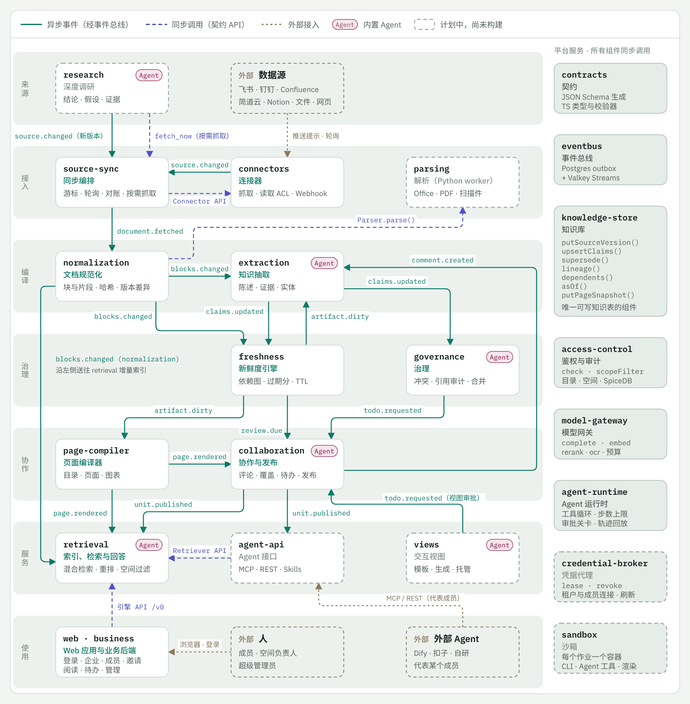
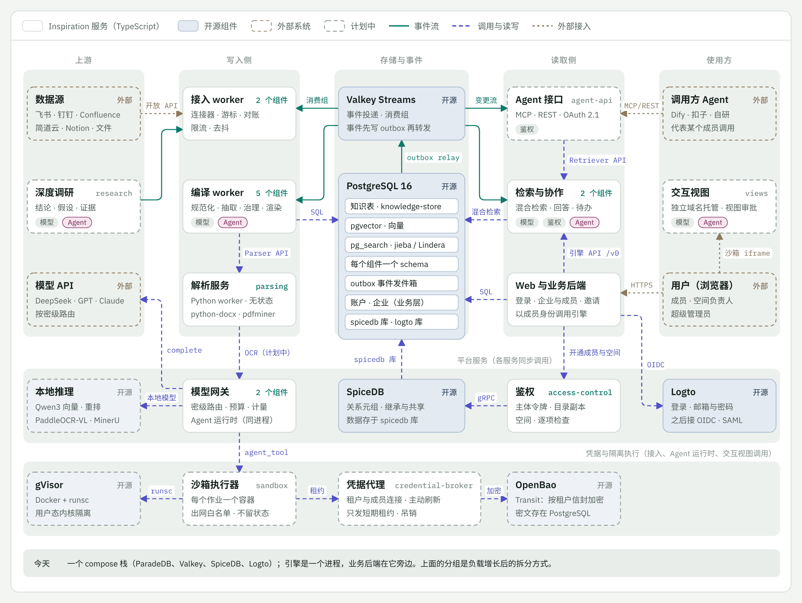

# 架构

Inspiration 是围绕一个知识存储的一组组件。每个组件只负责一件事，通过少数几条明确的路径与其他组件通信，
并且可以单独构建和测试。[`components.yaml`](../../components.yaml) 是权威清单；本页说明各部分如何配合。
本文是英文版 [architecture.md](../architecture.md) 的中文副本，两者不一致时以英文版为准。

## 引擎与业务层

**引擎**负责连接器、知识流水线、存储、权限、模型访问和 Agent API。它通过 ID 认识租户、空间和主体，
并自行执行每一项权限检查，但它没有账户、登录、邀请或计费。

**业务层**维护人和租户：外部身份提供方、可以是多个租户成员的账户、个人租户、发布策略和
管理治理。它通过引擎命令为引擎开通资源（成员、组、空间、策略），并对引擎事件作出反应。调用向下，事件向上：
引擎从不调用业务层。两层的设计哲学、一件事放在哪一层的判断方法、两层各自绝不做的事，以及两层都参与的事怎样划分，
见总览（[overview.md](overview.md)）的“9. 架构概览”一节。

共有三种 ID：租户（`ten_`）、业务层的用户，也就是账户（`usr_`），以及成员（`mem_`），即一个租户内的一位用户。
用户 ID 从不进入引擎；引擎唯一的人员 ID 是成员 ID。成员 ID 只在其租户内唯一（业务层可以让一个人在其加入的每个
租户里使用相同的成员 ID），没有任何 ID 由另一个 ID 推导而来，也不从 ID 的内容中解读含义。因此，引擎在租户自身的
行之外保存的所有内容都按租户来标识主体：权限图（`<ten_…>|<mem_…>`，服务、组和部门同理）、索引中的主体令牌，
以及 Agent 运行记录。

引擎 API 感知租户和成员身份，且不涉及界面问题，所以业务层、它的 Web 应用和 Agent 都使用同一套接口。

Web 应用通过引擎的 HTTP API（第 0 版，`apps/engine/src/http.ts`）读取引擎：成员能读的空间、一个空间的文档树、一篇文档及其标注视图里的标记、搜索和回答，一个空间的知识大纲和每个主题里各个事实的现行值，成员的待办和每个待办可供选择的结果，以及给空间负责人（或租户管理员）看的空间概览：空间里待处理的工作、读者看到有争议的事实、按治理级别统计的文档和最近的变化。目前写入知识的操作有处理待办，以及空间负责人立即同步一个来源；两者都在引擎读完它们引起的一切之后才返回。业务层的租户服务把租户和成员写入引擎保存的目录副本（访问控制的 `Directory`），空间也通过同一个 API 管理：超级管理员创建空间并指定空间负责人，空间负责人改名并设置谁能阅读，超级管理员可以移除读者但不能添加。`GET /v0/me` 告诉 Web 应用该成员是否是超级管理员，`GET /v0/spaces?manage=true` 列出该成员能管理的空间。只有当目录中的成员和租户都处于启用状态时，成员的请求才会被接受。每次读取都按成员的权限检查，成员不能读的内容一律当作不存在来回答。请求携带主体令牌：业务层用 Ed25519 签名的 JWT（内核中的 `signJwt`，两层共用这一实现），由访问控制按业务层公布的公钥验证（`TokenVerifier`）；令牌的作用域限定请求能做什么。开发时，`--dev-identity` 还允许请求用 `x-inspiration-tenant` 和 `x-inspiration-member` 两个请求头说明租户和成员，用 `x-inspiration-locale` 说明成员的语言；这是开发用的替身，只监听本机。Web 应用自己的后端也是替身（`apps/web/src/backend.ts`）：使用者选择以谁的身份操作，只有后端设置这两个请求头。`pnpm demo` 在演示租户上同时运行两者；`pnpm snapshot` 通过两者把演示脚本录下来，生成一个从录像作答的静态页面（`apps/web/src/replay.ts`）。

业务后端（`apps/business`）是浏览器真正的服务端，与网站同源。它通过 Logto 让用户登录（OIDC，在 `business/accounts` 里），保存他们的企业、成员和邀请链接（`business/tenancy`），以租户服务的身份把每次变更写入引擎，并把页面的 `/api/v0/` 调用转给引擎的 `/v0/`，附上它为该成员签发的主体令牌；它在 `/.well-known/jwks.json` 公布自己的公钥。MCP 客户端带着成员的个人访问令牌（`business/access-grants`）调用它的 `/mcp`，它再以代表该成员的智能体身份把调用转给引擎。它也提供构建好的 Web 应用。它的路由列在 `apps/business/src/index.ts` 里。

## 一个仓库，每层一个目录

两层都在本仓库里构建，同属一个 pnpm workspace，每层有自己的目录：

```
libs/<name>       两层共用的共享库：contracts、kernel、eventbus、testkit
engine/<name>     引擎组件，每个组件一个包
business/<name>   业务层组件，每个组件一个包
apps/<name>       组装根：引擎进程、它的测量工具、业务后端和 Web 应用
```

包名仍是 `@inspiration/<name>`。

同一个仓库意味着边界靠检查保证，而不是靠仓库之间的隔离：

- **依赖只能单向。** `engine/` 和 `libs/` 中的任何东西都不依赖 `business/`。业务组件只通过契约（类型、接口和引擎的
  API 客户端）使用引擎，从不直接引用引擎组件。这样引擎仍能单独运行，任何一方也都能对着另一方的替身测试。
- **层内只用声明过的依赖。** 一个包只依赖共享库和 `calls` 中列出的组件，和现在一样。业务层也有自己的层级：业务组件、
  组装这些组件并为 Web 应用提供服务的后端，以及只与这个后端通信的 Web 应用。
- **应用负责组装，包不负责。** 一个应用可以组装两层的组件，例如单进程的开发服务器；任何包都不依赖应用。唯一的例外是测量工具（`apps/bench`），它运行它所测量的引擎进程。
- **一份清单，一个检查。** [`components.yaml`](../../components.yaml) 的每一节对应一个目录：`components` 对应
  `engine/`，`libraries` 对应 `libs/`，`business` 对应 `business/`，`apps` 对应 `apps/`。
  引擎组件的 `layer` 字段仍表示它所在的阶段（ingest、compile、store、serve、control）。`test/manifest.test.ts`
  会拒绝不在所属一节目录里的包，以及 `engine/` 或 `libs/` 中任何依赖 `business/` 的东西。
- **一棵 Schema 树。** 只属于业务层的类型放在契约中单独的目录里（`libs/contracts/schema/business/`），生成到单独的入口
  （`@inspiration/contracts/business`），`engine/` 和 `libs/` 里的任何代码都不引入它。
- **一套工具链，分开部署。** 一个锁文件，一套 Biome、`tsc` 和 Vitest 配置，一个 `make check`，所以契约变更和两侧的
  改动在同一个拉取请求里合入。引擎的 API 照样有版本，因为外部 Agent 也在使用。引擎和业务后端仍作为独立的进程部署：
  monorepo 关乎源代码，而不是运行时。等到不同的团队分别负责两层时，`CODEOWNERS` 按目录划分，CI 也可以只运行受改动
  影响的包。

## 分层与组件

| 层 | 组件 | 职责 |
| --- | --- | --- |
| 导入 | connectors、source-sync、parsing、normalization、research | 连同 ACL 一起获取来源，解析它们，并以稳定的 ID 保存规范化的块和片段 |
| 编译 | extraction、freshness、governance、page-compiler | 带证据的陈述、过期与脏标记传播、冲突、带引用的页面和图表 |
| 存储 | knowledge-store | 知识表的唯一所有者：血缘、双时态读取、页面快照、搜索索引 |
| 服务 | retrieval、agent-api、views | 混合检索与有依据的回答、面向 Agent 的 MCP 和 REST、沙箱中的交互视图 |
| 控制 | collaboration、access-control、model-gateway、agent-runtime、credential-broker、sandbox | 待办箱、评论与提议、权限、每一次模型调用、内置 Agent 运行的循环、来源连接及其凭据、为不是我们写的代码（厂商 CLI 和 MCP 服务器）和渲染检查提供的隔离作业 |

<picture>
<source media="(prefers-color-scheme: dark)" srcset="../assets/components.zh.dark.png">

</picture>

图中按阶段画出每个组件，组件之间的事件用实线，同步调用用虚线。右侧的平台服务供所有组件使用。虚线框表示计划中。

共享库位于所有组件之下：**contracts**（类型、校验器、事件目录、组件接口）、**kernel**（设置、日志、插件、
迁移、Blob 存储、数据库连接池、语言包）、**eventbus**（发件箱、中继、消费者）和 **testkit**（面向 compose 栈的测试夹具
和测试数据）。

除了 **parsing** 之外全部是运行在 Node 22 上的 TypeScript。parsing 是一个 Python 工作进程，负责繁重的文档解析
（Office、PDF、扫描件），normalization 通过 HTTP 契约调用它。

引擎读写英文、中文和日文。组件需要了解的语言知识（线索词、标点、日期和编号的写法、模型替身写出的措辞）都是数据：
每种语言在组件的 `languages/` 目录下有一个语言包，所以支持新语言只需新增语言包，不用改代码。在文档带上语言标签之前，
组件用全部语言包读取每段文本，并按文本看起来所属的语言书写。

## 组件之间如何通信

只有三条路径。

1. **事件。** 组件在同一个 Postgres 事务中写入数据和它的事件（`tx.publish` 写入 `bus.outbox`）。中继把发件箱中的
   行搬到 Valkey Streams，每种事件类型一个流。每个消费组件用以自己命名的消费者组读取，所以每个组件都会看到每个事件
   一次（失败时至少一次）。无法解析的事件、版本比消费者所知更新的事件，以及一再失败的事件，会进入每个消费者组的
   死信流。
2. **知识存储的仓储 API。** 对知识的读写都经过 `KnowledgeStore`。任何组件都不读取其他组件的表。
3. **同步调用** `libs/contracts/src/interfaces.ts` 中的接口：`AuthZ`（access-control）、`ModelGateway`
   （model-gateway）、`Retriever`（retrieval）、`AgentRuntime`（agent-runtime）、Blob 存储，以及 retrieval 在回答时
   读取的 `SlotVerdicts`（governance，一个槽里成立的值）和 `StalenessReader`（freshness，一个单元有多陈旧）。
   每个接口都有进程内实现，在有用的地方还有接口相同的 HTTP 实现（model gateway 目前两者都有）。`components.yaml` 列出每个组件可以
   发起哪些调用，清单测试检查一个包不依赖其他任何东西。

主流程，从一份变化的文档到一个最新的页面：

```
source.changed -> source-sync 获取 -> document.fetched（+ acl.changed，仅供参考的 ACL 快照）
  -> normalization 解析（Office 和 PDF 交给 parsing 工作进程）并对块做差异比较 -> blocks.changed
  -> extraction -> claims.updated -> freshness -> artifact.dirty
                                   -> governance 比较事实槽的取值 -> todo.requested -> collaboration
  freshness：复核时钟、计划日、遗留的副本 -> review.due -> collaboration、research
  引擎的每日定时任务：freshness 发布到期的复核，governance 重新检查带日期的变更
  -> page-compiler 重建页面 -> page.rendered
  -> retrieval 重建索引，collaboration 发出通知，views 刷新
```

## 治理级别与事实槽

并非每份文档都值得维护人关注。一个来源，或其中的文件夹或条目，有一个治理级别，source sync 会把它解析到每个
版本上（`SourceVersion.governance_level`；上传文件和网页一开始是 `reference`）：

| 级别 | 抽取 | 治理 | 保鲜 |
| --- | --- | --- | --- |
| `governed`（制度） | 完整抽取 | 它的取值决定事实槽；维护人收到待办 | 复核时钟和副本复核 |
| `reference`（参考） | 块中提到目录里的事实时，只抽取事实槽陈述；页面或回答用到某个段落时再完整抽取该段落 | 它的取值从不压过或阻挡受治理的取值，只有一种例外：它注明了日期、已经生效、并且晚于受治理取值的变更（页面还没跟上的公告）会成立，并请页面的负责人处理；只有它陈述的取值是一条备注 | 无 |
| `search_only`（仅检索） | 从不抽取 | 无 | 无 |

关于同一个单值事实的陈述共享一个事实槽键（`Claim.slot_key`：已解析时的主体实体、谓词和排序后的限定词）。
`KnowledgeStore.slot()` 无论一个事实槽有多少条陈述，都只用少量几行读出它：当前的取值及其计数和代表陈述，
以及它在各个时期的取值。

## 知识大纲

每条陈述有两个大纲。来源大纲（文档、标题路径、段落）来自它的证据片段。知识大纲（空间、领域、主题、子主题）
来自一条归属（`Placement`：陈述、主题键、页面块、placed_by、confirmed）。

- page-compiler 按空间把当前受治理文档的章节聚类成主题。主题是 `TaxonomyNode`，最多三层，键在一次次重新聚类
  之间保持不变。
- 带事实槽的陈述放在其事实槽多数陈述所在的位置。这也是参考文档的陈述获得归属的唯一方式。
- 没有主题的受治理陈述是未归类的，显示在它的来源章节之下。
- 聚类提出主题，由维护人确认。已确认的主题，以及由人或页面放置或确认的归属，从不移动。一次重新聚类最多有
  `budget`（5%）的已归属陈述更换主题。
- `KnowledgeStore.topics()`、`placementsOf()` 和 `placementsIn()` 读取大纲。

## 待办箱

collaboration 把 `todo.requested` 和 `review.due` 变成待办，并以一个人能跟得上的数量，把它们放到负责相关主题的
人面前。

- 每个去重键只有一个打开的待办。之后的请求会更新它，标记为撤回（其原因已消失）的请求会把它关闭。
- 待办的主题来自其陈述的归属。它的处理人是该主题的维护人，或者在其上方最近的维护人。业务层指定维护人，主题会
  保留他们（`TaxonomyNode.owner_id`）。
- 一位维护人在一个 ISO 周内关于一个主题的待办共享一张卡片（`Todo.batch_key`），每张最多 20 个。一位维护人每周
  最多 10 张卡片；其余的顺延到之后第一个有空位的周，高优先级和紧急的待办除外。预算是软上限：冲突和它的复核副本
  也会一起留在它们的周里，必要时超出预算。
- 备注（参考文档陈述的取值与受治理的取值不同）放在预算之外的每周备注卡片上，一个操作即可确认它们。
- 复核副本挂在其源更新打开的冲突的卡片上（卡片满时放在它的续卡上），无论两者以什么顺序到达，直到该冲突关闭。
  首次看到某份文档时已经到期的复核，进入按主题划分的首次复核专项。无人负责的主题的待办交给该空间的知识管理员。
- 待办可以提供几种处理结果，每种带一个由发起方执行的效果：冲突为每个取值提供一种。处理待办时，在同一个事务里发布
  带有所选结果的 `todo.resolved`。随后治理以所选取值为现行值（`SlotVerdict.chosen_by`），把其他取值都标为已过时，
  并保持这个选择，直到出现新的取值。如果冲突在提出之后已经变化，基于旧冲突做出的选择会被重新提出。

## 存储

一个 Postgres 实例（ParadeDB 镜像：带 pgvector 和 pg_search 的 Postgres 16）保存：

| Schema | 所有者 | 内容 |
| --- | --- | --- |
| `kb` | knowledge-store | 来源版本、来源块、片段、分块（BM25 索引）、向量（HNSW）、陈述、证据、推导、依赖、页面快照、ACL 快照 |
| `bus` | eventbus | 发件箱和收件箱 |
| `gateway` | model-gateway | 用量记录（预算是对它们的求和） |
| `agents` | agent-runtime | Agent 运行轨迹 |
| `authz` | access-control | 业务层目录的副本（租户、成员及其版本）；空间及其负责人和受众；创建空间的幂等键。它们授予的关系图保存在 SpiceDB 中 |
| `sync` | source-sync | 已注册的来源；每个条目的连接器版本哈希以及它们变成的来源版本 |
| `normalization` | normalization | 每份文档最近一次保存为块的版本（差异比较的基准）、它的解析器和指纹；用于查重的 SimHash 分段索引 |
| `extraction` | extraction | 每份文档最近抽取的版本 |
| `freshness` | freshness | 每份文档的复核时钟、陈述类别和计划日；副本；按日期到期的复核；已删除的文档 |
| `governance` | governance | 事实槽成员和取值分组、冲突案例、每个事实槽最近一次的请求和留下的备注、重新检查的日期 |
| `page_compiler` | page-compiler | 章节及其向量和主题、上一次聚类的主题和质心、每个事实槽所在的主题、更新尚未完成的存储写入 |
| `collaboration` | collaboration | 待办箱：每个待办及其去重键、卡片、所在周和到期周 |
| `retrieval` | retrieval | 每份文档的切块所属的版本；规范化报告的、属于同一文本不同版本的文档 |
| `public.inspiration_migrations` | kernel | 带校验和的迁移台账 |

SpiceDB 把自己的数据存放在同一实例上单独的 `spicedb` 数据库中。Valkey 承载事件流和模型响应缓存。二进制文件
进入 Blob 存储（原型中是一个本地目录，之后是对象存储）。

每个 `kb` 表都把完整的契约对象保存在 `doc` 列中，只把查询要过滤的字段复制到有类型的列，所以契约变更很少需要
迁移。

原型中检索在 Postgres 内运行：BM25 通过 pg_search 和 jieba 分词器（搜索模式、去除空白、繁体折叠为简体），向量
通过 pgvector。两者都在 `VectorIndex` 和 `KeywordIndex` 接口之后，所以部署可以换成 Milvus 或 OpenSearch 而不改动
retrieval。

## 安全模型

可见性来自一个单元所在的空间，从不来自来源权限（已采纳的权限模型，见 `docs/design/business-engine-contract.md`）。
尚待实现的是成员自己的空间（只有该成员可读），以及针对一个单元共同需要的输入的依据规则：一条陈述可见的条件是它的
空间可读，并且它有一条完整的依据可读。

- **空间决定谁能读。** 一个来源属于一个空间，它的文档由能读这个空间的人读取：空间的受众（成员、群组、部门或整个
  租户），角色从查看者到负责人，每个角色在下层所有空间中同样有效。超级管理员管理每个空间（名称、负责人和受众），
  但只能读受众包括自己的空间。来源 ACL 不决定任何事：source-sync 把它们作为仅供参考的快照保存，用于发布时的
  受众缺口提示。
- **派生知识跟随其来源。** 一条陈述、一个页面或一个 SOP，只有通过查看者当前能读的来源文档才可读。access-control
  在读取时沿支持路径（支持证据、推导、依赖）遍历血缘来判定，所以它跟随查看者当前能读的空间；反驳或限定一条陈述的
  证据从不会让它变得可读。隐藏的支持从不被计数或指名。一次请求中的来源检查会批量发往 SpiceDB 并做记忆化。
- **检索预过滤。** `scopeFilter` 为每个索引提供查看者可读的空间、所在租户的令牌和许可级别，所以 top-k 只在查看者
  可见的行中选取。结果离开服务器前还会再检查一次。
- **写入之后的新鲜读取。** 每次权限写入都返回 SpiceDB 的一致性令牌（ZedToken）。判定结果把它带在
  `consistency_token` 中，调用方可以要求之后的读取至少同样新鲜。
- **按敏感度路由。** 每次模型调用都带有其内容的最高敏感度标签。每个模型提供方有一个最高标签；机密和绝密内容只会
  发往客户网络内的模型。
- **Agent 代表成员行事。** Agent 主体必须带有 `on_behalf_of`，即其租户的一位成员。它的权限是该成员的权限再按它的
  作用域（默认只读）和空间收窄。内置 Agent 工具只读取或提议；Agent 做的任何事情，都要有人批准才会改变知识。
  外部 Agent 只能通过 MCP 端点（`POST /v0/mcp`，即 agent API）访问引擎，所用令牌由业务层根据它持有的个人令牌为它签发，
  并且只在它代表的成员处于启用状态时有效。

## 部署形态

原型在一个或少数几个进程中运行所有组件，对接 compose 栈。接口是之后拆分的接缝：model gateway 已经作为独立的
HTTP 服务（`inspiration-gateway`）运行，其客户端抛出相同的错误；事件总线让消费者可以运行在任何能连到 Valkey 的
地方。

<picture>
<source media="(prefers-color-scheme: dark)" srcset="../assets/deployment.zh.dark.png">

</picture>

图中把组件按负载增长后会拆成的服务分组，旁边是它们运行所依赖的开源组件。今天这些分组都在引擎的一个进程里运行；业务后端和 compose 栈（ParadeDB、Valkey、SpiceDB 和 Logto）在它旁边运行。两张图各由 [`assets/`](../assets/components.html) 里的一个源文件画出，怎么重画见[开发指南](development.md#重画架构图)。
