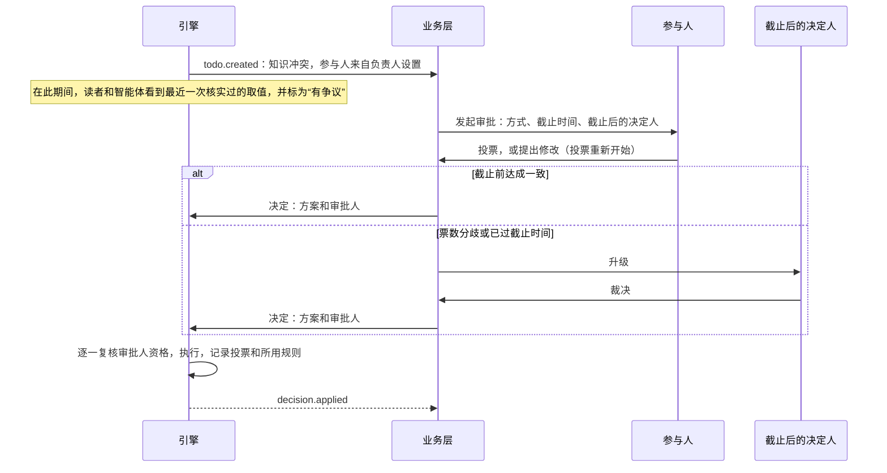
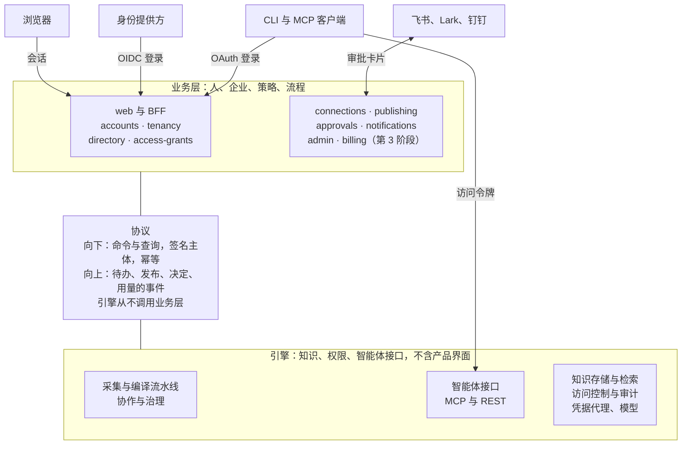

# 业务层：功能设计

状态：已采纳的设计，2026-10-24。它需要的引擎契约改动列在[业务层与引擎契约](business-engine-contract.md)中。本文是 [docs/design/business-layer.md](../../design/business-layer.md) 的中文副本，两者不一致时以英文版为准。

## 摘要

Inspiration 分为两层。**引擎**没有产品界面，只负责知识、权限机制和面向智能体的接口（MCP、REST 和 CLI）。**业务层**位于引擎之上，负责人、企业、策略、审批、通知和 Web 应用。业务层带着签名的主体调用引擎命令，引擎回传事件，每晚一次对账修复偏差。引擎从不调用业务层。

一个人有一个**用户**（账号），在他所属的每个**租户**里各有一个**成员**身份，所有工作都记在成员名下。这是常见的 B2B 结构，Notion、Figma 和 Linear 都是这样。产品界面里把租户叫作**企业**，和飞书、钉钉一致。

设计围绕五个要点展开：

1. **发布永远不跨租户。** 个人使用跑在一个个人租户里，但产品从不把它当作租户展示。每个成员在加入的每个租户里还有一个私有的“我的空间”。发布就是把内容从我的空间移进租户的共享空间。把个人租户里的内容带进公司，是一次单独、明确的迁移。
2. **两个域：发布后的知识归租户管，不跟随来源。** 我的空间只属于成员本人，任何人都看不到里面，超级管理员也不例外。发布把知识移入租户域，由超级管理员和空间负责人自上而下决定谁能读，发布者保留访问权。来源权限不被继承，只用来发出提醒。代价是发布时容易过度共享，所以每次发布都要经过检查和审批。
3. **公司数据可以留在公司管控之内。** 员工有可能把公司飞书连接到自己的个人租户。公司认领自己的飞书企业和邮箱域名，然后拦截这类连接，或把它们引导进公司的企业。
4. **联合审批总能收尾。** 编辑冲突和知识冲突分开处理，只有受治理知识上的知识冲突才需要共识。每次审批都有截止时间和截止后的决定人，争议期间智能体看到什么由企业设置决定。决定可以沉淀为可复用的裁决规则，同样的冲突不会反复出现。
5. **智能体访问由业务层管理。** 业务层给 MCP 客户端发 OAuth 令牌，给 CLI 发设备授权令牌，给企业智能体发身份，引擎只负责校验。

**成本。** 业务层原型约 16 人周，引擎侧净增约 4.5 人周。整体计划从约 70 人周增至约 90 人周，业务线安排两名开发者并行工作 8 到 9 周。

## 设计应对的风险

结构本身很简单：租户是隔离和计费的单位，用户在成员之上，成员是行为主体，先自下而上发布，再自上而下管理。风险几乎都出在转换环节：个人转团队、成员离开、凭据所有者离开，以及没人拍板的决定。

| # | 风险 | 为什么重要 | 设计如何应对 |
| --- | --- | --- | --- |
| 1 | 内容在个人租户里时，“发布到租户”含义不清 | 租户是隔离边界。跨租户的实时链接会破坏权限检查、删除和计费 | 发布始终在同一个租户内进行。每个成员在每个租户里都有个人空间。跨租户移动是一次明确的迁移，会重新创建来源 |
| 2 | 发布后的知识可能被来源本不允许的人读到 | 在两域模型下，用 A 的连接生成的页面，整个空间的可见范围都能读，包括在飞书里打不开原文的人。这是设计意图，但很容易过度共享 | 每次发布都做检查：基于来源权限的“部分读者无法打开原文”提醒、敏感信息和个人信息扫描、主题负责人或空间负责人审批、审计记录。来源权限日后收紧时标记相关文档 |
| 3 | 个人租户可能把公司数据带出公司管控 | 员工把公司飞书连到个人租户，脱离公司的审计和离职流程 | 公司验证邮箱域名并认领飞书企业。策略可以拦截这类连接，或引导进公司租户 |
| 4 | 每家公司有自己的登录规则 | 有人进入公司租户时，公司需要自己的 SSO、MFA 和会话规则；人事办理离职时必须切断访问 | 登录策略按租户设置。进入租户可能要求通过其 SSO 重新登录。通过 SCIM 或通讯录同步办理离职时，停用的是成员，而不是用户 |
| 5 | 各类冲突容易混在一起 | 两人同时编辑一个段落，和两个来源说法矛盾不是一回事。每次编辑都要共识会拖垮协作 | 编辑实时合并，或变成覆盖待办。只有已发布或已核实知识上的知识冲突才需要共识 |
| 6 | 联合审批可能永远卡住 | 一位审批人缺席，知识就会卡住，而智能体在此期间仍在读取 | 每条策略都有模式（单人、或签、会签、法定人数）、截止时间和截止后的决定人：空间负责人，跨空间时为超级管理员。由租户设置决定争议期间智能体看到什么 |
| 7 | 面向智能体的开放访问需要有人负责 | MCP 客户端、CLI 和企业智能体都需要令牌、权限范围和吊销 | 业务层运行 OAuth 服务器和智能体登记；引擎作为资源服务器校验令牌 |
| 8 | 按单条陈述指定负责人太细，管不过来 | 陈述数以千计，没有人会逐条指定 | 把负责人指定到空间、主题、页面或 SOP。陈述继承最近一级范围的负责人，最终落到空间负责人，再到超级管理员，所以任何知识都有人负责 |
| 9 | 负责人可能读不到全部证据 | 跨空间的冲突可能涉及负责人读不到的空间，结果只能看到一半 | 负责人无法读取其范围内的全部空间时，控制台给出提醒，这类冲突转给能读的人，或交给截止后的决定人 |
| 10 | 角色太多，或管理权限里包含了内容阅读权 | 角色一多，小团队就看不懂；而部分企业和政府客户期望系统、安全、审计三类管理员分开 | 产品只有三个角色：超级管理员、负责人、成员。超级管理员看得到用量，看不到内容：只能通过留痕的紧急访问流程阅读共享内容，且永远不能读“我的空间”。内部权限更细，以后需要三员分立时，只是同一批权限的一种新组合 |
| 11 | 成员离开后的数据归属 | 离职成员的个人空间内容、连接和已发布页面归谁 | 已发布知识属于租户，移交给空间负责人。我的空间保持私有：成员离开时锁定，保留期满后删除。其连接全部吊销 |
| 12 | 模型费用需要上限，而且一个重度用户可能用掉整个团队的份额 | 模型调用费是最大的可变成本 | 租户是计费单位。和主流 AI 产品一样，席位汇成企业的一个用量池，每个成员有默认上限，超级管理员可以调高。引擎按租户、成员和空间计量用量；超级管理员看得到每个成员的用量，看不到内容。除了连接策略，这些上限是租户对成员“我的空间”唯一的管控 |
| 13 | SaaS 和私有化部署方向相反 | 自助注册和个人租户是 SaaS 功能，而很多企业客户要求私有化部署 | 一套代码，两种部署形态，先做 SaaS。在中国大陆提供公开 SaaS 还需要生成式人工智能服务备案、ICP 许可证和等级保护 |
| 14 | 其他公司的访客 | 供应商和合作伙伴往往只需要一个空间 | 只能访问指定空间、带有效期的访客成员。放到后续阶段 |

## 核心模型

用户就是这个人（账号），成员是这个用户在某一个租户里的身份，到达引擎的永远只有成员。共有三种 ID，彼此不能互相替代：

| ID | 前缀 | 唯一范围 | 谁能看到 |
| --- | --- | --- | --- |
| 租户 ID | `ten_` | 整个系统 | 两层都能看到 |
| 用户 ID（账号 ID） | `usr_` | 整个系统 | 只在业务层：从不发给引擎，也从不放进令牌 |
| 成员 ID | `mem_` | 一个租户内。完整的键是租户 ID 加成员 ID | 两层都能看到。引擎识别人员的唯一 ID |

**成员 ID 由一条规则、在一个地方分配。** 用户加入租户时，由 tenancy 组件分配。第一阶段的规则是沿用用户 ID 的主体、换成成员前缀（`usr_01H…` 变成 `mem_01H…`）。以后可以改为在每个租户里新生成 ID。只有新成员采用新形式，已有的成员 ID 永远不变。

**任何代码都不能依赖这条规则。** 代码不从用户 ID 推导成员 ID，反之亦然；不解析 ID 的主体；只通过成员记录找到用户。凡是存放成员 ID 的键，都同时存放租户 ID：数据库键、权限对象（SpiceDB 对象写作 `ten_…|mem_…`）、缓存、审计记录和导出文件。前缀不同，Schema 和类型检查就能拒绝把用户 ID 放到成员 ID 的位置。

第一阶段沿用 ID 主体期间，持有成员 ID 的一方（包括引擎和导出的审计日志）可以把同一个人在不同租户间关联起来。起步阶段可以接受。改规则只对新成员生效；要解除已有成员之间的关联，需要一次重新编键的迁移。

| 对象 | 权威来源 | 关键字段 | 说明 |
| --- | --- | --- | --- |
| 用户（账号） | 业务层 | `usr_` ID、姓名、已验证的邮箱或手机号、界面语言、时区、状态 | 每人一个。从不发给引擎 |
| 登录身份 | 业务层 | 提供方、主体标识、已验证邮箱 | 每个用户可有多个：邮箱或短信验证码、微信、飞书、公司 SSO |
| 租户（界面上叫“企业”） | 业务层，复制到引擎 | `ten_` ID、类型（个人、团队、企业）、套餐、地区、默认语言、登录策略 | 隔离、策略和计费的单位 |
| 成员 | 业务层；引擎只知道它的 ID | `mem_` ID、租户、用户、角色、状态、在该租户里的姓名和工作邮箱 | 状态：已邀请、正常、已停用、已离开。租户里的每个动作都由成员完成 |
| 群组、部门 | 业务层，来自通讯录，推送给引擎 | `grp_`、`dep_` ID、成员、上级 | 用于空间的可见范围和角色 |
| 外部身份关联 | 业务层，推送给引擎 | 提供方、外部 ID（例如飞书 union\_id）、成员 | 把来源权限条目映射到成员。只用于发布时的提醒，从不用来决定谁能读 |
| 空间 | 引擎 | `spc_` ID、类型（个人、团队、组织）、上级、可见范围（角色） | 个人空间就是成员的“我的空间”，只有本人能读。其他空间的可见范围由超级管理员或空间负责人设定 |
| 智能体身份 | 业务层，推送给引擎 | `agt_` ID、所属成员、权限范围、空间、敏感级别上限 | 见“智能体访问” |

**每个租户里有两个域。** 成员域是每个成员的“我的空间”：只有本人能读，其他任何人都看不到里面，超级管理员也不例外。租户域是所有共享空间：由超级管理员和空间负责人按空间角色和敏感级别标签，自上而下决定谁能读什么。知识只能通过发布进入租户域。引擎从不跨越这条边界合并实体、去重陈述或检测冲突，所以两个成员的私有知识永远不会混在一起，私有内容也不会漏进共享知识。成员自己的页面仍然可以链接到他能读的共享知识。

**租户对成员的管控是商业层面的。** 在租户域里，租户给成员分配角色。在成员域里，租户只设上限：套餐、席位、每个成员的存储和模型用量，以及公司策略允许哪些连接。它从不决定成员的“我的空间”里有什么、谁能看。

**个人使用时从不显示租户。** 注册会创建一个只有一名成员的个人租户，产品里不出现企业、空间或发布：用户只看到自己的知识库，里面全部属于他的成员域。开始协作有两条路。邀请别人或开启协作，会把个人租户变成企业：企业这一层显现出来，已有内容留在创建者的“我的空间”里，保持私有。新建企业则会创建一个新租户，个人租户保持原样。两种方式下，内容在发布之前都不会共享给任何人。企业的每个成员，在那里都有一个“我的空间”，放草稿、个人连接和试验。

**登录策略按租户设置。** 用户的会话是全局的，但进入某个租户时要检查该租户的规则：指定的 SSO 连接、MFA、会话时长，以后还有 IP 白名单。会话不满足时，用户要通过该租户的 SSO 重新登录。之后每个租户上下文各自拿到一个短期有效的引擎令牌。

**安全地关联身份。** 只有当用户在同一会话里用两个登录身份都完成登录，这两个身份才会合并到同一个用户。未验证的邮箱从不自动关联用户。已验证邮箱域名的租户，可以允许其 SSO 关联到拥有相同已验证地址的现有用户。

**身份提供方。** 用户、成员和租户记录由业务层自己保存，身份提供方只负责认证，接在一个 OIDC 适配层后面。不使用身份提供方自带的组织功能充当租户记录，因为租户还承载策略、套餐和引擎状态。原型使用 **Logto**（MPL-2.0，支持 OIDC 和 SAML 企业 SSO，和技术栈其余部分一样用 TypeScript 编写），**Keycloak**（Apache-2.0，SAML 和 LDAP 支持最成熟）作为 LDAP 较重的客户的备选。两者都可以自托管。私有化部署时，适配层可以直接对接客户自己的身份提供方，中间不需要代理。

## 生命周期流程

每个流程最后都落到一条引擎命令上，而且没有显式发布，任何流程都不会扩大可读范围。比如把个人知识库变成企业，在有人发布之前什么都不会共享。

| 流程 | 触发 | 用户看到什么 | 引擎做什么 |
| --- | --- | --- | --- |
| 注册 | 通过身份提供方登录，但还没有用户 | 进入自己的知识库，第一步是“连接来源”和“上传”。不显示企业 | 开通租户（类型为个人）、此人的成员身份（拥有全部角色）、其个人空间和默认策略 |
| 邀请 | 超级管理员通过邮箱、手机号或链接邀请（链接 7 天后失效） | 被邀请人登录或注册后，企业出现在切换器里 | 添加成员，创建其个人空间 |
| 按域名加入 | 租户已通过 DNS 验证邮箱域名 | 拥有该域名已验证地址的人会看到“加入”。由策略决定：直接加入，或需超级管理员批准 | 与邀请相同，如需批准则在批准后执行 |
| SSO 与通讯录 | 首次 SSO 登录（即时开通），或 SCIM、飞书通讯录推送 | 无需操作：成员在首次登录前就已存在 | 添加成员、群组、部门和外部身份关联 |
| 个人转团队 | 用户邀请别人，或开启协作 | 企业这一层显现：名称、管理区域、共享空间。已有内容留在他的“我的空间”里，保持私有 | 租户类型变为团队。没有任何内容变得对他人可读 |
| 新建企业 | 用户从账号菜单新建 | 一个以他为超级管理员的新企业。他的个人知识库保持原样 | 开通新租户（类型为团队）、他的成员身份和“我的空间” |
| 个人转公司 | 成员在个人知识库里对条目选择“迁移到企业” | 选择条目，选择复制或移动。来源会要求在目标企业里建立连接 | 导出人工产生的内容（上传、评论、覆盖），在对方企业的“我的空间”里重建来源，并在那里重新编译知识。派生知识一律重建，从不复制 |
| 成员离开 | 被超级管理员移除、被 SCIM 或通讯录注销，或主动离开 | 他负责的范围和已发布页面，以移交待办的形式出现在空间负责人那里。他的“我的空间”从不移交 | 删除其权限元组，吊销其个人连接和智能体令牌，暂停由这些连接保鲜的团队来源，锁定其“我的空间”使任何人都无法读取，保留期满后删除 |
| 删除用户 | 用户删除自己的账号（中国《个人信息保护法》赋予的权利） | 如果他是某个企业唯一的超级管理员，交出之前无法删除 | 删除个人租户（销毁其密钥）。他在其他租户的成员身份变为“已离开”；如租户策略要求，其贡献以化名保留 |
| 删除租户 | 超级管理员删除企业 | 30 天宽限期，可导出，之后删除 | 销毁租户数据密钥，删除其数据，吊销其所有连接。按法律要求保留审计记录 |

在企业之间迁移，是唯一跨越租户边界移动数据的流程。原型阶段只覆盖上传文件和页面，来源由用户手动重新连接。

## 权限与发布

规则是：知识不继承来源权限。成员自己掌控自己的知识，已发布的知识由租户自上而下管理。继承来源权限本来也不可靠：连接往往看不到还有谁能打开某篇飞书文档，结果 B 会被挡在自己本来有权看的知识之外。

| 域 | 所在位置 | 谁能读 | 谁来决定 |
| --- | --- | --- | --- |
| 成员域 | “我的空间”，以及个人租户的全部内容 | 只有成员本人 | 成员本人 |
| 租户域 | 团队空间和组织空间 | 空间的可见范围，并受每位读者的敏感级别许可限制。发布者对自己发布的内容保留阅读和编辑权 | 超级管理员和空间负责人，自上而下 |

来源权限只在两个时刻起作用，而且只是提醒。发布时，引擎在能读到来源权限的情况下，把它和目标空间的可见范围对比：“销售空间 40 人中有 9 人在飞书里打不开其中 3 篇文档。”发布后，如果某篇文档在来源处的权限收紧，空间负责人会收到一条待办，由企业策略在“通知”（默认）和“先隐藏受影响的知识”之间选择，后者会在空间负责人处理之前隐藏相关知识。

### 发布后的来源如何保持更新

用户始终保留自己的凭据，任何密钥都不会换手。既然凭据不决定谁能读，发布时唯一的问题就是每个来源怎样保持更新：

| 选项 | 怎么运作 | 何时停止 | 适用场景 |
| --- | --- | --- | --- |
| 通过企业连接保持更新（有企业连接时为默认） | 来源切换到企业的应用连接。切换前先做覆盖检查，列出应用能访问什么、不能访问什么及原因（例如该知识库未添加这个应用），以及会新增什么 | 超级管理员移除该连接时 | 团队依赖的一切内容 |
| 通过我的连接保持更新 | 发布者的个人连接继续抓取。发布者需在一个说明页上同意：该连接能访问的文档会共享给这个空间 | 发布者离开或连接失效时。负责人会收到待办，改用企业连接或冻结 | 小团队，以及只有个人令牌的工具。策略可以关闭；企业类型的租户默认关闭 |
| 发布快照 | 冻结的副本，没有实时来源。必须设定复核日期 | 从不刷新；负责人可以上传新版本 | 上传的文件、已定稿的文档、无法连接的来源 |

来源总是随知识一起走，读者因此能把每条陈述追溯到证据。只有发布人能访问的来源通过“我的连接”保持更新，凭据始终不会交给其他人。

### 发布流程

1. A 在“我的空间”里选择页面、SOP、来源或文件夹，并提议一个目标空间。
2. A 为每个来源选择保持更新的方式。
3. 引擎检查这个请求：敏感信息和个人信息扫描（并建议一个敏感级别标签）、与已发布知识的冲突预览、覆盖差异，以及“部分读者无法打开原文”提醒。
4. 目标主题的负责人审批；没有主题负责人时由空间负责人审批。审批人可以更改目标空间或标签。提交请求是进入“我的空间”的唯一途径：在审批完成前，审批人可以读请求里的条目，不能读其他任何内容。超级管理员可以在发布队列里看到请求及其检查结果，但打不开条目。超级管理员可以改派审批人；自己接手审批时，也只获得同样仅限这些条目的访问权，并留有记录。
5. 引擎把这些条目移入租户域。人工产生的内容一并带过去（上传、编辑、覆盖、评论）。派生知识在租户域里重建，并与已发布的知识合并，新的冲突变成待办。A 对自己发布的内容保留访问权，所以对他来说什么都不会消失。
6. 此后空间的可见范围内的人都能读。可见范围由超级管理员和空间负责人自上而下调整，来源自身的权限不再起作用。

以实时连接发布的来源，会继续从同一文件夹带入新文档。每篇新文档都要经过同样的敏感信息扫描：被标记的文档等空间负责人处理，其余的直接进入，并在每周摘要里告知空间负责人。企业策略也可以要求每篇新文档都经过审批。

### 为什么合并保持简单

所有已发布知识都在同一套权限模型之下，所以租户域可以跨所有空间合并实体、去重陈述、发现冲突，而不必按“谁能读哪个来源”把合并后的页面拆开。读者只看到来自自己可读空间的陈述和引用，这是对其证据和派生输入的一次集合查找，而不是沿来源权限逐层遍历。A 和 B 的私有知识在各自发布之前完全不会合并。

### 防止影子 IT

个人知识库让员工有可能把公司文档带出公司管控，放进一个公司的超级管理员看不到的“我的空间”。用三项控制堵住这个口子：

- **认领。** 公司安装自己的飞书应用时，业务层记录该飞书组织归属这个企业。已验证的邮箱域名同理。
- **按认领设置策略。** 允许从任何地方连接、只允许在公司的企业内连接（默认），或需要超级管理员审批。
- **连接时检查。** OAuth 流程由业务层发起。凭据代理在连接生效前兑换授权码，并报告提供方的企业或站点 ID。业务层核对认领后再启用或丢弃该连接。引擎完全不需要知道其他租户。

新增认领时，已有的、连向该飞书企业的个人连接会按成员汇总数量报告给公司的超级管理员，从不包含内容。相关成员有 30 天时间把它们迁走。

## 治理

治理在发布那一刻从自下而上转为自上而下：发布之前，一切由作者决定；发布之后，由超级管理员和空间负责人决定谁能读，由负责人决定内容怎么说。机器在引擎里发现问题、提出建议，人在业务层做决定，引擎执行决定并保留痕迹。

### 角色

产品只有三个角色，在产品还小的阶段有意少设。内部权限更细，以后要拆分角色，不需要新代码。

| 角色 | 范围 | 能做什么 | 个人使用 | 团队或公司 |
| --- | --- | --- | --- | --- |
| 超级管理员 | 企业 | 成员、空间及其可见范围、连接、策略、敏感级别标签和模型路由限制、对外部组织的认领、审计、智能体、套餐、计费和用量、删除企业。是最后一级的兜底负责人，也是跨空间冲突的截止后决定人。看得到每个成员的用量，看不到内容：只能通过留痕的紧急访问流程阅读共享内容，且永远不能读“我的空间” | 本人 | 创建者，以及他添加的人 |
| 负责人 | 空间、主题、页面、SOP 或模型 | 审批发布到该范围的内容、核实、让它保持最新（过期、待复核和冲突待办），并裁决其中的冲突。空间负责人接手空间里没有更近负责人的一切，并决定空间内停滞的联合审批 | 本人 | 由超级管理员指定，或由上一级范围的负责人指定 |
| 成员 | 企业 | 在各空间的可见范围内阅读、提问、评论和编辑；拥有自己的“我的空间”并从中发布。访客（后续）是限定在指定空间、带有效期的成员 | 本人 | 其他所有人 |

引擎内部保留更细的角色：空间授予 `viewer`、`commenter`、`editor`、`steward` 和 `owner`，主题、页面和 SOP 带有负责人。产品角色是它们的组合：空间负责人持有该空间的 `owner` 和 `steward`，成员按空间的可见范围获得 `viewer`、`commenter` 或 `editor`。以后的预设，例如国内政府和国企客户期望的系统、安全、审计三员分立，只是同一批权限的一种新组合，不需要新代码。

### 用量

用量参照主流 AI 产品，在设计计费之前保持简单。席位汇成企业的一个用量池。每个成员有默认上限，超级管理员可以为重度用户调高，这样一个人不会无意中用掉整个团队的份额。用量记在发起工作的人名下：提问、研究、智能体和“我的空间”的维护记在成员名下，共享空间的维护记在该空间名下。引擎按企业、成员和空间计量模型用量，每次调用前同时检查成员上限和用量池，以较低者为准。超级管理员看得到每个成员、每类工作的用量，永远看不到任何人问了什么、读了什么、研究了什么。每个席位含多少额度、用量池用完后怎么办，和计费一起决定。

### 负责范围

负责人指定到范围，而不是单条陈述：空间、分类体系里的主题、页面、SOP 或模型。一条陈述属于引用它的页面和 SOP 的范围，也属于它所在的主题。任何内容的负责人，依次是它上方最近一级有负责人的范围、空间负责人、超级管理员，所以任何内容都有人负责。每项指定包括一名或多名负责人、一名备份，以及该范围内冲突的审批策略。

负责人必须能读其范围内的全部空间，否则只能看到冲突的一半。不满足时控制台会提醒，这类冲突转给备份负责人或截止后的决定人。

### 冲突类型

只有已发布知识上的知识冲突才需要多人参与。其他冲突都由一个人处理，协作不会被拖住。成员自己的来源之间的冲突留在成员本人的“我的空间”里，由成员本人处理。

| 类型 | 例子 | 由谁发现 | 由谁决定 | 联合审批 |
| --- | --- | --- | --- | --- |
| 编辑碰撞 | A 和 D 同时编辑同一段落 | 实时协同编辑 | 在草稿中实时合并 | 否 |
| 覆盖冲突 | A 的修改写 500 元，来源现在写 600 元 | 保鲜引擎 | 覆盖的作者 | 否 |
| 单一范围内的知识冲突 | 两个来源对同一价格说法不同 | 治理智能体 | 该范围的负责人 | 按策略，默认单人 |
| 跨范围的知识冲突 | 财务说 X，销售 SOP 说 Y | 治理智能体 | 所有相关范围的负责人 | 是，默认会签；超过截止时间由空间负责人决定，跨空间时由超级管理员决定 |
| 断言冲突 | 一条评论陈述的事实与已核实的陈述相矛盾 | 评论智能体 | 该范围的负责人 | 按策略 |

### 联合审批

每次审批按一条策略运行：模式（单人、或签、会签或至少 n 人）、截止时间和截止后的决定人：空间负责人，冲突跨空间时为超级管理员。默认值是：同一范围内单人负责；跨范围时所有负责人会签，截止时间 5 个工作日。参与者从引擎给出的方案中投票（保留 A、保留 B、两者都保留并写明各自的适用范围、以最新为准），也可以提出修改；修改会成为新选项，投票重新开始。达成一致后，决定发给引擎。投票分裂或超过截止时间，交给截止后的决定人。参与者离开时撤回其投票，并重新检查策略。

引擎在执行决定前，会重新确认每位审批人都有权在该范围内核实，从不只看票数。

引擎负责发现和执行，人在业务层做决定；截止后的决定人保证有争议的事实不会一直悬而未决。

### 争议期间读者和智能体看到什么

由企业设置决定，因为人在投票时，智能体仍在调用：

- **最后核实值**（默认）：显示最后一次核实的值，标记“有争议”，需要时可以查看双方说法。
- **两者都给**：给出两条陈述并标出冲突，让智能体去问它的用户。
- **不给值**：只显示“有争议”，不给值，适用于受监管的内容。

### 决定记录与可复用的规则

每个决定都和冲突、选项、每张票（谁、选了什么、何时、为什么）以及结果一起保存。读者从值本身就能看到：“为什么是这个值？”会显示谁同意了、依据是什么。一个决定还可以生成一条**裁决规则**，例如“财务里的价格，以 2026 年价目表为准，优先于知识库页面”。规则需要与产生它的决定相同的审批。之后治理会把它用于同类新冲突，记录每次使用，并在每周摘要里列给负责人，负责人可以停用它。

## 智能体访问

业务层是 OAuth 授权服务器，引擎的 MCP 和 REST 端点是只校验令牌的资源服务器。这正是 [MCP 授权规范（2025-11-25）](https://modelcontextprotocol.io/specification/2025-11-25/basic/authorization)所要求的分工：MCP 服务器发布受保护资源元数据（RFC 9728），指明其授权服务器；客户端发送资源指示符（RFC 8707）；服务器拒绝签发给其他受众的令牌，也从不转传客户端的令牌。

| 客户端 | 如何获得访问 | 令牌里带什么 |
| --- | --- | --- |
| MCP 客户端（Claude、Cursor、自研智能体） | 带 PKCE 的 OAuth。优先使用客户端 ID 元数据文档，动态注册作为备选。授权页会问用哪个企业 | 成员 ID、租户 ID、该客户端的智能体身份、权限范围、可选的空间列表和敏感级别上限、语言 |
| Inspiration CLI | 设备授权流程。个人访问令牌（90 天内过期）仅用于脚本 | 同上，客户端为 CLI |
| 企业智能体（例如采购机器人） | 由超级管理员登记，指定空间列表和权限范围 | 尽可能代表发起调用的成员行事。以自身名义行事需要显式授权，并按服务身份审计 |
| Web 应用 | 业务层自己的后端，来自会话 | 短期有效的签名主体（见协议一节） |

权限范围按引擎工具的作用划分：`knowledge.read`、`knowledge.propose`、`comments.write`。有效权限始终是成员权限与智能体权限范围的交集，绝不是登记该智能体的人的权限。访问令牌有效期 10 到 15 分钟，刷新令牌轮换，这是规范对公开客户端的要求。成员离开或超级管理员吊销授权时，业务层发出吊销通知，引擎在该令牌剩余的有效期内也拒绝这项授权。超级管理员可以看到每个成员的所有授权，并可吊销任意一项。

## 语言与地区

Inspiration 从第一个版本起就面向英文、中文和日文用户。大部分工作在业务层，因为除知识本身以外，用户读到的一切都由它负责。

- **语言跟着账号走。** 每个账号选择界面语言：英文、简体中文或日文，繁体中文随后加入。注册时默认取浏览器语言。语言属于账号而不是成员，因为一个人的语言不会因企业而变。企业另有一个默认语言，用于发给多人的消息，例如摘要。日期、时间、数字和姓名排序跟随账号的区域设置和时区。
- **引擎不替人写句子。** 主体令牌带 `locale` 声明，引擎生成任何内容时都能选对语言，却不接触账号。事件和待办只带消息键和参数，不带展示文字，由业务层渲染。
- **产品文字不写在代码里。** 界面文字、邮件、通知和聊天卡片都来自三种语言的消息目录，复数和变量用 ICU MessageFormat。任何一种语言缺少某条文字，构建就失败。每种语言的用词来自同一份术语表，即下文的术语表。
- **登录页。** 身份提供方的页面跟随账号语言。Logto 自带英文、中文和日文。
- **用户输入的内容原样显示。** 空间名称、策略文字、评论和审批理由都按原文显示，从不机器翻译。
- **按市场接入聊天应用。** 飞书和钉钉服务国内团队。飞书的国际版 Lark 的 API 几乎相同，只是域名不同，所以同一套集成也服务日本和其他地区的 Lark 团队。邮件和应用内待办箱在所有地区都可用。
- **每个租户一个地区。** 租户在创建时确定地区（开通命令带这个字段），数据留在该地区。在中国大陆提供公开 SaaS 需要第 5 项决定里列出的备案和许可；其他用户由一个全球地区服务。

三种语言的知识本身（解析、搜索、抽取，以及跨语言识别同一事实）属于引擎，不在本文范围内。业务线第 1 阶段因此在 accounts 和 notifications 上增加约 0.5 人周；Web 应用的文字目录包含在它的 8 人周里。

尚未确定：先开放哪些地区；第 2 阶段是否在飞书和钉钉之外增加 Slack 和 Microsoft Teams 卡片（各约 0.5 人周）。

## 功能架构

业务层由一个 TypeScript 服务里的十个组件加上 Web 应用组成，有自己的数据库 Schema。用户是全局的，不能放在按租户划分的引擎存储里。它与引擎共用契约包、事件总线库和测试工具包，只通过下一节的协议与引擎通信。Web 应用属于业务层，所以引擎没有产品界面。

浏览器只通过业务层访问引擎；CLI 和 MCP 客户端先在业务层登录，再拿着该令牌直接调用引擎的智能体接口。

| 组件 | 负责 | 调用引擎的哪些接口 | 阶段 |
| --- | --- | --- | --- |
| accounts | 用户、登录身份、会话、语言和时区、身份提供方适配、身份关联 | 无 | 1 |
| tenancy | 租户、成员及成员 ID 分配、邀请、加入申请、已验证域名、企业角色、登录策略、个人转团队、迁移 | 租户和成员开通 | 1 |
| directory | SSO 连接、SCIM 端点、飞书和 Lark 通讯录同步（钉钉和企业微信后续）、群组、部门、外部身份关联 | 通讯录开通。从凭据代理获取飞书企业连接的租约 | 1（飞书）、2（SCIM） |
| access-grants | OAuth 授权服务器、客户端登记、设备授权、个人令牌、企业智能体、吊销、签名密钥 | 智能体开通、吊销 | 1 |
| connections | 企业连接和个人连接的连接流程、用个人连接为已发布来源保鲜的同意、对外部组织的认领 | 凭据代理：发起、完成、启用、丢弃、吊销 | 1（认领在第 2 阶段） |
| publishing | 发布向导：目标空间、每个来源的保鲜方式、覆盖检查、“部分读者无法打开原文”提醒、审批路由 | 发布请求及其检查（覆盖、可读差异、敏感信息、冲突） | 1 |
| approvals | 发布、冲突、快照和加入申请的多方审批：策略、投票、截止时间、升级、决定记录 | 对待办和发布请求的决定命令 | 1（单人）、2（联合） |
| notifications | 待办箱、邮件、带审批按钮的飞书、Lark 和钉钉机器人卡片、摘要、偏好设置、消息目录 | 无。消费引擎事件 | 1 |
| admin | 空间可见范围、企业策略、角色、负责人指定、审计查看、每个成员的用量 | 策略、负责人、审计和用量接口 | 1 |
| billing | 套餐、席位、企业用量池和成员上限 | 预算上限、用量记录 | 3 |
| web | 产品 Web 应用及其面向前端的后端（界面设计见 [UI 原则](ui-principles.md)） | 以上全部，以登录成员的身份 | 1 |

留在引擎里的：与知识有关的一切（连接器、同步、解析、规范化、抽取、保鲜、治理智能体、页面编译、视图，以及评论、覆盖、待办和发布状态机等协作机制）、知识存储、检索、智能体接口、访问控制（SpiceDB、空间可见范围、两个域、审计）、模型网关和智能体运行时、调研、凭据代理和沙箱。访问控制不做 SSO 和通讯录同步，这两项属于业务层；它保留身份映射，只用于发布时的提醒。

## 引擎与业务层协议

调用向下，事件向上：业务层向引擎发送命令和查询，引擎应答并发布事件，但从不调用业务层。这一条规则让引擎可以通过 MCP、REST 和 CLI 单独使用，也让任一方都能对着另一方的替身做测试。

### 原则

1. **按主题划分权威。** 业务层是人、租户和策略取值的权威来源。引擎是知识和每一次权限检查的权威。引擎保存它必须执行的内容的副本（成员、群组、角色、策略），在内容访问上从不听信业务层的一面之词。
2. **每次调用都带主体。** 用户操作带成员。开通操作带服务主体（例如 `svc_tenancy`），权限范围很窄，如 `provision.directory`。
3. **命令幂等。** 每条命令带幂等键，通讯录对象还带版本号。每条命令返回一个一致性令牌（SpiceDB ZedToken），Web 后端在下一次读取时带上它，新授权的空间就能立即显示。
4. **契约只有一份。** `packages/contracts/schema` 里的 JSON Schema 是唯一事实来源。仅业务层使用的类型（用户、邀请、审批）放在引擎包从不引用的单独目录里。REST 结构由 Schema 生成。

### 每次请求的身份

Web 后端保持浏览器会话，并在每个租户上下文中签发一个主体令牌：由业务层签名的 JWT，受众为引擎，有效期最多 5 分钟。令牌里带成员 ID、租户 ID、主体类型、智能体的 `on_behalf_of`、权限范围、空间列表、敏感级别上限、`locale`（账号的语言，供引擎生成内容时使用），以及会话的登录方式（方式、是否 MFA、时间）。OAuth 服务器签发的智能体访问令牌使用同样的声明，所以引擎只有一条校验路径，对照业务层公布的签名密钥。引擎从不接触用户 ID、会话或身份提供方的令牌。令牌里的敏感级别上限只能收窄访问控制已有的许可级别：引擎取两者中较低的一个。登录上下文只用于策略，例如超级管理员命令要求 MFA，从不被当作身份。

### 命令与查询（业务层到引擎）

| 分组 | 操作 | 调用身份 |
| --- | --- | --- |
| 租户 | 开通（类型、名称、地区、默认语言、默认策略）、停用、恢复、导出、带宽限期删除 | 服务 |
| 通讯录 | 新增或更新成员（状态、角色、许可级别）、群组、部门；批量身份关联；全量快照对账；成员离开（指定移交对象） | 服务 |
| 智能体 | 登记或更新智能体身份（所属成员、权限范围、空间）；吊销授权 | 服务 |
| 策略 | 写入企业策略文档（发布规则、争议期间的展示方式、模型限制、保留期） | 超级管理员 |
| 负责人 | 为某个范围写入负责人指定（负责人、备份、审批策略） | 超级管理员，或上一级范围的负责人 |
| 空间 | 创建、移动、设定可见范围（授予和撤销角色） | 超级管理员或空间负责人 |
| 发布 | 发布检查（覆盖、可读差异、敏感信息、冲突）；创建发布请求（目标空间、每个来源的保鲜方式、同意记录） | 成员本人 |
| 决定 | 对待办或发布请求作出决定（方案、审批人、审批 ID、可选的裁决规则） | 服务，并列出审批人；引擎逐一复核 |
| 连接 | 凭据代理：发起、完成、启用、丢弃、吊销 | 成员或超级管理员 |
| 用量 | 设定企业用量池和成员上限；按租户、成员、空间和时段读取用量 | 服务 |

每条通讯录命令都可以安全地重复执行。业务层每晚（以及按需）发送一次带版本号的全量通讯录快照。引擎应用差异并报告修复了多少偏差，任何偏差都会触发告警。其间每小时做一次摘要校验（每个分区一个哈希），以低成本发现偏差。

### 事件（引擎到业务层）

| 事件 | 使用方 | main 上已有 |
| --- | --- | --- |
| `todo.created` | 通知、审批（为冲突开启联合审批） | 是 |
| `todo.updated` | 待办箱状态、审批（撤回过时的审批） | 否 |
| `publish_request.updated` | 发布、通知 | 否 |
| `unit.published` | 通知、管理动态 | 是 |
| `decision.applied` | 审批（用方案 ID 关闭记录） | 否 |
| `connection.changed` | 连接、通知（重新授权） | 否（来自连接器设计） |
| `member.offboarded` | tenancy（标记离开流程完成，列出移交项） | 否 |
| `usage.recorded` | 管理端用量视图、计费（按租户、成员、空间和预算键每小时一次） | 否 |

只有引擎发布事件，所以业务层组件以消费组的形式出现，列在引擎组件清单（`components.yaml`）的“外部消费方”下。原型阶段它们用自己的消费组读取引擎的 Valkey 流。产品部署时提供一个事件拉取端点，业务层就不会绑死在某种传输方式上。

Schema 改动的完整清单见[业务层与引擎契约](business-engine-contract.md)。

## 并行开发

两层并行开发，前提是先花大约一周定契约。依赖是单向的：引擎在运行时只需要业务层提供令牌和通讯录数据，而开发用的令牌签发器加一条种子命令就能提供这两样。

### 两条线如何保持独立

1. **契约 v0（第 1 周）。** 令牌声明和签名密钥、开通命令、策略和负责人的结构、决定和发布请求的结构，以及新事件。Schema 的改动由引擎线负责，业务线评审。
2. **双方都有替身。** 引擎的测试工具包增加一个开发用令牌签发器和一条种子命令（一个带成员、群组和空间的租户）。业务层拿到一个由 REST Schema 生成的引擎替身，以及测试工具包里的内存事件流。
3. **CI 中的契约测试。** 双方都录制请求、响应和事件样例，每次改动都对照 JSON Schema 校验。契约漂移会让构建失败，而不是拖到联调那天才发现。
4. **集成关卡。** 每个关卡是一个对真实引擎端到端运行的脚本：
   - **第 3 周：** 注册，进入个人知识库，上传文件，阅读编译后的页面；一个 MCP 客户端用 OAuth 登录并搜索。
   - **第 6 周：** 企业、邀请、成员连接、分别通过企业连接和我的连接保鲜的发布、超级管理员设定可见范围、单人负责的冲突决定。
   - **第 9 周：** 飞书 SSO 和通讯录同步、对一个飞书企业的认领、带截止时间和截止后决定人的联合审批、一名成员离开并完成移交。

### 工作量（人周）

| 工作 | 第 1 阶段（个人与小团队） | 第 2 阶段（企业） |
| --- | --- | --- |
| accounts | 1.5 | 0.5（按租户的登录策略） |
| tenancy | 1.5 | 0.5（域名加入、迁移） |
| directory | 1（飞书通讯录） | 1（SCIM） |
| access-grants | 1.5 | 0 |
| connections | 1 | 0.5（认领） |
| publishing | 1.5 | 0 |
| approvals | 1（单人决定） | 1（联合审批、截止时间、截止后的决定人） |
| notifications | 1 | 0.5（聊天应用卡片） |
| admin | 1.5（空间可见范围、发布队列） | 0.5 |
| **业务层合计** | **11.5** | **4.5** |
| 引擎：令牌校验、服务主体 | 0.5 | 0 |
| 引擎：开通、对账、成员离开 | 1 | 0.5 |
| 引擎：策略与负责人 | 1 | 0 |
| 引擎：发布到租户域、保鲜方式选择、覆盖检查、可读差异 | 1.5 | 0 |
| 引擎：两个知识域，按空间与证明而非来源 ACL 判定可见性 | 0.5 | 0 |
| 引擎：多人决定、裁决规则、争议标记 | 0.5 | 0.5 |
| 引擎：SSO 和通讯录同步移出访问控制 | −1.5 | 0 |
| **引擎净增** | **3.5** | **1** |

Web 应用已在计划内（8 人周）。计费在第 3 阶段，约再加 3 人周。语言支持在第 1 阶段约增加 0.5 人周（见“语言与地区”）。业务线安排两名开发者，一人负责身份（accounts、tenancy、access-grants、directory），一人负责流程（connections、publishing、approvals、notifications、admin），第 1 阶段约 6 周，第 2 阶段约 3 周。

## 术语与界面

界面里把租户叫作“企业”，成员叫作“成员”，用户叫作“账号”，从不显示“租户”或任何 ID。单人使用时完全看不到企业。抽取出的单条事实在界面上叫“陈述”，“claim”只作为引擎内部用词。中文用语沿用飞书和钉钉用户已经熟悉的说法，审批方式用会签（所有人同意）和或签（任一人同意）。日文用语参照常见的日本企业软件；日文一栏是初稿，需要母语者审校。

| 概念 | 界面用语（英文） | 中文 | 日本語（初稿） | 说明 |
| --- | --- | --- | --- | --- |
| 租户 | Workspace | 企业 | ワークスペース | 个人租户从不显示：单人用户只看到自己的知识库，直到邀请他人或创建企业 |
| 个人租户 | Personal library | 我的知识库（切换器中显示为 个人知识库） | マイライブラリ（切换器中显示为 個人ライブラリ） | 单人用户完全看不到“企业”一类的字眼 |
| 成员 | Member | 成员 | メンバー |  |
| 企业中的个人空间 | My space | 我的空间 | マイスペース | 仅成员本人可见，超级管理员也看不到 |
| 团队或组织空间 | Space | 空间 | スペース |  |
| claim | Statement | 陈述 | 記述 | “claim”只作为引擎用词 |
| 租户连接 | Workspace connection | 企业连接 | ワークスペースの接続 |  |
| 成员连接 | Personal connection | 个人连接 | 個人の接続 |  |
| 通过租户连接保鲜 | Keep fresh with the workspace connection | 通过企业连接保持更新 | ワークスペースの接続で最新に保つ | 有企业连接时为默认 |
| 通过成员连接保鲜 | Keep fresh with my connection | 通过我的连接保持更新 | 自分の接続で最新に保つ | 需要发布人同意 |
| 快照 | Publish a snapshot | 发布快照 | スナップショットを公開 | 需要设定复核日期 |
| 空间可见范围 | Who can read this | 可见范围 | 公開範囲 | 由超级管理员或空间负责人设定 |
| 可读差异 | Some readers can't open the original | 部分读者无法打开原文 | 一部の閲覧者は原文を開けません | 只是提醒，从不阻止 |
| 来源权限收紧；隔离 | Source permissions tightened; Hide the affected knowledge first | 来源权限收紧；先隐藏受影响的知识 | ソースの権限が縮小されました；影響するナレッジを先に非表示にする | 隔离是可选的策略，默认只通知 |
| 负责人 | Owner, shown by scope: Space owner, Topic owner, Page owner, Procedure owner | 负责人：空间负责人、主题负责人、页面负责人、流程负责人 | 担当者：スペース担当者、トピック担当者、ページ担当者、手順担当者 | 取代知识管理员、保鲜负责人和仲裁人 |
| 超级管理员 | Super admin | 超级管理员 | 特権管理者 | 前期同时负责安全和审计 |
| 截止后的决定人 | Decides after the deadline | 截止后决定 | 期限後に決定 | 空间负责人，跨空间时为超级管理员 |
| 审批方式 | Single, Any one, Everyone, At least n | 单人、或签、会签、至少 n 人 | 単独承認、いずれか承認、全員承認、n名以上 |  |
| 有争议的取值 | Disputed | 有争议 | 異論あり |  |
| 优先规则 | Rule | 裁决规则 | 裁定ルール |  |
| 对外部租户的认领 | Verified Feishu organization | 已认证飞书企业 | 認証済みの Lark 組織 | 避免使用“认领”一词。Lark 租户显示 Lark 而不是飞书 |
| 智能体授权 | Connected apps | 已授权应用 | 連携済みアプリ |  |

| 界面 | 主要对象 | 状态与操作 |
| --- | --- | --- |
| 登录、注册 | 部署允许的登录方式 | 登录后选择企业，仅对加入了企业的人显示；企业要求时显示“使用公司 SSO 登录” |
| 企业切换器 | 个人知识库和所加入的企业 | 在加入或创建企业之前隐藏。进入某个企业需要重新登录时显示标记 |
| 首次使用 | 空的个人知识库，不显示企业 | 连接来源、上传、提问；之后可以邀请他人或创建企业 |
| 账号设置 | 个人资料、登录身份、语言、时区 | 选择 English、中文或日本語；关联或解除登录身份；在所有设备上退出 |
| 邀请与加入 | 邀请、加入申请、已验证域名 | 待处理、已接受、已过期；批准或拒绝申请 |
| 连接 | 企业连接和个人连接 | 待同意、已启用、需要重新授权、已暂停、已吊销、被公司策略禁止 |
| 发布向导 | 内容单元、目标空间、来源 | 选择目标空间，为每个来源选择保鲜方式（并显示覆盖差异），查看空间的可见范围和“部分读者无法打开原文”提醒，使用我的连接时确认同意，提交。请求状态：草稿、审核中、已发布、已撤下 |
| 待办箱 | 按类型分组的待办 | 待处理、处理中、已完成、已忽略；按批次分组；在卡片上直接审批 |
| 冲突处理 | 两条陈述及其证据、受影响的页面、可选项 | 参与人及其投票、审批方式、截止时间、截止后由谁决定；期间读者看到什么；“设为裁决规则”。审批状态：进行中、已同意、有分歧、已升级、已裁决、已撤回、已过期 |
| 为什么是这个值？ | 决定记录、裁决规则 | 谁同意的、何时同意、适用了哪条规则 |
| 管理后台（超级管理员） | 成员、带可见范围和负责人的空间树、发布队列、按主题的负责人、策略、企业默认语言、已验证域名以及飞书或 Lark 企业、已授权应用、审计日志、每个成员和每类工作的用量 | 从不显示任何人的“我的空间”，也不显示任何人问了什么、读了什么、研究了什么 |
| 移交 | 离开成员的负责范围、已发布页面和连接。从不包括其“我的空间” | 逐项重新指派，或接受空间负责人的默认安排 |
| 已授权应用 | 成员的智能体授权和令牌 | 吊销，查看最近使用时间 |

## 决定

第 1 到 10 项于 2026-10-24 定下，第 11、12 项于 2026-10-26 定下。

| # | 问题 | 决定 |
| --- | --- | --- |
| 1 | 分层与协议 | 采纳。Web 应用属于业务层，访问控制不再负责 SSO 和通讯录同步，引擎做契约改动 |
| 2 | 个人的工作如何进入公司 | 个人知识库，加上每个企业里私有的“我的空间”。发布只在同一个企业内进行，跨企业是显式迁移 |
| 3 | 已发布的来源如何保鲜 | 默认用企业连接。团队类型的租户默认允许“我的连接”，企业类型默认关闭 |
| 4 | 发布后来源权限收紧时怎么办 | 通知空间负责人。隔离作为企业策略选项 |
| 5 | 市场打法 | 先做 SaaS，私有化部署作为同一套代码的第二种部署方式。在中国大陆提供公开 SaaS 需要生成式人工智能备案、ICP 许可证和等级保护 |
| 6 | 已认证飞书企业的默认策略 | 个人连接只允许在该公司的企业内使用 |
| 7 | 争议期间智能体看到什么 | 最近一次核实过的取值，标记为有争议 |
| 8 | 原型使用的身份提供方 | Logto，Keycloak 作为备选 |
| 9 | 预算 | 再增加约 20 人周（计划从约 70 增到约 90），业务线安排两名开发者并行推进 |
| 10 | 成员离开后其“我的空间”怎么处理 | 锁定，谁都不能读，保留期（默认 30 天）后删除。成员可以在离开前发布 |
| 11 | 产品角色 | 三个：超级管理员（前期同时负责安全和审计）、空间、主题、页面或流程的负责人、成员。更细的角色留在内部，产品角色是它们的组合 |
| 12 | 用量如何落到成员 | 参照主流 AI 产品：席位汇成企业用量池，成员有默认上限，超级管理员可以调高；超级管理员看得到用量，看不到内容。每个席位含多少额度、用量池用完后怎么办，和计费一起决定 |

产品支持英文、中文和日文；由此增加的工作和仍待确定的两个问题见“语言与地区”一节。

## 资料来源

- [MCP 授权规范（2025-11-25）](https://modelcontextprotocol.io/specification/2025-11-25/basic/authorization)
- [Logto 仓库镜像](https://gitee.com/mirrors/logto)
- [Keycloak 26 组织功能（CNCF 博客）](https://www.cncf.io/blog/2024/11/13/scalable-authentication-across-organizations-with-keycloak-26/)
- [业务层与引擎契约](business-engine-contract.md)
