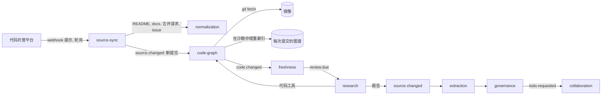

# 代码仓库作为知识来源

状态：提议中，2026-10-27；尚未构建。

## 摘要

**连接的仓库以本地镜像加代码图谱的形式维护，Deep Research 像读文档和网页一样读它。** research 组件逐个主题运行，使用基于镜像和图谱的只读代码工具。它的报告成为来源，结论成为主题下的陈述，所以来自代码的知识和飞书文档出现在同一批主题页上，走同一套治理。

**知识按主题和代码区域组织，而不是按问题。** 这回应了产品负责人对第二版提出的两点反对：

- **不需要有人先问。** 图谱社区和目录会映射到主题，连接仓库时每个已映射的区域都会被研究一次。没有主题的区域会列给空间负责人。
- **关联是结构化的，不是碎片。** 证据锚定在某次提交下的图谱符号上，每条依赖代码的结论都带有一条代码假设，写明它依赖的符号。

**每次合并都在图谱上比较，不调用模型。** 镜像拉取这次合并，图谱增量重建。两个图谱之间的差异给出变化的符号及其最近的调用方。freshness 把命中被引用符号的变化，按每份受影响的报告每天合成一条 `review.due`。research 随后只重新核对依赖这些符号的结论。结论变了，就产生新的报告版本；与文档不一致，就成为给该文档负责人的待办。

**图谱用开源工具，放在我们自己的接口后面。** 首先推荐 [codebase-memory-mcp](https://github.com/DeusData/codebase-memory-mcp)：

- 采用 MIT 许可，只有一个 C 二进制文件，不联网。
- 用 SQLite 存储图谱，带 162 种语言的 tree-sitter 语法。
- 能为主流语言做类型解析，包括 TypeScript、Python、Go 和 Java。
- 按文件哈希增量更新，并能比较两次提交之间的图谱。

它在沙箱中运行，放在 `code_indexers` 插件后面，可以替换。

**工作量约 8.5 人周，** 不含 research 组件本身。每天合并几百次也可行，因为每次合并的工作只是一次拉取、一次增量索引和一次比较，而模型工作按主题、按天封顶。

## 方向，以及它解决了什么

第二版保存由 Coding Agent 按需产出的代码解答。产品负责人在 2026-10-27 否定了它，原因有三：

1. **问答很零散。** 以问答形式保存的知识是分散的。
2. **问不到的知识就相当于不存在。**
3. **关联也很碎片化。** 上游更新和一条条问答之间的关联是零散的。

新的方向是：直接连接仓库；在本地维护一份克隆；用开源方案为它构建代码图谱；把它作为 Deep Research 的一个输入来源，Deep Research 基于本地副本检索；并在 research Agent 里建立关联，让代码自然融入现有的知识维护体系。

| 反对意见 | 本版如何回应 |
| --- | --- |
| 问答是碎片 | research 按主题、按一份常设任务说明运行，结论成为该主题的陈述，与来自文档的陈述并列 |
| 问不到的就不存在 | 首轮梳理覆盖每个已映射的区域；覆盖清单列出没有主题的代码区域，以及没有研究的主题 |
| 更新与问答的关联是碎片 | 证据锚定在图谱符号上；合并在图谱上比较，按符号找到受影响的结论并一起重新核对，每份报告每天一次 |

## 怎么运作

### 连接与镜像

- **每个代码托管平台一个集成，** 与所有厂商一样。一个类型化客户端同时服务同步和 Agent 工具，每个连接一套权限范围、一份速率预算。先做 GitHub；之后在 GitLab、Gitee 或阿里云 Codeup 中按第一个设计伙伴选择。企业连接是一次 GitHub App 安装。
- **镜像是一个由 code-graph 维护的 git 克隆。** 它放在按企业加密的卷上，因为 git 需要文件系统，而不是 blob 存储。当 source-sync 记录到跟踪分支上的新提交时，code-graph 用凭据代理给出的短期租约拉取它。这属于同步，不是 Agent 运行，所以可以使用企业连接。
  - 特别大的单体仓库不带 blob 克隆，只拉取跟踪提交所需的 blob。
  - 从不运行 hook，也不拉子模块。
- **跟踪分支** 是企业指定为线上版本的那个 ref：发布分支或标签，否则用默认分支。它上面每一次拉取到的提交，都是仓库来源的一个版本。
- **仓库里的文字是普通来源。** README、`docs/`、决策记录，以及合并请求和 issue 及其讨论，作为宽松文档，和上传文档一样按需读取。合并请求指向它关闭的 issue、以及 Inspiration 已有文档的链接，成为来源之间的链接。
- **断开连接时，** 镜像和图谱被清除。已登记的证据引文按[来源变化](source-changes.md)的规则保留。

### 代码图谱

- **它包含什么：** 文件、模块、类、函数、路由、配置键和环境变量。边包括调用、导入、继承、HTTP 路由到处理函数、配置键到读取它的代码、文档到它提及的代码，以及按调用边聚成的社区。
- **索引在沙箱中运行，** 使用新的配置 `code_index`。镜像的工作区以只读方式挂载，只有图谱目录可写，没有网络，CPU 和内存受限。二进制文件按版本和校验和固定。Tree-sitter 解析代码时不运行它；需要构建（因而会运行代码）的索引器，例如 Java 的 SCIP，默认不使用。
- **每个已索引的提交一份图谱。** 第一次是全量索引。之后只重新解析哈希变了的文件；codebase-memory-mcp 背后的论文报告增量更新约 1.2 秒。快照压缩后放进 blob 存储（zstd，通常缩小 8 到 13 倍）。保留最新的快照，以及仍被未完成的复核引用的快照。
- **符号 ID** 是图谱中的限定名（`engine/collaboration/src/inbox.ts::INBOX_DEFAULTS`）。代码在文件内移动时它不变。重命名通过图谱和 git 的重命名检测来匹配，像文档移动一样静默地带过去。
- **镜像和图谱归 code-graph，** 而不是 retrieval。图谱之于代码，就像规范化的块之于文档：它是带稳定 ID 的结构，证据锚定在它上面，变化也在它上面计算。它自己的关键词和结构搜索只服务于 research 的工具。从代码得出的知识，和其他知识一样由 retrieval 建索引。

### 基于代码的 Deep Research

- **工具。** code-graph 提供只读的 `agent_tools` 插件，每次调用都经过 agent runtime 的关卡。

  | 工具 | 做什么 |
  | --- | --- |
  | `code_overview` | 某次提交下仓库的区域、包、路由和热点 |
  | `code_search` | 名称、文本和结构 |
  | `code_read` | 某次提交下的一个文件或符号，带行号 |
  | `code_trace` | 调用方、被调用方，以及符号之间的路径 |
  | `code_impact` | 一个符号的变化会波及哪里 |
  | `code_history` | 改过某个符号的提交和合并请求，来自镜像的历史和托管平台上的讨论 |

  对比测试表明，只读普通文件的 Agent 已经能回答得很好。codebase-memory-mcp 背后的论文报告，图谱查询用的 token 约为逐个文件探索的十分之一，回答质量约为后者的 90%。所以 research 两类工具都有。
- **每个主题一份常设任务说明。**“这个主题对应的代码区域里，产品怎么运行，有哪些规则、限额、状态和例外，从什么时候开始，为什么”。一次运行会读取已映射的区域、主题已有的陈述和它的文档，写出一份包含结论、代码假设和证据的报告。
- **代码证据** 是某次提交下某个文件的一段引文，带路径、行号和符号。保存前先检查它是该文件的原样子串，并经过密钥扫描。讨论证据是合并请求或 issue 中的一段引文。
- **代码假设。** 每条依赖代码的结论都写明它依赖的符号，作为一条复核方法为 `code` 的假设。之后的合并就是靠它关联到结论的。
- **与文档的不一致。** 一次运行会把结论与同一主题的文档比较。有出入时，它提出一条 drift 待办：“产品实际是 X（某次提交下的代码、合并请求）；入职指南写的是 Y”。待办交给文档负责人，他可以更新文档，让助手以本人身份对代码开一个 issue，或者记录两者适用于不同情况。此外，governance 也会照常发现新陈述与文档陈述在同一事实槽中的冲突。
- **报告是一个来源。** 它作为主题所在空间的 `inspiration.research` 来源保存，extraction 把它的结论变成陈述，和所有调研报告一样。主题页在“现在怎么运行”和“历史”两节中展示它们。

### 关联

| 从 | 到 | 由谁建立 | 用于 |
| --- | --- | --- | --- |
| 代码区域（社区或路径模式） | 主题 | research 根据图谱和知识树提出，空间负责人确认，可以批量确认 | 覆盖、首轮梳理、把变化路由到主题 |
| 结论 | 某次提交下的符号 | research 运行，作为代码假设 | 找到一次合并影响的结论 |
| 证据 | 文件、行号、符号、提交 | research 运行 | 引用；引用上的“代码已更新” |
| 已合并的合并请求 | 它关闭的 issue；它链接的文档 | 连接器 | 历史，以及来源之间的链接 |
| 仓库中的文档 | 它提及的符号 | 图谱的文档到代码的边 | 显示一次变化让哪些仓库文档过时 |

### 每次合并时保持知识最新

1. **推送到跟踪分支时，** 以 webhook 提示到达，或被轮询发现。source-sync 把新提交记录为仓库来源的一个版本，code-graph 把它拉进镜像。
2. **code-graph 增量索引新提交，** 并与上次索引的图谱比较。它发布 `code.changed`，列出变化、新增、删除和重命名的符号，以及受波及的符号：变化符号的直接调用方和读取方，深度可由企业设置（默认 1）。
3. **freshness 查出写明这些符号的代码假设。** 它按报告把一天内的命中合在一起，为每份受影响的报告发出一条 `evidence_changed` 类型的 `review.due`，以这些符号为原因。freshness 决定何时，research 决定如何，这与 research 已经确定的分工一致。
4. **research 只重新核对受影响的结论。** 它拿到旧结论、相关符号的差异和代码工具。没有变化，就在新提交上记录一次核对；结论变了，就写出新的报告版本，常规流水线会替换旧陈述。
5. **只有发生变化时，人才会看到待办。** 页面或严格主题依赖的结论变了，交给主题负责人；与文档出现新的不一致，交给文档负责人。一次改变许多结论的发布，按现有规则合成一次批量变更审阅。
6. **每个仓库每天有一份预算** 为重新核对封顶。超出后，报告等到第二天，变化最早的先处理，期间它们的引用显示“代码已更新”。

未映射区域的变化不触发任何事，只计入覆盖清单，让空间负责人看到没有主题覆盖的代码。

### 没人问过的知识

- **首轮梳理。** 区域映射确认后，research 为每个已映射的主题运行一次任务说明。空间负责人可以按区域逐个启动，分摊成本。
- **覆盖清单，** 放在空间负责人的备注卡上：
  - 没有主题的代码区域；
  - 有已映射区域但没有研究的主题；
  - 研究早于设定期限的区域。
- **助手中的提问。** 关于产品怎么运行的问题，先用主题的陈述回答。陈述没有覆盖时，助手提出去研究它。这次运行作为主题研究的一部分挂在主题上，而不是一条零散的回答。

### 权限与密钥

- **规则不变。** 仓库被发布到一个空间，通常是工程空间，空间的受众读取从它得出的内容。代码托管平台上的读者只用于受众差异提醒（“这个仓库有 12 人可读；这个空间有 400 位读者”）。
- **Agent 从不持有令牌。** research 只通过 code-graph 的工具读取镜像，并且在它所代表的成员或空间的权限之内。企业连接从不借给 Agent 运行使用。
- **更广的受众** 读放行后的陈述。空间负责人按[编译知识中的权限](compiled-knowledge-permissions.md)的逐条放行来放行陈述；代码受限时不带代码引文。读者此时看到“来源：仓库 X 中的代码（仅工程人员可见）”。
- **密钥。** 代码证据保存前经过密钥扫描；图谱只存环境变量的名字，从不存它们的值。代码证据默认使用 `confidential` 标签，所以模型网关只会把它发给获准处理该标签的服务商。
- **隔离。** 镜像、图谱和沙箱按企业划分，从不共享。

### 用户看到什么

| 位置 | 显示什么 |
| --- | --- |
| 文档树 | 仓库及其文档、合并请求和 Issue，以及代码区域和它们对应的主题 |
| 知识视图 | 主题页，其“现在怎么运行”和“历史”两节引用某次提交下的代码以及背后的讨论 |
| 引用浮层 | 文件、行号、提交、“在 GitHub 中打开”，代码变了时显示“代码已更新”；读者无权读代码时显示“仓库 X 中的代码”，不带引文 |
| 待办箱 | drift 待办、变化了的结论、大发布的批量变更审阅，以及备注卡上的覆盖清单 |
| Agent API | 与其他知识相同的工具（[架构](../architecture.md#模型与-agent)）；来自代码的知识和其他知识一样被找到 |

## 选择代码图谱

| 工具 | 许可证 | 是什么 | 适合程度 |
| --- | --- | --- | --- |
| [codebase-memory-mcp](https://github.com/DeusData/codebase-memory-mcp) | MIT；内置的第三方部分为 MIT、BSD 和公有领域；附带的代码向量模型为 Apache-2.0 | 一个 C 二进制文件、SQLite、162 种语法、主流语言的类型解析、路由、配置键、文档到代码的边、社区、提交之间的图谱比较、CLI 和 MCP，不联网 | **首先推荐。** 可以直接在沙箱中运行；适合私有化部署和 arm64 |
| [CodeGraphContext](https://github.com/CodeGraphContext/CodeGraphContext) | MIT | Python，带嵌入式或服务端图数据库 | 第二选择；运维更多 |
| CodeGraph | MIT | Rust 引擎、SQLite | 默认开启遥测；更新 |
| SCIP 索引器（Sourcegraph） | Apache-2.0 | 按语言的精确索引 | 精确，但每种语言都需要构建，因而会运行代码；以后在需要精度时按语言引入 |
| GitNexus | PolyForm Noncommercial 1.0.0 | 带影响分析查询的图谱 | 排除：不允许商业使用 |
| Code Wiki、DeepWiki | 托管服务 | 生成的 Wiki | 不作为来源：生成的文字，不是证据 |

后端放在 `code_indexers` 插件后面，契约中有一个 `CodeGraph` 接口，所以第二个后端可以按语言或按客户替换它。许可证和前两个工具的细节，于 2026-10-27 从它们的仓库和包注册表中读取。一篇涵盖 17 个工具的综述（[rywalker.com](https://rywalker.com/research/code-intelligence-tools)）和一篇涵盖 5 个工具的综述（[ai.dosa.dev](https://ai.dosa.dev/blog/code-knowledge-graph-tools-ai-coding-agents)）给出的许可证与此一致。codebase-memory-mcp 是一家公司的年轻项目，变化很快；0.11 版改过索引格式。所以版本是固定的，升级就是一次全量重建索引，并用验证集检查。

## 每天合并很多次时的成本

### 每次合并，不调用模型

| 工作 | 成本 |
| --- | --- |
| 把合并拉进镜像 | 一次增量 `git fetch` |
| 索引变化的文件 | 沙箱中几秒钟的 CPU |
| 比较图谱并查找代码假设 | 数据库查询 |
| 保存已合并合并请求的文字 | 向量化几千个 token |

### 调用模型

| 工作 | 何时 | 成本 |
| --- | --- | --- |
| 区域到主题的映射提议 | 一次，之后针对新区域 | 每个仓库一次运行，大仓库上在几十万 token 量级 |
| 首轮梳理 | 每个已映射主题一次 | 每个主题一次 research 运行；估计约为单个问题的两倍，约 15 万 token |
| 重新核对 | 每份受影响的报告每天最多一次 | 一次运行，拿着旧结论和差异，估计 3 万到 6 万 token |
| 主题没有覆盖的新问题 | 被问到时 | 一次 research 运行；对比测试中，不用图谱工具时每题中位数约 7.6 万 token、76 秒 |

### 推演一个大仓库

以下是假设，不是测量：

- 每天合并 300 次，每次合并约改动 30 个符号，仓库共 20 万个符号；
- 100 个主题，每个主题的研究引用 40 个符号，共 4,000 个被引用的符号。

- **每次合并：** 每天 300 次拉取、增量索引和比较，外加约一百万 token 的合并请求文字向量化。
- **命中：** 把深度 1 的调用方按直接变化的约三倍计，一次合并触及 90 × 4,000 / 200,000 ≈ 1.8 个被引用符号。也就是每天约 540 次命中，落在几十份报告上，因为变化集中在热点区域。按假设每天 40 份报告、每次运行 5 万 token 计，重新核对每天约 200 万 token，在每日预算之内。
- **首轮梳理：** 约 100 × 150,000 = 1,500 万 token，一次性，可以分几天完成。
- **对比：** 每次合并都把变化的文件编译成知识，每天要重读 200 万到 2,100 万 token，这还没开始写任何东西（基于本仓库提交的测量，按 300 次合并放大）。而这里每次合并的工作完全不用模型。
- **人：** 只有结论变化或文档不一致时才产生待办，在每位负责人每周 10 张卡片的预算内。

所以模型成本取决于主题的数量，以及它们的代码真正变化的频率，而不是合并频率，企业还可以用每日预算封顶。

## 目前的证据

- **2026-10-26 的对比测试**（[examples/code-questions](../../../examples/code-questions/answers.md)）：
  - 设置：一个全新的 Coding Agent，读取本仓库在 4d5ea00 时的干净克隆，并能读取合并请求讨论。
  - 八个设计同学会问的问题全部回答正确、完整，中位数 76,391 个 token、76 秒。原因只存在于合并请求评论中的回答，需要读取托管平台上的讨论。
  - 它发现了八处文档与代码不一致、或没有任何文档写明的规则。其中三处现在就值得修：
    - 总览把 15 分钟轮询标为“已构建”，但没有定时器。
    - 总览只把“紧急”待办写成待办箱预算的例外。
    - 已完成的待办仍然占用卡片空位。

  这是基于镜像的 research 要达到的质量标准。同样的八个问题是第一个验证集。
- **codebase-memory-mcp 公布的数字，** 来自它的论文和 README，在 Apple M3 Pro 上测得，不是我们测的：
  - Django：约 6 秒完成索引，4.9 万个节点。
  - Linux 内核：约 3 分钟完成索引，480 万个节点。
  - token 约为逐个文件探索的十分之一，回答质量 0.83 对 0.92。
  - 写明的局限：只有静态结构，没有反射和动态分派，解析中缺少宏。
- **尚未测量：** 图谱在本仓库上的表现。当前环境不允许构建或运行下载的代码，所以第二阶段的第一步就是在沙箱中索引本仓库。它测量索引时间、图谱大小、每次提交的增量更新，以及之后每次提交的比较是否恰好标记了应该标记的结论。

## 这个设计是怎么来的

| 版本 | 思路 | 为什么改变 |
| --- | --- | --- |
| 1（合并请求 #21） | 从代码字面量读出行为陈述放进事实槽；编译功能页 | 对比测试：字面量映射在 7 个真实的代码发现中最多发现 2 个，而且每次合并的成本跟着合并频率走 |
| 2（合并请求 #22） | 由 Coding Agent 按需产出回答，再保存、跟踪和共享 | 产品负责人：问答是碎片，问不到的就不存在，变化到问答的关联是碎片化的 |
| 3（本版） | 镜像和代码图谱作为 Deep Research 的输入，按主题和区域组织 | — |

保留下来的部分：仓库里的文字作为宽松来源、提交作为版本、代码工具、代码证据、交给文档负责人的 drift 待办、密钥扫描、权限规则，以及每日预算。

## 我们不构建的东西

- **给人浏览的图谱或 Wiki。** 图谱是 research 的工具。人读主题页；工程师继续用自己的代码工具。
- **自研解析器或图谱引擎。** 我们封装一个开源的。
- **不经研究、直接从代码预编译的页面。** 关于代码的每句话都来自一份带证据的调研报告。
- **把机器写的 Wiki 当作来源**（Code Wiki、DeepWiki）。它们会把自己算作对自己的支持。
- **把原始代码转给外部 Coding Agent 的代理。** 它们用自己的代码托管平台；一个主题经过核实的规则可以作为 Agent Skill 导出给它们。
- **自行写入仓库。** 只有当做 drift 决定的人提出要求时，才以本人身份开一个 issue。

## 验证

1. **先用本仓库，端到端模拟：**
   - 在沙箱中索引本仓库，并把区域映射到主题。
   - 为待办箱和 source-sync 两个主题运行任务说明，模型调用用模拟，所以衡量的是流水线，而不是模型质量。
   - 回放 4d5ea00 之后的提交，衡量每次提交是否恰好标记了应该标记的结论、每次提交的索引时间，以及图谱大小。
2. **用真实模型回答八个问题，** 在首轮梳理之后从主题页回答，与对比测试的回答、token 和耗时比较。
3. **一个更大的仓库，** 与产品负责人一起选定，合并请求历史长、文档单薄、包含不止一种语言。衡量首轮梳理的成本、每天的重新核对次数，以及 drift 待办的精确率，对照冲突现有的至少一半的标准。
4. **试点中设计伙伴的仓库，** 只读。

## 阶段与工作量

| 阶段 | 交付什么 | 主要工作 | 人周 |
| --- | --- | --- | --- |
| 1. 连接、镜像和仓库里的文字 | 仓库作为来源；README、`docs/`、合并请求和 issue 作为宽松文档 | GitHub 连接器（通过凭据代理的 App 和 OAuth、webhook、跟踪分支、比较、重命名）、镜像及其拉取、合并请求和 issue 条目、来源之间的链接 | 2.5 |
| 2. 代码图谱 | 每次提交的图谱及其差异 | code-graph 组件、`code_index` 沙箱配置、`code_indexers` 后面的 codebase-memory-mcp 后端、`CodeGraph` 读取接口、快照、`code.changed` | 2 |
| 3. 基于代码的 Deep Research | 从代码出发的主题研究，带代码证据和假设 | 代码工具、代码证据的原样检查、符号锚点、区域到主题的提议与确认、任务说明和首轮梳理、research 任务的模拟 | 2.5 |
| 4. 保持最新 | 每次合并后的重新核对、drift 待办、覆盖清单 | freshness 从 `code.changed` 到 `review.due` 的规则（按天合并和预算）、只重新核对受影响的结论、带过重命名、drift 待办、覆盖清单 | 1.5 |
| **合计** | | | **约 8.5** |

第三和第四阶段建立在 research 组件之上（已在总体计划中，约 2.5 人周）。自托管 GitLab 另加约 1.5 人周。第一和第二阶段可以在凭据代理之前，用部署令牌在本仓库上运行，作为真实内容的探针。

## 契约变更

全部是新增；参见 [contracts.md](../contracts.md)。

- `SourceItemKind` 新增 `change_request`（pull request 或 merge request）和 `issue`。
- `SourceVersion` 新增可选的 `commit { sha, ref, committed_at, reached_ref_at }`。
- `ResearchEvidence` 新增可选的 `code { repository, commit, path, start_line, end_line, symbol }`。
- `RecheckMethod` 新增 `code`：目标是一组符号 ID，合并改动它们时重新核对。
- 新事件 `code.changed { source_id, from_commit, to_commit, changed, added, removed, renamed, impacted }`，由 code-graph 发布，freshness 消费。
- 新增 `CodeArea { source_id, id, paths, community, topic_id, confirmed_by }`，用于区域到主题的映射。
- `TodoKind` 新增 `drift`：文档与代码不一致。
- 新增 `SourceLink { from, to, kind: closes | references }`，连接来源条目。
- 在 `interfaces.ts` 中新增 `CodeGraph` 接口，在 kernel 中新增插件组 `code_indexers`。

## 风险与待定事项

| 风险 | 缓解 |
| --- | --- |
| 静态图谱看不到运行时行为（反射、依赖注入、功能开关、运行时读取的配置） | research 既读图谱也读代码；波及深度可配置；结论记录它依赖的符号，所以遗漏会在验证中表现为缺失的假设 |
| 图谱准确度因语言而异 | 类型解析覆盖主流语言；验证集按语言运行；需要精度时按语言引入 SCIP |
| 后端很年轻、变化快 | 固定版本，使用我们自己的接口，准备好第二个后端（CodeGraphContext），升级时全量重建索引 |
| 社区不等于产品功能 | 区域到主题的映射只是提议，由空间负责人确认；路径模式优先于社区 |
| 在大仓库上首轮梳理成本高 | 只梳理已确认的区域；按区域逐个启动；有预算 |
| 客户不愿把代码交给 SaaS | 第一阶段只读文字；代码留在企业自己的镜像里，只保存被引用的代码段；`confidential` 标签决定模型路由；私有化部署，单一二进制文件对此有帮助 |
| 镜像占用磁盘 | 每个仓库每个企业一份镜像；单体仓库不带 blob 克隆；没有复核引用的旧图谱快照会被删除 |
| 企业内网的自托管 GitLab 从 SaaS 访问不到 | 先做 GitHub、Gitee 和 Codeup；私有化部署，或只出不进的中继（尚未设计） |

## 需要产品负责人决定的事项

1. **设计：** 镜像和代码图谱作为 Deep Research 的输入，按主题和代码区域组织，来自代码的知识通过现有的维护体系保持最新。
2. **图谱后端：** 首先用 codebase-memory-mcp，放在我们自己的接口后面（推荐）；或 CodeGraphContext；或按语言用 SCIP。
3. **顺序：** 现在就在本仓库上做第一和第二阶段作为探针，等 research 组件建好后再接研究（推荐）；或者全部放在凭据代理和 research 组件之后。
4. **两个默认值：** 受影响的报告每天最多重新核对一次（推荐），而不是每次合并都核对；首轮梳理只针对空间负责人确认的区域（推荐），而不是整个仓库。

## 术语

| 概念 | 界面用语 | 中文 | 日本語（草案） |
| --- | --- | --- | --- |
| Code repository | Repository | 代码仓库 | リポジトリ |
| Followed ref | Followed branch | 跟踪分支 | 追跡ブランチ |
| Pull request | Pull request | 合并请求 | プルリクエスト |
| Code graph | Code map | 代码图谱 | コードマップ |
| Code area | Code area | 代码区域 | コード領域 |
| Code changed since | Code changed since | 代码已更新 | コードが更新されました |
| Drift | Documents and product disagree | 文档与产品不一致 | 文書と製品の不一致 |
| Coverage list | Not covered yet | 尚未覆盖 | 未カバー |

## 关于本文

这是第三版，2026-10-27 提出，等待产品负责人决定。它按照产品负责人 2026-10-27 给出的方向：直接连接仓库，在本地维护一份克隆，用开源方案为它构建代码图谱，并把它作为 Deep Research 的一个输入来源，让代码融入现有的知识维护体系。本文是英文版 [docs/design/code-repositories.md](../../design/code-repositories.md) 的中文副本，两者不一致时以英文版为准。
