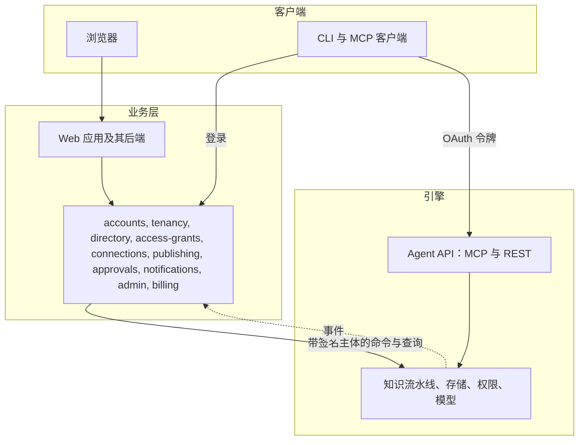
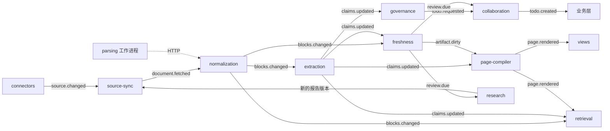

# Inspiration：产品与技术总览

截至 2026-10-26。这是第一份要读的文档。它描述已经决定的产品和已经构建的工程，并明确说明哪些部分已经构建、
哪些已经设计但尚未构建。本文是英文版 [overview.md](../overview.md) 的中文副本，两者不一致时以英文版为准。

## 一页看懂

**Inspiration 把公司分散的文档、审批流程和研究整理成受治理的知识。** 每条陈述都保留确切的证据，随来源变化保持最新，
有一位负责它的人，并以可读的页面提供给人、通过 MCP 提供给 Agent，各自都在自己的权限之内。

四点与众不同：

1. **知识细到单条陈述。** 每个事实只存一次，带着来源中的原文引文、它为真的时间和系统得知它的时间。页面、流程和回答
   都由这些陈述构成，所以每一句话都可以追溯。
2. **保鲜像构建系统一样工作。** 来源有变化时，只重读变了的段落，只更新它们支持的陈述，只重建引用了这些陈述的内容。
   复核日期由知识的类型决定。
3. **知识按一条简单规则从个人流向共享。** 每位成员自己的空间是私有的。发布把知识移入企业，由超级管理员和空间负责人决定谁能阅读。
   来源权限只产生提示，所以合并后的知识从不需要按来源逐一计算权限。
4. **人和 Agent 一起治理，工作量控制在人能跟上的范围内。** Agent 负责发现、提议和回答，人来决定。大多数来源不逐条
   治理，复核按主题和周分组送达，并受每周预算限制。

**面向谁。** 知识分散在多个工具里的团队和公司（飞书或 Lark、Confluence、审批系统、文件共享、PDF），从一个人的知识库
开始，逐步扩展到团队和企业。早期最有力的用途是跨工具的流程与制度治理，以及为公司自己的 Agent 提供一个受治理的
知识端点。产品先以 SaaS 形式提供，私有化部署是同一套代码的第二种形态。英文、中文和日文从第一个版本起就都支持，
而且是同一个知识库：知识与语言无关，语言只是知识的表现形式。

**进展到哪里。** 引擎已经在模拟模型上端到端跑通七个阶段：导入、抽取、治理、保鲜、治理级别、主题和待办箱，全部已合入
`main`。页面、搜索、Agent API、业务层和界面已经设计，尚未构建。等模拟流水线覆盖每个阶段之后，再接入真实模型。

## 核心概念

本文其余部分使用下面这些词。界面对其中一些用了更友好的说法，[词表](#语言)列出了它们的三种语言形式。

| 概念 | 是什么 | 在界面上叫 |
| --- | --- | --- |
| 租户（Tenant） | 隔离、策略和计费的单位。除了显式的迁移，任何东西都不会从一个租户跨到另一个租户 | 企业（一个人使用时从不显示） |
| 用户（User） | 一个人的账户。只存在于业务层 | 账户 |
| 成员（Member） | 一个租户里的一位用户。租户内的所有活动都由成员完成，成员也是引擎唯一知道的“人” | 成员 |
| 空间（Space） | 带有受众的知识容器。每位成员在每个租户里都有一个私有的个人空间；其他空间都是共享的，受众由超级管理员或空间的负责人设定 | 我的空间；空间 |
| 域（Domain） | 成员域是一位成员的个人空间。租户域是所有共享空间。知识从不跨域合并或比较 | （不显示） |
| 来源（Source） | 一个已连接的系统或文件夹，例如一个飞书知识库空间、一个上传文件夹或一份研究报告 | 来源 |
| 来源版本（Source version） | 来源中一份文档被抓取的一个修订版 | （版本历史） |
| 块与片段（Block and span） | 块是一个版本中的一个段落、标题、表格行或表单区块，有稳定的 ID。片段是块内的一段确切文字：一句话、一个表格单元格、一个表单字段 | 段落 |
| 陈述（Claim） | 一条原子化的陈述，带有来自片段的原文证据、为真的时间、得知的时间、知识类别（制度、价格、流程……）和状态 | 陈述 |
| 事实槽（Fact slot） | 由主语 + 谓词 + 限定条件构成的键（“深圳，住宿上限，经理及以下”）。关于同一个单值事实的所有陈述共用一个事实槽，它保留每个版本和每个变体 | （仅负责人可见） |
| 治理级别（Governance level） | 按来源或文件夹设置：严格（完整抽取并有负责人）、宽松（只在触及已知事实或被引用时读取）或仅检索（从不抽取） | 严格、宽松、仅检索 |
| 主题与归属（Topic and placement） | 主题构成知识大纲（领域、主题、子主题）。归属把一条陈述放在某个主题下；没有归属的陈述是未归类的 | 主题 |
| 知识页、流程、卡片 | 由陈述构成的可读形态：知识页、流程（SOP），以及关于一个对象（城市、供应商、角色）的卡片 | 知识页、流程、卡片 |
| 待办与备注（Todo and note） | 待办请一个人决定或复核某件事。备注告诉负责人一件事，但不要求做决定 | 待办箱 |
| 负责人、超级管理员 | 负责人指定给一个空间、主题、页面或流程：批准发布到那里的内容、让它保持最新、裁决其中的冲突；没有负责人的内容由上方最近的负责人接手。超级管理员管理整个企业，是最后的兜底 | 负责人、超级管理员 |

## 功能设计

### 谁在使用，每个人看到什么

大多数人只阅读。产品的设计让读者看到的是一份普通文档，从不看到背后的知识机制。

| 人 | 主要工作 | 看到什么 |
| --- | --- | --- |
| 成员 | 阅读、提问、评论，从“我的空间”发布 | 带小引用编号的页面。正文中只出现两种标记：已过时和有争议 |
| 负责人 | 负责一个空间、主题、页面或流程：批准发布到那里、让它保持最新、裁决其中的冲突 | 自己的待办箱，以及展示陈述、来源和来龙去脉的追溯视图。空间负责人还能看到空间的积压和首次复核专项 |
| 超级管理员 | 成员、空间及其受众、连接、策略、敏感标签、审计、Agent、套餐和用量 | 管理控制台，含每位成员的用量。永远看不到任何人的“我的空间”，也看不到任何人问了什么、读了什么、调研了什么 |
| Agent 开发者（一位成员） | 通过 MCP 或 REST 接入 Agent | 已连接的应用、权限范围和审计 |

产品里只有这三个角色。内部的权限更细：空间有 `viewer`、`commenter`、`editor`、`steward`、`owner` 五种内部角色，主题和页面有负责人。产品角色是
它们的组合，所以以后的预设，例如部分国内客户要求的系统、安全、审计三员分立，只是一种新的组合，不需要新代码。

追溯视图需要有意打开（从页面菜单、命令面板或 CLI）。它先把一个主题或页面展示为事实槽，然后是使用这些事实槽的页面，
最后是其余所有内容，按来源文档折叠并显示计数，所以即使一个主题有上千条陈述，它也依然好用。

### 导入知识

- **已连接的来源，持续监听。** 首先支持飞书文档、知识库和审批，以及文件上传。Lark 是飞书的国际版，API 几乎相同，
  所以同一套连接器也服务于它。Confluence 和钉钉在试点阶段跟进，Notion 和简道云更晚。推送事件只被当作提示；每 15 分钟
  一次的轮询和每晚一次的完整列举会补上推送漏掉的一切，包括删除。
- **审批流程变成流程。** 一个流程由流程定义、对 90 到 180 天审批日志的流程挖掘，以及模型的整理文字共同生成。每一步
  都标明“来自定义”“挖掘得出”或“推断”，并由一个人批准。
- **研究报告也是来源。** 成员提出一个问题，研究 Agent 产出一份由结论、假设和证据组成的报告，报告作为来源保存。每个
  假设都有一个复查查询和一个日期。
- **不是所有内容都要治理。** 每个来源或文件夹有一个治理级别，在来源树中向下继承：

| 级别 | 典型来源 | 抽取什么 | 负责人、复核、冲突 |
| --- | --- | --- | --- |
| 严格 | 制度、价目表、SOP、审批流程、正式规范 | 全部 | 由主题负责人负责，按周期复核，冲突成为待办 |
| 宽松 | 论文、会议纪要、文章、FAQ、供应商文档 | 只抽取陈述了已知事实的块，以及页面或回答第一次引用时的整段内容 | 没有负责人，没有复核周期。与严格级别的值不一致的值成为一条备注，从不成为阻塞性的待办 |
| 仅检索 | 聊天记录、草稿、周报、大型归档 | 不抽取 | 无；只能被搜索 |

上传文件和网页一开始是宽松级别。超级管理员在连接每个知识库空间时选定它的级别，空间负责人之后可以修改任意文件夹的级别。

### 从来源到陈述

- **陈述总有证据。** 只有当引文是所引段落的原文子串时，抽取才会保留这条陈述。陈述从不删除：新的陈述取代旧的，并结束
  旧陈述“被知道”的时间区间。
- **关于同一件事的事实收拢到一个事实槽。** 来自三份文档、四个版本的十条陈述，只是一行需要维护的内容，冲突也发生在
  一个事实槽内部。数字、日期、限额和负责人很适合放进事实槽；自由文本的规则继续按页面小节分组。
- **每条陈述都在两份大纲里。** 来源大纲（文档、标题路径、段落）来自它的证据。知识大纲（空间、领域、主题、子主题）
  来自它的归属。主题自动聚类，最多三层，键保持稳定。一次重新聚类最多只有 5% 的陈述可以换主题，而人放置或确认过的
  内容永远不会移动。负责人尚未确认的主题从不展示给读者。
- **合并只在一个域内进行。** 两位成员的私有知识从不混合；只有两人都发布之后，它们才会相遇。

### 阅读

同一份知识有三个视图，共用相同的段落和陈述 ID，并有两棵树用来浏览：

| 视图 | 显示什么 | 是否用模型生成 |
| --- | --- | --- |
| 原文 | 每个来源按原样、按它自己的结构显示。PDF 和扫描件显示为带文字层的页面图像 | 否 |
| 批注 | 原文加上段落上的标记：被引用、已过时、已被取代、有冲突、被人更正 | 否 |
| 知识 | 每句话都引用陈述的主题页、流程视图、卡片，以及一个小的“相关”面板（一到两跳） | 是 |

- **来源树和知识树。** 来源树是覆盖所有已连接来源的一个文件系统，按每个来源自己的顺序排列。知识树存放主题，每个主题
  有它的负责人。读者打不开的文件夹或空间不会显示，连数量也不显示。
- **页面读起来像 Claude Artifacts。** 页面是结构化数据，有 14 种块类型，包括由结构编译出的图（模型选择展示什么，但从
  不画连线）、绑定到陈述或已登记查询的图表，以及由模板构建、在沙箱中运行的交互视图。每次重建都是一个带差异的版本。
- **引用会在页面旁边打开来源，** 定位到确切的段落和版本；如果段落在陈述抽取之后变了，也会注明。
- **读者看到的四种状态都用文字表示，从不只靠颜色：** 有效、待复核、已过时和有争议。只有已过时和有争议出现在正文中；
  待复核出现在引用浮窗和追溯视图里。
- **评论交给助手。** 它用带引用的方式回答问题，对照来源检查更正，并提出修改，由负责人接受。一个人做的修改作为固定的
  覆盖保留，重建永远不会覆盖它；如果之后来源与它不一致，它的作者会收到一条待办。
- **提问。** 回答以陈述为依据，引用对应的段落，并使用提问者的语言。

### 保持知识最新

- **变化只传播到有关的地方为止。** 来源的新版本逐块做差异比较。只重读变了的块，只取代证据变了的陈述，只重建引用它们
  的页面。如果重读得到相同的陈述，后面什么也不会发生。
- **来源自己更正时静默同步。** 一篇文档改了自己的值，新陈述取代旧陈述，不问任何人；追溯视图保留两者。只有来源之间
  说法不同才需要人，冲突里会显示每个值有多少份不同的文档支持，以及它们的权威。
- **被删除的来源，其知识保留到有人决定为止。** 知识从不被静默删除。陈述保留，引用上标“原文已删除”，每位受影响的
  主题负责人按每篇被删文档或文件夹收到一条待办：保留为快照（默认，30 天无人决定时也按此处理）、指向替代文档，或不
  保留。同一权限边界内的文档移动会静默跟随；移向更广的受众、或在“我的空间”和共享空间之间移动，要走发布审批。默认保留
  从不改变谁能看到这些知识。大量文档同时消失按连接失效处理，而不是当作删除。见[来源变化](design/source-changes.md)。
- **复核日期来自知识本身。** 每份严格级别的文档都有一个复核时钟，由它的陈述类别决定（例如制度每年一次，流程每 180 天
  一次）；在计划指定的每个日期复核一次；一次编辑留下的副本立即复核。
- **研究是复查，不是重跑。** 当被引用的材料变化，或某个假设的日期到来时，只重新检查受影响的结论。只有结论变了，才写
  一个新的报告版本。
- **新企业从积压开始，而不是从洪水开始。** 第一天就已逾期的复核，按主题交给空间负责人作为首次复核专项，不进入主题负责人
  的待办箱。

### 治理：人来决定，工作量控制在人能跟上的范围内

- **引擎提出一个值，并说明理由。** 对每个事实槽，治理提出当前有效、最权威的值，除非之后某条带日期的陈述改变了它
  （“自 2026-10-01 起上限为 650”）。被归档文档明确取代的情况无需人工即可解决。
- **一个触发，一条待办。** 关于同一事实槽或同一文档的请求合并成一条待办，交给它所在主题的负责人；没有时交给上方最近的
  负责人，再没有时交给空间负责人，最后交给超级管理员。任何事都不会无人负责。
- **一个原因，一次审阅。** 一个原因会产生超过 20 条待办或涉及 3 个以上主题时，例如制度出了新版本、文件夹被整理，就合成
  一次批量变更审阅，交给覆盖范围最小的负责人，整体决定，每一项仍留记录。模型升级这类引擎原因，值不变就保持静默；值变
  了就交给评测，不进待办箱。
- **每周待办卡片。** 一位负责人在一周内关于一个主题的待办共用一张待办卡片，最多 20 条。每位负责人每周最多 10 张卡片；
  其余的顺延到之后有空位的周，紧急的除外。备注单独放在每周的备注卡片上，不占预算，一个操作即可确认。副本的复核跟随
  引起它的冲突所在的卡片，即使超出预算也是如此。
- **只有部分冲突需要不止一个人：**

| 类型 | 例子 | 由谁决定 |
| --- | --- | --- |
| 编辑冲突 | 两个人编辑同一个段落 | 在草稿中实时合并 |
| 覆盖冲突 | 一个人的修改写的是 500，来源现在写的是 600 | 该覆盖的作者 |
| 同一范围内的知识冲突 | 两个来源对一个价格说法不一 | 该范围的负责人（默认单人审批） |
| 跨范围的知识冲突 | 财务说 X，销售流程说 Y | 每位受影响的负责人（默认会签）；截止后由空间负责人决定，跨空间时由超级管理员决定 |
| 断言冲突 | 一条评论陈述的事实与已核实的陈述矛盾 | 该范围的负责人 |

- **会签总能结束。** 每项策略都有审批方式（单人审批、或签、会签、至少 n 人）、截止期限（跨范围默认 5 个工作日）和
  截止后的兜底决定人：空间负责人，跨空间时为超级管理员。在决定期间，读者和 Agent 看到的是标为有争议的最后核实值（默认）、两个值都显示，或什么都不显示，由企业选择。
- **每个决定都是一条记录。** “为什么是这个值？”会显示谁决定的、何时、依据什么。一个决定可以变成一条裁决规则（“在财务
  中，价格以价目表为准，高于知识库页面”），治理随后把它应用到同类的新冲突上，并每周汇报。

### 从个人到团队：两个域与发布

- **一个人使用时不显示企业。** 注册会创建一个个人知识库。邀请别人或开启协作，会把它变成一个企业；新建企业
  则从一个全新的企业开始。无论哪种方式，在发布之前都不会共享任何东西。
- **我的空间是私有的。** 在每个企业里，每位成员都有一个“我的空间”，用于草稿、个人连接和试验。其他任何人都不能阅读，
  超级管理员也不例外。
- **共享空间自上而下治理。** 超级管理员和空间负责人通过空间角色和敏感标签设定每个共享空间的读者。发布者保留对所发布内容的
  访问权。
- **发布是移动知识，不是复制知识：**
  1. 成员在“我的空间”里选择页面、流程、来源或文件夹，以及一个目标空间。
  2. 对每个来源，选择它如何保持更新：通过企业连接（默认）、通过自己的连接（需要本人同意；超级管理员可以关闭），或作为
     带复核日期的快照。
  3. 引擎检查这次申请：敏感信息和个人数据扫描、与已发布知识的冲突预览、企业连接能和不能访问的内容，以及受众中有多少
     人无法在来源系统中打开原文。
  4. 由目标主题的负责人或空间负责人审批。审批人能阅读申请中的条目，但看不到“我的空间”里的其他内容。超级管理员能看到
     申请，但看不到条目。
  5. 条目连同其中的人工工作（上传、编辑、覆盖、评论）移入租户域。派生的知识在那里重建，并与已发布的知识合并；新的冲突
     成为待办。
  6. 从此由空间的受众阅读。来源权限不再起作用。
- **来源权限只作提示。** 发布时，它们产生“部分读者无法打开原文”的提示，从不阻止发布。如果已发布文档在来源中的权限后来
  收紧，空间负责人会收到一条待办；企业策略决定是仅通知（默认），还是在空间负责人决定之前隐藏受影响的知识。
- **公司数据留在公司。** 公司验证自己的邮箱域名和飞书组织。之后，策略会阻止在公司的企业之外以个人连接访问它，或要求
  审批。
- **离开。** 已发布的知识留在企业，交给空间负责人。该成员的“我的空间”被锁定，任何人都不能阅读，30 天后删除。其连接
  和 Agent 授权被撤销，靠其连接保持更新的来源暂停，直到它的负责人切换连接或将其冻结。
- **在企业之间迁移**是一次单独的、显式的迁移，它在目标企业重新创建来源，并在那里重建派生知识。

### Agent 作为使用者

- **一个受治理的端点。** 一个远程 MCP 服务器和一个由同一份 schema 生成的 REST API。已核实的流程还可以导出为 Agent
  Skills。
- **为 Agent 预算设计的工具：** `search`、`get_outline`、`read`、`get_sop`、`get_entity`、`graph_neighbors`、`answer`、
  `get_changes`、`verify_claim` 和 `report_feedback`。每个响应都带有来源、版本、新鲜度、置信度、复核状态和 token 估算。
  一个结构化的 `get_sop` 回答应当控制在约 2,500 个 token 以内。
- **登录。** MCP 客户端使用带 PKCE 的 OAuth，CLI 使用设备授权流程，超级管理员登记企业 Agent。权限范围是
  `knowledge.read`、`knowledge.propose` 和 `comments.write`。Agent 总是代表一位成员行事，它的权利是该成员的权利再按
  它的权限范围和空间收窄。
- **内置 Agent 只读取或提议。** 评论助手、问答助手、治理 Agent、流程撰写、发布检查、视图生成和研究 Agent 都运行在同一个
  运行时上。Agent 做的任何事都不会在没有人批准的情况下改变知识。

### 管理

- **三个角色。** 超级管理员管理企业：成员、空间、连接、策略、敏感标签、审计、Agent、套餐和用量。负责人管理自己范围内的
  内容，其他人都是成员。一个人使用时，三个角色都由这个人自己担任。
- **生命周期流程**覆盖注册、邀请（链接 7 天后过期）、通过已验证的邮箱域名加入、带目录同步的 SSO、从个人到团队、成员
  离开、账户删除（删除个人知识库）和删除企业（30 天宽限期可导出，之后销毁数据密钥）。
- **限额与用量。** 企业是计费单位。和主流 AI 产品一样，席位汇成企业的一个用量池，每位成员有一个默认上限，超级管理员
  可以调高；引擎按企业、成员和空间计量模型用量。超级管理员能看到每位成员按工作类型的用量，永远看不到任何人问了什么、
  读了什么、调研了什么。每席位的点数、用量池用完后怎么办，到计费阶段再定。除了连接策略，限额是企业对成员“我的空间”
  唯一的控制。

### 语言

英文、简体中文和日文从第一个版本起就平等对待。繁体中文之后提供。

- **界面语言属于账户，** 因为一个人的语言不会随企业改变。它的初始值在注册时取自浏览器。每个企业有一个默认语言，用于
  发给很多人的消息。
- **知识与语言无关，语言只是它的表现形式。** 陈述、事实槽、实体、主题、流程和页面在所有语言里都只有一个身份。同一份知识用
  两种语言写，是一个单元的两种表达，既不重复，也不冲突。译本和原文算作一份；译本落后时，收到一条“译本已过时”复核，而不是
  冲突。见[知识与语言](design/knowledge-and-language.md)。
- **来源保持自己的语言。** 来源和引文从不被悄悄翻译。每个空间有一种内容语言，由空间负责人设定，作为页面的标准版本语言。
  读者可以要求用自己的语言阅读一个页面：它从同一批陈述编译出来，并标明由机器撰写。
- **回答跟随提问的人。** 回答使用提问者的界面语言，引用的段落保持原文语言。引用浮窗可以按需翻译一个段落，标明是机器翻译，
  点一下就回到原文。人输入的内容从不做机器翻译。
- **不同语言里的同一个事实就是一个事实。** 事实槽按实体、谓词和限定条件建键，而不是按措辞，值也带类型，所以同一个限额的
  日文陈述和中文陈述会落在同一个事实槽里。普通陈述在模型确认意思相同后跨语言合并，各自的引文保持原来的语言。
- **排版与输入。** 每个块都带语言标记，使共用的汉字按中文或日文字形正确显示。标签换行而不截断（英文约是中文的 1.5 到 2
  倍宽）。日期、数字、货币和复数遵循语言区域规则。输入法组字时按回车从不提交。
- **通知**以每位接收者的语言发出：在中国用飞书和钉钉卡片，在其他地区用 Lark，所有地区都有邮件和应用内待办箱。
- **区域。** 企业的区域在创建时确定，数据留在该区域。计划是中国大陆加一个全球区域。

一份词表支撑所有状态、按钮和空状态文案。中文列已采纳；日文列是提议，等待审阅。

<!-- glossary -->
| English | 中文 | 日本語 |
| --- | --- | --- |
| Personal library | 我的知识库（切换器中为个人知识库） | マイライブラリ（切替メニューでは個人ライブラリ） |
| Company | 企业 | 企業 |
| Space, My space | 空间, 我的空间 | スペース, マイスペース |
| Member | 成员 | メンバー |
| Company connection, Personal connection | 企业连接, 个人连接 | 企業の接続, 個人の接続 |
| Source, Passage, Statement | 来源, 段落, 陈述 | ソース, 段落, 記述 |
| Topic, Knowledge page, Procedure, Card | 主题, 知识页, 流程, 卡片 | トピック, ナレッジページ, 手順, カード |
| Knowledge tree, Sources tree | 知识树, 来源树 | ナレッジツリー, ソースツリー |
| Original, Annotated, Knowledge views | 原文, 批注, 知识 | 原文, 注釈, ナレッジ |
| Fresh, Review due, Outdated, Disputed | 有效, 待复核, 已过时, 有争议 | 有効, 要確認, 旧版, 異論あり |
| Owner, Super admin | 负责人, 超级管理员 | 担当者, 特権管理者 |
| Rule | 裁决规则 | 裁定ルール |
| Any one, Everyone (approval modes) | 或签, 会签 | いずれか承認, 全員承認 |
| Who can read this | 可见范围 | 公開範囲 |
| Inbox, Assistant | 待办, 助手 | 受信トレイ, アシスタント |
| Keep fresh with the company connection, Keep fresh with my connection, Publish a snapshot | 通过企业连接保持更新, 通过我的连接保持更新, 发布快照 | 企業の接続で最新に保つ, 自分の接続で最新に保つ, スナップショットを公開 |
| Some readers can't open the original | 部分读者无法打开原文 | 一部の閲覧者は原文を開けません |
| Source permissions tightened | 来源权限收紧 | ソースの権限が縮小されました |
| Governed, Reference, Search only | 严格, 宽松, 仅检索 | 規程, 参考, 検索のみ |
| Trace view | 追溯 | 追跡 |
<!-- /glossary -->

## 技术设计

### 两层：引擎与业务层

**引擎**（本仓库）负责与知识有关的一切：连接器、流水线、存储、权限检查、模型访问和 Agent API。**业务层**负责人、租户、
登录、策略取值、审批、通知、计费和 Web 应用。调用向下，事件向上：业务层发送命令和查询，引擎作出应答并发布事件，引擎从不
调用业务层。这一条规则让引擎可以通过 MCP、REST 和 CLI 单独使用，也让任何一方都可以对着另一方的替身来测试。

- **三种 ID。** 租户 `ten_`、用户 `usr_`（账户，只在业务层）和成员 `mem_`（一个租户内的一位用户，是引擎唯一的人员 ID）。
  成员 ID 只在其租户内唯一，所以凡是在租户自己的数据行之外保存成员 ID 的地方，都同时保存租户（在 SpiceDB、缓存、审计和
  导出中写作 `<ten_...>|<mem_...>`）。成员 ID 由 tenancy 组件中的一个函数分配；任何地方都不从一种 ID 推导另一种，也不从
  ID 里解读含义。
- **一条验证路径。** 每次调用都带一个由业务层签名的 JWT：成员、租户、主体类型、Agent 所代表的成员、权限范围、可选的
  空间和敏感级别上限、本次会话的登录方式，以及界面语言 `locale`。Web 令牌最长 5 分钟，OAuth 访问令牌 10 到 15 分钟。
  引擎用公开的密钥验证它们，从不接触用户 ID 或身份提供方的令牌。令牌只能收窄引擎已持有的授权，不能扩大。
- **命令是幂等的**（带幂等键，目录对象带版本号），并返回权限系统的一致性令牌，使下一次读取能看到这次变更。每晚一次的
  目录快照修复偏差，每小时一次的摘要检查在两次快照之间发现偏差。
- **契约集中在一处。** 本仓库中的 JSON Schema 是两层共同的事实来源。只属于业务层的类型放在单独的目录里，引擎的包从不
  引用它们。

### 组件

引擎有 19 个组件，每个都是一个只做一件事的包 `packages/<name>`，另有四个共享库（contracts、kernel、eventbus、testkit）
和一个组装根（`apps/engine`）。组件名同时也是它的事件生产者名、消费组名和模型任务名的前缀。
[`components.yaml`](../../components.yaml) 是已构建和计划内容的权威清单；credential-broker 和 sandbox 在构建时加入其中，
其中的 `web` 条目移到业务层。

| 层 | 组件 | 职责 | 状态 |
| --- | --- | --- | --- |
| 导入 | connectors | 来源插件：列举、抓取、读取 ACL、Webhook。已构建：本地文件夹、飞书文档和审批（录制的测试数据） | 已构建 |
| 导入 | source-sync | 版本、墓碑记录、ACL 快照、轮询与对账；之后为研究提供 `fetch_now`，并维护来源树 | 已构建 |
| 导入 | parsing | 处理 Office、PDF 和扫描件的 Python 工作进程（Docling、PaddleOCR-VL），通过 HTTP 契约调用 | 计划中 |
| 导入 | normalization | 带稳定 ID 的规范块和片段、块级差异、重复文档；之后为原文视图生成镜像页 | 已构建 |
| 导入 | research | 基于 Agent API 和经批准的网页搜索的研究 Agent；报告成为来源 | 计划中 |
| 编译 | extraction | 带原文证据的陈述、事实槽键、治理级别和按需抽取。之后是实体、流程和审批挖掘 | 已构建 |
| 编译 | freshness | 复核时钟、计划日、副本、陈旧度评分、`review.due`。之后是依赖图和 `artifact.dirty` | 已构建 |
| 编译 | governance | 事实槽取值、带提议值的冲突案例、待办请求、备注。之后是语义和模型裁判层级、裁决规则 | 已构建 |
| 编译 | page-compiler | 主题与归属；之后是带引用的页面、图和页面快照 | 主题已构建 |
| 存储 | knowledge-store | 知识表的唯一所有者：来龙去脉、双时态读取、事实槽、主题、页面快照 | 已构建 |
| 服务 | retrieval | 拥有分块、向量和所有搜索索引；混合检索、重排序、权限过滤、有依据的回答 | 计划中 |
| 服务 | agent-api | MCP 服务器、REST 与 OpenAPI、Skills 导出、逐次调用审计 | 计划中 |
| 服务 | views | 交互视图模板、视图生成、渲染检查、沙箱托管 | 计划中 |
| 控制 | collaboration | 待办箱；之后是评论、Agent 回复、覆盖、发布和决定 | 待办箱已构建 |
| 控制 | access-control | 基于 SpiceDB 的权限、搜索预过滤、审计 | 已构建；双域规则已设计 |
| 控制 | model-gateway | 所有模型调用：按敏感级别路由、预算、提示词、缓存、计量；既是库也是 HTTP 服务 | 已构建 |
| 控制 | agent-runtime | 内置 Agent 运行的循环：工具、限制、审批关口、运行轨迹 | 已构建 |
| 控制 | credential-broker | 属于租户或成员的连接、加密的密钥、刷新、短期租约 | 已设计 |
| 控制 | sandbox | 每个作业一个隔离容器，用于厂商 CLI、Agent 工具和视图渲染检查 | 已设计 |

业务层是一个 TypeScript 服务，有自己的数据库 schema，外加 Web 应用。它与引擎共用 contracts、eventbus 和 testkit 三个库。

| 组件 | 负责 | 阶段 |
| --- | --- | --- |
| accounts | 用户、登录身份、会话、身份提供方适配器（Logto；Keycloak 作为备选） | 1 |
| tenancy | 租户、成员和成员 ID、邀请、已验证域名、企业角色、登录策略、从个人到团队、迁移 | 1 |
| directory | SSO 连接、飞书通讯录（第 2 阶段支持 SCIM）、群组、部门、外部身份关联 | 1 和 2 |
| access-grants | OAuth 授权服务器、客户端登记、设备授权流程、个人令牌、企业 Agent、撤销 | 1 |
| connections | 企业连接和个人连接的接入流程、同意书、对外部组织的认领 | 1（认领在 2） |
| publishing | 发布向导：目标空间、保鲜方式、覆盖范围、受众差距、审批路由 | 1 |
| approvals | 单人审批和会签、截止期限、兜底决定人、决定记录 | 1（会签在 2） |
| notifications | 待办箱、邮件、飞书、Lark 和钉钉卡片、摘要、偏好、消息目录 | 1 |
| admin | 空间受众、策略、角色、负责人分配、审计和用量视图 | 1 |
| billing | 套餐、席位、配额、每位成员的限额、模型预算 | 3 |
| web | 产品 Web 应用及其面向前端的后端 | 1 |

### 组件之间如何通信

只有三条路径，组件清单测试保证一个包不依赖其他任何东西。

1. **事件。** 组件在同一个 Postgres 事务里写入数据和事件（事务性发件箱）。一个中继把它们搬到 Valkey Streams，每种事件
   类型一个流，每个消费组件用自己的消费组读取。投递至少一次，所以处理程序是幂等的。无法解析、比消费者已知版本更新，或
   反复失败的事件进入死信流。载荷里只有 ID 和代码，从不放句子。
2. **知识存储的仓库 API。** 任何组件都不读取其他组件的表。
3. **契约包中的同步接口：** `AuthZ`、`ModelGateway`、`Retriever`、`AgentRuntime`、blob 存储，以及之后的
   `SourceSync.fetch_now`、`CredentialBroker` 和 `Sandbox`。每个接口都有进程内实现，必要时还有接口相同的 HTTP 实现。

| 事件 | 发布方 | 消费方 | 发布方的状态 |
| --- | --- | --- | --- |
| `source.changed` | connectors、source-sync、research | source-sync | 已构建 |
| `document.fetched` | source-sync | normalization | 已构建 |
| `acl.changed` | source-sync | access-control；collaboration 用于来源权限收紧待办（已设计） | 已构建 |
| `blocks.changed` | normalization | extraction、freshness、retrieval | 已构建 |
| `claims.updated` | extraction、governance、collaboration | freshness、governance、page-compiler、retrieval | 已构建 |
| `artifact.dirty` | freshness | extraction、page-compiler、retrieval | 计划中 |
| `review.due` | freshness | collaboration、research | 已构建 |
| `todo.requested` | governance；views（已设计） | collaboration | 已构建 |
| `todo.created` | collaboration | 业务层（notifications、approvals、web） | 已构建 |
| `page.rendered` | page-compiler | collaboration、retrieval、views | 计划中 |
| `comment.created` | collaboration | extraction、collaboration | 计划中 |
| `unit.published` | collaboration | retrieval、agent-api、业务层 | 计划中 |
| `connection.changed` | credential-broker | source-sync、collaboration、业务层 | 已设计 |
| `source.tree_changed` | source-sync | access-control、retrieval、业务层 | 已设计 |
| `source.moved` | 发布步骤 | normalization，它在目标空间重建被移动的来源 | 已设计 |
| `todo.updated`、`publish_request.updated`、`decision.applied`、`member.offboarded`、`usage.recorded` | 引擎 | 业务层 | 已设计 |

只有引擎发布事件。业务层组件以消费组的身份读取它们；产品部署会增加一个事件订阅端点，使业务层不依赖具体传输方式。

### 端到端的流水线

1. **同步。** source-sync 列举一个来源，把每个条目的内容、元数据和 ACL 哈希与上一次比较，抓取变了的内容，并在一个事务
   里写入来源版本和 ACL 快照。只有权限变化时不写新版本，所以不会重新解析。
2. **规范化。** normalization 解析版本（文本格式用内置解析器，Office、PDF 和扫描件用 parsing 工作进程），构建带稳定 ID
   的块和片段，与上一个版本做差异比较，并检测重复文档。之后的每个阶段都基于这份差异工作。
3. **抽取。** extraction 只读取严格级别文档中新增和变化的块，以及宽松级别文档中提到已知事实的块。每个窗口一次模型调用。只有
   引文是原文时陈述才会保留；证据消失的陈述被取代或撤回。按来源变化的设计，被删除文档的陈述会保留到负责人决定为止。
4. **治理。** governance 增量统计每个事实槽的取值，提出成立的值，为其他值开立冲突案例，并为每个事实槽发出一条待办请求。
   目前它是确定性的；之后会为没有事实槽的陈述加入语义、NLI 和模型裁判层级。
5. **保鲜。** freshness 维护复核时钟，每天一次为已到期的内容发布 `review.due`。它不调用模型，也不改变知识，所以模型故障
   或预算耗尽都不会让它停下。
6. **组织与编译。** page-compiler 为严格级别文档的小节生成向量，把陈述放进主题，并在变动预算内重新聚类。下一步它会撰写
   带引用的页面和图，并为每个版本做快照。
7. **请人处理。** collaboration 是唯一创建待办的组件：它合并请求，把它们交给负责人，并归入每周卡片。
8. **提供服务。** retrieval 为块、陈述和页面建立索引，为 Web 应用和 Agent API 提供搜索与回答。

### 知识模型与存储

| 层 | 内容 | 状态 |
| --- | --- | --- |
| 来源版本 | 一个抓取到的修订版、它的哈希、敏感级别和治理级别 | 已构建 |
| 块、片段 | 稳定 ID、标题路径、父节点；片段按块和文字做内容寻址 | 已构建 |
| 陈述与证据 | 陈述、主语、谓词、值、限定条件、类别、事实槽键、两个时间区间、原文引文 | 已构建 |
| 事实槽 | 当前的各个变体（含计数和代表陈述），以及历来取过的每个值 | 已构建 |
| 主题与归属 | 有稳定键、状态、负责人和计数的分类节点；每条陈述一个归属 | 已构建 |
| 实体、关系 | 解析后的人员、部门、产品、供应商；每条边都有陈述支撑 | 计划中 |
| 流程、模型 | 步骤、角色、条件；假设本身就是陈述的公式和决策表 | 计划中 |
| 页面 | 句子绑定到陈述的 PageSpec 版本；原文视图的镜像页 | 仅有契约 |
| 来源节点 | 来源树：每份文档在其来源层级中的位置 | 已设计 |

知识存储强制执行的规则：没有支撑证据或推导的陈述会被拒绝；证据引文必须是其片段的原文子串；陈述从不删除；页面版本不可
变且每次加一。读取是双时态的：某一时刻什么为真，以及系统在某一时刻知道什么。

所有数据都在一个 Postgres 16 实例中（ParadeDB 镜像，带 pgvector 和 pg_search）。每个拥有表的组件都有自己的 schema：
`kb`（知识存储）、`bus`（事件总线）、`gateway`、`agents`、`sync`、`normalization`、`extraction`、`freshness`、
`governance`、`page_compiler` 和 `collaboration`。retrieval 从 `kb` 接管分块、向量和索引时，会有自己的 schema。SpiceDB
在同一实例上使用自己的数据库，Valkey 承载事件流和模型响应缓存，文件放在 blob 存储里。每张 `kb` 表都在 `doc` 列中保存
完整的契约对象，只把可过滤的字段复制到有类型的列中，所以大多数契约变更不需要迁移。

### 权限

引擎根据业务层下发的数据副本，自己做出每一个权限决定。

- **SpiceDB 保存租户、成员、群组、部门和空间，** 都以租户为键。陈述、页面和流程不写入 SpiceDB。
- **一个单元可读，当且仅当它所在的空间可读，且它的敏感标签不高于读者的授权级别。** 个人空间只有它的所有者（外加供引擎
  工作进程使用的服务关系）；任何租户或管理员关系都伸不进去。共享空间的角色（`viewer`、`commenter`、`editor`、`steward`、`owner`；空间负责人
  持有 `owner` 和 `steward`）自上而下授予，并沿空间树向下继承。单元的发布者保留对它的授权，发布申请的审批人只能阅读申请中的条目。
- **陈述还需要一个读者能读的证明。** 证明是位于可读空间中的证据片段，或是一个所有输入都可读的派生。两份文档各自写明
  一个价格，它们互为替代证明，任意一份就足够；由价格和成本算出的毛利则需要两者都可读。
- **跨越受众需要审批。** 输入分布在受众不同的多个空间里的派生结果，只有能读全部输入的读者才能看到。要让它对所在空间的
  全体受众可见，需要由该受众无法阅读的那些输入空间的负责人审批一次发布申请。如果其中某个空间之后收窄了受众，它的
  负责人会收到一条待办，决定保留还是撤回审批。
- **跨空间引用。** 指向另一个空间的引用只有在读者能读那个空间时才显示，否则显示为受限。没有可读证明的陈述会被隐藏，
  由它构成的一切也一并隐藏：提议值、冲突中的一个变体、页面中的一句话、一个回答。每次请求只查询一次可读空间集合，并做
  缓存。
- **不泄露存在性。** 被隐藏的引用、计数和图的边会被直接去掉，从不显示为“3 条已隐藏”。共享的回答缓存以可读空间和授权
  级别为键；缓存项用到的单元的标签、证明或授权一旦变化，该缓存项即被丢弃；用到了只能通过读者本人授权（作为发布者或
  审批人）才可读的单元的回答，从不共享。
- **搜索在索引内部过滤，** 按可读空间和敏感级别过滤，每条靠前的结果在离开服务器之前还会再检查一次。
- **来源 ACL 只作参考。** source-sync 保存 ACL 快照和身份关联，只用于受众差距提示和来源权限收紧待办。
- **目前已构建：** 基于 SpiceDB、以租户为键的主体的 access-control，来源 ACL 镜像，搜索范围过滤和一致性令牌，以及根据
  来源文档判定派生单元的来龙去脉遍历。这种遍历只要任意一个来源可读就放行，这对替代证据是对的，对共同必需的输入则过于
  宽松；目前没有已构建的组件写入这类派生。用上面的空间规则和证明规则替换它，是 access-control 的下一项改动；retrieval
  尚未构建，所以没有其他东西依赖旧规则。

### 模型与 Agent

- **每一次模型调用都经过 model-gateway，** 包括补全、向量、重排序和 OCR，研究所需的 `web_search` 也在计划中。调用要写明
  任务名（`<component>.<verb_object>`，例如 `extraction.extract_claims`）、预算键（`tenant:<id>/<component>`）以及内容的
  最高敏感标签。网关拒绝把内容发给未获该标签许可的提供方，所以机密内容只会到达客户网络内部的模型。
- **提示词是带版本的文件。** 版本是每个产物输入哈希的一部分，所以提示词或模型的变化能准确说明要重建什么、要花多少。
- **在配置真实模型之前，每个模型任务都附带一个确定性的替身**（一个 `model_mocks` 插件），由假的提供方用它作答。在模拟上
  测得的数字描述的是流水线，不是模型质量。
- **agent-runtime** 运行每一个内置 Agent：一个名为 `<component>.<agent>` 的 `AgentSpec`，效果只限于读取或提议的工具，
  步数和 token 限制，审批关口和运行轨迹。工具选择使用基于 OpenAI 兼容 API 的 schema 约束输出，所以更换模型不会改变 Agent。

### 连接器、凭据与沙箱

- **同步在进程内通过 SDK 使用各厂商的 API，** 因为同步需要 Webhook、ACL 读取、调用额度和稳定的块 ID。厂商 CLI（例如
  lark-cli）只在沙箱中运行：从试点开始作为 Agent 工具，并且只在某个来源没有可用 API 时作为连接器的传输方式。
- **credential-broker 拥有每一个连接及其密钥。** 连接属于租户（公司的应用，用于团队空间）或属于成员（本人的登录）。密钥
  用每个租户一个的数据密钥做信封加密；密钥加密密钥在原型中是部署密钥，在产品中是 OpenBao Transit 或客户的 KMS（需要时
  用 SM4）。刷新是主动的，每天保活一次，每个连接同一时间只有一次刷新。其他组件只拿到持有访问令牌的短期租约，租户连接从不
  租给 Agent 运行。刷新失败会把连接标记为需要重新授权，暂停它的来源，并给所有者一条待办。
- **sandbox 每个作业运行一个容器：** 只读根文件系统、没有卷、出站流量经过白名单代理、从不跨租户共享、作业之间不保留任何
  东西。原型中用 Docker 加 gVisor，产品中用 Kata Containers 或 Firecracker。它的三种配置是连接器 CLI、Agent 工具和视图
  渲染检查。

### 页面与视图

页面和视图的契约已经就位；编译器、视图宿主和沙箱在计划中。

- **页面是一个 `PageSpec`：** 一个由 14 种有类型的块组成的有序列表（标题、段落、列表、提示框、引用、表格、代码、公式、
  图片、分隔线、图、图表、视图、嵌入），其中的句子带有陈述 ID。看不到某条陈述的读者，也看不到对应的句子。每个版本都是
  带有起因的不可变快照，块的键保持稳定，所以评论在重建后依然保留，差异也能说明什么移动了。
- **图表**的数据来自一个 `DataRef`：内联的行、陈述（固定的或按查询的），或某个已连接系统中已登记的查询，从不允许自由
  SQL。每一行都保留它的陈述 ID，所以读者不该看到的行会在渲染前被去掉。
- **交互视图**把代码和数据分开。一个视图版本是一个模板或生成的代码，它要通过无头渲染检查（控制台错误、手机和桌面宽度下
  的溢出、两种主题、空数据和大数据），并经一个人批准。它运行在另一个源上的 iframe 中，内容安全策略阻止一切网络访问，只
  通过有类型的消息协议与宿主通信。在获批之前，读者看到的是该块的静态替代内容。
- **镜像页**不用模型、直接从块渲染原文视图，每个块标明还原程度（精确、近似，或一个写着“在来源中打开”的占位）。

### 搜索与 Agent API

计划中，契约已经就位：

- **retrieval 拥有每一个搜索索引：** 带上下文标题的结构感知分块、向量，以及块、陈述、流程和页面的 BM25 与向量索引。搜索
  是混合检索，用倒数排名融合加重排序，并按可读空间和敏感级别预过滤。每条引用带一个读者状态（有效、变旧、陈旧、有风险、
  已取代、有争议），界面把它映射为读者看到的四个词。
- **引用从不等待抽取。** 引用基于片段。宽松级别的段落第一次被引用时，retrieval 在后台请 extraction 完整读取它。
- **Agent API** 是一个遵循当前规范的无状态 MCP 服务器，放在普通负载均衡器后面，REST 和 OpenAPI 由同一份操作 schema
  生成。业务层是 OAuth 授权服务器；引擎是资源服务器，检查令牌的受众，从不把客户端的令牌转发出去。

### 国际化

| 位置 | 设计 | 状态 |
| --- | --- | --- |
| 契约 | 文档、解析提示、陈述、页面和视图消息上的 `Locale`（BCP 47） | 已构建 |
| 契约 | 事件和待办携带代码和参数，从不携带句子。主体令牌携带界面语言 `locale` | 已设计 |
| normalization | 按文档和按块检测语言。断句和分句规则、全角形式和数字格式来自每种语言（en、zh、ja）的资源文件，而不是代码 | 已设计 |
| extraction | 提示词写明来源语言。证据引文保持原文语言。日期、纪年（例如日本年号）、大数单位和货币被规范化为有类型的值 | 已设计 |
| 事实槽 | 谓词键和限定条件键与语言无关，各语言有自己的标签和别名，实体名称跨文字体系解析，所以不同语言里的同一事实落在同一个事实槽 | 已设计；谓词键和带类型的值已实现 |
| 陈述 | 译本关联到原文并和原文算作一份；陈述在模型确认后跨语言合并，每段引文保持原来的语言 | 已设计 |
| retrieval | 多语言向量（Qwen3-Embedding）；每种语言一个分词器的 BM25（中文用 jieba，日文用形态素分词器，英文做词干化）；跨语言查询走向量一侧 | 已设计；知识存储中目前已有 jieba 索引 |
| page-compiler | 页面结构只构建一次；标准版本用空间的内容语言，其他语言的版本按需从同一批陈述编译；回答用提问者的语言 | 已设计 |
| 业务层 | 账户语言、企业的群发默认语言、ICU MessageFormat 消息目录（缺少字符串时构建失败）、本地化的登录页、每个租户一个区域 | 已设计 |
| 界面 | en、zh-Hans 和 ja 的消息目录；每个块带语言标记；按文字体系选字体；按语言区域格式化和排序；输入法规则；伪语言测试 | 已设计 |
| 仓库 | 代码和注释中不出现中文或日文；语言数据放在资源文件里；文档以英文为主，中文副本放在 `docs/zh/` 下。由一个仓库测试来强制 | 下一步 |

### 技术栈与部署

| 方面 | 原型 | 产品 |
| --- | --- | --- |
| 语言 | 全部使用 Node 22 上的 TypeScript；只有文档解析使用 Python 工作进程 | 同上；只有需要单一二进制的部分用 Go |
| 数据库 | PostgreSQL 16 | PostgreSQL，或通过一个精简 SQL 子集支持人大金仓（KingbaseES）和 openGauss |
| 搜索 | pgvector 和 ParadeDB pg_search | Milvus，或客户自己运行的 Elasticsearch 或 OpenSearch |
| 权限 | SpiceDB | SpiceDB，外加一个用于标签的策略引擎 |
| 队列 | Postgres 发件箱和 Valkey Streams | NATS JetStream 或 Kafka |
| 模型 | 目前是带模拟的假提供方；下一步是一个 flash 级模型（在中国用国产模型）、Qwen3-Embedding 和 Qwen3-Reranker | 按区域和敏感级别在 vLLM、SGLang 和 MindIE 之间路由 |
| 解析 | 一块 GPU 上的 Docling 和 PaddleOCR-VL | 带置信度升级的路由器 |
| 身份 | 位于 OIDC 适配器之后的 Logto | Logto、Keycloak 或客户自己的身份提供方 |
| 密钥 | 部署密钥下的信封加密 | OpenBao Transit，或客户的 KMS 或 HSM |
| 沙箱 | Docker 加 gVisor | 带预热池的 Kata Containers 或 Firecracker |
| 部署 | 单节点 Docker Compose | Helm、离线安装包、amd64 和 arm64 |

- **同一套代码两种部署形态。** 先做 SaaS：企业的区域在创建时确定，先从中国大陆和一个全球区域开始。在中国大陆提供公有
  SaaS 需要生成式人工智能备案、ICP 许可证和等级保护。私有化部署是第二种形态，以国产基础设施（麒麟、鲲鹏或海光、人大
  金仓、昇腾）为认证目标。
- **许可证。** pg_search 是 AGPL-3.0；BM25 放在插件接口之后，客户需要时可以用 OpenSearch 索引替换。使用 Valkey（BSD）
  而不是 Redis。见 [licensing.md](../licensing.md)（英文）。

### 我们如何构建

- **契约优先。** `packages/contracts/schema/*.yaml` 是事实来源；类型和校验器由它生成。增量式的变更可以直接在分支里做；
  任何删除、重命名或收紧字段的变更都需要先取得一致。见 [contracts.md](../contracts.md)（英文）。
- **通过注册表使用插件。** 连接器、解析器、图编译器、索引后端、模型提供方、模型模拟、视图模板和迁移都按名称注册在固定的
  插件组中。新的来源或模型是一个新插件，而不是对核心的修改。
- **在两种后端上测试。** 单元测试使用内存替身；有 Postgres、Valkey 或 SpiceDB 实现的代码，同样的测试也对真实服务运行。
  `make check` 在服务栈启动的情况下运行 Biome、严格模式的 `tsc`、契约新鲜度检查和全部测试。
- **一个演示租户和一个规模生成器。** `examples/corpus` 是一家虚构的公司，预先埋入了重复和冲突；`pnpm engine synthesize`
  可以生成任意规模的合成租户，`pnpm engine ingest` 打印数量报告。
- **每一项改动都通过拉取请求合入。** 由产品负责人本地的 Codex 审阅；修复审阅意见后合并 PR。正确性第一，其次是分层、清晰的
  组件边界和明确的契约。
- **名称描述事物做什么。** 代码、文档和事件中都不使用计划编号。[AGENTS.md](../../AGENTS.md)（英文）为任何构建组件的人或
  Agent 列出了完整规则。

## 现在的进展

**已构建并合入 `main`**（PR #2 到 #7，2026-10-23 和 2026-10-24）：契约、内核、事件总线、测试工具包、知识存储、访问控制、
模型网关、Agent 运行时、连接器、来源同步、规范化、抽取、治理、保鲜、按租户划分的成员 ID，以及带 CLI、演示语料和合成器
的引擎进程。

**规模化的陈述**，经过两轮 Codex 审阅后于 2026-10-26 合入：

| PR | 新增内容 |
| --- | --- |
| [#8](https://github.com/AngelMsger/Inspiration/pull/8) | 治理级别、事实槽键和事实槽读取、按需抽取 |
| [#9](https://github.com/AngelMsger/Inspiration/pull/9) | page-compiler 中的主题与归属：知识大纲 |
| [#10](https://github.com/AngelMsger/Inspiration/pull/10) | collaboration 中的待办箱：负责人路由、每周卡片、预算、备注、专项；主题负责人 |

**实测**基于一个有 10,000 份文档的合成租户，使用模拟模型和假向量（Postgres 和 Valkey）。这些数字描述的是数量和流水线，
不是模型质量：

| 指标 | 数值 |
| --- | --- |
| 文档：严格 / 宽松 / 仅检索 | 1,366 / 5,530 / 3,104 |
| 抽取的陈述（引入治理级别之前） | 3.99 万（13.78 万）；合并后 1.75 万 |
| 位于事实槽中的陈述 | 59% |
| 模型调用（引入治理级别之前） | 5,600 次（1 万次） |
| 冲突待办 | 30（28 条普通，2 条高优先级） |
| 需要请人处理任何事的来源更新 | 一轮编辑中 175 次里有 1 次 |
| 主题数；每个主题的陈述数，中位数 / 最多 | 41；1,143 / 6,206 |
| 第二次重新聚类 / 一轮编辑后改变主题的陈述 | 25,660 条中 0 条 / 25,683 条中 0 条 |
| 每位负责人每周的待办卡片，中位数 / 最多（15 位负责人，模拟一年） | 1 / 4，有无每周 10 张的预算都一样 |
| 第一天就逾期的复核 | 605 条，分在 44 张首次复核专项卡片上 |
| 宽松级别段落的首次引用（模拟） | 中位数 13 毫秒 |
| 导入时间（含主题） | 同步 72 秒，处理完成 535 秒 |

主题大约是设计目标（约 100 条陈述）的十倍大，因为合成租户在许多文档中反复表述 30 个对象，而假向量分不清这些小节。拆分
效果只能用真实向量来评判，所以追溯视图按每个主题约 1,000 条陈述来设计。预算从未需要推迟任何待办，因为按负责人、主题和周
分组已经让每位负责人都低于预算。

**已设计并决定，尚未构建：** 双域权限规则和主体令牌、发布、credential-broker 和 sandbox、来源树和镜像页、页面和视图、
retrieval 和 Agent API、带 `fetch_now` 和 `web_search` 的研究、parsing 工作进程、来源删除与批量变更审阅、跨语言的知识、国际化，以及整个业务层和界面。

## 计划

### 下一步：完成端到端的模拟原型

规则是：在产品的每个阶段都端到端跑通之前，模拟所有模型调用，之后再接入真实模型。剩余阶段的建议顺序如下，供讨论：

1. **语言清理：** 把语言规则移入资源文件，加入禁止代码中出现中文和日文的仓库测试，为其他文档补上中文副本。
2. **业务契约的引擎一侧：** 主体令牌、下发和初始化命令、access-control 中的双域空间规则和证明规则，以及事实槽和冲突上
   的域键。一组权限测试用例覆盖四种情况：替代证明、共同必需的输入、经审批的跨空间发布，以及之后某个输入空间收窄受众。
3. **页面和来源的视图：** 带引用的页面合成、PageSpec 快照和差异、带 `artifact.dirty` 的依赖图、镜像页和来源树。
4. **搜索与 Agent：** 拥有自己索引的 retrieval、有依据的回答、主题总览读取，以及 MCP 服务器。
5. **连接与解析：** credential-broker、成员连接、parsing 工作进程。
6. **研究、视图和沙箱。**
7. **业务层第 1 阶段和 Web 应用，** 在契约（第 1 周）就位后并行进行。

### 然后：真实模型，以及各个关口

当模拟流水线覆盖每个阶段之后，申请真实模型访问，并在真实内容上重复测量。各关口是要在试点数据上校准的目标：

| 关口 | 时间 | 标准 |
| --- | --- | --- |
| G1，原型 | 真实模型验证结束时 | 引用蕴含率不低于 95%；权限红队测试集零泄露（个人空间隔离、跨空间引用和派生、共享回答、图路径）；冲突队列精确率不低于 50%；一个流程领域经其负责人核实；与只用分块的基线相比测量每个任务的 Agent token；以及为国际化新增的：一份中文、日文和英文的评测语料 |
| G2，试点 | 约第 6 个月 | 一家设计伙伴投入使用，至少五位负责人每周活跃；权限撤销在 p95 下 15 分钟内传达到每位读者；在伙伴自己的数据集上 retrieval 的 Recall@10 超过分块基线；签署商业意向 |
| G3，产品 v1 | 约第 12 个月 | 等级保护三级控制包，国产基础设施兼容性认证（麒麟、鲲鹏或海光、人大金仓、昇腾），一天之内完成离线安装，两家付费客户 |

### 工作量

以人周计的估算，来自各设计文档；国际化一项是本文的估算。

| 范围 | 人周 |
| --- | --- |
| 引擎原型：19 个引擎组件和 Web 应用 | 70 |
| 知识视图（原文、批注、来源树、分栏引用面板） | 6 |
| 流水线边界（网页连接器、`fetch_now`、`web_search`、证据登记） | 2 |
| 规模化的陈述（治理级别、事实槽、主题、分组复核） | 7.5 |
| 业务层第 1 和第 2 阶段 | 16 |
| 为业务边界所做的引擎工作（净增） | 4.5 |
| 国际化（引擎 3.5、界面 3、业务层 0.5） | 7 |
| 来源变化（删除、移动、批量变更审阅） | 3 |
| 跨语言的知识（译本、跨语言合并、其他语言的页面） | 3.5 |
| **合计** | **约 120** |

此后，试点和产品 v1 阶段达到 Artifact 级编辑的工作（模板、Word 和 PDF 导出、块编辑器、实时协同编辑、视图宿主 API、移动端、
分享链接）约 19 到 27 人周，计费约 3 人周。原型的前七个阶段由 Agent 在两天内完成，所以日历时间更多取决于审阅和集成，而不是
这些人周数字。

## 风险

| 风险 | 影响 | 缓解 |
| --- | --- | --- |
| 抽取错误获得虚假的权威 | 给人和 Agent 错误的回答 | 原文引文、蕴含检查、置信度阈值、治理级别 |
| 发布时过度共享 | 一份受限文档变得整个空间都能读 | 受众差距提示、敏感信息和个人数据扫描、负责人审批、来源权限收紧待办、审计 |
| 复核疲劳 | 负责人忽视自己的待办箱 | 治理级别、按主题和周分组、每周预算、不占预算的备注、把队列精确率作为产品指标 |
| 主题的变动与规模 | 主题太大或太不稳定，无法负责 | 稳定的键、每次运行的变动预算、负责人确认；用真实向量重新测量 |
| 重建时丢失人工修改 | 失去信任 | 重建永不覆盖的固定覆盖；改为产生待办 |
| 跨语言匹配 | 两种语言中的同一事实被漏掉或被错误合并 | 与语言无关的键、各语言别名、译本关联到原文、任何合并之前先经模型确认、多语言评测语料 |
| 套件捆绑类似功能 | 失去单一套件的订单 | 以跨套件治理和受治理的 Agent 端点为主打 |
| 国产加速卡上的模型吞吐 | 首次建索引缓慢 | 在试点早期用客户的硬件做基准测试 |

## 现行决定

| 决定日期 | 决定 |
| --- | --- |
| 2026-10-22 | 产品名为 Inspiration；Artifact 级的页面呈现是承诺的范围；先做底层能力，通过 MCP、REST 和 CLI 验收 |
| 2026-10-23 | 除 Python 解析工作进程外全部使用 TypeScript；使用描述性的组件名；每项改动都通过产品负责人本地 Codex 审阅的 PR |
| 2026-10-23 | 先做每个阶段的端到端模拟原型；跑通后才接入真实模型；引擎和界面基于实测数量共同迭代 |
| 2026-10-24 | 三种 ID：租户、用户（账户）和成员 |
| 2026-10-24 | 两个知识域：“我的空间”私有，共享空间自上而下；来源权限只作提示；发布是移动知识；凭据只决定保鲜方式 |
| 2026-10-24 | 规模化的陈述：两份大纲、治理级别、分组复核；上传文件一开始是宽松级别，每周预算 10 张，宽松级别从不阻塞严格级别的陈述 |
| 2026-10-24 | 引擎与业务层分离，采用上述协议；Logto 作为身份提供方；先做 SaaS，私有化部署作为第二种形态；成员离开时锁定“我的空间”并在 30 天后删除；审批人只看到申请中的条目；每次发布都做敏感信息扫描并由负责人审批 |
| 2026-10-24 | 连接器基于厂商 API，CLI 只在沙箱中运行，设立 credential-broker |
| 2026-10-24 | 阅读采用三个视图和两棵树 |
| 2026-10-24 | 流水线边界：规范化在抽取和建索引之前，retrieval 拥有每一个索引，freshness 只发信号，collaboration 拥有每一条待办 |
| 2026-10-24 | 从第一个版本起支持英文、中文和日文；代码和注释中不出现中文；文档以英文为主并提供中文副本 |
| 2026-10-26 | 产品里只有三个角色：超级管理员、负责人（空间、主题、页面或流程的）和成员；更细的角色留在内部，产品角色是它们的组合 |
| 2026-10-26 | 用量参照主流 AI 产品：席位汇成企业用量池，成员有默认上限，超级管理员看得到用量、看不到内容；细节随计费再定 |
| 2026-10-26 | 中文用语：工作区改称“企业”，治理级别为“严格”“宽松”“仅检索”。英文与之对应用 Company，日文用“企業”，不再用 workspace |
| 2026-10-26 | 来源变化：知识从不被静默删除；被删除的来源保留并标记，直到它的负责人决定；大规模变化作为一个整体审阅一次 |
| 2026-10-26 | 知识与语言无关，语言只是知识的表现形式：每份知识在所有语言里只有一个单元，译本和原文算作一份，引文逐字保留，读者用自己的语言阅读 |

## 下次讨论的待定问题

- 审阅词表中提议的日文用词。
- 先开放哪个 SaaS 区域，以及先做 SaaS 后关口 G2 和 G3 如何调整（G3 是按在中国的私有化部署写的）。
- 每个区域由哪些模型提供方服务，各自对应哪些敏感标签。
- 在中国以外，第二和第三个连接器是哪些（例如 Confluence、Notion、Google Drive、SharePoint），试点面向哪家首个设计伙伴和
  哪个行业。
- 上面建议的剩余原型阶段的顺序，以及是否要在每个阶段都完成模拟之前，先用真实模型在真实文档上做一次小规模、有上限的
  验证。

## 延伸阅读

- [界面原则](design/ui-principles.md)：交互原则、视觉系统、关键界面，以及界面的国际化规则。
- [规模化的陈述](design/statements-at-scale.md)：两份大纲、事实槽、治理级别、分组复核和实测数量。
- [业务层](design/business-layer.md)：账户、企业、发布、治理角色、Agent 访问和业务层计划。
- [业务层与引擎契约](design/business-engine-contract.md)：两层之间的命令、事件、主体令牌和 schema 改动。
- [来源变化](design/source-changes.md)：来源自己更正、被删除或大规模变化时会发生什么，以及什么时候问人。
- [知识与语言](design/knowledge-and-language.md)：知识与语言无关；译本、跨语言合并和其他语言的页面。
- [架构](../architecture.md)（英文）：已构建的组件、通信方式、存储和安全。
- [契约](../contracts.md)（英文）：修改 schema、ID、事件、版本管理。
- [PageSpec 与视图](../pagespec.md)（英文）：页面与 Claude Artifacts 的对比，以及视图沙箱。
- [许可证](../licensing.md)（英文）：技术栈的许可证及其对交付的影响。
- [`components.yaml`](../../components.yaml)：组件清单。
- [AGENTS.md](../../AGENTS.md)（英文）：构建组件的规则。
- [`examples/corpus`](../../examples/corpus/README.md)：演示租户及其预期产出。
