# Inspiration：产品需求与技术架构

第 2 版，截至 2026-10-27。本文取代第一版产品与技术总览，并吸收了围绕它的全部讨论。第一部分是产品需求：Inspiration 为谁而做、必须应对哪些场景、必须做到什么。第二部分是技术架构：它如何构建，以及我们怎样知道难点能够做成。第三部分是计划：现在到了哪里、接下来做什么、有哪些风险和决定。每条需求和每个组件都注明它是已构建、已设计、提议中还是尚未决定。细节在文末列出的设计文档里。本文是英文版 [overview.md](../overview.md) 的中文副本，两者不一致时以英文版为准。

| 想了解 | 阅读 |
| --- | --- |
| 产品是什么，为什么应该存在 | 1 摘要，2 问题 |
| 谁在用，用它做什么 | 3 核心概念，4 用户与角色，5 场景 |
| 具体要构建什么 | 6 功能需求，7 质量需求，8 版本 |
| 它如何工作 | 9 至 20 |
| 难点能否做成 | 21 可行性 |
| 接下来做什么，哪些需要决定 | 23 至 27 |

## 1. 摘要

**Inspiration 把企业分散的文档、审批流程和研究整理成受治理的知识。** 每条陈述都保留确切的证据，随来源变化保持最新，有一位维护它的人，并以可读的页面提供给人、通过 MCP 提供给 Agent，各自都在自己的权限之内。

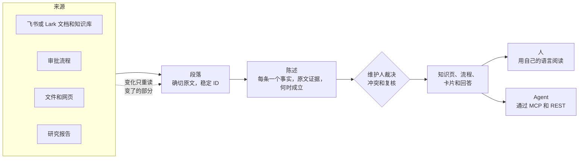

*图 1. 知识的生命周期。来源被读成段落，段落被读成陈述，陈述之间的分歧由人来裁决，人和 Agent 读到的一切都由陈述构成。来源的变化只传播到有关的地方为止。*

Inspiration 的与众不同在于四个判断，每一个都针对今天工具的一种失败：

1. **知识以单条陈述存储，而不是文档或文本块。** 每个事实只存一次，带着来源中的原文引文、它成立的时间和系统得知它的时间。知识页、流程和回答都由陈述构成，所以每一句话都能追溯。像“我能在深圳订一晚 650 元的酒店吗？”这样的问题，需要的是当前有效的那一个值和它的出处，而不是来自五个版本的五段文字。
2. **保鲜像构建系统一样工作。** 一次变化只重读变了的段落，只更新它们支持的陈述，只重建引用了这些陈述的内容。制度一直在变；全部重读太慢、太贵，每次变化都去问人又会把人淹没。
3. **由人来决定，数量控制在人跟得上的范围内。** Agent 负责发现、提议和回答；人来决定。大多数来源从不逐条治理，复核按主题和周分组送达，并受每周预算限制。一个让维护人应接不暇的治理产品，几周之内就会被弃用。
4. **知识按一条规则从个人流向共享。** 每位成员的“我的空间”是私有的。发布把知识移入共享空间，由空间维护人决定谁能阅读。来源权限只产生提醒。跨多个来源合并后的权限计算无法可靠完成，而且应该由企业，而不是每个来源应用，来决定谁能读企业的知识。

**面向谁。** 知识分散在多个工具里的团队和企业（飞书或 Lark、Confluence、审批系统、文件共享、PDF）。它从一个人的知识库开始，逐步扩展到团队和企业。早期最有力的用途是跨工具治理流程和制度，以及为企业自己的 Agent 提供一个受治理的知识端点。产品先以 SaaS 形式销售，私有化部署是同一套代码的第二种形态。英文、中文和日文从第一个版本起就都支持，而且是同一个知识库：知识与语言无关，语言只是知识的表达方式。

**进展到哪里。** 引擎已经在模拟模型上端到端跑通七个阶段：导入、抽取、治理、保鲜、治理级别、主题和待办箱，全部已合入 `main`，语言规则也已放进资源文件。知识页、搜索、Agent API、业务层和界面已经设计，尚未构建。等模拟流水线覆盖每个阶段之后，再接入真实模型。

**这一版的新内容。** 本文按 PRD 加技术架构设计来写：场景说明每项设计为什么存在，可行性一节说明哪些已经证明、哪些还没有。它还吸收了第一版之后讨论中的决定和提议：

- 超级管理员管理企业，维护人维护知识，两者的界线更清楚；中文里“负责人”改为“维护人”（提议，第 4 节）。
- 汇编知识为它的受众而写，从不按读者删减；改变意思的省略交给人来决定（提议，第 15 节）。
- 持有来源凭据的人都可以从中导入；个人连接不再按邮箱域名或飞书组织拦截（已决定，第 17 节）。
- 自主运行的 Agent 只读取或提议；成员明确提出的请求，就是在该成员自身权限内修改的批准（已决定，第 18 节）。
- Agent 工具：四个按 Agent 要做的事划分的工具和一个反馈工具，包括输入、输出和权限（提议，第 18 节）。

## 第一部分 产品需求

## 2. 问题

以青禾科技为例，它是我们演示语料中的虚构企业。它的差旅规定分散在六个地方：

| 在哪里 | 关于深圳这类一线城市酒店的说法 |
| --- | --- |
| 差旅费用管理制度，财务制度库 | 每晚 600 元 |
| 制度的转发副本，人力资源文件夹 | 每晚 600 元 |
| 入职指南，团队知识库 | 每晚 600 元 |
| 9 月经营会议纪要 | 2026-10-01 起每晚 650 元，并由财务修订制度 |
| 关于一线城市住宿标准的通知 | 2026-10-01 起每晚 650 元 |
| 已归档的 2023 版制度 | 每晚 500 元 |

同一家企业还埋了三处分歧：餐补、第一年的年假（入职指南说 7 天，人力资源制度说 5 天），以及一个只在会议纪要里改过的预算截止日。这很平常。今天的问题在于：

1. **没人说得清哪个值有效。** 搜索返回全部六份文档，读者得自己弄明白通知在 2026-10-01 改了制度。
2. **助手凭排在最前面的内容自信作答。** 基于文本块的聊天助手可能引用 2023 版，或者人力资源文件夹里的副本。
3. **没人维护一个事实。** 文档有作者，但一个在六份文档里重复出现的事实，没有人对它负责。
4. **变化不会传播。** 财务修订了制度，没人去更新人力资源的副本、入职指南或常见问题。
5. **Agent 需要同样的答案，在同样的权限之内，还要在 token 预算之内。** 飞书里的采购机器人或编码 Agent，需要为它所代表的人拿到当前的流程和出处。

现有做法如何应对：

| 做法 | 擅长 | 不足之处 |
| --- | --- | --- |
| 单一套件内的知识库（飞书知识库、Confluence）及其助手 | 在套件内撰写和组织页面 | 知识横跨多个工具；回答来自页面，而不是有人维护的事实 |
| 企业搜索和基于文本块的检索（RAG） | 跨工具快速找到段落 | 段落之间互相矛盾：没有东西决定哪个值有效，也没有东西发现过时的副本 |
| 经过核实的知识卡片 | 有人按周期为卡片背书 | 卡片由人手写，脱离来源，在两次复核之间悄悄过时 |
| Inspiration | 跨工具、与来源相连的陈述，每个范围有维护人，变化会传播，人和 Agent 共用一个受治理的端点 | 抽取质量仍需用真实模型证明（第 21 节） |

## 3. 核心概念

下面这些词贯穿全文。引擎还用一些更精确的词，第 12 节列出了它们。

| 概念 | 是什么 |
| --- | --- |
| 企业 | 使用 Inspiration 的一家公司或一个团队，是隔离和计费的单位。一个人单独使用时只有个人知识库，从不看到企业 |
| 空间，我的空间 | 空间是企业中有特定受众的一块区域，例如财务或采购。每位成员在每个企业里还有一个私有的“我的空间” |
| 来源 | 材料的出处，例如一个飞书知识库空间、一个上传文件夹或一份研究报告 |
| 段落 | 来源中一段确切的内容：一句话、一个表格单元格、一个表单字段。每个引用都指向一个段落 |
| 陈述 | 一个事实，带原文证据、成立的时间、状态和知识类别（制度、价格、流程等） |
| 事实槽 | 关于一个单值事实的所有陈述（“住宿上限，一线城市，经理及以下”）。冲突发生在一个事实槽内部 |
| 治理级别 | 按来源或文件夹设置：严格（完整读取并有人维护）、宽松（只在触及已知事实或被引用时读取）或仅检索 |
| 主题 | 知识大纲中的一个位置（领域、主题、子主题）。每条受治理的陈述都归在一个主题下 |
| 知识页、流程、卡片 | 读者读到的内容，只由陈述构成：知识页、流程（SOP），以及关于一个对象（例如一座城市或一家供应商）的卡片 |
| 待办，待办箱 | 待办请一个人决定或复核某件事。待办送到同一个待办箱，按周归入卡片 |
| 维护人 | 维护一个范围的人：一个空间、主题、页面或流程。总是连同范围一起称呼，例如主题维护人 |
| 超级管理员 | 管理企业的人：人员、连接、设置、用量和审计 |

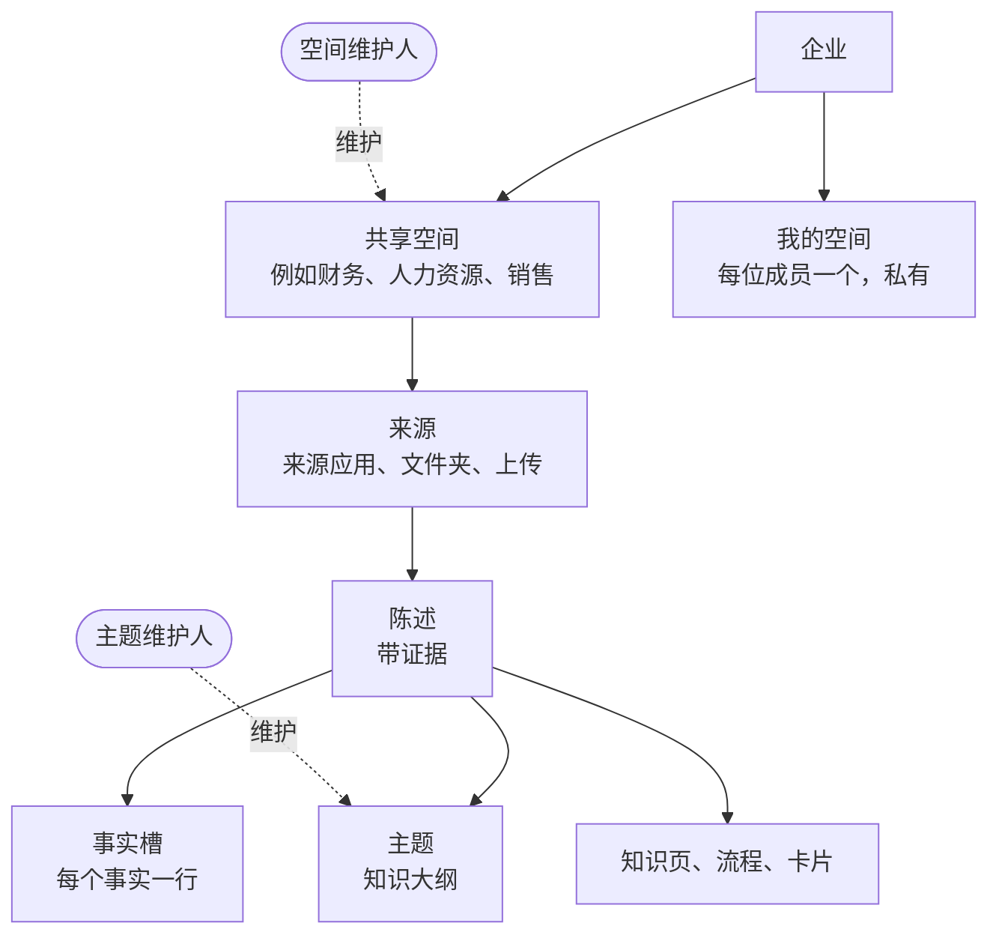

*图 2. 概念之间的关系。来源属于空间；陈述来自来源；事实槽、主题和页面组织陈述；维护人维护空间和主题。*

## 4. 用户与角色

大多数人只阅读。产品的设计让读者看到的是一份普通文档，从不看到背后的知识机制。

| 谁 | 主要工作 | 看到什么 |
| --- | --- | --- |
| 成员 | 阅读、提问、评论，在“我的空间”里保存材料并从那里发布 | 带小引用编号的页面。正文中只出现两种标记：已过时和有争议 |
| 空间、主题、页面或流程维护人 | 批准发布到自己范围的内容，让它保持最新，裁决其中的冲突，把陈述放行给更广的受众。空间维护人还设定谁能阅读这个空间以及它的治理级别 | 自己的待办箱，以及展示陈述、来源和来龙去脉的追溯视图。空间维护人还能看到空间的积压和首次复核专项 |
| 超级管理员 | 成员和席位、来源连接、企业设置、敏感标签和许可级别、审计、Agent、套餐和用量。创建空间并指定它们的维护人 | 管理控制台，含每位成员的用量。永远看不到任何人的“我的空间”，也看不到任何人问了什么、读了什么、调研了什么 |
| Agent 开发者（一位成员） | 通过 MCP 或 REST 连接 Agent | 使用知识的应用、授权范围和审计 |
| 单独使用的人 | 在自己的知识库里做以上所有事 | 没有企业、空间、成员或发布 |
| Agent | 代表一位成员行事，权限是该成员的权限再按它的授权范围收窄 | 该成员能读的同样知识，通过工具获取 |

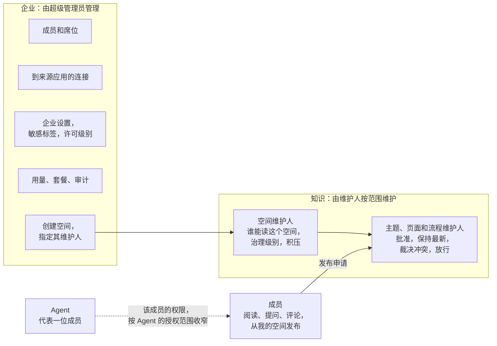

*图 3. 超级管理员管理企业；维护人维护知识。两边唯一的连接，是超级管理员为每个空间指定维护人。*

**超级管理员与维护人的边界**（2026-10-26 提议，等待产品负责人确认）：

- **超级管理员决定“谁”和“怎么做”，从不决定“是什么”。** 谁在企业里，连接哪些应用，企业设置和敏感标签是什么，用了多少、付多少费用。超级管理员从不决定一条陈述说什么，或者哪个值有效。
- **维护人决定知识说什么，以及谁能读。** 维护人批准发布，让自己的范围保持最新，裁决冲突，并把陈述放行给更广的受众。空间维护人设定空间的受众和治理级别。
- **每个共享空间始终有维护人。** 超级管理员创建空间时指定一位，并在最后一位离开之前指定新的。没有维护人的主题、页面和流程交给上方最近的维护人，直到空间维护人为止，所以没有任何东西无人维护。
- **在没人会做决定的地方，超级管理员指定一个人，而不是自己决定。** 跨空间的冲突过了截止日期，交给超级管理员为跨空间决定指定的一位维护人。在指定之前，这个值保持“有争议”的标记。
- **超级管理员保留一个安全杠杆。** 发生安全事件时，超级管理员可以立即收窄任何空间的受众，并留下审计记录。扩大受众始终由空间维护人决定。
- **一个人可以同时担任两个角色。** 在小团队里，超级管理员常常也是空间维护人；两个角色仍然分别行事、分别审计。单独使用的人同时担任三个角色。

**名称。** 英文里这个角色叫 Owner，总是带着范围：Space owner、Topic owner、Page owner、Procedure owner。中文里改为“维护人”（空间维护人、主题维护人、页面维护人、流程维护人），不再用“负责人”，因为“负责人”读起来像“主管”，容易和“管理员”混在一起；“维护”属于知识，正如“管理”属于企业，“文档维护人”也是大家熟悉的说法。日文草案为スペース担当者等。

**产品角色是内部角色的组合。** 内部的权限更细：空间有内部角色 `viewer`、`commenter`、`editor`、`steward` 和 `owner`，主题和页面有各自的维护人。超级管理员同时持有企业级内部角色 `owner`、`admin`、`security_admin` 和 `auditor`。以后的预设，例如部分中国客户要求的系统管理员、安全管理员、审计管理员三员分立，只是一个新的组合，不需要新代码。

## 5. 场景

每个场景说明发生了什么、产品为什么这样做，以及构建到了哪一步。合在一起，它们覆盖了每项主要功能。

### 5.1 成员提问

一位销售经理问：“下周我能在深圳订一晚 700 元的酒店吗？”回答使用提问者的语言：“不能。一线城市的上限从 2026-10-01 起是每晚 650 元 [1]，此前是 600 元 [2]。”引用 1 在回答旁边打开通知，并定位到确切的段落；引用 2 打开制度。人力资源的副本、入职指南和 2023 版不被引用，因为它们的陈述已被取代，或者只是副本。

- **原因。** 住宿上限是一个事实槽，保存了它历来的每个值，所以回答取出差日期当天有效的值，并附上证据。基于文本块的检索会返回全部六份文档，让读者自己去分辨。
- **读者看到什么。** 一个直白的回答，以及带小引用编号的页面。正文中只出现“已过时”和“有争议”；“待复核”出现在引用浮窗里。如果相关材料在提问者读不到的空间里，回答会说明它可能不完整，并指出可以问谁（第 15 节）。
- **进展。** 陈述、事实槽以及提议 650 元都已构建，并在演示语料上运行。检索、回答和阅读界面已经设计。

### 5.2 制度变更

财务发布了修订后的差旅制度（第 4 版），包含新的上限和另外 40 处改动。

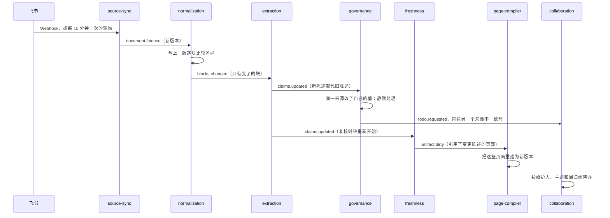

*图 4. 变化只传播到有关的地方为止。每个箭头都是一个事件；没有任何东西会重读未变的块。*

- **发生了什么。** 只有变了的块会被重读。制度自己改的值是一次更正，所以静默同步，追溯视图保留历史。现在不一致的副本（人力资源的副本、入职指南）产生的复核附在同一张卡片上。同一个原因带来的 41 处变化会把主题维护人淹没，所以它们合成一次批量变更审阅：说明发生了什么，按主题分组，并提供“全部跟随来源”之类的批量操作。
- **原因。** 来源自我更正不是冲突；只有来源之间不一致才需要人。一个会产生 20 条以上待办或涉及 3 个以上主题的原因，作为一个整体审阅一次，每一项仍留记录。
- **进展。** 块差异、增量抽取、静默自我更正和复核时钟都已构建。在测量的一轮编辑中，175 次来源更新只有 1 次需要问人。批量变更审阅和页面重建已经设计。

### 5.3 两个部门意见不一

财务的制度说一线城市上限是 650 元，销售的差旅流程仍然写着拜访客户可住 700 元。

- **发生了什么。** 治理在一个事实槽里发现两个值，提议当前有效且更权威的那个，并开一个冲突案例。卡片并排显示双方及其证据，以及各自有多少份不同的文档支持、权威程度如何（“4 份文档说 650，1 份说 700”）。两个范围的主题维护人按联合审批策略共同决定，默认是 5 个工作日内全员同意。在此期间，读者和 Agent 看到的是最近一次核实过的值，标为“有争议”。
- **原因。** 跨范围的冲突需要双方维护人，但投票绝不能无限期拖下去。常见的结果是“两者都对，把范围写清楚”：一般情况 650 元，经销售批准的客户拜访 700 元。一个决定可以变成一条裁决规则（“在财务空间里，涉及价格时价目表优先于知识库页面”），用来处理以后同类的冲突。

*图 5. 联合审批总会结束。审批方式有单人、或签、会签和至少 n 人。兜底裁决人是空间维护人；跨空间时，是超级管理员指定的一位维护人。*

- **进展。** 冲突案例、提议和按维护人分派已经构建。联合审批、投票和裁决规则已经设计。

### 5.4 来源在上游被删除

有人在飞书里删除了入职指南。

- **发生了什么。** 什么都不会消失。陈述保留，引用上写着“原文已于 10 月 20 日在飞书删除”，证据仍能打开最后一个版本。还有其他来源支持的陈述会静默重新计算。其余的，主题维护人会为每个被删除的文档或文件夹收到一条待办，有三个选择：保留为快照、指向替代文档，或不保留。没有决定时，30 天后默认保留，并设置复核日期。如果一次同步中某个来源超过 10% 或超过 50 份文档消失，原因几乎总是失去了访问权限，所以这个来源会暂停，超级管理员收到一条连接待办。
- **原因。** 知识悄悄消失会破坏信任，而一个受治理的事实可能比发现它的那份文档更重要。默认保留是安全的，因为它从不改变谁能看到什么。
- **进展。** 已设计（[来源变化](design/source-changes.md)）；约 3 人周。

### 5.5 从一个人到一个团队

一位采购专员独自注册，连接自己的飞书账号，建立了一个包含供应商笔记和调研的知识库。后来团队也开始使用 Inspiration。

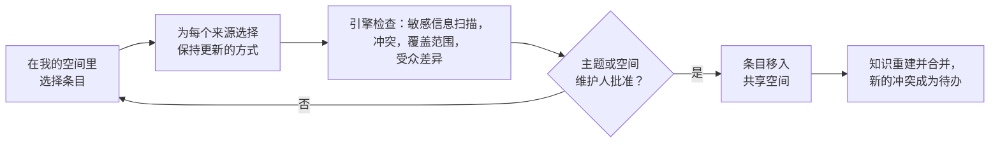

*图 6. 发布把知识从“我的空间”移入共享空间。审批人只读申请中的条目。*

- **发生了什么。** 邀请一位同事，就把这个知识库变成了一个企业；专员的材料成为其“我的空间”，只有本人可见。为了共享供应商准入笔记，专员把它们发布到采购空间。每个来源都要选择保持更新的方式：通过企业连接（默认）、通过自己的连接（需同意），或者发布带复核日期的快照。引擎检查这次申请，主题维护人批准，条目随之移动。从此由采购空间的受众阅读它们；来源自身的权限如果之后收紧，只会产生一条提醒。
- **原因。** 个人知识应当完全属于个人，共享知识应当可以治理、可以合并。只在一个域内部合并，意味着两位成员的草稿从不冲突，它们只在双方都发布之后才相遇。
- **进展。** 已在[业务层](design/business-layer.md)中设计；两个域在引擎一侧的实现是下一个引擎改动。

### 5.6 跨部门的知识

全员差旅指南用到了人力资源的职级和财务的住宿上限。财务还有一份只有财务能读的备忘录，主张下调上限，而一份公开文档持反对意见。

- **发生了什么。** 指南为它的全体受众而写，只用这些受众能读的内容。人力资源和财务把职级和上限开放给全体员工，所以指南用到了它们。备忘录不是全体员工都能读，而省略它会让一场争论只剩下一方，所以省略检查会触发。指南的维护人收到一条待办：请财务放行相关的陈述、改写这一节使其不偏向任何一方，或者带说明发布。打不开备忘录的读者会看到“这一点上有部分材料在你无法打开的空间里，可联系财务空间维护人。”财务的读者看到完整的这一节。
- **原因。** 按读者删减文字会扭曲原意；因为一个输入受限就隐藏整页，既不可用，又会被滥用：任何人只要把一条无关紧要的受限备注关联上去，就能藏起一整页。所以受众由人设定，从不由输入决定；单元为它的受众而写；改变意思的省略交给人来决定（第 15 节）。
- **什么时候会遇到。** 只有一个共享空间的企业永远不会遇到。当财务或人力资源这样的部门收窄自己空间的读者范围时，它才开始重要。
- **进展。** 提议中（[汇编知识的权限](design/compiled-knowledge-permissions.md)），等待产品负责人确认第 27 节中的取舍；约 3 人周。

### 5.7 企业的 Agent 使用知识

一位成员在飞书里问企业的采购机器人，怎样为新供应商办理准入。

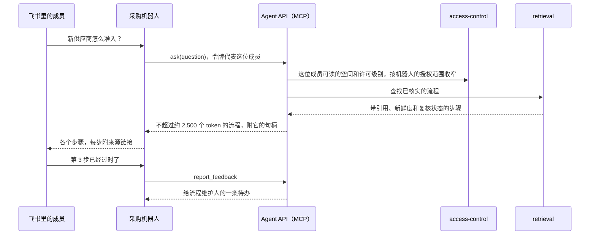

*图 7. Agent 以它所代表的成员的权限读取，它的反馈作为待办送达维护人。*

- **原因。** Agent 会因为过时或互相矛盾的上下文而出错，而且每个 token 都要付费。一个受治理的端点给它们带来源、新鲜度和 token 估算的当前流程，而且从不超出成员能读的范围。编码 Agent 通过 MCP 使用同样的工具。
- **进展。** Agent API 和它的工具是提议（第 18 节）；内置 Agent 使用的 Agent 运行时已经构建。

### 5.8 成员借助助手更正知识

一位成员在页面上评论：“这已经过时了，从 10 月起上限就是 650 元。”

- **发生了什么。** 助手对照来源核实这个说法，找到通知，并提出修改。如果成员要求它直接修改，而且成员有权编辑这个页面，助手会立即修改，记录在成员名下，标明由助手完成，并且可以撤销。如果成员只能提议，助手就为维护人提交一份提议。人的修改是固定的人工覆盖，重建从不改写它；如果之后来源与它不一致，修改的作者会收到待办。
- **原因。** 让人把刚刚请助手改的内容再手动输入一遍很痛苦，而请求本身就是批准。自主运行的 Agent（在后台、按计划或由事件触发）仍然只读取或提议，因为没有人请它们这么做。
- **进展。** 已决定；评论、人工覆盖和修改路径已经设计。

### 5.9 同一份制度的中文版和日文版

青禾在日本的子公司有一份日文差旅规程，重复了住宿上限。

- **发生了什么。** 同一个上限的日文陈述和中文陈述落在同一个事实槽里，因为事实槽按与语言无关的谓词、限定条件和带类型的值建键，而不是按措辞。如果日文是译文，它和原文算作一体，而不是第二个来源。原文变了而译文没变时，译文收到一条“译文已过时”的复核，而不是冲突。日文读者读到的是日文页面，由同一批陈述编译而成，引文保持原来的语言。
- **原因。** 知识与语言无关，语言只是它的表达方式。同一份知识用两种语言表达，绝不能变成重复或虚假的冲突。
- **进展。** 已设计（[知识与语言](design/knowledge-and-language.md)）；en、zh 和 ja 的语言包已经构建。

### 5.10 审批流变成流程

青禾的差旅申请审批在飞书里运行。

- **发生了什么。** 流程由三部分构建：流程定义、对 90 到 180 天审批日志的流程挖掘，以及模型写出的说明。每一步都标注“来自定义”“挖掘所得”或“推断”，流程维护人批准之后才有人能读到。Agent 用 `ask` 或读取它的句柄获取它，它也可以导出为 Agent Skill。
- **原因。** 正式定义说明谁来审批；日志说明实际发生了什么（例如超过 5,000 元的金额总会转到财务）。标注出处能防止推断出的步骤被当成事实。
- **进展。** 飞书审批连接器已用录制的测试数据构建；流程构建已经设计。

### 5.11 研究成为来源

一位采购员请研究 Agent 找出华东地区持有某项认证的供应商。

- **发生了什么。** 研究 Agent 通过 Agent API 和经过批准的网络搜索工作，写出一份包含结论、假设和证据的报告。报告像其他来源一样存储。每个假设都有一个复核查询和一个日期。当被引用的材料变化或日期到来时，只重新检查受影响的结论，只有结论改变时才写新版本。
- **进展。** 已设计。

## 6. 功能需求

状态：**已构建**（在 `main` 上，有测试），**已设计**（已决定，未构建），**提议中**（等待决定），**已计划**（同意构建，尚未详细设计），**未决定**（尚未决定）。

### 6.1 引入知识

| 编号 | 需求 | 状态 |
| --- | --- | --- |
| IN-1 | 连接飞书文档、知识库和审批以及文件上传；用同样的连接器服务飞书的国际版 Lark | 已构建（录制的测试数据） |
| IN-2 | 持续关注来源：推送事件作为提示，每 15 分钟一次轮询，以及每晚一次同时发现删除的全量列举 | 已构建 |
| IN-3 | 把 Office 文件、PDF 和扫描件解析成带稳定 ID 的块 | 已计划（解析 worker） |
| IN-4 | 给每个来源或文件夹设置治理级别，沿文档树向下继承；上传和网页默认为宽松 | 已构建 |
| IN-5 | 从审批流构建流程：定义、挖掘的日志和说明，每一步标注出处并由维护人批准 | 已设计 |
| IN-6 | 把研究报告作为来源存储，每个假设带复核查询和日期 | 已设计 |
| IN-7 | 试点阶段加入 Confluence 和钉钉；之后是 Notion 和简道云；中国以外的连接器待定 | 已计划 / 未决定 |

### 6.2 陈述与结构

| 编号 | 需求 | 状态 |
| --- | --- | --- |
| ST-1 | 只有证据引文是所引段落的原文子串时，才保留这条陈述 | 已构建 |
| ST-2 | 从不删除陈述：新的取代旧的，并结束旧陈述被知道的时间区间 | 已构建 |
| ST-3 | 把单值事实归入事实槽，值带类型（带单位的数字、范围、日期、金额） | 已构建 |
| ST-4 | 宽松级别的文档只在触及已知事实时读取，被页面或回答第一次引用时完整读取 | 已构建 |
| ST-5 | 把陈述归入最多三层的主题，键保持稳定；一次重新聚类最多移动 5%，人放置过的从不移动 | 已构建 |
| ST-6 | 解析实体（人员、部门、产品、供应商）和关系，每个都有陈述支撑 | 已计划 |
| ST-7 | 译文视为原文的副本；同一陈述跨语言合并前先经模型检查 | 已设计 |
| ST-8 | 从不跨域合并或比较知识：成员的“我的空间”和企业的共享空间 | 已设计 |

### 6.3 阅读与提问

| 编号 | 需求 | 状态 |
| --- | --- | --- |
| RD-1 | 三个共用 ID 的视图：原文（原样）、批注（带标记）和知识（主题页）。新导入的来源以原文视图打开，知识从这里由具体到抽象地展开（第 19 节） | 已设计 |
| RD-2 | 两棵树：文档树和知识树；读者打不开的文件夹或空间从不显示，连计数都不显示 | 已设计 |
| RD-3 | 页面是 `PageSpec`，有 14 种块类型，每句话都引用陈述，每次重建都是带差异的版本 | 契约已构建，编译器已计划 |
| RD-4 | 引用在页面旁边打开来源，定位到确切的段落和版本，并在段落之后变过时注明 | 已设计 |
| RD-5 | 四种状态用文字表达，从不只靠颜色：有效、待复核、已过时、有争议；正文中只出现已过时和有争议 | 已设计 |
| RD-6 | 回答以陈述为依据，引用段落，使用提问者的语言；可能不完整的回答会说明 | 已设计 |
| RD-7 | 评论交给助手，助手带引用回答或提出修改；人的修改是固定的人工覆盖 | 已设计 |
| RD-8 | 图表来自陈述或已登记的查询，从不使用自由 SQL；交互视图来自模板，在沙箱中运行 | 已设计 |

### 6.4 保鲜与来源变化

| 编号 | 需求 | 状态 |
| --- | --- | --- |
| FR-1 | 只重读变了的块，只取代证据变了的陈述，只重建引用它们的内容 | 到抽取为止已构建；重建已计划 |
| FR-2 | 来源改了自己的值时静默同步，保留历史 | 已构建 |
| FR-3 | 复核时钟来自知识类别（例如制度每年一次，流程每 180 天）、计划日期和遗留的副本 | 已构建 |
| FR-4 | 被删除的来源保留其知识并加标记；每个文档或文件夹一条待办：保留为快照、指向替代文档或不保留；30 天后默认保留 | 已设计 |
| FR-5 | 一次同步中某个来源超过 10% 或超过 50 份文档消失时，暂停该来源，并就连接询问超级管理员 | 已设计 |
| FR-6 | 被引用的材料变化或假设的日期到来时复核研究；只有结论改变时才写新版本 | 已设计 |
| FR-7 | 新企业以按主题划分的首次复核专项交给空间维护人，而不是一大批逾期复核 | 已构建 |

### 6.5 治理与待办箱

| 编号 | 需求 | 状态 |
| --- | --- | --- |
| GV-1 | 对每个事实槽，提议当前有效、最权威的值并说明理由 | 已构建 |
| GV-2 | 一个触发，一条待办，交给最近的维护人；没有任何东西无人维护 | 已构建 |
| GV-3 | 一个原因，一次审阅：会产生 20 条以上待办或涉及 3 个以上主题的原因，成为一次批量变更审阅 | 已设计 |
| GV-4 | 每周卡片：每张卡片最多 20 条待办，每位维护人每周最多 10 张卡片；备注单独成卡，不计入预算 | 已构建 |
| GV-5 | 冲突卡片显示每个值有多少份不同的文档支持，以及它们的权威程度 | 已设计 |
| GV-6 | 联合审批有审批方式、截止日期和兜底裁决人；在此期间读者看到什么由企业选择 | 已设计 |
| GV-7 | 每个决定都是一条记录，并可成为裁决规则，供治理用于之后的同类冲突 | 已设计 |

### 6.6 域、发布与权限

| 编号 | 需求 | 状态 |
| --- | --- | --- |
| PB-1 | 单独使用的人看不到企业；邀请他人时新建一个企业，个人知识库（每个账号一个）保持原样 | 已设计 |
| PB-2 | “我的空间”只对其成员可见，超级管理员也看不到 | 已设计 |
| PB-3 | 发布在检查和维护人批准之后，把条目从“我的空间”移入共享空间；审批人只读申请中的条目 | 已设计 |
| PB-4 | 每个已发布的来源选择保持更新的方式：企业连接（默认）、成员自己的连接（需同意）或快照 | 已设计 |
| PB-5 | 来源权限只提醒：发布时的受众差异，以及之后收紧时的一条待办 | 已设计 |
| PB-6 | 在读者的许可级别下其空间可读时，单元可读；陈述还需要一个读者可读的依据 | 已设计；已构建的是较早的规则 |
| PB-7 | 汇编知识为受众而写；改变意思的省略交给人；告诉读者，不误导读者；按陈述放行 | 提议中 |
| PB-8 | 持有来源凭据的人都可以从中导入；不按邮箱域名或飞书组织拦截 | 已决定 |
| PB-9 | 成员离开：已发布的知识留在企业；“我的空间”锁定，30 天后清除 | 已设计 |

### 6.7 Agent

| 编号 | 需求 | 状态 |
| --- | --- | --- |
| AG-1 | 一个受治理的端点：远程 MCP 服务器和 REST API 来自同一份 schema；已核实的流程可导出为 Agent Skill | 已计划 |
| AG-2 | 四个按 Agent 要做的事划分的工具（`ask`、`search`、`read`、`get_changes`）和一个反馈工具，按 Agent 预算设计，每个结果带来源、版本、新鲜度、置信度、复核状态和 token 估算 | 提议 |
| AG-3 | Agent 总是代表一位成员行事，权限是该成员的权限再按授权范围和空间收窄 | 已设计 |
| AG-4 | 自主运行的 Agent 只读取或提议；成员明确提出的请求，就是在该成员权限内修改的批准 | 已决定 |
| AG-5 | MCP 客户端使用带 PKCE 的 OAuth，CLI 使用设备授权流程；企业 Agent 由超级管理员注册 | 已设计 |

### 6.8 管理与用量

| 编号 | 需求 | 状态 |
| --- | --- | --- |
| AD-1 | 三个产品角色（成员、按范围的维护人、超级管理员），每个都是内部角色的组合 | 已决定；边界提议中 |
| AD-2 | 生命周期：注册、邀请（链接 7 天后失效）、通过已验证的邮箱域名加入、带目录同步的 SSO、从个人到企业、离开、删除账户、删除企业（30 天宽限期，可导出） | 已设计 |
| AD-3 | 席位汇入一个用量池；每位成员有默认上限，超级管理员可以调高；超级管理员能看到每位成员按工作类型的用量，从不看到内容 | 方向已决定；细节随计费确定 |
| AD-4 | 审计知识读取、权限变更、决定和紧急访问 | 已设计 |
| AD-5 | 提高标签或收窄受众之前，显示它影响多少单元和读者 | 提议中 |

### 6.9 语言

| 编号 | 需求 | 状态 |
| --- | --- | --- |
| LN-1 | 英文、简体中文和日文从第一个版本起同等支持；繁体中文以后再做 | 已设计；语言包已构建 |
| LN-2 | 一份知识只有一个知识单元，每种语言一个表达 | 已设计 |
| LN-3 | 界面语言按账户设置；发给多人的消息有企业默认语言；每个空间有内容语言 | 已设计 |
| LN-4 | 回答使用提问者的语言；引文保持原文；翻译按需提供，并标明是机器翻译 | 已设计 |
| LN-5 | 按文字体系选择字体，快捷键不干扰输入法，本地化的格式和排序 | 已设计 |

## 7. 质量需求

| 质量 | 需求 | 如何检查 | 状态 |
| --- | --- | --- | --- |
| 证据 | 每条陈述都带原文引文；存储层拒绝其他任何东西 | 存储规则和测试 | 已构建 |
| 忠实度 | 引用蕴含率不低于 95% | G1 评测集 | 目标 |
| 权限安全 | 红队测试集上零泄露：个人空间隔离、跨空间引用和推导、共享回答、图路径、省略 | G1 红队和验收测试 | 目标 |
| 权限撤销 | 撤销的权限在 15 分钟内（p95）到达每位读者 | G2 | 目标 |
| 变化发现 | 轮询在 15 分钟内发现变化，推送更快；每晚的列举发现删除 | source-sync 测试 | 已构建 |
| 复核负担 | 每位维护人每周最多 10 张待办卡片 | 模拟一年：中位数 1，最多 4 | 已测量 |
| 冲突精度 | 至少一半的冲突待办是真正的冲突 | G1，之后作为试点指标 | 目标 |
| 规模 | 单节点、模拟模型下，10,000 份文档约 72 秒同步完，约 9 分钟处理完 | 规模报告 | 已测量 |
| 主题稳定 | 陈述不会无故更换主题 | 一次重新聚类中 25,660 条移动 0 条 | 已测量 |
| Agent 效率 | 结构化的流程保持在约 2,500 个 token 以内；每个任务的 token 少于只用文本块的基线 | G1 | 目标 |
| 检索 | 在合作伙伴自己的问题上，Recall@10 超过只用文本块的基线 | G2 | 目标 |
| 隐私 | 超级管理员从不读取“我的空间”、提问、回答或研究 | 权限测试 | 已设计 |
| 模型路由 | 内容只送到获准处理其敏感标签的服务商 | 网关测试 | 已构建 |
| 数据驻留 | 企业的数据留在创建时选定的区域 | 部署检查 | 已设计 |
| 语言 | 每个界面都有三种语言；缺少字符串时构建失败；伪语言测试 | 构建检查 | 已设计 |
| 交付 | 一天内完成离线安装；国产化基础设施认证 | G3 | 目标 |

## 8. 版本、范围与成功标准

*图 8. 版本与关口。只有每个阶段都在模拟模型上跑通之后，才接入真实模型。*

| 版本 | 证明什么 | 包含 |
| --- | --- | --- |
| 模拟原型 | 产品的每个阶段都能以真实的数据量端到端运行 | 引擎流水线、页面、搜索和回答、Agent API、业务层第一阶段和网页应用，全部基于模拟模型 |
| 真实模型验证（G1） | 真实模型在真实内容上的质量 | 真实模型、三种语言的评测语料、权限红队、测得的 token 用量 |
| 试点（G2） | 一位设计合作伙伴每周都在用 | 一个真实的飞书或 Lark 企业、联合审批、Confluence 和钉钉、业务层第二阶段 |
| 产品 v1（G3） | 可以销售和交付 | 合规包、国产化基础设施、离线安装、Artifact 级编辑、计费 |

**暂不包含**：繁体中文、深色主题、访客、三员分立预设和个人计费。引擎从不处理账户、登录或界面；这些属于业务层。

| 关口 | 标准 |
| --- | --- |
| G1，原型 | 引用蕴含率不低于 95%；权限红队测试集零泄露；冲突队列精度不低于 50%；一个流程领域由其维护人核实；测量每个任务的 Agent token，并与只用文本块的基线比较；一套中文、日文和英文的评测语料 |
| G2，试点，约第 6 个月 | 一位设计合作伙伴至少有五位维护人每周活跃；权限撤销在 15 分钟内（p95）到达每位读者；在合作伙伴自己的测试集上检索 Recall@10 超过文本块基线；签署商业意向 |
| G3，产品 v1，约第 12 个月 | 等保三级控制包，国产化基础设施兼容认证（麒麟、鲲鹏或海光、人大金仓、昇腾），一天内完成离线安装，两家付费客户 |

G3 是为中国的私有化部署写的；SaaS 优先时这些关口如何调整，是一个待决问题。

## 第二部分 技术架构

## 9. 架构概览

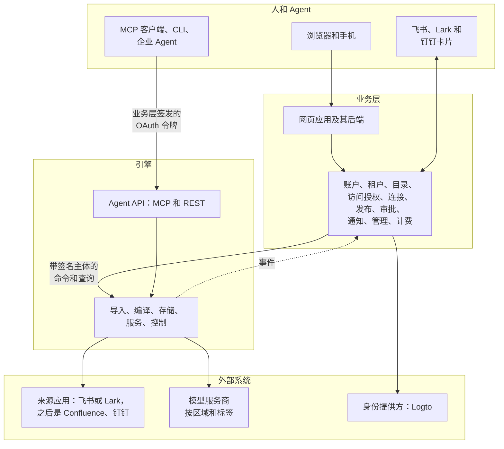

*图 9. 两层。调用从业务层向下到引擎，事件向上返回；引擎从不调用业务层。*

**引擎是知识的记录系统，没有界面。** 给定一个租户和一个主体，它独立回答四个问题：知道什么、从哪里来、谁能看、是否仍然成立。它没有人、没有界面、没有商业条款，所以无论在我们的产品之下、在私有化部署中客户自己的身份系统之下，还是前面只有 Agent，它的行为都一样。

**业务层是围绕引擎、面向人和企业的产品**：一个人是谁，属于哪些企业，这些企业买了什么，怎样询问、提醒和通知一个人，界面长什么样。它把人的决定和商业决定变成引擎命令，把引擎事件变成人读的消息；它可以因市场而异，而不触及知识。

**整个系统，以及每个部分的外部对等产品。** 图 10 画出了每个组件，并为每个组件列出做类似工作的产品或项目。这个对照帮助读者理解每个部分的位置，也记录了我们从外部拿来了什么。我们不是把这些项目拼在一起。工作通用、许可证也合适的地方，我们直接运行现成的项目，有时放在插件后面，以便替换。其他地方我们参考它们的设计、自己实现，因为 Inspiration 的增量正在这些地方：逐字证据、事实槽、由具名的人做的决定，以及从来源到回答的一套权限模型。

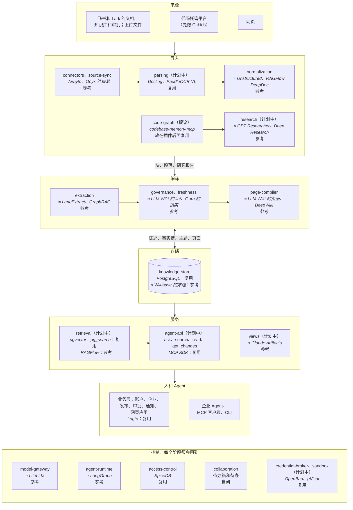

*图 10. 整个系统。每个框写的是我们的组件，≈ 后面是做类似工作的外部产品。复用表示直接运行它；放在插件后面表示可以替换；参考表示我们研究了它的设计、自己实现。标为计划中或提议的组件尚未构建。*

| 部分 | 我们的组件 | 外部对等产品 | 我们怎样用 | 原因 |
| --- | --- | --- | --- | --- |
| 来源集成 | connectors、source-sync | Airbyte、Onyx 的连接器、LlamaHub 的读取器 | 参考；直接使用厂商 SDK | 我们需要版本、删除、ACL 快照，以及同步和 Agent 工具共用的每厂商一个集成；这些项目对飞书和 Lark 的支持很薄 |
| 文档解析 | parsing（计划中） | Docling、PaddleOCR-VL、MinerU、RAGFlow DeepDoc | 在 Python worker 中复用 Docling 和 PaddleOCR-VL | 解析已经是通用能力；由路由器按文档类型选择解析器 |
| 块和段落 | normalization | Unstructured 的元素、Docling 的文档模型、RAGFlow 的分块 | 参考 | 证据需要跨版本保持稳定的块 ID 和段落 ID，以及按块的差异；这些工具每次都从头重建文档 |
| 代码仓库 | code-graph（提议） | codebase-memory-mcp、CodeGraphContext、Sourcegraph SCIP；DeepWiki 和 Code Wiki | 在沙箱中、放在 `code_indexers` 插件后面复用 codebase-memory-mcp；不使用生成的 wiki | 每个提交一张图，提供锚定证据的符号，并在每次合并时给出差异；生成的文字不是证据（[代码仓库](design/code-repositories.md)） |
| 深度研究 | research（计划中） | OpenAI 和 Gemini 的 Deep Research、GPT Researcher、LangChain 的 open_deep_research | 参考 | 报告必须成为来源，带逐字证据，以及在代码或页面变化时会重新核对的前提 |
| 抽取 | extraction | LangExtract（以原文偏移为依据的抽取）、GraphRAG 和 LightRAG（实体和断言抽取） | 参考 | 证据要作为逐字子串核对，陈述要有事实槽键并能相互取代；图摘要会丢掉证据 |
| 治理与保鲜 | governance、freshness | LLM Wiki 模式（模型根据原始资料维护一个 wiki，并检查其中的矛盾和过时说法）；Guru 和 Confluence 的核实；Wikidata 的等级 | 参考 | 在 LLM Wiki 里模型自己改写页面；我们保留陈述及其证据，由具名的人解决分歧，有截止日期，也有记录 |
| 页面 | page-compiler | LLM Wiki 的页面、DeepWiki、Notion AI | 参考 | 页面由陈述为一个受众编译而成，每句都有引用，每次重建都是一个版本 |
| 知识存储 | knowledge-store | Wikibase（带出处和限定词的陈述）、XTDB 和 Datomic（历史和时间回溯） | 复用 PostgreSQL；参考它们的模型 | 一个客户自己就能运行的数据库，带来龙去脉和“何时得知”的读取 |
| 搜索与回答 | retrieval（计划中） | RAGFlow、Onyx、Glean | 复用 pgvector 和 pg_search（以后可换 OpenSearch 或 Milvus）；参考 RAGFlow 的流水线 | 不仅为块建索引，也为陈述建索引；排序前先按可读空间过滤；每条引用带读者状态 |
| Agent 访问 | agent-api（计划中） | Glean 和 Notion 的 MCP 服务器 | 复用 MCP TypeScript SDK | 四个按任务划分的工具，权限与界面相同（第 18 节） |
| 交互式视图 | views（计划中） | Claude Artifacts | 参考 | 代码和数据分开，有渲染检查和人的批准，在沙箱框架中运行 |
| Agent 框架 | agent-runtime | LangGraph、OpenAI Agents SDK、Claude Agent SDK | 参考；我们自己的小循环已经构建 | 工具受我们的权限和审批约束；如果研究需要长时间、可持久的运行，LangGraph.js 是第一个考虑采用的 |
| 模型网关 | model-gateway | LiteLLM、Portkey、OpenRouter | 参考 | 按敏感标签路由、按企业和成员的预算、带版本的提示词和模拟都是我们自己的；LiteLLM 可以作为服务商适配器放在它后面 |
| 权限 | access-control | SpiceDB、OpenFGA（都以 Zanzibar 为模型） | 复用 SpiceDB | 基于关系的检查和搜索预过滤，规模覆盖每一条陈述 |
| 待办与决定 | collaboration | Guru 和 Confluence 的复核队列 | 自研 | 按主题和周分组、受预算约束的待办是产品本身，不是基础设施 |
| 凭据 | credential-broker（计划中） | Nango、Composio；OpenBao、Vault | 复用 OpenBao Transit 管理密钥；OAuth 流程参考 Nango | 令牌从不交给 Agent；租约短，按任务发放 |
| 沙箱 | sandbox（计划中） | E2B、Daytona；gVisor、Kata Containers、Firecracker | 复用 gVisor，之后是 Kata Containers 或 Firecracker；参考 E2B | 不是我们写的代码，每个任务一个容器 |
| 事件 | eventbus（库） | Kafka、NATS JetStream | 复用 Postgres outbox 和 Valkey Streams；产品中用 NATS 或 Kafka | 事件和数据一起提交 |
| 身份 | accounts（业务层） | Logto、Keycloak、Auth0 | 复用 Logto | 标准能力；成员 ID 仍由我们自己管理 |
| 通知 | notifications（业务层） | Novu、Knock | 参考 | 消息以代码和参数到达，按每个收件人的语言措辞 |
| 计费 | billing（业务层） | Stripe、Lago | 以后复用 | 试点之前不需要 |

与之竞争的是整个产品，而不是其中某个部分：Glean、Guru、Onyx、RAGFlow、Notion AI，以及飞书的知识问答（第 2 节）。

**某样东西放在哪里。** 按顺序提问，第一个“是”决定归属。

1. 它是否读取、修改、推导或执行任何与知识有关的东西，或者决定一个主体能否看到某样东西？放在引擎。
2. 它是否关于一个人本身（登录、个人资料、语言、会话）、作为客户的企业（套餐、席位、计费、域名），或者触达一个人的渠道（邮件、即时消息、摘要）？放在业务层。
3. 它是一项设置吗？业务层拥有它的值和设置它的界面；引擎拥有它的含义、默认值和执行方式。
4. 它是人对知识做出的决定吗？引擎拥有这个条目（待办、发布申请、冲突）、它的状态、谁可以决定以及之后发生什么。业务层拥有人如何做出决定：问谁、提醒、截止日期、升级、投票和卡片。它把结果作为命令送回，引擎再检查一遍。

**绝不。** 下面每一条都由一项测试或评审规则保证。

- 引擎从不调用业务层，也从不保存用户 ID、登录身份、会话、密码、套餐或支付信息。
- 业务层从不保存知识（来源、陈述、页面、向量）或来源凭据，也从不决定谁能看到内容：它去问引擎。它展示或发送的内容，都是为接收者从引擎获取的，并且不保留。
- 引擎只信任签名令牌和它自己保存的成员、群组、角色和设置的副本。令牌可以收窄引擎允许的范围，从不扩大。
- 没有业务层，引擎也能运行：一个签发令牌、发送开通命令的替身，就足以支持测试、评测和只有 Agent 的使用场景。

**共同关注点的分工。**

| 关注点 | 引擎 | 业务层 |
| --- | --- | --- |
| 人 | 成员、群组、角色和许可级别作为被执行的副本；每一次权限检查 | 账户、登录、邀请、目录同步、分配角色 |
| 企业 | 租户作为隔离边界和数据区域；按命令开通、导出和删除 | 作为客户的企业：名称、域名、套餐、席位、转移和删除流程 |
| 设置 | `TenantPolicy` 的含义、默认值和执行 | 超级管理员选定的值，以及对应的界面 |
| 空间与受众 | 空间、受众和检查 | 修改它们的界面 |
| 待办与决定 | 待办、发布申请和冲突：状态、分派、每周预算、谁可以决定、效果、记录 | 让人做出决定：提醒、截止日期、升级、投票、即时消息卡片 |
| 消息 | 带代码和参数的事件 | 用每位接收者的语言写成的文字、渠道、摘要、偏好、待办箱界面 |
| 文字 | 某种语言的知识：页面、回答、摘要 | 界面和消息中的每一个字 |
| 来源连接 | 凭据（凭据代理）、抓取、同步、来源 ACL 快照 | 连接和同意界面，设置允许哪些连接 |
| Agent | Agent API、令牌验证、授权范围执行、Agent 审计 | OAuth 服务器、客户端注册、设备授权流程、同意、撤销 |
| 用量 | 按企业、成员和空间计量模型使用；在给定的上限处停止 | 套餐、席位、用量池、每位成员的上限、发票 |
| 审计 | 知识读取、权限变更、决定、紧急访问 | 登录以及账户、管理和计费事件；控制台同时展示两者 |
| 搜索与阅读 | 检索、回答、引用、页面 | 阅读和搜索界面 |

## 10. 代码仓库与组件

**一个仓库，每层一个文件夹。** 两层都在这个 monorepo 里构建。

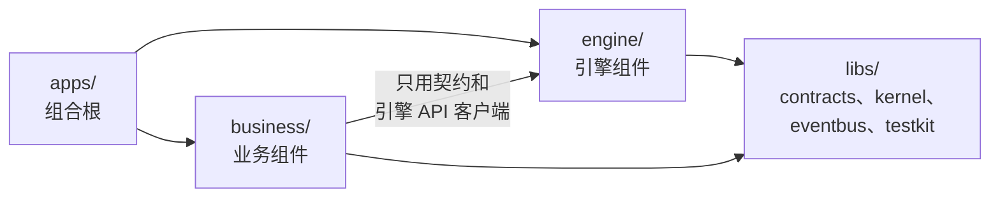

*图 11. 依赖只朝一个方向。`engine/` 和 `libs/` 里的任何东西都不依赖 `business/`，任何试图这样做的改动都会让清单测试失败。*

[`components.yaml`](../../components.yaml) 的每一节对应一个文件夹。一个包只依赖基础库和它 `calls` 中列出的组件。一套工具链和一个 `make check` 覆盖两层，所以契约改动可以在一个拉取请求里同时落到两边，而引擎和业务后端作为独立进程部署。各个包已经在一个只做重命名的拉取请求（#15）里从 `packages/` 迁到这些文件夹。

**引擎组件。** 每个组件只做一件事。它的名字也是它的事件生产者名、消费者组名和模型任务名的前缀。

| 阶段 | 组件 | 职责 | 状态 |
| --- | --- | --- | --- |
| 导入 | connectors | 每个厂商一个集成：列举、抓取、读取 ACL、Webhook、Agent 工具。已构建：本地文件夹、飞书文档和审批（录制的测试数据） | 已构建 |
| 导入 | source-sync | 版本、删除标记、ACL 快照、轮询和对账；之后是 `fetch_now` 和文档树 | 已构建 |
| 导入 | parsing | 处理 Office、PDF 和扫描件的 Python worker（Docling、PaddleOCR-VL），通过 HTTP 契约调用 | 已计划 |
| 导入 | normalization | 带稳定 ID 的规范块和片段、块差异、重复文档；之后是镜像页 | 已构建 |
| 导入 | research | 基于 Agent API 和经批准的网络搜索的研究 Agent；报告成为来源 | 已计划 |
| 导入 | code-graph | 每个仓库一个 git 镜像，每个提交一张代码图，在沙箱中构建；每次合并发出 `code.changed`（[代码仓库](design/code-repositories.md)） | 提议中 |
| 编译 | extraction | 带原文证据的陈述、事实槽键、治理级别、按需抽取；之后是实体和流程 | 已构建 |
| 编译 | freshness | 复核时钟、计划日期、副本、过时判断、`review.due`；之后是依赖图和 `artifact.dirty` | 已构建 |
| 编译 | governance | 事实槽取值、带提议值的冲突案例、待办请求、备注；之后是模型裁判层级和裁决规则 | 已构建 |
| 编译 | page-compiler | 主题和归属；之后是带引用的页面、省略检查、图示、快照 | 主题已构建 |
| 存储 | knowledge-store | 知识表的唯一所有者：来龙去脉、双时态读取、事实槽、主题、页面快照 | 已构建 |
| 服务 | retrieval | 所有搜索索引；混合搜索、重排、权限过滤、有依据的回答 | 已计划 |
| 服务 | agent-api | MCP 服务器、REST 和 OpenAPI、Skill 导出、逐次调用审计 | 已计划 |
| 服务 | views | 交互视图模板、生成、渲染检查、沙箱托管 | 已计划 |
| 控制 | collaboration | 待办箱；之后是评论、人工覆盖、发布、决定、放行 | 待办箱已构建 |
| 控制 | access-control | 基于 SpiceDB 的权限、搜索预过滤、审计 | 已构建；空间和依据规则已设计 |
| 控制 | model-gateway | 每一次模型调用：按敏感度路由、预算、提示词、缓存、计量 | 已构建 |
| 控制 | agent-runtime | 内置 Agent 运行的循环：工具、限制、审批关卡、运行轨迹 | 已构建 |
| 控制 | credential-broker | 租户和成员的连接、加密的密钥、刷新、短期租约 | 已设计 |
| 控制 | sandbox | 为不是我们写的代码，每个任务一个隔离容器 | 已设计 |

**业务组件。** 一个有自己数据库 schema 的 TypeScript 服务，加上网页应用。

| 组件 | 拥有 | 阶段 |
| --- | --- | --- |
| accounts | 用户、登录身份、会话、身份提供方适配器（Logto；Keycloak 作为备选） | 1 |
| tenancy | 租户、成员和成员 ID、邀请、已验证的域名、企业角色、登录策略、从个人到企业、转移 | 1 |
| directory | SSO 连接、飞书通讯录（第二阶段加 SCIM）、群组、部门、外部身份关联 | 1 和 2 |
| access-grants | OAuth 授权服务器、客户端注册、设备授权流程、个人令牌、企业 Agent、撤销 | 1 |
| connections | 企业连接和个人连接的连接流程、同意 | 1 |
| publishing | 发布向导：目标空间、保鲜方式、覆盖范围、受众差异、审批分派 | 1 |
| approvals | 单人和联合审批、截止日期、兜底裁决人、决定记录 | 1（联合审批在 2） |
| notifications | 待办箱、邮件、飞书、Lark 和钉钉卡片、摘要、偏好、消息目录 | 1 |
| admin | 空间维护人、企业设置、角色、审计和用量视图 | 1 |
| billing | 套餐、席位、配额、每位成员的上限、模型预算 | 3 |
| web | 产品网页应用及其面向前端的后端 | 1 |

## 11. 组件之间如何通信

只有三条路径，清单测试保证一个包不使用任何其他路径。

1. **事件。** 组件在同一个 Postgres 事务中写入数据和事件（事务性发件箱）。一个中继把它们搬到 Valkey Streams，每种事件类型一个流，每个消费组件用自己的消费者组读取。投递至少一次，所以处理器是幂等的。无法解析、版本比消费者所知更新或反复失败的事件进入死信流。载荷携带 ID 和代码，从不携带句子。
2. **知识存储的仓储 API。** 没有组件读取其他组件的表。
3. **契约包中的同步接口**：`AuthZ`、`ModelGateway`、`Retriever`、`AgentRuntime`、blob 存储，之后还有 `SourceSync.fetch_now`、`CredentialBroker` 和 `Sandbox`。每个接口都有进程内实现，需要时还有接口相同的 HTTP 实现。

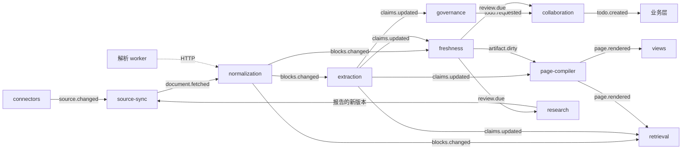

*图 12. 以事件表示的引擎流水线。每个组件只对它订阅的事件作出反应。*

| 事件 | 发布者 | 消费者 | 状态 |
| --- | --- | --- | --- |
| `source.changed` | connectors、source-sync、research | source-sync | 已构建 |
| `document.fetched` | source-sync | normalization | 已构建 |
| `acl.changed` | source-sync | access-control；collaboration（来源权限收紧待办） | 已构建 |
| `blocks.changed` | normalization | extraction、freshness、retrieval | 已构建 |
| `claims.updated` | extraction、governance、collaboration | freshness、governance、page-compiler、retrieval | 已构建 |
| `artifact.dirty` | freshness | extraction、page-compiler、retrieval | 已计划 |
| `review.due` | freshness | collaboration、research | 已构建 |
| `todo.requested` | governance；views 和 page-compiler（已设计） | collaboration | 已构建 |
| `todo.created` | collaboration | 业务层 | 已构建 |
| `page.rendered` | page-compiler | collaboration、retrieval、views | 已计划 |
| `comment.created` | collaboration | extraction、collaboration | 已计划 |
| `unit.published` | collaboration | retrieval、agent-api、业务层 | 已计划 |
| `connection.changed` | credential-broker | source-sync、collaboration、业务层 | 已设计 |
| `source.tree_changed`、`source.moved` | source-sync、发布步骤 | access-control、retrieval、normalization、业务层 | 已设计 |
| `todo.updated`、`publish_request.updated`、`decision.applied`、`member.offboarded`、`usage.recorded` | 引擎 | 业务层 | 已设计 |

只有引擎发布事件。业务组件以消费者组的方式读取它们；产品部署会增加一个订阅端点，让业务层不绑定于传输方式。

## 12. 知识模型与存储

知识分布在三层里，三层之间从不互相写入。

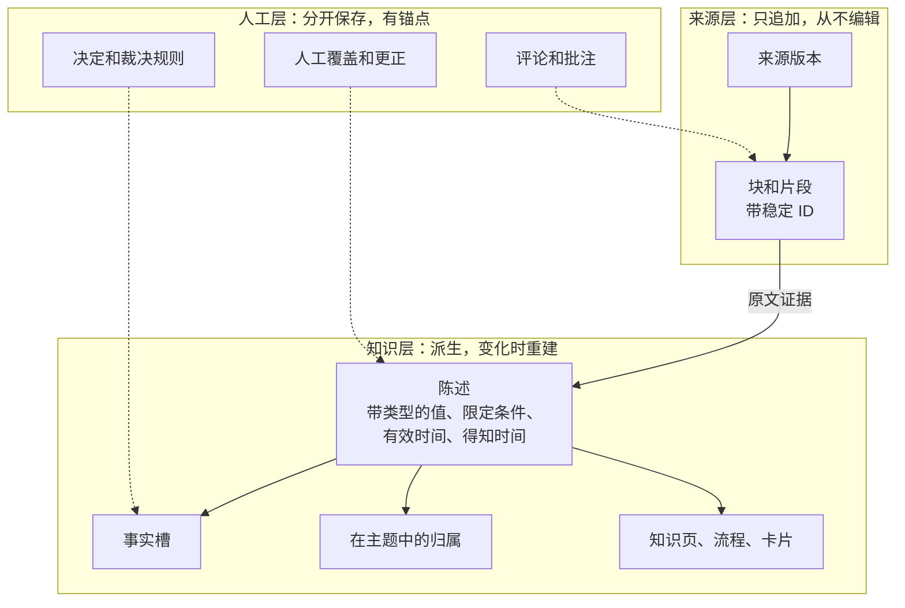

*图 13. 三层。来源层始终与来源一致；人添加的一切都在自己的层里，锚定在稳定的 ID 上。*

- **来源层始终与来源一致。** 每次同步保存一个不可变的来源版本；变化增加一个版本，删除增加一个“已删除”版本。Inspiration 内部没有任何东西编辑它。
- **知识层是派生的。** 陈述、事实槽、主题和页面由来源版本计算得出，在来源版本变化时重建。
- **人工层分开保存。** 批注、更正、决定、裁决规则以及人添加的陈述单独存储，带作者和时间，锚定在稳定的 ID 上（飞书块 ID、陈述 ID）。新版本到来时，锚点未变的批注随之移动；来源现在认同的更正自行退役；来源与之矛盾的更正让其作者收到待办；锚点已经消失的批注作为孤立批注保留在页边。所以系统永远不会以一种无人能解释的方式偏离来源。

**一条陈述的构成。** 来自通知的深圳住宿上限：

| 字段 | 值 |
| --- | --- |
| 主语、谓词 | 差旅，每晚住宿上限 |
| 值 | 每晚 650 元人民币（带类型的金额） |
| 限定条件 | 城市级别：一线；职级：经理及以下 |
| 有效时间 | 自 2026-10-01 起 |
| 得知时间 | 自读取这份通知的那次同步起 |
| 类别 | 制度 |
| 证据 | 来自通知的原文引文，带版本和片段 |
| 事实槽键 | 谓词 + 限定条件，与语言无关 |

**陈述承载知识，查询承载大规模数据。** 一条陈述不只是主语、谓词和宾语：它带类型的值、作为维度使用的限定条件（城市、职级、期间）和有效时间，让同一谓词的陈述构成一张小事实表，例如按城市和职级划分的住宿上限，而且始终带引用、受治理。这适合规则和事实，每个对象从几百条到几千条，因为每一条都可以复核。大规模的业务数据（每日销售、库存、交易）从不变成陈述：它留在自己的记录系统里，通过一个已登记、参数化的查询到达图表；这个查询由 `data_providers` 插件以该系统的权限运行，并缓存为图表引用的快照。文档里的大表，例如有几千个条目的价目表，仍然是一个可以按行引用的来源；只有当页面或回答用到某一行时，这一行才成为陈述。

| 层 | 保存 | 状态 |
| --- | --- | --- |
| 来源版本 | 一次抓取的修订版、它的哈希、敏感度和治理级别 | 已构建 |
| 块、片段 | 稳定 ID、标题路径、父级；片段按块和文本内容寻址 | 已构建 |
| 陈述和证据 | 主语、谓词、值、限定条件、类别、事实槽键、两个时间区间、原文引文 | 已构建 |
| 事实槽 | 当前的变体及其计数和代表，以及历来的每个值 | 已构建 |
| 主题和归属 | 带稳定键、状态、维护人和计数的分类节点；每条陈述一个归属 | 已构建 |
| 实体、关系 | 人员、部门、产品、供应商；每条边都有陈述支撑 | 已计划 |
| 流程、模型 | 步骤、角色、条件；假设本身是陈述的公式和决策表 | 已计划 |
| 页面 | `PageSpec` 版本，句子绑定到陈述；用于原文视图的镜像页 | 只有契约 |
| 来源节点 | 文档树：每份文档在其来源层级中的位置 | 已设计 |

知识存储执行四条规则：没有证据或推导的陈述被拒绝；证据引文必须是其片段的原文子串；陈述从不删除；页面版本不可变，并且每次加一。读取是双时态的：某个时间点上什么为真，以及系统在某个时间点上知道什么。

**存储。** 一切都在一个 PostgreSQL 16 实例里（ParadeDB 镜像，带 pgvector 和 pg_search）。每个拥有表的组件都有自己的 schema：`kb`（知识存储）、`bus`、`gateway`、`agents`、`sync`、`normalization`、`extraction`、`freshness`、`governance`、`page_compiler` 和 `collaboration`；retrieval 从 `kb` 接管索引时会有自己的 schema。SpiceDB 把它的数据库放在同一个实例上，Valkey 承载流和模型响应缓存，文件存入 blob 存储。每张 `kb` 表把完整的契约对象存在一个 `doc` 列里，只把可过滤的字段复制到带类型的列中，所以大多数契约改动不需要迁移。

## 13. 流水线与增量保鲜

1. **同步。** source-sync 列举一个来源，把每个条目的内容、元数据和 ACL 哈希与上一次比较，抓取变了的部分，并在一个事务中写入来源版本和 ACL 快照。只有权限变化时不写新版本，所以不会重新解析任何东西。
2. **规范化。** normalization 解析版本（文本格式用内置解析器，Office、PDF 和扫描件用解析 worker），构建带稳定 ID 的块和片段，与上一版比较差异，并发现重复文档。之后的每个阶段都基于这份差异工作。
3. **抽取。** extraction 只读取严格级别文档中新增和变化的块；宽松级别的文档只读取提到已知事实的块。每个窗口一次模型调用。只有引文是原文时才保留陈述；证据消失的陈述被取代，如果文档已被删除，则留给其维护人处理。
4. **治理。** governance 增量地统计每个事实槽的取值，提议有效的值，为其他值开冲突案例，并为每个事实槽发出一条待办请求。目前它是确定性的；针对没有事实槽的陈述，语义层级和模型裁判层级之后加入。
5. **保鲜。** freshness 维护复核时钟，每天为已到期的内容发布一次 `review.due`。它不调用模型，也不修改知识，所以模型故障或预算耗尽都不会让它停下。
6. **组织和编译。** page-compiler 为严格级别文档的小节生成向量，把陈述放进主题，并在变化预算内重新聚类。接下来，它为受众编写带引用的页面和图示，并为每个版本保存快照。
7. **询问人。** collaboration 是唯一创建待办的组件：它合并请求，分派给维护人，并按周归入卡片。
8. **服务。** retrieval 为块、陈述和页面建索引，并为网页应用和 Agent API 提供搜索和回答。

**为什么增量可行。** 块有稳定的 ID，每个阶段都消费块差异，所以一次典型的编辑只涉及少数几个块。重新抽取得到相同的陈述时，后面什么都不会改变。引擎自身引起的变化，例如新的提示词或模型，在值不变时保持静默；值变了时进入评测，而不是进入待办箱。

## 14. 治理引擎

| 类型 | 例子 | 由谁决定 |
| --- | --- | --- |
| 编辑冲突 | 两个人编辑同一段 | 在草稿中实时合并 |
| 覆盖冲突 | 人的修改是 500，来源现在是 600 | 修改的作者 |
| 同一范围内的知识冲突 | 两个来源对一个价格的说法不同 | 该范围的维护人（默认单人） |
| 跨范围的知识冲突 | 财务说 X，销售的流程说 Y | 每位受影响的维护人（默认全员）；截止日期之后由空间维护人决定，跨空间时由超级管理员指定的一位维护人决定 |
| 断言冲突 | 一条评论陈述的事实与已核实的陈述矛盾 | 该范围的维护人 |

- **引擎提议一个值，并说明理由。** 对每个事实槽，治理提议当前有效、最权威的值，除非之后某条带日期的陈述改变了它（“自 2026-10-01 起上限为 650 元”）。被已归档文档明确取代的情况，不需要人就能处理。
- **一个触发，一条待办；一个原因，一次审阅。** 关于同一事实槽或同一文档的请求合并成一条待办，交给它所在主题的维护人；没有时交给上方最近的维护人，再没有时交给空间维护人。一个会产生 20 条以上待办或涉及 3 个以上主题的原因，成为一次批量变更审阅，交给覆盖它的最小范围的维护人，整体决定，每一项仍留记录。连接问题交给超级管理员，因为它们不是知识变化。
- **每周待办卡片。** 一位维护人在一周内关于同一主题的待办共用一张卡片，每张最多 20 项。每位维护人每周最多 10 张卡片；其余的顺延到下一个有空位的周，紧急的除外。备注单独成卡，不计入预算。副本的复核附在引起它们的冲突卡片上。
- **联合审批总会结束**（图 5）。每个策略都有审批方式、截止日期（跨范围默认 5 个工作日）和兜底裁决人。在人做决定期间，读者和 Agent 看到的是标为“有争议”的最近一次核实的值（默认）、两个值都显示，或者什么都不显示，由企业选择。
- **每个决定都是一条记录。** “为什么是这个值？”会显示谁、在何时、依据什么做出决定。一个决定可以成为裁决规则，治理会把它用于同类的新冲突，并每周报告。
- **维护人必须能读到自己的整个范围**，否则只能判断半个冲突。维护人读不到时，控制台会提醒，这样的冲突交给备份维护人或兜底裁决人。

## 15. 权限

引擎根据业务层开通的副本，自己做出每一个权限决定。

- **两个域。** 成员域是每位成员的“我的空间”：只有该成员能读，超级管理员也不能，任何租户或管理关系都伸不进去。租户域是所有共享空间。知识只能通过发布进入租户域，跨越边界的东西从不合并或比较。
- **SpiceDB 保存租户、成员、群组、部门和空间**，以租户为键。陈述、页面和流程不写入 SpiceDB。共享空间的角色（`viewer`、`commenter`、`editor`、`steward`、`owner`）自上而下授予，并沿空间树向下继承。
- **空间可读，且敏感标签不高于读者的许可级别时，单元可读。** 标签有 `public`、`internal`、`confidential` 和 `secret`。
- **陈述还需要一个读者能读的依据。** 依据说明一条陈述为什么成立。它要么是来自读者可读空间中某份文档的证据引文，要么是一个推导（由其他陈述计算出的陈述），且读者能读它的所有输入。两份都写明深圳上限的文档是可替代的依据：有一个就够。由销售价格和财务成本算出的毛利需要两者都可读：看到了毛利和价格的人，就能算出成本。

**汇编知识为它的受众而写**（提议）。页面、流程、主题摘要和回答会组合多个空间的陈述。按读者删减会扭曲原意，因为一个输入受限就屏蔽则既不可用、也会被滥用。这个设计用六条原则同时守住两个承诺：受众由人设定，从不由输入决定；为受众而写，从不按读者删减；改变意思的省略需要人来决定；告诉读者，不误导读者；`secret` 材料留在自己的空间里；可替代的依据只会增加可见性。

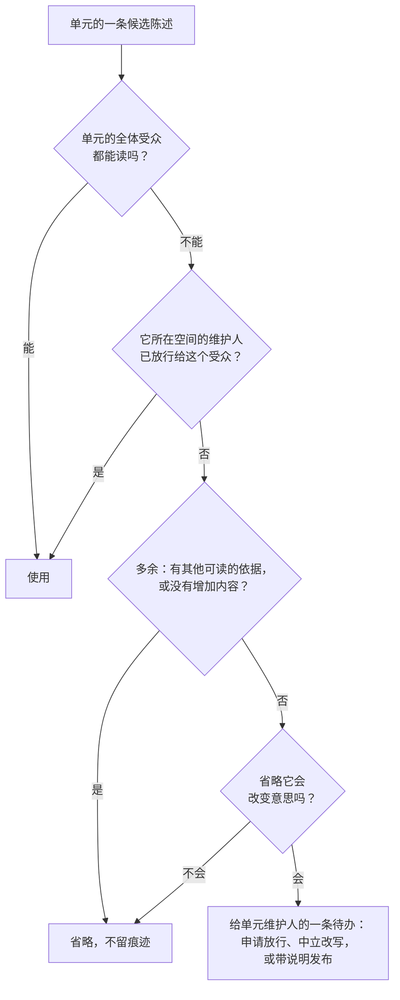

*图 14. 编译器如何处理每个输入。`secret` 输入在它自己的空间之外从不进入这个流程；如果它与某个单元矛盾，待办发给该机密空间的维护人。*

- **省略检查。** 省略一个输入会改变意思，是指它为单元用到的事实槽给出了不同的值、取代了单元所说的内容、增加了条件或例外，或者论述了某个观点的另一面。前三种不需要模型调用，从知识模型就能得出；最后一种需要模型任务 `page_compiler.check_omission`，原型里有确定性的模拟实现。
- **按陈述放行。** 一次放行把一条陈述开放给一个受众，记录谁、在何时批准，并成为该受众能读的依据。证据引文默认不随之开放，除非放行时一并包含。之后的变化会让批准人收到一条待办，决定保留还是撤回。
- **回答**是为一位提问者、用这位提问者能读的内容写成的。如果提问者读不到的材料会改变回答，在 `internal` 和 `confidential` 级别，回答会说明它可能不完整以及可以问谁；对于 `secret` 材料，它什么也不说。
- **按读者的安全网**只作用于完整的条目（一篇文档、一个块、一行、一条搜索结果），从不作用于行文中的字句。当它不得不去掉一个段落时，单元会按这位读者的可读空间集合重新编译，并为共享同一集合的所有人缓存。流程要么完整，要么不给。
- **在要紧的地方隐藏存在。** 不可读的空间从不出现在树、搜索、计数或图里；当陈述还有其他依据时，指向读者读不到的空间的引用会被去掉，不留标记。
- **共享的回答缓存**以可读空间和许可级别为键；当它用到的单元改变标签、依据或授权时，缓存条目被丢弃；用到只因读者自己的授权才可读的单元的回答，从不共享。
- **搜索在索引内部过滤**可读空间和敏感度，每个靠前的结果在离开服务器之前再检查一次。
- **来源 ACL 只作参考。** source-sync 保留 ACL 快照，只用于受众差异提醒和来源权限收紧待办。
- **目前已构建**：基于 SpiceDB、以租户为键的主体的 access-control，来源 ACL 镜像，搜索范围过滤和一致性令牌，以及一个接受任意一个可读来源的来龙去脉遍历。这对可替代的证据是对的，对共同必需的输入则过于宽松；目前已构建的部分还不会写入这种推导。用空间和依据规则替换它，是 access-control 的下一个改动。

设计、滥用场景和八个验收测试见[汇编知识的权限](design/compiled-knowledge-permissions.md)。

## 16. 身份、租户与请求路径

- **三种 ID。** 租户 `ten_`、用户 `usr_`（账户，只在业务层）和成员 `mem_`（一个租户里的一位用户，是引擎唯一的人员 ID）。成员 ID 只在其租户内唯一，所以在租户自己的行之外保存成员 ID 的地方，都要连同租户一起保存。tenancy 组件中的一个函数分配成员 ID；任何地方都不从一种 ID 推导另一种。
- **一条验证路径。** 每次调用都带一个业务层签名的 JWT：成员、租户、主体类型、Agent 所代表的成员、授权范围、可选的空间和敏感度上限、会话的登录方式，以及界面 `locale`。网页令牌最多有效 5 分钟，OAuth 访问令牌 10 到 15 分钟。引擎用公开的密钥验证它们，从不看到用户 ID 或身份提供方的令牌。

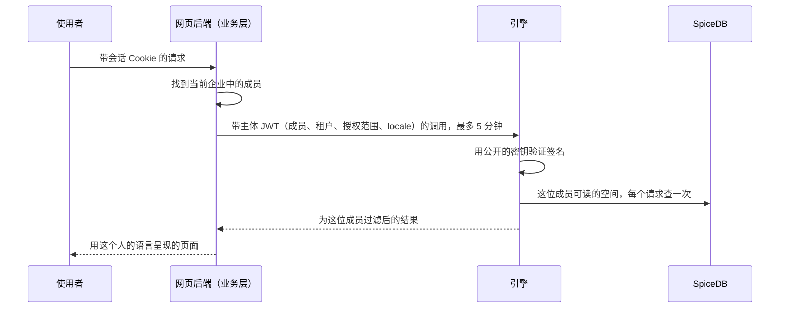

*图 15. 请求只携带一个短期的签名主体。引擎自己检查权限。*

- **开通命令是幂等的**（幂等键，目录对象带版本），并返回 SpiceDB 的一致性令牌，让下一次读取能看到变化。每晚的目录快照修复偏差，每小时的摘要检查在两次之间发现偏差。
- **契约只在一个地方。** 这个仓库中的 JSON Schema 是两层共同的事实来源；只属于业务的类型放在自己的文件夹里，引擎包从不导入。

## 17. 连接器、凭据与沙箱

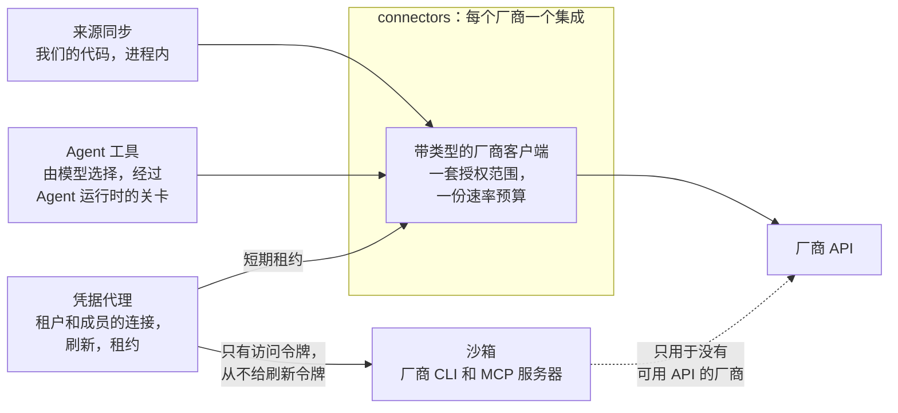

*图 16. 同步和 Agent 工具共用一个厂商集成和一个凭据代理；只有不是我们写的代码才在沙箱里运行。*

- **每个厂商一个集成，同时服务同步和 Agent 工具。** 两者面对同样的问题：调用用谁的身份、租户和成员之间的隔离、令牌刷新、速率限制、同意、撤销和审计。所以每个厂商（先是飞书）只有一个带类型的客户端，每个连接一套授权范围、一份速率预算。同步用它跟踪变化；注册为 `agent_tools` 插件的 Agent 工具用它搜索、读取和提议。撤销一个连接会同时停止两者。交互式的工具调用在速率预算中有保留份额，所以大规模同步永远不会让它们得不到额度。
- **两者遵循同样的身份规则。** 同步使用发布时选定的连接。Agent 工具总是以它所服务的成员身份、用该成员自己的连接行事；企业连接从不租给 Agent 运行。
- **信任不同，执行方式也不同。** 同步是我们自己的确定性代码，在进程内运行。工具调用由模型根据可能含有恶意的内容选择，所以要经过 Agent 运行时的关卡：允许的操作、经过校验的参数、除非成员要求修改否则只读取或提议，以及每次调用一条审计记录。不是我们写的代码（例如 lark-cli 这样的厂商 CLI，或厂商的 MCP 服务器）只在沙箱中运行，拿到短期访问令牌，从不自己刷新令牌，因为飞书的刷新令牌只能用一次，第二个刷新者会让连接失效。
- **持有凭据的人都可以导入**（2026-10-26 决定）。如果一个人能登录飞书、钉钉、企业微信或某个 OA 系统，那个系统的管理员已经允许这个人阅读这些内容。在这里拦截连接并不构成安全边界：同样的内容可以通过任何第三方导出再导入，而且来源再也无法识别。对成员的管理在上游进行，通过来源系统的权限和凭据。已验证的邮箱域名保留，只用于自动加入企业。
- **凭据代理拥有每个连接及其密钥。** 连接属于租户（企业的应用，用于共享空间）或属于成员（成员自己的登录）。密钥用每个租户的数据密钥做信封加密；密钥加密密钥在原型里是部署密钥，在产品里是 OpenBao Transit 或客户的 KMS（需要时用 SM4）。刷新是主动的，每个连接单路执行，并有每日保活。刷新失败时，连接被标记为需要重新授权，其来源暂停，连接的持有方收到一条待办。
- **沙箱每个任务运行一个容器**：只读根文件系统、没有卷、出站流量经过白名单代理、从不跨租户共享、任务之间不保留任何东西。原型用 Docker 加 gVisor，产品用 Kata Containers 或 Firecracker。它的配置包括厂商 CLI 和 MCP 服务器，以及视图渲染检查。

## 18. 模型与 Agent

- **每一次模型调用都经过模型网关**，包括补全、向量、重排和 OCR，研究用的 `web_search` 已在计划中。一次调用要写明它的任务（`<component>.<verb_object>`，例如 `extraction.extract_claims`）、预算键（`tenant:<id>/<component>`）以及内容的最高敏感标签。网关拒绝把内容发给未获准处理该标签的服务商。
- **提示词是带版本的文件。** 版本是每个产物输入哈希的一部分，所以提示词或模型一变，就能准确知道要重建什么、代价多少。
- **在配置真实模型之前，每个模型任务都附带一个确定性的替身**（`model_mocks` 插件），由假的服务商用它作答。在模拟模型上测得的数字描述的是流水线，而不是模型质量。
- **Agent 运行时**运行每个内置 Agent：一个名为 `<component>.<agent>` 的 `AgentSpec`，效果为读取、提议或（应成员请求）修改的工具，步数和 token 限制，审批关卡以及运行轨迹。工具选择使用 OpenAI 兼容 API 上受 schema 约束的输出，所以更换模型不会改变 Agent。
- **内置 Agent**：评论助手、问答助手、治理 Agent、流程撰写、发布检查、视图生成和研究 Agent。
- **Agent 何时可以修改知识**（2026-10-26 决定）。自主运行时（在后台、按计划或由事件触发），Agent 只读取或提议。当成员在对话或评论中明确要求修改时，这个请求就是批准：在成员可以编辑的地方，Agent 直接修改，修改记录在成员名下，标明由 Agent 完成，并且可以撤销。在成员只能提议的地方，Agent 提出提议。

**Agent API。** 一个遵循当前规范的无状态 MCP 服务器，放在普通负载均衡器后面，REST 和 OpenAPI 由同一份操作 schema 生成。业务层是 OAuth 授权服务器；引擎是资源服务器，检查令牌的受众，从不转发客户端的令牌。MCP 客户端用 OAuth 和 PKCE 登录，CLI 用设备授权流程，企业 Agent 由超级管理员注册。

**授权范围按调用对知识做了什么来划分**，采用常见的 `resource.action` 形式：`knowledge.read` 没有副作用；`knowledge.propose` 创建一个需要经过审批的提议；`knowledge.write` 以成员自己的权限直接修改，如上所述；`comments.write` 写入讨论，讨论本身不是知识。Agent 的权限总是成员的权限再按它的授权范围和空间收窄。

**工具**（2026-10-27 提议，取代十个工具的初稿）。Agent 按名字和描述选择工具，所以工具按 Agent 想做的事来划分，而不是按我们知识模型的形状。由引擎在一次调用内部决定用陈述、流程、实体还是段落来回答。

| 工具 | 何时使用 | 主要输入 | 主要输出 | 授权范围 |
| --- | --- | --- | --- | --- |
| `ask` | 有一个问题，或有一句话要核对 | `question` 或 `claim`、`spaces`、`max_tokens` | 每句带引用的回答，并说明冲突、证据不足或可能不完整；对一句话则给出支持、矛盾或无依据，附证据；以及可继续读取的句柄 | `knowledge.read` |
| `search` | 要查找或列出材料 | `query`、`types`、`spaces`、`exclude_states`（例如 stale、superseded）、`limit`（默认 10，最多 50）、`cursor` | 命中：句柄、类型、上下文标题、约 80 个 token 的摘录、读者状态、空间、整个条目的 token 估算；从不返回全文 | `knowledge.read` |
| `read` | 手里有句柄，要看它背后的内容 | `id`（页面、章节、流程、卡片或段落）、`outline` 和 `depth`、`max_tokens`、`cursor` | 每句带引用的内容，或带每节 token 估算的标题树；相关的卡片和页面以句柄给出；在预算处截断，并给出继续用的 `cursor` | `knowledge.read` |
| `get_changes` | 要让一份副本、缓存或索引保持同步 | `since`（上一次的 `cursor`）、`spaces`、`types` | 新增、变化和被取代的条目，以及新的 `cursor` | `knowledge.read` |
| `report_feedback` | 某个结果有错、过时或缺失 | `target`、`kind`（wrong、outdated、missing）、`note` | 给该范围维护人的一条待办 | `comments.write` |

- **初稿里的工具去了哪里。** `get_outline` 和 `get_sop` 是对页面或流程的 `read`；流程以前提条件、步骤、执行角色和例外返回，不超过约 2,500 个 token。`get_entity` 和 `graph_neighbors` 是 `read` 返回的卡片和链接。`verify_claim` 是带一句话的 `ask`，`answer` 就是 `ask`。
- **和界面相同的权限规则。** Agent 能读的，是成员可读的空间和许可级别，再按 Agent 的授权范围和注册的空间收窄。“无权限”和“不存在”返回同样的 `not_found`。
- **统一的响应信封。** 每个结果都带来源、版本、读者状态、置信度、复核状态和 token 估算；每个响应带一个一致性令牌，Agent 回传它就能读到同一个版本。
- **为 Agent 设计。** 先提问或搜索，再读取：回答和命中都返回句柄和估算，由 Agent 在自己的预算内决定读什么。句柄稳定，在每个工具中都可用。每个结果都说明下一步（“完整流程请 read 这个句柄”），拒绝或截断会说明该用哪个 `cursor` 或参数。每个工具都无状态，读取类工具是幂等的。
- **靠测量，不靠推断。** 在 API 定下来之前，用同一组任务、几种模型，分别跑这组工具和初稿的十个工具，比较完成的任务数、调用次数和 token 用量。
- **仍未决定**：`search` 默认是否把块和陈述放在一起排序，以及 `ask` 内部的模型调用由谁的预算支付。

## 19. 页面、视图与搜索

页面和视图的契约已经就位；编译器、视图宿主和检索已在计划中。

**从文档到知识**（2026-10-27 决定）。人们先看到的是自己的材料。导入之后，来源以镜像页面打开：文档保持它自己的样子，标题、段落、列表和表格都在，即使不完全一样也接近原文，就像 Claude Artifact 呈现页面那样。知识从这里一步步展开，从具体到抽象：先是批注视图里的标记，然后在选中一段话时打开“这段讲了什么”面板（这段话说了什么、哪些其他文档与它一致、不同或有补充，以及用到它的页面），最后是由它构建的知识页。新来的人从自己的文档开始，而不是从知识卡片开始，文档树排在知识树上面。界面原则把这叫作“先具体，后抽象”，设计画布画出了它。共享空间的读者止步于标记和页面，因为陈述和来龙去脉属于追溯视图；成员是自己“我的空间”的维护人，所以在那里可以打开追溯视图。

- **页面是一个 `PageSpec`**：由 14 种带类型的块（标题、段落、列表、提示框、引用、表格、代码、公式、图片、分隔线、图示、图表、视图、嵌入）组成的有序列表，句子带陈述 ID。每个版本都是带变化原因的不可变快照，块键保持稳定，所以评论能在重建后保留，差异也能说明什么移动了。
- **页面为它的受众而写**，只用它全体受众都能读、或已放行给受众的陈述（第 15 节）。只有受众能读每一步时，流程才会发布。之后空间收窄时，页面会作为新版本重新编译。
- **图示从结构编译而来**：模型选择展示什么，但从不画连线。
- **图表**的数据来自 `DataRef`：内联的行、陈述（固定的或按查询）或已连接系统的已登记查询，从不使用自由 SQL。由陈述构建的行保留它们的陈述 ID。
- **交互视图**把代码和数据分开。一个视图版本是一个模板或生成的代码，要通过无头渲染检查（控制台错误、手机和桌面宽度下的溢出、两种主题、空数据和大数据）以及一个人的批准。它在独立源上的 iframe 中运行，内容安全策略阻止一切网络访问，只通过带类型的消息协议与宿主通信。
- **镜像页**不用模型、直接从块渲染原文视图，每个块标明保真度（精确、近似，或一个写着“在来源中打开”的占位符）。
- **retrieval 拥有每一个搜索索引**：带上下文标题、感知结构的文本块，向量，以及块、陈述、流程和页面的 BM25 与向量索引。搜索是混合的，用倒数排名融合和重排器，并按可读空间和敏感度预过滤。每个引用带一个读者状态（fresh、aging、stale、at risk、superseded、disputed），界面把它映射为读者看到的四个词。
- **引用从不等待抽取。** 引用基于片段。宽松级别的段落第一次被引用时，retrieval 请 extraction 在后台完整读取它（模拟模型下中位数 13 毫秒）。

## 20. 国际化

| 位置 | 设计 | 状态 |
| --- | --- | --- |
| 契约 | 文档、解析提示、陈述、页面和视图消息上带 `Locale`（BCP 47）；事件和待办携带代码和参数，从不携带句子；主体令牌携带界面 `locale` | Locale 已构建；其余已设计 |
| 语言包 | 句子和从句规则、全角形式、数字格式和标题模式放在按语言划分的资源文件里（en、zh、ja），由仓库测试检查 | 已构建 |
| 规范化 | 按文档和按块检测语言 | 已设计 |
| 抽取 | 提示词写明来源语言；引文保持原文；日期、年号、大数单位和货币变成带类型的值 | 已设计 |
| 事实槽 | 与语言无关的谓词和限定条件键，每种语言有标签和别名；实体名称跨文字体系解析 | 键和带类型的值已构建；其余已设计 |
| 陈述 | 译文关联到原文并与之算作一体；陈述在模型检查后跨语言合并 | 已设计 |
| 检索 | 多语言向量（Qwen3-Embedding）；每种语言一个分词器的 BM25（jieba、日文形态素分词器、英文词干） | 已设计；知识存储中已有 jieba 索引 |
| page-compiler | 页面结构只构建一次；规范版本使用空间的内容语言，其他语言按需从同一批陈述编译 | 已设计 |
| 业务层 | 账户语言、企业的广播默认语言、ICU MessageFormat 目录（缺少字符串时构建失败）、本地化登录、每个租户一个区域 | 已设计 |
| 界面 | en、zh-Hans 和 ja 的目录；每个块带语言标签；按文字体系选择字体；本地化格式和排序；输入法规则；伪语言测试 | 已设计 |
| 仓库 | 代码和注释中没有中文或日文；文档用英文写，并在 `docs/zh/` 下有中文副本 | 已构建（仓库测试） |

## 21. 可行性：哪些已经证明，哪些没有，如何查明

原型有意运行在模拟模型上：它证明的是流水线、数据量和边界，而不是模型质量。下面每个难点都说明今天的证据是什么，以及什么能给出定论。如何在真实文档上验证知识核心，包括通过标准、普通 RAG 基线和会改变设计的结果，见[验证知识核心](design/validation.md)。

| 难点 | 目前的证据 | 尚未证明 | 如何查明 | 如果达不到 |
| --- | --- | --- | --- | --- |
| 带原文证据的陈述抽取 | 存储层强制执行引文检查；抽取在模拟模型上端到端运行 | 真实模型在真实文档上的质量和召回 | 一次有上限的探测，然后是 G1 评测（蕴含率不低于 95%） | 治理级别把抽取限制在严格级别文档；低置信度的陈述按宽松处理 |
| 跨文档的事实槽 | 合成租户上 59% 的陈述落入事实槽；带类型的值已构建 | 真实的谓词和限定条件有多分散 | 在一个真实的制度库上运行探测；维护人确认谓词目录 | 没有事实槽的陈述按页面小节分组，照样被引用 |
| 人能维护的主题 | 没有陈述无故移动；首次复核专项可用 | 真实向量下的主题大小（假向量让主题大了约十倍） | 用 Qwen3-Embedding 重新测量 | 追溯视图按每个主题约 1,000 条陈述设计；维护人可以拆分主题 |
| 复核负担 | 模拟一年中，每位维护人每周卡片中位数 1、最多 4 | 真实的冲突率和维护人的行为 | G1 的冲突精度；G2 的每周活跃维护人 | 治理级别、每周预算、裁决规则和批量变更审阅 |
| 规模化的增量保鲜 | 10,000 份文档：同步 72 秒，处理完 535 秒；175 次编辑只有 1 次问人 | 真实飞书企业中的变化模式、Webhook 和速率限制 | 试点企业 | 每晚的全量列举能补上推送和轮询漏掉的 |
| 不泄露、也不空白的权限 | SpiceDB 检查、范围过滤和一致性令牌已构建；汇编知识的设计有八个验收测试 | 省略检查的精度，“另一面”需要模型判断 | 一套平衡论证和滥用场景的评测集；红队 | 四种触发中有三种不需要模型；“带说明发布”始终可用 |
| 回答和 Agent 效率 | 契约已就位 | 检索质量和每个任务的 token | 与只用文本块的基线比较 Recall@10 和每个任务的 token（G1、G2） | 带重排的混合搜索；工具先返回句柄再返回文本 |
| 跨语言的知识 | 语言包和与语言无关的键已构建 | 跨语言的漏合并和错合并 | 三种语言的评测语料 | 未合并的陈述保持为重复，从不成为虚假冲突 |
| 解析 Office、PDF 和扫描件 | 内置文本解析器 | 吞吐量和版面质量，尤其是在国产加速卡上 | 试点早期在客户硬件上对 Docling 和 PaddleOCR-VL 做基准测试 | 带置信度升级的路由；写着“在来源中打开”的占位符 |
| 生产环境中的飞书和 Lark | 连接器基于录制的测试数据构建；单路刷新已设计 | 真实企业上的速率限制和令牌刷新 | 试点企业 | 为交互式调用保留速率份额；重新授权待办 |
| 模型成本 | 有治理级别时 10,000 份文档 5.6k 次模型调用，没有时 10k 次 | 真实模型上每份文档的 token 和费用 | 在探测中测量 | 治理级别、按需抽取、响应缓存和 flash 级模型 |
| 中国的合规 | 已知要求：生成式 AI 备案、ICP 许可证、等级保护 | 认证所需时间 | 在 G3 之前开始备案 | 受监管的客户先用私有化部署 |

## 22. 我们如何构建

- **契约优先。** `libs/contracts/schema/*.yaml` 是事实来源；类型和校验器由它生成。在分支里做增量改动没问题；任何删除、重命名或收紧字段的改动都要先达成一致。见 [contracts.md](contracts.md)。
- **边界靠检查，不靠信任。** 一个包放在它所在层的文件夹里，只依赖基础库和它 `calls` 中的组件；层与层之间的依赖只朝一个方向。
- **通过注册表使用插件。** 连接器、Agent 工具、解析器、图示编译器、索引后端、数据提供者、模型服务商、模型替身、视图模板和迁移，都按名字注册到固定的插件组。新来源或新模型是一个新插件，而不是核心改动。
- **在两种后端上测试。** 单元测试使用内存替身；有 Postgres、Valkey 或 SpiceDB 实现的代码，对真实服务运行同样的测试。`make check` 在服务启动的情况下运行 Biome、严格 `tsc`、契约新鲜度检查和全部测试。
- **一个演示租户和一个规模生成器。** `examples/corpus` 是青禾科技，埋有重复和冲突；`pnpm engine synthesize` 生成任意规模的合成租户，`pnpm engine ingest` 输出规模报告。
- **每个改动都通过拉取请求合入。** 产品负责人本地的 Codex 评审它；修复发现的问题后合并。正确性第一，然后是分层、清晰的组件边界和明确的契约。
- **名字描述事物做什么。** 代码、文档和事件中没有计划编号。[AGENTS.md](../../AGENTS.md) 是给任何构建组件的人或 Agent 的完整规则。

**技术栈。**

| 关注点 | 原型 | 产品 |
| --- | --- | --- |
| 语言 | 全部用 Node 22 上的 TypeScript；只有文档解析用 Python worker | 相同；只有需要单一二进制的部分用 Go |
| 数据库 | PostgreSQL 16 | PostgreSQL，或通过一个窄的 SQL 子集支持人大金仓和 openGauss |
| 搜索 | pgvector 和 ParadeDB pg_search | Milvus，或在客户自己运行时用 Elasticsearch 或 OpenSearch |
| 权限 | SpiceDB | SpiceDB，加上一个处理标签的策略引擎 |
| 队列 | Postgres 发件箱和 Valkey Streams | NATS JetStream 或 Kafka |
| 模型 | 现在是带模拟的假服务商；接下来是一个 flash 级模型（在中国用国产模型）、Qwen3-Embedding 和 Qwen3-Reranker | 按区域和敏感度在 vLLM、SGLang 和 MindIE 之间路由 |
| 解析 | 一张 GPU 上的 Docling 和 PaddleOCR-VL | 带置信度升级的路由 |
| 身份 | 通过 OIDC 适配器接入 Logto | Logto、Keycloak，或客户自己的身份提供方 |
| 密钥 | 在部署密钥下做信封加密 | OpenBao Transit，或客户的 KMS 或 HSM |
| 沙箱 | Docker 加 gVisor | Kata Containers 或 Firecracker，带预热池 |
| 部署 | 单节点 Docker Compose | Helm、离线安装包、amd64 和 arm64 |

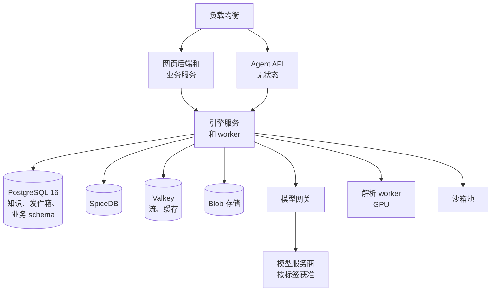

*图 17. 一个 SaaS 区域。每个企业的数据留在创建企业时选定的区域。*

- **一套代码，两种部署形态。** SaaS 优先：企业的区域在创建时确定，先开中国大陆和一个全球区域。在中国大陆提供公有 SaaS 需要生成式 AI 备案、ICP 许可证和等级保护。私有化部署是第二种形态，以国产化基础设施（麒麟、鲲鹏或海光、人大金仓、昇腾）为认证目标。
- **许可证。** pg_search 是 AGPL-3.0；BM25 放在插件接口后面，客户需要时可以换成 OpenSearch 索引。使用 Valkey（BSD）而不是 Redis。见 [licensing.md](licensing.md)。

## 第三部分 计划

## 23. 现在到了哪里

**已构建并合入 `main`**：契约、kernel、事件总线、测试工具包、知识存储、访问控制、模型网关、Agent 运行时、连接器、来源同步、规范化、抽取、治理、保鲜、按租户划分的成员 ID，以及引擎进程及其 CLI、演示语料和合成器（PR #2 至 #7）；治理级别、事实槽键和按需抽取、主题和归属，以及待办箱（PR #8 至 #10）；en、zh 和 ja 的语言规则放入资源文件，并有一项防止代码中出现中文和日文的仓库测试（PR #12 和 #13）；按层分文件夹的迁移（PR #15）；设计文档（PR #11 和 #14），以及这份作为产品需求和技术架构的总览（PR #17）；尚未生效的陈述给出的值不带权威（PR #16）；每个案例只有一个正确答案的对照语料，并记录引擎已知的差距（PR #18）；在 `components.yaml` 中写明谁负责厂商集成、工具关卡和沙箱（PR #19）；界面的快照（PR #20）；以及代码仓库的设计（PR #21 至 #23）。

**测量结果**来自一个 10,000 份文档的合成租户，使用模拟模型和假向量（Postgres 和 Valkey）。这些数字描述的是数据量和流水线，而不是模型质量：

| 指标 | 数值 |
| --- | --- |
| 严格 / 宽松 / 仅检索的文档 | 1,366 / 5,530 / 3,104 |
| 抽取的陈述（引入治理级别之前） | 39.9k（137.8k）；合并后 17.5k |
| 落入事实槽的陈述 | 59% |
| 模型调用（引入治理级别之前） | 5.6k（10k） |
| 冲突待办 | 30（28 条普通，2 条高优先级） |
| 需要问人的来源更新 | 一轮编辑中 175 次有 1 次 |
| 主题数；每个主题的陈述数，中位数 / 最大值 | 41；1,143 / 6,206 |
| 第二次重新聚类 / 一轮编辑之后更换主题的陈述 | 25,660 条中 0 条 / 25,683 条中 0 条 |
| 每位维护人每周的待办卡片，中位数 / 最大值（15 位维护人，模拟一年） | 1 / 4，有没有 10 张的预算都一样 |
| 第一天的逾期复核 | 605 条，分布在 44 张首次复核专项卡片上 |
| 宽松段落第一次被引用（模拟） | 中位数 13 毫秒 |
| 导入时间（含主题） | 同步 72 秒，处理完 535 秒 |

主题比约 100 条陈述的设计目标大了约十倍，因为合成租户在许多文档中反复陈述 30 个对象，而假向量无法区分这些小节。预算从来不需要压下任何一条待办，因为按维护人、主题和周分组已经让每位维护人都在预算之内。

**已设计、未构建**：双域权限规则和主体令牌、发布、汇编知识的权限、凭据代理和沙箱、文档树和镜像页、页面和视图、检索和 Agent API、研究、解析 worker、来源删除和批量变更审阅、跨语言的知识、代码仓库作为来源（提议中），以及整个业务层和界面。

## 24. 下一步与工作量

规则是：在每个阶段都端到端跑通之前，模拟所有模型调用，然后才接入真实模型。剩余阶段的建议顺序，供讨论：

1. **业务契约在引擎一侧的实现**：主体令牌、开通和种子命令、access-control 中的空间和依据规则，以及事实槽和冲突上的域键。
2. **来源的页面和视图**：为受众合成带引用的页面、`PageSpec` 快照和差异、带 `artifact.dirty` 的依赖图、镜像页和文档树。
3. **搜索和 Agent**：有自己索引的 retrieval、有依据的回答、主题概览读取，以及带这些工具的 MCP 服务器。
4. **连接和解析**：凭据代理、成员连接、解析 worker。
5. **研究、视图和沙箱。**
6. **业务层第一阶段和网页应用**，契约就位后并行进行。

| 范围 | 人周 |
| --- | --- |
| 引擎原型：19 个引擎组件和网页应用 | 70 |
| 知识视图（原文、批注、文档树、拆分的引用面板） | 6 |
| 流水线边界（网页连接器、`fetch_now`、`web_search`、证据登记） | 2 |
| 规模化的陈述（治理级别、事实槽、主题、分组复核） | 7.5 |
| 业务层第一和第二阶段 | 16 |
| 业务边界的引擎工作（净增） | 4.5 |
| 国际化（引擎 3.5，界面 3，业务 0.5） | 7 |
| 来源变化（删除、移动、批量变更审阅） | 3 |
| 跨语言的知识（译文、跨语言合并、其他语言的页面） | 3.5 |
| 汇编知识的权限（为受众而写、省略检查、放行） | 3 |
| 代码仓库（code-graph、对代码的研究；提议中） | 8.5 |
| **合计** | **约 131** |

之后，试点和产品 v1 中 Artifact 级编辑的工作（模板、Word 和 PDF 导出、块编辑器、实时协同编辑、视图宿主 API、移动端、分享链接）约 19 到 27 人周，计费约 3 人周。原型的前七个阶段由 Agent 在两天内构建完成，所以日历时间更多取决于评审和集成，而不是这些数字。

## 25. 风险

| 风险 | 影响 | 缓解 |
| --- | --- | --- |
| 抽取错误获得虚假的权威 | 给人和 Agent 错误的回答 | 原文引文、蕴含检查、置信度阈值、治理级别 |
| 发布时过度共享 | 一份受限文档变得整个空间都能读 | 受众差异提醒、敏感信息和个人数据扫描、维护人批准、来源权限收紧待办、审计 |
| 省略误导读者 | 页面只呈现争论的一面 | 省略检查、给读者的说明、按陈述放行 |
| 复核疲劳 | 维护人忽略待办箱 | 治理级别、按主题和周分组、每周预算、批量变更审阅、预算外的备注、把队列精度作为产品指标 |
| 主题变动和大小 | 主题太大或太不稳定，无法维护 | 稳定的键、每次运行的变化预算、维护人确认；用真实向量重新测量 |
| 人的修改在重建时丢失 | 失去信任 | 独立的人工层；重建从不改写的固定人工覆盖；改为待办 |
| 跨语言匹配 | 两种语言中的同一事实被漏掉或被错误合并 | 与语言无关的键、每种语言的别名、译文关联原文、任何合并前的模型检查、三种语言的评测语料 |
| 套件捆绑类似功能 | 丢掉只用单一套件的客户 | 以跨工具治理和受治理的 Agent 端点为主打 |
| 国产加速卡上的模型吞吐 | 首次建索引慢 | 试点早期在客户硬件上做基准测试 |

## 26. 现行决定

| 决定日期 | 决定 |
| --- | --- |
| 2026-10-22 | 产品名 Inspiration；Artifact 级的页面呈现是承诺的范围；能力优先，通过 MCP、REST 和 CLI 验收 |
| 2026-10-23 | 除 Python 解析 worker 外全部用 TypeScript；描述性的组件名；每个改动都通过 PR，由产品负责人本地的 Codex 评审 |
| 2026-10-23 | 先做每个阶段都端到端的模拟原型；原型跑通之后才接入真实模型；引擎和界面基于测得的数据量一起迭代 |
| 2026-10-24 | 三种 ID：租户、用户（账户）和成员 |
| 2026-10-24 | 两个知识域：“我的空间”私有，共享空间自上而下治理；来源权限只提醒；发布移动知识；凭据只决定保鲜 |
| 2026-10-24 | 规模化的陈述：两份大纲、治理级别、分组复核；上传默认为宽松；每周预算 10；宽松从不阻塞严格级别的陈述 |
| 2026-10-24 | 引擎与业务层分离；Logto 作为身份提供方；SaaS 优先，私有化部署作为第二种形态；离开时锁定“我的空间”，30 天后清除；审批人只看到申请中的条目 |
| 2026-10-24 | 连接器基于厂商 API，厂商 CLI 只在沙箱中运行，凭据代理 |
| 2026-10-24 | 阅读用三个视图和两棵树 |
| 2026-10-24 | 流水线边界：规范化先于抽取和建索引，retrieval 拥有所有索引，freshness 只发出信号，collaboration 拥有所有待办 |
| 2026-10-24 | 第一个版本起支持英文、中文和日文；代码和注释中没有中文；文档用英文并有中文副本 |
| 2026-10-26 | 三个产品角色：超级管理员、维护人（总是带范围称呼；中文名称“维护人”待确认）和成员；更细的角色留在内部，产品角色是它们的组合 |
| 2026-10-26 | 用量参照主流 AI 产品：席位汇入企业用量池，成员有默认上限，超级管理员看得到用量，看不到内容；细节随计费确定 |
| 2026-10-26 | 用词：英文 Company，中文“企业”，日文“企業”，从不用 workspace；治理级别中文为严格、宽松和仅检索 |
| 2026-10-26 | 来源变化：知识从不悄悄消失；被删除的来源保留并加标记，直到其维护人决定；大规模变化作为整体审阅一次 |
| 2026-10-26 | 知识与语言无关，语言只是它的表达方式 |
| 2026-10-26 | 持有来源凭据的人都可以从中导入；不按邮箱域名或飞书组织拦截；已验证的域名只用于加入 |
| 2026-10-26 | 自主运行的 Agent 只读取或提议；成员明确提出的请求，就是在该成员权限内修改的批准（`knowledge.write`） |
| 2026-10-26 | 引擎和业务层在一个 monorepo 中，每层一个文件夹（`libs/`、`engine/`、`business/`、`apps/`），单向依赖由清单测试检查 |
| 2026-10-26 | 每个厂商一个集成，同时服务同步和 Agent 工具；工具以成员身份行事；只有不是我们写的代码在沙箱中运行 |
| 2026-10-27 | 先具体，后抽象：导入的来源以保持原样的文档打开，知识从它一步步展开，由具体到抽象；新来的人从自己的文档开始，而不是从知识卡片开始 |
| 2026-10-27 | 来源树改叫文档树（英文 Documents tree，日文 ドキュメントツリー），因为“文档”是人们称呼自己材料的词，虽然里面也有群聊和表格；页面引用的仍然叫来源 |
| 2026-10-27 | 把知识带进来的连接叫来源连接（英文 Source connections，日文 ソース接続），单说“连接”时总是指来源连接；使用知识的应用和智能体叫使用知识的应用（提议中；英文 Apps with access，日文 アクセスを許可したアプリ），从不叫已连接的应用。不再有单独的已验证域名页面：用于加入的邮箱域名放在「成员」里，企业的飞书组织放在来源连接旁边 |

## 27. 待决问题

1. **确认超级管理员与维护人的边界，以及中文名称“维护人”**（第 4 节）。
2. **确认汇编知识权限中的取舍**：在 `internal` 和 `confidential` 级别，读者会知道存在相关的受限材料以及可以问谁，但从不知道内容；`secret` 材料不留任何痕迹（第 15 节）。
3. **审阅词表中提议的日文术语。**
4. **先开放哪个 SaaS 区域**，以及 SaaS 优先时 G2 和 G3 关口如何调整。
5. **每个区域由哪些模型服务商提供服务**，以及在哪些敏感标签下。
6. **中国以外第二、第三个连接器是哪些**（例如 Confluence、Notion、Google Drive、SharePoint），以及试点面向哪一位设计合作伙伴、哪个行业。
7. **剩余原型阶段的顺序**，以及是否应在每个阶段都模拟完成之前，先用真实模型在真实文档上做一次小规模、有上限的探测。
8. **Agent 工具的两个细节**：`search` 默认是否把块和陈述放在一起排序，以及 `ask` 内部的模型调用由谁的预算支付。
9. **长期有效的“替我决定”委托是否算作成员的批准**（AG-4，第 6.7 节）。单次点击“替我决定”是明确的请求，已经符合 AG-4。长期委托是事先提出的请求，限定决定的种类，可以暂停；界面设计提议把它加进 AG-4，并提出联合审批中的每一票是否都可以委托。尚未决定（[替我决定](design/decide-for-me.md)，PR #25）。

## 附录 A. 三种语言的词表

同一份词表供给每个状态、按钮和空状态。中文一列除标注之外均已采用；日文一列是提议，等待审阅。

<!-- glossary -->
| 英文 | 中文 | 日文 |
| --- | --- | --- |
| Personal library | 个人知识库 | 個人ライブラリ |
| Company | 企业 | 企業 |
| Space, My space | 空间, 我的空间 | スペース, マイスペース |
| Member | 成员 | メンバー |
| Source connection: company, personal | 来源连接：企业、个人 | ソース接続：企業、個人 |
| Apps with access（提议中） | 使用知识的应用 | アクセスを許可したアプリ |
| Source, Passage, Statement | 来源, 段落, 陈述 | ソース, 段落, 記述 |
| Topic, Knowledge page, Procedure, Card | 主题, 知识页, 流程, 卡片 | トピック, ナレッジページ, 手順, カード |
| Knowledge tree, Documents tree | 知识树, 文档树 | ナレッジツリー, ドキュメントツリー |
| Original, Annotated, Knowledge views | 原文, 批注, 知识 | 原文, 注釈, ナレッジ |
| Fresh, Review due, Outdated, Disputed | 有效, 待复核, 已过时, 有争议 | 有効, 要確認, 旧版, 異論あり |
| Space owner, Topic owner, Page owner, Procedure owner（中文为提议）; Super admin | 空间维护人、主题维护人、页面维护人、流程维护人；超级管理员 | スペース担当者、トピック担当者、ページ担当者、手順担当者；特権管理者 |
| Rule | 裁决规则 | 裁定ルール |
| Any one, Everyone（审批方式） | 或签, 会签 | いずれか承認, 全員承認 |
| Who can read this | 可见范围 | 公開範囲 |
| Inbox, Assistant | 待办, 助手 | 受信トレイ, アシスタント |
| Keep fresh with the company connection, Keep fresh with my connection, Publish a snapshot | 通过企业连接保持更新, 通过我的连接保持更新, 发布快照 | 企業の接続で最新に保つ, 自分の接続で最新に保つ, スナップショットを公開 |
| Some readers can't open the original | 部分读者无法打开原文 | 一部の閲覧者は原文を開けません |
| Source permissions tightened | 来源权限收紧 | ソースの権限が縮小されました |
| Governed, Reference, Search only | 严格, 宽松, 仅检索 | 規程, 参考, 検索のみ |
| Trace view | 追溯 | 追跡 |
| Release to | 放行到 | 公開を許可 |
| May be incomplete | 可能不完整 | 不完全な可能性があります |
<!-- /glossary -->

## 附录 B. 延伸阅读

- [界面原则](design/ui-principles.md)：交互原则、视觉系统、关键界面和界面的国际化规则。
- [规模化的陈述](design/statements-at-scale.md)：两份大纲、事实槽、治理级别、分组复核和测得的数据量。
- [业务层](design/business-layer.md)：账户、企业、发布、治理角色、Agent 访问和业务层计划。
- [业务层与引擎契约](design/business-engine-contract.md)：两层之间的命令、事件、主体令牌和 schema 改动。
- [来源变化](design/source-changes.md)：来源自我更正、被删除或大规模变化时会发生什么。
- [知识与语言](design/knowledge-and-language.md)：译文、跨语言合并和其他语言的页面。
- [汇编知识的权限](design/compiled-knowledge-permissions.md)：为受众而写、改变意思的省略、放行、滥用场景和取舍。
- [验证知识核心](design/validation.md)：核心价值的各项主张、通过标准、真实语料、答案键、普通 RAG 基线，以及会改变设计的结果。
- [架构](architecture.md)：已构建的组件、通信方式、存储和安全。
- [契约](contracts.md)：修改 schema、ID、事件、版本管理。
- [PageSpec 与视图](pagespec.md)：页面与 Claude Artifacts 的比较，以及视图沙箱。
- [许可证](licensing.md)：技术栈的许可证及其对交付的影响。
- [`components.yaml`](../../components.yaml)：组件清单。
- [AGENTS.md](../../AGENTS.md)：构建组件的规则。
- [`examples/corpus`](../../examples/corpus/README.md)：演示租户及其应有的产出。
